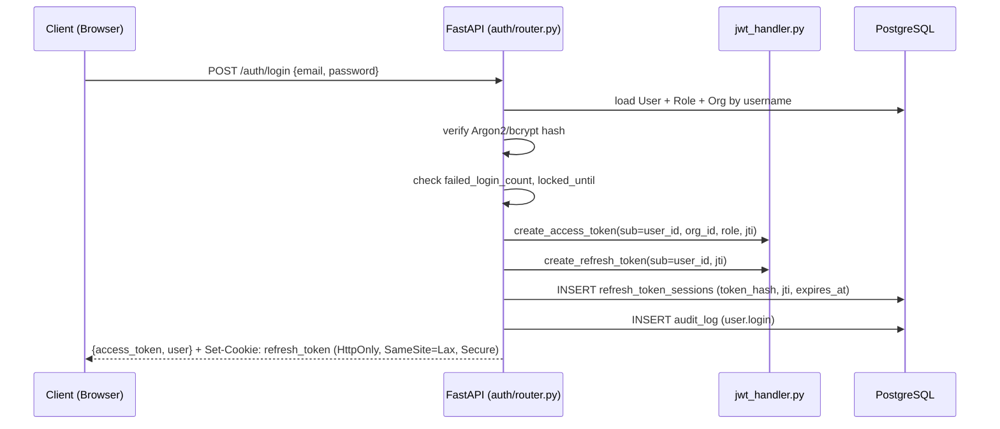
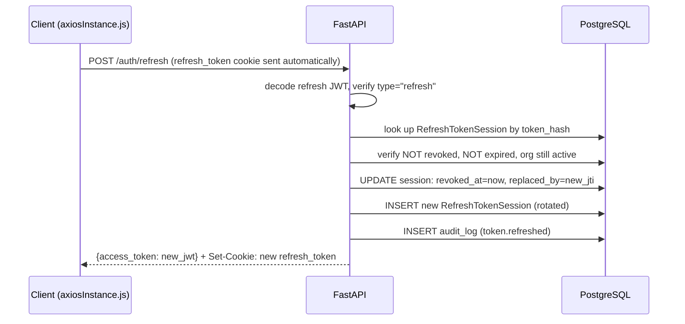
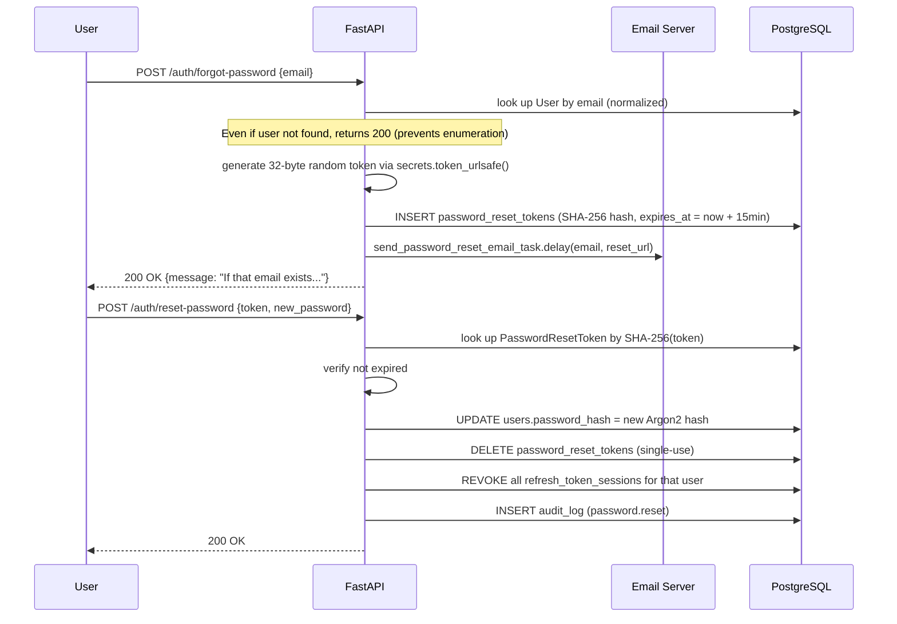

# CCure-Audit-PRO — Authentication & Authorization

> Sources: `Backend/auth/router.py`, `Backend/auth/jwt_handler.py`, `Backend/auth/rbac.py`, `Backend/auth/dependencies.py`, `Backend/db/models/users.py`, `Backend/db/models/rbac.py`.

## 1. Authentication Architecture Overview



### Organization Deactivation Guard

On every API request, the authentication middleware (`auth/dependencies.py`) resolves the user context and performs a live check on their organization's `is_active` status. If the organization has been deactivated (`is_active = false`), the API immediately rejects the request with an `HTTP 403 Forbidden` error: `"Your organization has been deactivated. Please contact support."`. This ensures deactivation is enforced statefully in real time, preventing inactive organizations from executing scans, modifying assets, or fetching dashboard metrics.

## 2. Token Design

### Access Token (JWT)

- **Algorithm:** HS256 (`JWT_SECRET_KEY` env var — must be a cryptographically random string ≥32 chars)
- **Lifetime:** `ACCESS_TOKEN_EXPIRES_MINUTES` (default 30 minutes)
- **Delivered via:** JSON response body `{"access_token": "<jwt>", ...}`
- **Used via:** `Authorization: Bearer <token>` header on all protected API calls

**Payload claims:**

| Claim    | Value                                                            |
| -------- | ---------------------------------------------------------------- |
| `sub`    | `user.id` (e.g. `usr_defa_1a2b3c4d_alice_x9v1`)                  |
| `type`   | `"access"`                                                       |
| `jti`    | UUID4 (unique token identifier, for future revocation extension) |
| `role`   | role name string (e.g. `"analyst"`)                              |
| `org_id` | organization ID (e.g. `"org_acme"`)                              |
| `exp`    | Unix timestamp of expiry                                         |
| `iat`    | Unix timestamp of issue                                          |

### Refresh Token (JWT)

- **Algorithm:** HS256, same secret
- **Lifetime:** `REFRESH_TOKEN_EXPIRES_DAYS` (default 7 days)
- **Delivered via:** `Set-Cookie: refresh_token=<jwt>; HttpOnly; SameSite=Lax; Path=<REFRESH_COOKIE_PATH>; Secure` (only on HTTPS unless `APP_ENV != production`)
- **Stored in DB:** SHA-256 hash of the raw token is stored in `refresh_token_sessions.token_hash` — the raw token is never persisted

**Payload claims:**

| Claim  | Value                                                        |
| ------ | ------------------------------------------------------------ |
| `sub`  | `user.id`                                                    |
| `type` | `"refresh"`                                                  |
| `jti`  | UUID4 (unique; stored in `refresh_token_sessions.token_jti`) |
| `exp`  | Unix timestamp of expiry                                     |

### WebSocket Ticket Token

A short-lived (60-second) JWT variant with `type: "ticket"`, issued by `POST /auth/ticket`. Used exclusively by WebSocket endpoints (`/scans/{id}/progress`, `/web-scans/{id}/progress`) via the `?ticket=` query parameter (WebSocket connections cannot set `Authorization` headers from browsers).

## 3. Token Refresh Flow (Silent Rotation)



**Key design decisions:**

- Rotation on every refresh — each refresh token can only be used once. The old token is immediately revoked and `replaced_by` is set to the new `jti`.
- If the refresh token is already revoked (reuse detection), the endpoint returns `HTTP 401` and the client is forced to re-login.
- The frontend `axiosInstance.js` intercepts all `401` responses, silently calls `POST /auth/refresh`, and retries the original request with the new access token. If refresh also fails, the user is logged out.

## 4. Registration Flow

`POST /auth/register` is publicly accessible (no auth required):

1. Validates `username` uniqueness (`/auth/check-username`), `email` uniqueness (`/auth/check-email`), and password strength (via `auth/password_strength.py`).
2. Returns `201 Created` on success and immediately issues access + refresh tokens, setting the refresh cookie on the response.
3. Hashes password with Argon2 (`passlib[argon2-cffi]`), falling back to bcrypt if Argon2 is unavailable.
4. Lazily creates a `"self-service"` organization (`id="org_self-service"`, plan `community`) on the first registration if it does not already exist.
5. Assigns the `analyst` role (the lowest role with scan-launch capability).
6. Inserts `User` row and writes audit log `user.registered`.
7. Returns the same payload as `/auth/login` (access token + refresh token cookie) — the user is logged in immediately after registration.

## 5. Password Security

### Hashing

- **Primary:** Argon2id via `argon2-cffi` (memory-hard, recommended)
- **Fallback:** bcrypt via `passlib[bcrypt]` (used if Argon2 library is unavailable)
- **Detection:** `auth/dependencies.py` `verify_password()` auto-detects the hash type from the stored hash prefix

### Strength Requirements (checked at registration + admin password-set)

Enforced by `auth/password_strength.py`:

- Minimum 8 characters
- At least one uppercase letter
- At least one lowercase letter
- At least one digit
- At least one special character (`!@#$%^&*()-_=+[]{}|;:'",.<>?/`)
- Not in a common-passwords blocklist

### Password Reset Flow



Email delivery is handled by a Celery task (`send_password_reset_email_task`, queue `default`) using SMTP configured via `SMTP_HOST`, `SMTP_PORT`, `SMTP_USER`, `SMTP_PASSWORD`, `SMTP_SECURE`, `SMTP_FROM_EMAIL`.

## 6. Brute-Force Protection

Tracked in `users.failed_login_count` and `users.locked_until`:

- Each failed login increments `failed_login_count` and returns `HTTP 401`.
- At **5 consecutive failures**, `locked_until = now + 15 minutes`.
- While locked, even correct passwords are rejected with `HTTP 429 Too Many Requests` (`"Account temporarily locked"`).
- Successful login resets `failed_login_count = 0` and clears `locked_until`.

Additionally, all login/register/forgot-password endpoints are decorated with `@limiter.limit("5/minute")` (slowapi), applied per client IP.

## 7. Multi-Factor Authentication (MFA)

CCure-Audit-PRO implements a robust Multi-Factor Authentication (MFA) system.

### MFA Flow & Lifecycle

1. **Initial Login Challenge**: When a user with MFA enabled logs in via `POST /auth/login`, they receive an intermediate response `{ "status": "mfa_required", "mfa_token": "<mfa_challenge_jwt>" }`. No access or refresh tokens are issued at this stage.
2. **Code Verification**: The user must submit their TOTP code or backup code along with the `mfa_token` to `POST /auth/login/verify-mfa` to receive the final access and refresh tokens.
3. **Email OTP Fallback**: If the user lacks access to their Authenticator App, they can call `POST /auth/login/send-email-otp` using their `mfa_token`. The system generates a cryptographically random 6-digit verification code, hashes it, stores it in the database with a 5-minute expiry, and emails it to the user.

### MFA Methods Supported

- **Authenticator App (TOTP)**: Symmetrically encrypted secret key using Fernet (`AppConfig.MFA_KEY`). Verification uses `pyotp.TOTP` with a clock-drift safety window of ±30 seconds.
- **Email OTP**: Hashed 6-digit numeric verification code fallback.
- **Recovery Backup Codes**: 8 single-use hex codes generated during setup, hashed in the database. When used, the matched code is permanently revoked from the user's `mfa_backup_codes` JSON list.

## 8. Logout

`POST /auth/logout`:

- Reads the refresh token from the cookie.
- Revokes the corresponding `RefreshTokenSession` in the DB (`revoked_at = now`).
- Clears the `refresh_token` cookie.
- Writes audit log `user.logout`.

The access token is **not invalidated** server-side (it remains valid until expiry). Clients must discard it locally. For session-sensitive use cases, the 30-minute access token lifetime limits the exposure window.

## 9. Username & Email Availability Checks

```
GET /auth/check-username?q=<value>
GET /auth/check-email?q=<value>
```

Both are **unauthenticated** and return:

```json
{ "available": true }


// or false
```

Used by the registration form for real-time validation. Email is normalized before the check.

## 10. Authorization Enforcement (`auth/rbac.py`)

See `RBAC_Management_Permissions.md` for the full permission matrix. The runtime enforcement pattern is:

```python
# In every protected route handler:
user: User = Depends(require_permission("resource", "action"))
```

`require_permission(resource, action)` is a dependency factory that:

1. Calls `get_current_active_user()` to authenticate and load the user.
2. **Bypasses all permission checks** if `user.role.name == "superadmin"`.
3. Otherwise performs a `JOIN`-based DB lookup of `role_permissions → permissions` for the given `(resource, action)` pair.
4. Returns `HTTP 403` if the permission is not found.

All endpoints that do not require authentication are explicitly marked with `dependencies=[]` or use `get_current_user_optional()`.

## 11. Multi-Tenant Session Context

Every authenticated request carries the user's `org_id` (from the JWT payload and confirmed against the DB). All database queries in route handlers include `WHERE org_id = :resolved_org_id`. A `superadmin` can pass an `?org_id=` query parameter to switch context to any organization; all other users are hard-locked to their own `org_id`. This is enforced by the `_resolve_org(user, requested_org)` pattern (see `SYSTEM_ARCHITECTURE.md §4`).

## 12. Key Auth Endpoints Summary

| Method | Path                         | Auth?  | Description                                                   |
| ------ | ---------------------------- | ------ | ------------------------------------------------------------- |
| `POST` | `/auth/register`             | No     | Self-registration                                             |
| `POST` | `/auth/login`                | No     | Obtain access + refresh tokens (or MFA challenge token)       |
| `POST` | `/auth/login/send-email-otp` | No     | Send email verification OTP (MFA challenge fallback)          |
| `POST` | `/auth/login/verify-mfa`     | No     | Verify MFA code (TOTP/Email OTP/Backup code) to log in        |
| `POST` | `/auth/mfa/enable`           | Bearer | Initiate MFA setup, generate TOTP secret and QR code Data URI |
| `POST` | `/auth/mfa/confirm`          | Bearer | Confirm setup code, enable MFA, generate recovery codes       |
| `POST` | `/auth/mfa/disable`          | Bearer | Disable MFA (requires password verification)                  |
| `POST` | `/auth/refresh`              | Cookie | Rotate refresh token, get new access token                    |
| `POST` | `/auth/logout`               | Bearer | Revoke refresh token, clear cookie                            |
| `GET`  | `/auth/me`                   | Bearer | Current user profile + permissions list                       |
| `GET`  | `/auth/check-username`       | No     | Username availability check (using `?q=`)                     |
| `GET`  | `/auth/check-email`          | No     | Email availability check (using `?q=`)                        |
| `POST` | `/auth/forgot-password`      | No     | Initiate password reset email                                 |
| `POST` | `/auth/reset-password`       | No     | Consume reset token, set new password                         |
| `POST` | `/user/change-password`      | Bearer | Authenticated password change                                 |
| `POST` | `/auth/ticket`               | Bearer | Issue 60-second ticket JWT for WebSocket & PDF downloads      |
