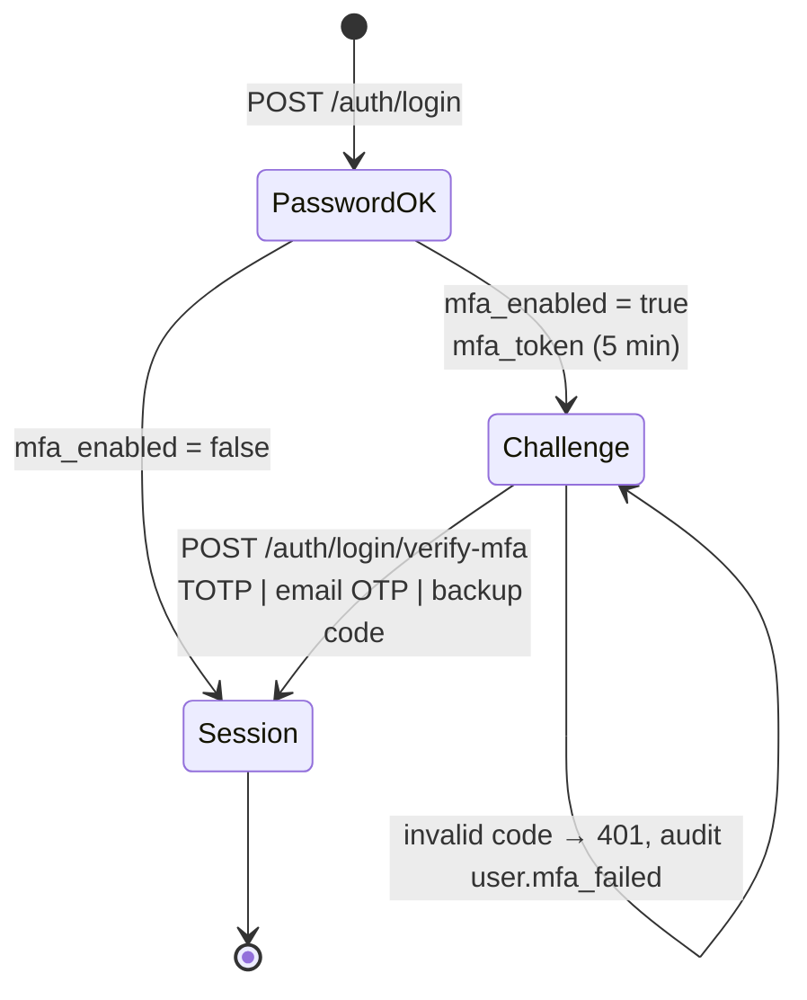
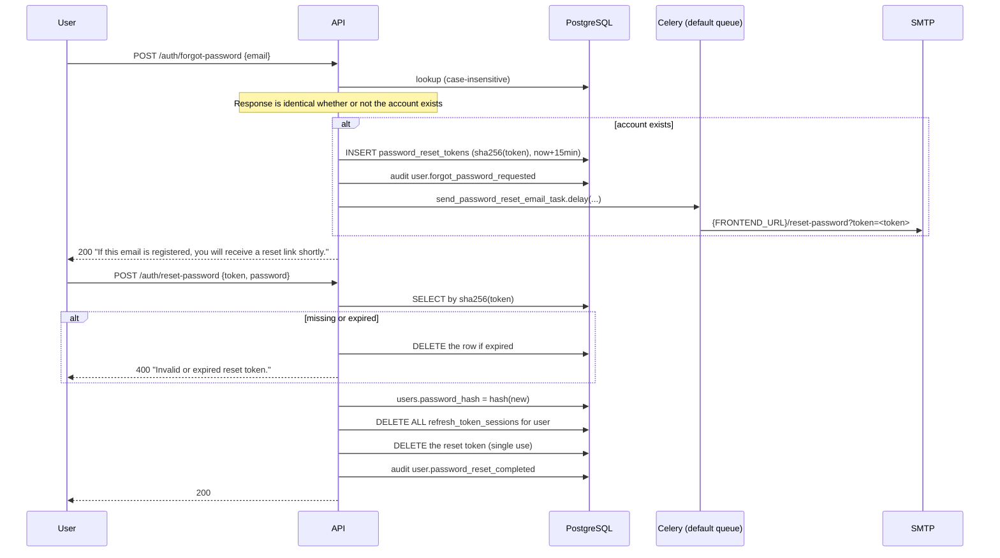
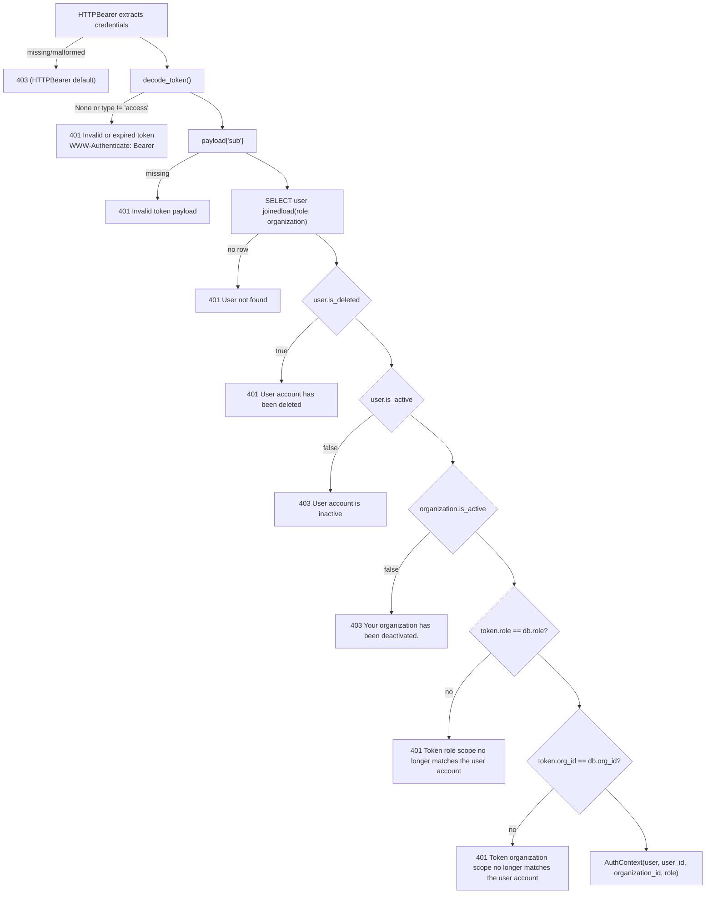
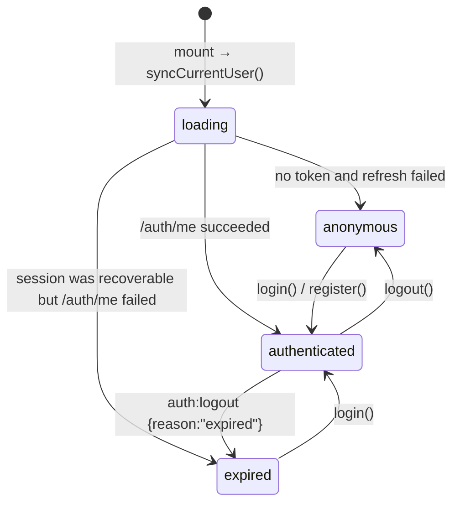

# Authentication and Authorization

**CCure-Audit-PRO** — an end-to-end trace of identity, session and access
control, read from `Backend/auth/`, `Backend/db/models/users.py`,
`Backend/db/models/rbac.py` and `Frontend/src/`.

---

## 1. The five concerns, kept separate

This system distinguishes five things that are frequently conflated. Naming them
precisely makes the rest of the document unambiguous.

| Concern                           | Question it answers                         | Implementation                                                                                          |
| --------------------------------- | ------------------------------------------- | ------------------------------------------------------------------------------------------------------- |
| **Authentication**                | Who is this?                                | `POST /auth/login` → password verify → optional MFA                                                     |
| **Identity / session management** | Is this request still from them?            | Stateless access JWT (30 min) + stateful, rotating refresh session (7 days) in `refresh_token_sessions` |
| **Roles**                         | What kind of user are they?                 | `users.role_id` → `roles`; 5 seeded system roles                                                        |
| **Permissions**                   | What is that role allowed to do?            | `role_permissions` → `permissions`; 51 `resource:action` atoms                                          |
| **Authorization enforcement**     | May _this_ request proceed on _these_ rows? | `require_permission()` dependency, then per-handler `org_id`/`created_by` scoping                       |

Only mechanisms present in the current code are described. There is no OAuth, no
SAML, no API-key scheme and no session cookie carrying identity — the refresh
cookie carries a rotating opaque grant, nothing more.

---

## 2. Credential storage

`Backend/auth/jwt_handler.py`.

**Hashing** — `hash_password()` uses **argon2** (`argon2.PasswordHasher`) and
falls back to bcrypt via passlib only if argon2 raises. `verify_password()`
dispatches on the stored prefix: a hash beginning `$argon2` goes to
`argon2_hasher.verify()`, anything else to `pwd_context.verify()`. Both paths
return `False` on any exception rather than propagating, so a malformed stored
hash cannot 500 a login.

**Strength policy** — `validate_password_strength()` is bound as a Pydantic
`field_validator` on `RegisterRequest.password` and `ResetPasswordRequest.password`:

| Rule      | Check                      |
| --------- | -------------------------- |
| Length    | `len(password) >= 12`      |
| Uppercase | `any(c.isupper() ...)`     |
| Digit     | `any(c.isdigit() ...)`     |
| Special   | `any(not c.isalnum() ...)` |

Violations become HTTP 422 through the scrubbing validation handler, which
redacts the submitted value.

**Email and username matching** — `auth/email_utils.py` provides
`normalize_email()`, `email_matches()` and `username_matches()`, all
case-insensitive. Login, registration, both availability probes and password
reset use them, so `Analyst@Example.COM` and `analyst@example.com` are the same
account.

---

## 3. Token model

Five token types, all HS256-signed with `JWTConfig.SECRET_KEY` and distinguished
by a `type` claim that every consumer checks.

| `type`          | Lifetime                                           | Claims                                                    | Transport                         | Minted by                    |
| --------------- | -------------------------------------------------- | --------------------------------------------------------- | --------------------------------- | ---------------------------- |
| `access`        | `ACCESS_TOKEN_EXPIRES_MINUTES`, default **30 min** | `sub`, `username`, `type`, `role`, `org_id`, `iat`, `exp` | `Authorization: Bearer`           | `create_access_token`        |
| `refresh`       | `REFRESH_TOKEN_EXPIRES_DAYS`, default **7 days**   | `sub`, `type`, `jti`, `iat`, `exp`                        | HttpOnly cookie (or request body) | `create_refresh_token`       |
| `mfa_challenge` | **5 minutes**                                      | `sub`, `username`, `type`, `role`, `org_id`               | Response body → next request body | `create_mfa_challenge_token` |
| `ticket`        | **60 seconds**                                     | `sub`, `username`, `type`                                 | `?ticket=` query parameter        | `create_download_ticket`     |

`decode_token()` returns `None` on any `JWTError`; callers treat `None` and a
wrong `type` identically. Checking `type` is what prevents a refresh token being
replayed as an access token.

### Secret-key guard

At import, `jwt_handler` compares `SECRET_KEY` against four known development
defaults:

```
dev-secret-key-change-in-production
ccure-dev-only-secret-change-me
ccure-super-secret-change-in-production
your-super-secret-jwt-key-change-in-production
```

A match raises `RuntimeError` when `ENVIRONMENT == "production"`, and logs a
warning otherwise. `docker-compose.yml` independently refuses to start any of
`api`, `worker` or `web-worker` without `JWT_SECRET_KEY` set
(`${JWT_SECRET_KEY:?JWT_SECRET_KEY must be set}`).

### Refresh cookie

Set by `_set_refresh_cookie()`:

| Attribute  | Value                                  | Env var                   |
| ---------- | -------------------------------------- | ------------------------- |
| name       | `ccure_refresh_token`                  | `REFRESH_COOKIE_NAME`     |
| `httponly` | **always `True`**                      | —                         |
| `secure`   | `False` unless set                     | `REFRESH_COOKIE_SECURE`   |
| `samesite` | `lax`                                  | `REFRESH_COOKIE_SAMESITE` |
| `path`     | `/`                                    | `REFRESH_COOKIE_PATH`     |
| `domain`   | unset                                  | `REFRESH_COOKIE_DOMAIN`   |
| `max_age`  | `REFRESH_TOKEN_EXPIRE.total_seconds()` | —                         |

> **CAUTION:** `REFRESH_COOKIE_SECURE` defaults to `false`. Set it to `true` in
> any deployment served over HTTPS.

`_clear_refresh_cookie()` deletes the cookie twice — once at
`REFRESH_COOKIE_PATH` and once at `/auth` — so cookies written under an earlier
path configuration are also removed.

---

## 4. Login

```mermaid
sequenceDiagram
    autonumber
    participant U as Browser
    participant A as POST /auth/login
    participant DB as PostgreSQL
    participant AU as audit_logs

    U->>A: {email, password}
    A->>DB: SELECT user WHERE lower(email) = lower(:email)
    alt not found
        A-->>U: 401 "Invalid email or password"
    end
    A->>A: is_deleted?
    A->>AU: user.login_failed (denied, "account deleted")
    A-->>U: 403 "Account deleted"
    A->>A: is_active?
    A-->>U: 403 "Account disabled"
    A->>DB: organizations.is_active?
    A-->>U: 403 "Your organization has been deactivated."
    A->>A: locked_until > now?
    A-->>U: 403 "Account locked temporarily"
    A->>A: verify_password(plain, hash)
    alt mismatch
        A->>DB: failed_login_count += 1
        alt count >= 5
            A->>DB: locked_until = now + 15 min
            A->>AU: user.locked
        end
        A->>AU: user.login_failed
        A-->>U: 401 "Invalid email or password"
    end
    A->>DB: failed_login_count = 0; locked_until = NULL
    alt mfa_enabled
        A->>AU: user.mfa_challenge_issued
        A-->>U: 200 {status:"mfa_required", mfa_token}
    else
        A->>DB: last_login_at = now
        A->>AU: user.login (success)
        A->>DB: INSERT refresh_token_sessions
        A-->>U: 200 {access_token, user{...role.permissions}} + Set-Cookie
    end
```

Every gate writes an audit row **and commits** before raising, so a denied login
is recorded even though the request fails. The lockout is time-based, not
permanent: after 15 minutes the `locked_until` comparison passes again and the
counter resets on the next success.

`create_refresh_token()` repeats the eligibility checks server-side — it raises
`ValueError` for a deleted or inactive user, or one whose organization is
inactive — so no code path can mint a session for an ineligible account.

---

## 5. Multi-factor authentication

MFA is optional per user and is a **step-up after** password verification, not a
replacement for it.



### Enrolment

| Step | Endpoint                 | Effect                                                                                                                                                                                                                                                        |
| ---- | ------------------------ | ------------------------------------------------------------------------------------------------------------------------------------------------------------------------------------------------------------------------------------------------------------- |
| 1    | `POST /auth/mfa/enable`  | `pyotp.random_base32()`; secret Fernet-encrypted into `users.totp_secret`; returns the plaintext secret **and** a PNG QR as a base64 data URI. 400 if MFA is already on                                                                                       |
| 2    | `POST /auth/mfa/confirm` | Verifies a TOTP with `valid_window=1`; on success sets `mfa_enabled=True`, generates **8** backup codes (`secrets.token_hex(4).upper()`), stores their hashes, **deletes every refresh session**, audits `user.mfa_enabled`, returns the plaintext codes once |
| —    | `POST /auth/mfa/disable` | Requires the account password; clears secret, backup codes and pending OTP; deletes every refresh session; audits `user.mfa_disabled`                                                                                                                         |

Encryption uses `AppConfig.MFA_KEY` — a urlsafe-base64 SHA-256 digest of
`MFA_ENCRYPTION_KEY`, which itself defaults to `JWT_SECRET_KEY`. Rotating
`JWT_SECRET_KEY` without setting `MFA_ENCRYPTION_KEY` therefore makes every
enrolled TOTP secret undecryptable.

### Verification

`POST /auth/login/verify-mfa` tries three factors in order:

1. **Authenticator TOTP** — decrypt `totp_secret`, `pyotp.TOTP(...).verify(code, valid_window=1)`.
   The window tolerates one 30-second interval of clock drift each way.
2. **Email OTP** — the handler reads `email_otp_hash` and `email_otp_expires_at`
   into locals, **nulls both columns and commits before checking anything**, then
   verifies. A code cannot be replayed even on a failed attempt.
3. **Backup code** — `verify_password(code, h)` against each stored hash. A match
   is removed from `mfa_backup_codes` (single use) and audited as
   `user.mfa_recovery_used`.

Failure audits `user.mfa_failed` and returns 401. Success clears the lockout
counters, stamps `last_login_at`, audits `user.login` with
`changes={"mfa_method": "totp"|"email_otp"|"backup_code"}`, and issues the
session exactly as a non-MFA login would.

Both MFA endpoints are limited to 5 requests/minute.

**Administrative reset** — `POST /admin/users/{user_id}/reset-mfa`
(`users:update`) lets an administrator clear MFA for a locked-out user.

---

## 6. Password reset



Only the SHA-256 hash is stored, so a database read does not yield usable reset
links. Every session is destroyed on reset — a reset triggered because an account
was compromised also evicts the attacker. `/auth/forgot-password` is limited to
3 requests/minute. Expired rows are additionally purged by the API's lifespan
cleanup loop.

---

## 7. Session lifecycle

```mermaid
sequenceDiagram
    autonumber
    participant SPA
    participant AX as axiosInstance
    participant API
    participant DB

    Note over SPA,AX: Access token lives only in a module variable
    SPA->>AX: any API call
    AX->>API: + Authorization: Bearer, + org_id param, withCredentials
    API-->>AX: 401 (token expired)
    AX->>AX: single-flight guard: isRefreshing?
    AX->>API: POST /auth/refresh (cookie only)
    API->>DB: locate session by jti, compare token_hash
    API->>DB: revoked_at? expires_at? user active? org active?
    API->>DB: old.revoked_at = now; old.replaced_by = new_jti
    API->>DB: INSERT new refresh_token_sessions row
    API-->>AX: {access_token, refresh_token: null} + new Set-Cookie
    AX->>AX: setAuthTokens(); notify queued subscribers
    AX->>API: replay original request with the new token
```

### Session record

Each active session is one `refresh_token_sessions` row holding `token_jti`
(UNIQUE), `token_hash` (UNIQUE, SHA-256 of the token), `expires_at`,
`revoked_at`, `replaced_by`, `ip_address` and `device_info`. `_get_refresh_session`
validates **six** conditions before accepting a token:

1. Decodes and `type == "refresh"`.
2. Both `jti` and `sub` present.
3. A row exists with that `jti`.
4. `row.token_hash == sha256(presented_token)`.
5. `row.revoked_at is None`.
6. `row.expires_at > now` and `row.user_id == sub`.

### Rotation

`refresh_access_token()` performs a strict rotation: it mints a new `jti`,
inserts a replacement row, marks the old row revoked with `replaced_by` pointing
forward, and commits — leaving an auditable chain. It re-checks user and
organization status, returning `None` (→ 401) if either has become inactive.

The API deliberately nulls `refresh_token` in the response body after writing the
cookie, so the value never reaches JavaScript.

### Termination

| Path                                                | Effect                                                                                                |
| --------------------------------------------------- | ----------------------------------------------------------------------------------------------------- |
| `POST /auth/logout`                                 | Revokes the presented session; clears the cookie; audits `user.logout`                                |
| `DELETE /user/sessions/{session_id}`                | Revokes one specific session (self-service "sign out other devices")                                  |
| `POST /auth/reset-password`                         | Deletes **all** sessions for the user                                                                 |
| `POST /auth/mfa/confirm` / `POST /auth/mfa/disable` | Deletes **all** sessions for the user                                                                 |
| Organization deactivated                            | No session row changes, but every request, refresh and new login is refused while `is_active = false` |
| Access token expiry                                 | 30 minutes; the SPA refreshes on 401 and proactively every 20 minutes                                 |

An access token cannot be revoked before it expires — that is the cost of
statelessness. The 30-minute lifetime bounds it, and the claim-consistency check
in §8 closes the specific case of a role or organization change.

### Client-side session upkeep

`Frontend/src/context/AuthContext.jsx` runs two timers while authenticated:

- `setInterval(refreshActiveSession, 20 * 60 * 1000)` — a proactive refresh
  every 20 minutes, comfortably inside the 30-minute access lifetime.
- A `visibilitychange` listener that refreshes when the tab becomes visible if
  more than 10 minutes have passed since the last refresh — the case where a
  laptop was asleep.

On boot, `syncCurrentUser()` attempts `POST /auth/refresh` when no in-memory
access token exists, then `GET /auth/me`. The distinction it draws matters for
UX: if a session was recoverable but `/auth/me` still failed, `authState` becomes
`"expired"` with the message _"Your session expired. Please sign in again."_; if
there was never a session, it becomes `"anonymous"` with no message.

---

## 8. Request-time identity resolution

`Backend/auth/dependencies.py`. Every protected endpoint reaches
`_load_auth_context_from_payload`, whose checks execute in this order:



Three properties are worth calling out:

- **`role` and `organization` are eagerly loaded** with `joinedload`, so RBAC
  guards read `user.role.name` without a lazy-load in a possibly-closed session.
- **Claim-consistency enforcement.** If the token carries `role` or `org_id` and
  either disagrees with the database, the request is rejected with 401. This is
  how a role change or an org move takes effect before the 30-minute token
  expires — the SPA's interceptor sees the 401, refreshes, and gets a correctly
  claimed token. Both checks are skipped when the claim is absent, so access
  tokens minted before these claims existed keep working until they rotate out.
- **Organization status is re-read on every request**, so deactivating a tenant
  locks its users out immediately without touching any user row or invalidating
  any token. Reactivating restores access just as immediately.

### `get_current_user` vs `get_current_user_flexible`

|                    | `get_current_user`                             | `get_current_user_flexible`                                                                           |
| ------------------ | ---------------------------------------------- | ----------------------------------------------------------------------------------------------------- |
| Bearer scheme      | `HTTPBearer()` — 403 when the header is absent | `HTTPBearer(auto_error=False)` — 401 "Authentication token is missing."                               |
| Accepts `?ticket=` | No                                             | Yes, requiring `type == "ticket"`                                                                     |
| Used by            | Almost every endpoint                          | `GET /reports/download/{scan_id}`, `DELETE /reports/{scan_id}`, `routers/admin_nvd.py::_verify_admin` |

The ticket path exists because a browser navigating to a download URL cannot set
an `Authorization` header. The same reasoning drives the WebSocket ticket.

---

## 9. Authorization enforcement

Full detail: [RBAC_Management_Permissions.md](RBAC_Management_Permissions.md).
The mechanism, in brief:

```python
def require_permission(resource: str, action: str):
    def _guard(user: User = Depends(get_current_user),
               db: Session = Depends(get_db)) -> User:
        role = getattr(user, "role", None)
        if not role:
            raise HTTPException(403, "Your account does not have a role assigned.")
        if role.name.lower() == "superadmin":
            return user                      # bypass — no query
        has_perm = (db.query(RolePermission)
                      .join(Permission, Permission.id == RolePermission.permission_id)
                      .filter(RolePermission.role_id == role.id,
                              Permission.resource == resource,
                              Permission.action == action)
                      .first()) is not None
        if not has_perm:
            logger.warning("RBAC denied: user %s (role=%s) lacks %s:%s.", ...)
            raise HTTPException(403, f"... does not have '{resource}:{action}' permission.")
        return user
    return _guard
```

Because the grant is read live on every request, revoking a permission takes
effect on the next call with no token churn.

`require_role(allowed_roles)` also exists in `auth/rbac.py` but has **no call
sites**. Role-based decisions are made through ad-hoc `_is_superadmin` helpers
and `routers/topology.py::_ORG_WIDE_ROLES` instead.

### Row-level scoping

Permission checks answer "may this kind of user do this?"; they say nothing about
_which rows_. Every tenant-scoped handler adds its own filter:

```python
def _resolve_org(user, requested_org):
    if _is_superadmin(user) and requested_org:
        return requested_org      # only superadmin may cross tenants
    return str(user.org_id)
```

and, for scans, findings and reports, a second filter unless the caller holds
`scans:read_all`:

```python
if not _user_can_read_all_scans(user, db):
    query = query.filter(Scan.created_by == str(user.id))
```

`scans:read_all` is queried directly rather than injected as a dependency,
because it widens visibility rather than gating the endpoint.

---

## 10. Protected-endpoint enforcement summary

| Dependency                  | Endpoints                                                                                                                                                                                                                                                                       | Failure modes                                                                                                                         |
| --------------------------- | ------------------------------------------------------------------------------------------------------------------------------------------------------------------------------------------------------------------------------------------------------------------------------- | ------------------------------------------------------------------------------------------------------------------------------------- |
| `require_permission(...)`   | 132 operations across 16 routers                                                                                                                                                                                                                                                | 403 no role · 403 missing atom                                                                                                        |
| `get_current_user`          | `/auth/me`, `/auth/ticket`, all 3 MFA management routes, all 7 `/user/*`, all 7 `/notifications/*`, all 8 `/web-scans/*`, `DELETE /admin/organizations/{org_id}`                                                                                                                | 401/403 per §8                                                                                                                        |
| `get_current_user_flexible` | `/reports/download/{scan_id}`, `DELETE /reports/{scan_id}`, both `/api/v1/admin/*`                                                                                                                                                                                              | 401 missing/invalid token or ticket. The two `/api/v1/admin/*` routes then hit `_verify_admin`, which **always** raises 403 — see §14 |
| _(none)_                    | `GET /`, `/api/pipeline-modes`, `/api/workflow-example`, `/auth/check-username`, `/auth/check-email`, `/auth/register`, `/auth/login`, `/auth/logout`, `/auth/refresh`, `/auth/forgot-password`, `/auth/reset-password`, `/auth/login/send-email-otp`, `/auth/login/verify-mfa` | —                                                                                                                                     |
| Ticket only                 | `WS /scans/{scan_id}/progress`, `WS /web-scans/{scan_id}/progress`                                                                                                                                                                                                              | Close 1008                                                                                                                            |

`/auth/logout` and `/auth/refresh` are public in the dependency sense but require
possession of a valid refresh token; the OTP and MFA-verify endpoints require a
valid `mfa_challenge` token.

---

## 11. WebSocket authorization

```python
def _get_websocket_user(websocket: WebSocket) -> User:
    ticket = websocket.query_params.get("ticket")
    if not ticket:            raise HTTPException(401, "Authentication ticket is required ...")
    payload = decode_token(ticket)
    if not payload:           raise HTTPException(401, "Invalid or expired authentication.")
    if payload.get("type") != "ticket":
                              raise HTTPException(401, "Unsupported token type for WebSocket.")
    user_id = payload.get("sub")
    if not user_id:           raise HTTPException(401, "Invalid token payload.")
    # load user with joinedload(User.role)
    if not user:              raise HTTPException(401, "User not found.")
    if role != "superadmin" and not has scans:read:
                              raise HTTPException(403, "Insufficient privileges.")
    return user
```

Any raised `HTTPException` closes the socket with code **1008** _before_
`accept()`. The 60-second ticket lifetime means an intercepted URL is useless
almost immediately.

> **NOTE:** The ticket check verifies `scans:read` but does **not** re-verify
> `is_active`, `is_deleted` or organization status the way
> `_load_auth_context_from_payload` does. The 60-second window bounds the
> exposure, and a full `AuthContext` load here would close the gap entirely.

---

## 12. Frontend authentication state

### Token custody

```javascript
// Frontend/src/api/tokenStorage.js — the entire module
let accessToken = null;
export const getAccessToken = () => accessToken;
export const setAccessToken = (token) => { accessToken = token || null; };
export const setAuthTokens = ({ access_token }) => { ... };
export const clearAuthTokens = () => { accessToken = null; };
```

The access token lives in a module-scope variable — **not** `localStorage`, not
`sessionStorage`, not a readable cookie. It does not survive a page reload, which
is exactly why `syncCurrentUser()` calls `POST /auth/refresh` on boot: the
HttpOnly cookie is the durable half of the session and JavaScript never sees it.

`localStorage` holds one auth-adjacent value, `activeOrgId`, which is a tenant
selector rather than a credential.

### Axios interceptors

`Frontend/src/api/axiosInstance.js`.

**Request** — attaches `Authorization: Bearer` when a token exists, and injects
`params.org_id` from `localStorage.activeOrgId` unless the caller already set it.
`withCredentials: true` sends the refresh cookie.

**Response** — a single-flight 401 refresh:

1. Non-401, already-retried (`_retry`), or bypassed URL → reject unchanged.
   Bypassed: `/auth/login`, `/auth/refresh`, `/auth/register`,
   `/auth/forgot-password`, `/auth/reset-password` — their 401s are real answers,
   not expiry.
2. If a refresh is already in flight, the request subscribes and waits.
3. Otherwise `refreshClient.post("/auth/refresh", {})` — a **separate axios
   instance without interceptors**, so a failing refresh cannot recurse.
4. On success: store the token, notify every queued subscriber, replay the
   original request.
5. On failure: notify subscribers with `null`, then `forceLogout("expired")` —
   which stashes the current path in `sessionStorage.postLoginRedirect`, clears
   the token and `activeOrgId`, and dispatches `window` event
   `auth:logout` with `{ reason: "expired" }`.

`AuthContext` listens for `auth:logout` and moves `authState` to `expired` or
`anonymous` accordingly.

### `AuthContext` state machine



Exposed value: `{ user, authState, authMessage, loading, isAuthenticated, login,
register, logout, refreshUser }`.

`login()` returns the raw response, so a caller can detect
`data.status === "mfa_required"` and route to the MFA step without the context
transitioning to `authenticated`. `logout()` calls the API inside a `try` and
performs local cleanup in `finally`, so a network failure still logs the user out
of the SPA.

### Route guards

`Frontend/src/components/PrivateRoute.jsx` — renders a spinner while
`loading`, redirects to `/login` (carrying `state.from`, `state.reason`,
`state.message`) when there is no user, then evaluates
`superadminOnly` / `requiredPermission` / `requiredAny` / `requiredAll`. On
denial it redirects to the first reachable route from
`/dashboard` → `/history` → `/reports` → `/admin/users` → `/admin/audit-logs`,
falling back to `/login`.

Client-side gating shapes the UI; every check is repeated on the server.

---

## 13. Failure-handling reference

| Status   | Meaning here                                                                                                                                                                                                                                      | Emitted by                                            |
| -------- | ------------------------------------------------------------------------------------------------------------------------------------------------------------------------------------------------------------------------------------------------- | ----------------------------------------------------- |
| **401**  | Missing / malformed / expired token; wrong token `type`; unknown user; deleted account; refresh token invalid, revoked, expired or hash-mismatched; role or org claim drift; bad MFA code                                                         | `dependencies.py`, `jwt_handler.py`, `auth/router.py` |
| **403**  | Bearer header absent under `HTTPBearer()`; account disabled; organization deactivated; account locked; no role assigned; missing permission atom; scan owned by another user (topology); requesting another user's scans without `scans:read_all` | `HTTPBearer`, `dependencies.py`, `rbac.py`, routers   |
| **409**  | Email or username already registered                                                                                                                                                                                                              | `POST /auth/register`                                 |
| **422**  | Weak password, invalid enum, missing required field — value redacted for sensitive fields                                                                                                                                                         | Global `RequestValidationError` handler               |
| **429**  | Rate limit exceeded; scan quota exceeded                                                                                                                                                                                                          | SlowAPI, `core/quota.py`                              |
| **1008** | WebSocket policy violation — bad or missing ticket, insufficient permission                                                                                                                                                                       | `scan_progress_ws`                                    |

Every error carries the standard envelope and an `X-Request-ID` header, so a
403 in the browser console can be tied to the exact `RBAC denied:` line in the
server log.

The 422 handler is worth restating: it removes Pydantic's raw `input` payload
from every error (which otherwise echoed the submitted password back to the
client on _any_ validation failure in the same body), stringifies `ctx` so an
un-serialisable exception object cannot turn the 422 into a 500, and replaces the
context of any field named `password`, `key_path`, `secret`, `token`, `api_key`
or `credential` with `"Value redacted for security."`.

---

## 14. Security controls actually present

Only mechanisms verified in the current code.

| Control                        | Implementation                                               | Location                                 |
| ------------------------------ | ------------------------------------------------------------ | ---------------------------------------- |
| Password hashing               | argon2, bcrypt fallback                                      | `jwt_handler.hash_password`              |
| Password policy                | 12 chars, upper, digit, special                              | `validate_password_strength`             |
| Brute-force lockout            | 5 failures → 15-minute lock                                  | `POST /auth/login`                       |
| Login rate limit               | 10/min                                                       | `@limiter.limit`                         |
| Registration rate limit        | 5/min                                                        | `@limiter.limit`                         |
| Password-reset rate limit      | 3/min                                                        | `@limiter.limit`                         |
| Enumeration probe limit        | 20/min                                                       | `check-username`, `check-email`          |
| Account-enumeration resistance | Identical 200 from `/auth/forgot-password`                   | `forgot_password`                        |
| MFA                            | TOTP + email OTP + 8 single-use backup codes                 | `auth/router.py`                         |
| TOTP secret at rest            | Fernet, key derived from `MFA_ENCRYPTION_KEY`                | `encrypt_secret`                         |
| Refresh-token rotation         | New `jti` per refresh, old revoked with `replaced_by`        | `refresh_access_token`                   |
| Refresh-token storage          | SHA-256 hash + `jti`, never plaintext                        | `refresh_token_sessions`                 |
| XSS token exposure             | Access token in memory only; refresh in HttpOnly cookie      | `tokenStorage.js`, `_set_refresh_cookie` |
| Session invalidation           | Full wipe on reset, MFA enable and MFA disable               | `auth/router.py`                         |
| Live authorization             | `role_permissions` read per request                          | `require_permission`                     |
| Immediate tenant lockout       | `organization.is_active` re-read per request                 | `_load_auth_context_from_payload`        |
| Claim-drift detection          | Token `role`/`org_id` vs database                            | `_load_auth_context_from_payload`        |
| Audit trail                    | `audit_logs`, hash-partitioned, `user_id` SET NULL on delete | `core/audit.py`                          |
| Real client IP                 | `X-Forwarded-For` walked against `TRUSTED_PROXIES`           | `core/ip_resolver.py`                    |
| Sensitive-field redaction      | 422 scrubbing                                                | `main.py`                                |
| Path-traversal guard (keys)    | `key_path` must resolve under `SCAN_KEY_DIR`                 | `routers/credentialed.py`                |
| Path-traversal guard (reports) | `os.path.commonpath` against `Backend/reports/`              | `routers/reports.py`                     |
| Credential encryption at rest  | AES-256-GCM, key resolved on first use                       | `core/security_crypto.py`                |
| Weak-JWT-key guard             | `RuntimeError` in production                                 | `jwt_handler` import                     |
| Startup secret enforcement     | `${VAR:?...}` for 5 variables                                | `docker-compose.yml`                     |
| Short-lived download/WS grants | 60-second `ticket` tokens                                    | `create_download_ticket`                 |
| Static security analysis       | Bandit `-lll` in CI and pre-commit                           | `.github/workflows/ci.yml`               |

### Known gaps

| Gap                                                                                                          | Impact                                                                                                                        | Where                                  |
| ------------------------------------------------------------------------------------------------------------ | ----------------------------------------------------------------------------------------------------------------------------- | -------------------------------------- |
| `_verify_admin` compares a `Role` object against strings and reads a non-existent `is_superadmin` attribute  | Both `/api/v1/admin/*` routes return **403 to every caller**, superadmin included. The 24-hour NVD sync loop is unaffected    | `routers/admin_nvd.py`                 |
| All `/web-scans` routes are authentication-only                                                              | `viewer` can start and cancel DAST scans                                                                                      | `routers/web_scans.py`                 |
| `DELETE /admin/organizations/{org_id}` enforces superadmin in the handler body, not via `require_permission` | Access level is correct, but `organizations:delete` is never consulted and the route is invisible to a dependency-based audit | `routers/admin_orgs.py`                |
| `REFRESH_COOKIE_SECURE` defaults to `false`                                                                  | Refresh cookie can traverse plain HTTP unless configured                                                                      | `auth/router.py`                       |
| WebSocket ticket check omits `is_active` / `is_deleted` / org status                                         | A user deactivated within the last 60 s can still open a progress socket                                                      | `scans/router.py::_get_websocket_user` |
| `permissions.js` honours a `resource:manage` wildcard with no backend counterpart                            | Dead branch today; would silently widen client gating if such an atom were ever seeded                                        | `Frontend/src/auth/permissions.js`     |
| `MFA_ENCRYPTION_KEY` defaults to `JWT_SECRET_KEY`                                                            | Rotating the JWT key orphans every enrolled TOTP secret                                                                       | `config.py::JWTConfig`                 |

---

## 15. Related documents

- [RBAC_Management_Permissions.md](RBAC_Management_Permissions.md) — the 51 atoms, matrices and gaps
- [BACKEND_API_REFERENCE.md](BACKEND_API_REFERENCE.md) — per-endpoint auth column
- [DATABASE_SCHEMA.md](DATABASE_SCHEMA.md) — `users`, `refresh_token_sessions`, `password_reset_tokens`, `audit_logs`
- [FRONTEND_ARCHITECTURE.md](FRONTEND_ARCHITECTURE.md) — SPA session handling
- [SYSTEM_ARCHITECTURE.md](SYSTEM_ARCHITECTURE.md)
