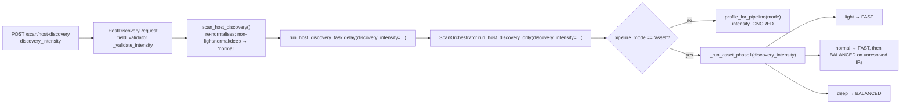

# Backend API Reference

**CCure-Audit-PRO** — complete inventory of the FastAPI surface, derived from
`Backend/main.py`'s router registration and the route decorators in each router
module.

> Every endpoint below is registered in the running application. Nothing is
> documented that the code does not implement, and no implemented route is
> omitted. Counts were taken from `app.routes` on the current tree.

---

## Contents

1. [Totals and conventions](#1-totals-and-conventions)
2. [Authentication — `/auth`](#2-authentication--auth)
3. [Health, progress and documentation](#3-health-progress-and-documentation)
4. [Phase-selective scans — `/scan/*`](#4-phase-selective-scans--scan)
5. [Traditional scans](#5-traditional-scans)
6. [Credentialed scans](#6-credentialed-scans)
7. [Scan history — `/scans`](#7-scan-history--scans)
8. [Reports](#8-reports)
9. [Assets — `/assets`](#9-assets--assets)
10. [Findings — `/findings`](#10-findings--findings)
11. [Dashboard — `/dashboard`](#11-dashboard--dashboard)
12. [Network topology — `/topology`](#12-network-topology--topology)
13. [Web application scans — `/web-scans`](#13-web-application-scans--web-scans)
14. [Compliance — `/compliance`](#14-compliance--compliance)
15. [Notifications — `/notifications`](#15-notifications--notifications)
16. [User profile — `/user`](#16-user-profile--user)
17. [Administration — `/admin`, `/api/v1/admin`](#17-administration--admin-apiv1admin)
18. [WebSocket endpoints](#18-websocket-endpoints)
19. [Server-Sent Events in depth](#19-server-sent-events-in-depth)
20. [`discovery_intensity` in depth](#20-discovery_intensity-in-depth)
21. [Frontend/backend contract gaps](#21-frontendbackend-contract-gaps)

---

## 1. Totals and conventions

| Metric                           | Value                                                                 |
| -------------------------------- | --------------------------------------------------------------------- |
| HTTP operations                  | **155**                                                               |
| WebSocket endpoints              | **2**                                                                 |
| Routers registered in `main.py`  | **20**                                                                |
| Distinct registered path strings | 166 (includes trailing-slash aliases and the four FastAPI doc routes) |

### Base URL

No global prefix is applied. Routers declare their own prefix, so paths are
served at the application root: `http://127.0.0.1:8000/auth/login`, etc. The only
versioned prefix in the codebase is `/api/v1/admin` on `routers/admin_nvd.py`.

`/docs`, `/redoc` and `/openapi.json` are served in every environment except
production — `main.py` sets each to `None` when `ENV=production`.

### Authentication

Unless a row says otherwise, an endpoint requires
`Authorization: Bearer <access_token>` and a specific permission atom.

| Column value      | Meaning                                                                             |
| ----------------- | ----------------------------------------------------------------------------------- |
| `public`          | No authentication dependency                                                        |
| `authenticated`   | `Depends(get_current_user)` — any valid access token                                |
| `resource:action` | `Depends(require_permission("resource", "action"))`; superadmin bypasses the lookup |
| `flexible`        | `Depends(get_current_user_flexible)` — bearer header **or** `?ticket=` JWT          |
| `ticket`          | WebSocket only; a `type="ticket"` JWT in the `?ticket=` query parameter             |

### Multi-tenancy

Most read/write endpoints accept an optional `org_id` query parameter. It is
honoured **only for superadmins**; every other role is pinned to
`user.org_id`. The frontend's axios interceptor injects `org_id` from
`localStorage.activeOrgId` on every request.

### Response envelopes

Successful responses are endpoint-specific. All errors share one shape, produced
by the global `HTTPException` handler in `main.py`:

```json
{
  "success": false,
  "error_code": "HTTP_403",
  "message": "Insufficient privileges. Your role 'viewer' does not have 'scans:execute' permission.",
  "detail": "Insufficient privileges. Your role 'viewer' does not have 'scans:execute' permission.",
  "request_id": "0f6b1a2c-..."
}
```

Validation failures use `error_code: "VALIDATION_ERROR"` and add an `errors`
array. Rate-limit rejections use `error_code: "RATE_LIMIT_EXCEEDED"` with status 429. Every response carries an `X-Request-ID` header.

### Trailing-slash aliases

Five routers register both the bare and the trailing-slash form of their
collection routes, so `/admin/users` and `/admin/users/` are both valid:
`/admin/organizations`, `/admin/roles`, `/admin/users`, `/admin/audit-logs`,
`/assets`, `/findings`, plus the parameterised admin sub-routes
(`/admin/users/{user_id}/`, `/admin/organizations/{org_id}/status/`, etc.).
The frontend's `api/admin.js` sends the trailing-slash form.

---

## 2. Authentication — `/auth`

Source: `Backend/ccure_platform/identity/router.py` (legacy path `auth/router.py`) — 18 operations.

| Method | Path                         | Auth                       | Rate limit | Purpose                                  |
| ------ | ---------------------------- | -------------------------- | ---------- | ---------------------------------------- |
| GET    | `/auth/check-username`       | public\*                   | 10/min     | Username availability                    |
| GET    | `/auth/check-email`          | public\*                   | 10/min     | Email syntax only — never an oracle      |
| POST   | `/auth/register`             | public\*                   | 3/min      | Self-registration → **202, no tokens**   |
| POST   | `/auth/verify-email`         | public                     | 10/min     | Consume verification token               |
| POST   | `/auth/resend-verification`  | public\*                   | 3/min      | Re-send verification link                |
| POST   | `/auth/login`                | public                     | 10/min     | Password login → tokens or MFA challenge |
| POST   | `/auth/logout`               | public (cookie/body token) | —          | Revoke refresh session                   |
| GET    | `/auth/me`                   | authenticated              | —          | Current user + role + permissions + org  |
| POST   | `/auth/refresh`              | public (cookie/body token) | —          | Rotate refresh, issue access             |
| POST   | `/auth/ticket`               | authenticated              | —          | 60-second WebSocket/download ticket      |
| GET    | `/auth/jwks.json`            | public                     | 60/min     | Token-verification public keys (JWKS)    |
| POST   | `/auth/forgot-password`      | public                     | 3/min      | Send reset link                          |
| POST   | `/auth/reset-password`       | public                     | —          | Consume reset token                      |
| POST   | `/auth/login/send-email-otp` | MFA challenge token        | 5/min      | Email a 6-digit OTP                      |
| POST   | `/auth/login/verify-mfa`     | MFA challenge token        | 5/min      | Verify TOTP / OTP / backup code          |
| POST   | `/auth/mfa/enable`           | authenticated              | —          | Generate TOTP secret + QR                |
| POST   | `/auth/mfa/confirm`          | authenticated              | —          | Activate MFA, return backup codes        |
| POST   | `/auth/mfa/disable`          | authenticated              | —          | Disable MFA (password required)          |

### `GET /auth/check-username`

Availability probe used by the registration form.

**Query parameters**

| Name | Type   | Required | Notes                                             |
| ---- | ------ | -------- | ------------------------------------------------- |
| `q`  | string | **yes**  | Candidate username. FastAPI returns 422 if absent |

**Behaviour** — returns `{"available": false}` immediately when
`len(q.strip()) < 3`, without querying. Otherwise it matches with
`username_matches(User.username, q)` (case-insensitive, from
`auth/email_utils.py`) and returns availability. It searches **all users
globally**, not per-organization, because `users.username` carries a global
unique constraint.

```http
GET /auth/check-username?q=pankaj
```

```json
{ "available": false }
```

**Errors** — `422` when `q` is missing; `429` above 10 requests/minute;
**`404` when `ALLOW_SELF_REGISTRATION` is off**.

It matches usernames **only**. It previously also matched `q` against
`users.email`, which meant an email address could be confirmed from either
probe.

### `GET /auth/check-email`

Validates email **syntax**. It deliberately does not report whether the address
is registered.

**Query parameters**

| Name | Type   | Required | Notes           |
| ---- | ------ | -------- | --------------- |
| `q`  | string | **yes**  | Candidate email |

**Behaviour** — returns `{"available": false, "reason": "invalid"}` when `q` is
blank or contains no `@`. Otherwise the address is screened by the email domain
guard and the response carries the verdict:

```json
{ "available": false, "reason": "disposable", "detail": "Disposable and temporary email addresses can't be used to register…" }
{ "available": true,  "reason": "ok" }
```

A taken address and a free one remain **indistinguishable** — both return
`available: true`. The collision surfaces at submit time as the same generic
`202` every other registration outcome returns.

Reporting the _domain_ verdict is safe where reporting account existence is not:
"this is a disposable mail service" is identical for every caller and reveals
nothing about any account. It saves the person filling in the form from
completing a signup that would be refused at submit.

`reason` is one of `ok`, `allowlisted`, `disposable`, `denylisted`, `invalid`.

**Errors** — `422` missing `q`; `429` above 10/min; `404` when
`ALLOW_SELF_REGISTRATION` is off.

> Live "already registered" feedback on a signup form is a small convenience for
> the person typing and a bulk account oracle for everyone else. Only one of
> those is worth having.

### `POST /auth/register`

Status **`202`**. Returns **no tokens**. Gated behind `ALLOW_SELF_REGISTRATION`
(default **off** — `POST /admin/users` is the supported onboarding path);
returns `404` when disabled.

**Body**

| Field      | Type       | Validation                                                                               |
| ---------- | ---------- | ---------------------------------------------------------------------------------------- |
| `username` | string     | ≥ 3 characters after strip, no `@`                                                       |
| `email`    | `EmailStr` | Normalised via `normalize_email`                                                         |
| `password` | string     | `validate_password_strength`: ≥ 12 chars, ≥ 1 uppercase, ≥ 1 digit, ≥ 1 non-alphanumeric |

**Behaviour** — creates the account in the `self-service` organization with the
**`viewer`** role and `is_verified=False`, `is_active=False`,
`approved_at=NULL`, writes a `user.created` audit event, then issues a
verification token and dispatches `send_verification_email_task`.

The response body is **identical** for success, a taken email, and a taken
username, so the endpoint cannot be used to enumerate accounts:

```json
{
  "detail": "If that email address can be registered, a verification link is on its way. New accounts also require administrator approval before sign-in is enabled.",
  "status": "pending_verification"
}
```

A taken _mailbox_ counts as a taken email: `email_canonical` is compared as well
as `email`, so `pkumar+ccure@gmail.com` collides with an existing
`p.kumar@gmail.com` and receives the same generic `202`.

**Email domain screening.** The address is checked against the domain guard
before anything is written. A confirmed disposable or explicitly denied domain
returns **`400` with a reason**, which deliberately breaks the uniform-`202`
contract above — and is safe to, because the response describes the _domain_,
not whether an account exists. When `EMAIL_DOMAIN_GUARD_MODE=flag` the account
is created and flagged for the approval queue instead of refused.

Accounts that pass are still screened asynchronously (MX presence, RDAP domain
age) by `ccure.tasks.enrich_email_risk`; those signals only ever raise
`users.is_email_flagged`, never refuse a registration.

**Errors** — `400` disposable/denied email domain; `404` feature disabled; `422`
weak password / invalid username; `429` above 3/min **or** past
`REGISTRATION_DAILY_IP_LIMIT` for the day; `503` when pending approvals exceed
`PENDING_APPROVAL_QUEUE_LIMIT`; `500` RBAC not seeded.

> **This endpoint used to return access + refresh tokens for an `analyst`
> account.** `analyst` carries `scans:execute`, so anyone who could reach it
> could issue themselves a credential that runs Nmap, Scapy and Nuclei from a
> worker holding raw-socket privileges on the host network. Registration now
> yields nothing usable until both gates are cleared.

### `POST /auth/verify-email`

**Body** `{"token": "..."}` — the token from the emailed link
`{FRONTEND_URL}/verify-email?token=<token>`.

Looks the token up by SHA-256 hash in `email_verification_tokens`, rejects
expired tokens (deleting them), checks the token's `email` still matches the
account's, sets `is_verified=True`, and deletes the row in the same transaction
(single use). Logs `user.email_verified`.

Returns `{"status": "pending_approval"}` — verification is **not** a login and
issues no tokens. When `SELF_REGISTRATION_AUTO_APPROVE=True` it also stamps
`approved_at` and returns `{"status": "verified"}`.

**Errors** — `400` for every invalid case (unknown, expired, already used,
wrong user, address changed) with an identical message, so the endpoint cannot
be used to probe which tokens exist; `429` above 10/min.

### `POST /auth/resend-verification`

**Body** `{"email": "..."}`. Always returns `200` with the same body whether the
address is unknown, already verified, or genuinely pending. Issuing a new token
deletes any outstanding one for that user, so only one link is ever live.

**Errors** — `404` when `ALLOW_SELF_REGISTRATION` is off; `429` above 3/min.
The limit matters here because the endpoint sends mail to a caller-chosen
address, which is a mail-relay primitive if left open.

### `POST /auth/login`

`response_model=Union[TokenResponse, MfaChallengeResponse]`.

**Body** — `{"email": "...", "password": "..."}`. The field is `email`, not
`username`.

**Gate order** (each writes an audit event and commits before raising):

1. user exists — if not, a dummy Argon2 verification runs so the timing matches
   a real account, then `401`
2. not locked (`403`) — the one state check that must precede the password,
   because its purpose is to stop the brute-force attempt in progress
3. **password verifies** — `401` on failure
4. not `is_deleted` (`403`)
5. `is_verified` (`403`)
6. `approved_at IS NOT NULL` (`403`)
7. `is_active` (`403`)
8. organization active (`403`)

> Steps 4–8 used to run **before** the password. That made each of them an
> account oracle: submitting any address with any password returned a 403 that
> distinguished "deleted", "disabled" and "org deactivated" from the generic
> 401 — undoing the uniform "Invalid email or password" message entirely.
> Running them after costs one Argon2 verification and closes the leak.

On failure `failed_login_count` increments; at **5** failures `locked_until` is
set to now + 15 minutes and a `user.locked` event is logged.

On success, if `mfa_enabled` the response is
`{"status": "mfa_required", "mfa_token": "<5-minute JWT>"}` and **no session is
created**. Otherwise `last_login_at` is stamped, a refresh session row is
written, the HttpOnly cookie is set, and the body carries `access_token` plus the
user with `role.permissions`.

**Errors** — `401` invalid credentials; `403`
locked/deleted/unverified/unapproved/disabled/org-deactivated (only reachable
with the correct password, except `locked`); `429`.

### `POST /auth/logout`

Body `{"refresh_token": "..."}` is optional; the token is otherwise read from the
refresh cookie (`_resolve_refresh_token`). Revokes the matching
`refresh_token_sessions` row, clears the cookie (twice — once at
`REFRESH_COOKIE_PATH`, once at `/auth`, so cookies written under an older path
setting are also removed), and logs `user.logout`. Returns `401` if no valid
refresh token was presented.

### `GET /auth/me`

`response_model=UserOut`. Returns `id`, `org_id`, `username`, `email`,
`created_at`, `mfa_enabled`, `role` (`{name, permissions[]}`) and `organization`
(`{id, name, slug}`). **This is the sole source of the permission set the SPA
uses for its own gating.**

### `POST /auth/refresh`

Rotates the presented refresh token: the old row is marked `revoked_at` with
`replaced_by` pointing at the new `jti`, a new row is inserted, and a new access
token is minted. The new refresh token is written to the cookie and the body
field is explicitly nulled (`token_bundle["refresh_token"] = None`) so it never
reaches JavaScript. Returns `401` and clears the cookie on any failure, including
a deactivated organization.

### `POST /auth/ticket`

Returns `{"ticket": "<JWT>"}` with `type="ticket"`, valid **60 seconds**. Used
for WebSocket connections and for `GET /reports/download/{scan_id}?ticket=`.

### `GET /auth/jwks.json`

The platform's token-verification keys as a JSON Web Key Set (RFC 7517), added
in Phase 9.3. **Public key material only**: each key is
`{"kty":"EC","crv":"P-256","x","y","kid","alg":"ES256","use":"sig"}`. The `kid`
is the RFC 7638 thumbprint of the key. Every key in the `next`, `active` and
`retired` states is listed. `Cache-Control: public, max-age=300`. Answers **503**
when no signing keyset is configured. Verifiers (the gateway, IR) cache it and
refetch only on an unknown `kid`. Tokens are still issued HS256 until Phase 9.4,
so no issued token uses these keys yet.

### `POST /auth/forgot-password`

Always returns `200` with the same message regardless of whether the address
exists — account-enumeration protection. When the user does exist it stores a
SHA-256 hash of a `secrets.token_urlsafe(32)` token in `password_reset_tokens`
with a **15-minute** expiry, logs `user.forgot_password_requested`, and dispatches
`send_password_reset_email_task`. The link is
`{AppConfig.FRONTEND_URL}/reset-password?token=<token>`.

### `POST /auth/reset-password`

Body `{"token", "password"}` with the same strength rules as registration.
Looks the token up by hash, rejects expired tokens (deleting them),
re-hashes the password, **deletes every `refresh_token_sessions` row for the
user**, deletes the reset token (single use), and logs
`user.password_reset_completed`. Returns `400` for any invalid/expired token.

### MFA endpoints

| Endpoint                          | Input               | Output                | Notes                                                                                                                        |
| --------------------------------- | ------------------- | --------------------- | ---------------------------------------------------------------------------------------------------------------------------- |
| `POST /auth/login/send-email-otp` | `{mfa_token}`       | `{"success": true}`   | 6-digit code, hashed into `users.email_otp_hash`, 5-minute expiry, mailed via `send_mfa_otp_task`                            |
| `POST /auth/login/verify-mfa`     | `{mfa_token, code}` | `TokenResponse`       | Tries TOTP (`valid_window=1`), then email OTP, then a backup code (consumed on use)                                          |
| `POST /auth/mfa/enable`           | —                   | `{secret, qr_code}`   | `pyotp.random_base32()`, Fernet-encrypted into `users.totp_secret`; QR returned as a base64 data URI. 400 if already enabled |
| `POST /auth/mfa/confirm`          | `{code}`            | `{backup_codes: [8]}` | Sets `mfa_enabled`, stores hashed backup codes, **deletes all refresh sessions**                                             |
| `POST /auth/mfa/disable`          | `{password}`        | `{"success": true}`   | Clears secret, backup codes and pending OTP; deletes all refresh sessions. 400 on wrong password                             |

`verify-mfa` reads and immediately clears `email_otp_hash`/`email_otp_expires_at`
before checking anything, so a code cannot be replayed. A successful backup-code
use writes a `user.mfa_recovery_used` audit event; a failure writes
`user.mfa_failed`.

---

## 3. Health, progress and documentation

Source: `Backend/routers/health.py` — 4 operations.

| Method | Path                       | Auth         | Purpose                                                                          |
| ------ | -------------------------- | ------------ | -------------------------------------------------------------------------------- |
| GET    | `/`                        | public       | `HostDiscoveryAPI.get_system_info()` — platform, privileges, engine availability |
| GET    | `/scan/progress/{scan_id}` | `scans:read` | DB-backed progress, multi-worker safe                                            |
| GET    | `/api/pipeline-modes`      | public       | Pipeline modes and their phase lists                                             |
| GET    | `/api/workflow-example`    | public       | Frontend orchestration example                                                   |

### `GET /scans/{scan_id}/policy`

The assessment configuration a scan actually ran under. `scans:read`, 60/min.

Read from the scan's own immutable snapshot, **not** from the policy row it
names — the policy may since have been edited, versioned, archived or deleted,
and none of that changes what the scan assessed. A question an auditor asks
about a scan has to be answerable from the scan.

| Field                  | Meaning                                                                                                   |
| ---------------------- | --------------------------------------------------------------------------------------------------------- |
| `policy`               | Identity, fingerprint and a human-readable summary. `recorded: false` for a scan predating GAP-12.        |
| `effective`            | The full configuration, field by field, so two scans can be diffed.                                       |
| `policy_current_state` | Whether the policy still exists and still says the same thing. Reported, never used to change the record. |

`recorded: false` is a real answer and is not turned into a default policy:
inventing a configuration record would put a claim in front of an auditor that
nothing supports.

### `GET /scans/{scan_id}/comparison`

What changed between this scan and a baseline. `scans:read`, 30/minute.

| Query              | Meaning                                                                                                            |
| ------------------ | ------------------------------------------------------------------------------------------------------------------ |
| `baseline`         | Scan to compare against. Defaults to the previous completed scan of the same `pipeline_mode` in this organisation. |
| `asset_id`         | Restrict to these assets (repeatable).                                                                             |
| `severity`         | Restrict to these severities (repeatable).                                                                         |
| `limit`            | Cap on returned rows, 1–5000, default 500. Bounds the list, **never the counts**.                                  |
| `include_findings` | Omit the row list for a counts-only call.                                                                          |

Findings are classified `new`, `still_open`, `fixed`, `reappeared` or
`not_assessed`. The last is the important one: a finding that was open and is
absent from this scan is only reported **fixed** when the scan actually
assessed the relevant check. Where it did not — no credential, a collector
that errored, a scan with no recorded assessment scope — it is
`not_assessed`, never `fixed`.

Both scans are resolved through the same tenant-scoped lookup as every other
scan route, so a scan the caller could not read returns 404. A first scan with
no baseline returns the normal shape with `comparable: false` and a reason
rather than an error.

### `GET /scan/progress/{scan_id}`

Reads from PostgreSQL (`scans/progress.py::read_progress`) rather than an
in-memory dict, so any API worker can answer regardless of which worker started
the scan. Returns `total_ips`, `discovered`, `active`, `status`, `elapsed_time`
and `percentage`.

### `GET /api/pipeline-modes`

Built from `scan_helpers.PIPELINE_PHASES`:

```json
{
  "pipeline_modes": {
    "basic": {
      "phases": [1, 4],
      "terminal_phase": 4,
      "description": "Host Discovery only. Scan is marked complete after Phase 1."
    },
    "asset": {
      "phases": [1, 2, 4],
      "terminal_phase": 4,
      "description": "Host Discovery then Port Scanning. Marked complete after Phase 2."
    },
    "vulnerability_audit": {
      "phases": [1, 2, 3, 4],
      "terminal_phase": 4,
      "description": "Full pipeline. Marked complete after Phase 3 (vuln + risk)."
    },
    "credentialed": {
      "phases": [3],
      "terminal_phase": 3,
      "description": "Standalone credentialed audit. Runs Phase 3 only — no host discovery and no port scan."
    }
  }
}
```

> **NOTE:** `terminal_phase` in this response is `max(phases)`, which includes the
> optional Phase 4. The completion logic uses `get_terminal_phase()`, which
> _excludes_ Phase 4 — so the terminal core phases are 1 / 2 / 3 / 3 respectively.
> The description text is looked up with `.get(...)`, not indexed: a mode added to
> `PIPELINE_PHASES` without a description used to raise `KeyError` and 500 the
> whole endpoint.

---

## 4. Phase-selective scans — `/scan/*`

Source: `Backend/routers/phase_scans.py` — 5 operations. All mutating endpoints
are limited to 5/minute.

| Method | Path                        | Permission      | Purpose                           |
| ------ | --------------------------- | --------------- | --------------------------------- |
| GET    | `/scan/quota`               | `scans:read`    | Organization quota status         |
| POST   | `/scan/host-discovery`      | `scans:execute` | Phase 1; auto-chains 2 and 3      |
| POST   | `/scan/asset-discovery`     | `scans:execute` | Phase 2 (manual trigger)          |
| POST   | `/scan/vulnerability-audit` | `scans:execute` | Phase 3 (manual trigger)          |
| POST   | `/scan/phases`              | `scans:execute` | Any phase combination in one call |

### `GET /scan/quota`

```json
{
  "plan": "community",
  "scans_used_24h": 3,
  "scans_limit_24h": 5,
  "concurrent_running": 1,
  "concurrent_limit": 1,
  "max_ips_per_scan": 254,
  "max_subnet_prefix": 24,
  "quota_exceeded": false,
  "concurrent_exceeded": false
}
```

Limits come from `core/quota.py::_PLAN_LIMITS`:

| Plan         | Scans / rolling 24 h | Concurrent | Max prefix | Max IPs    | Max custom ports |
| ------------ | -------------------- | ---------- | ---------- | ---------- | ---------------- |
| `community`  | 5                    | 1          | /24        | 254        | 100              |
| `pro`        | 50                   | 5          | /16        | 65 534     | 1 000            |
| `enterprise` | unlimited            | 20         | /8         | 16 777 214 | 65 535           |

### `POST /scan/host-discovery`

The primary scan entry point. The UI posts here for every network pipeline; the
backend chains the later phases itself.

**Body — `HostDiscoveryRequest`**

| Field                  | Type                | Default       | Notes                                                                                                                    |
| ---------------------- | ------------------- | ------------- | ------------------------------------------------------------------------------------------------------------------------ |
| `targets`              | `list[str]`         | **required**  | IPs, ranges (`10.0.0.1-50`), CIDRs                                                                                       |
| `scan_type`            | string              | `"adaptive"`  | `"fast"` forces the FAST discovery profile                                                                               |
| `pipeline_mode`        | string              | `"basic"`     | `basic` \| `asset` \| `vulnerability_audit` \| `credentialed` \| `advanced`. **Validated** — unknown values are rejected |
| `phases`               | `list[int]` \| null | null          | Informational/audit only                                                                                                 |
| `discovery_intensity`  | string              | `"normal"`    | `light` \| `normal` \| `deep` — see §20                                                                                  |
| `port_scan_intensity`  | string              | `"normal"`    | `light` \| `normal` \| `deep` — Phase 2 intensity                                                                        |
| `os_detection`         | bool                | `true`        | Passes `-O` to Nmap in Phase 2                                                                                           |
| `execution_mode`       | string              | `"automatic"` | `"interactive"` stops after Phase 1 regardless of mode                                                                   |
| `rate_limit`           | float \| null       | null          | Probes per second                                                                                                        |
| `max_concurrency`      | int \| null         | null          | Concurrent probe cap                                                                                                     |
| `wait`                 | bool                | `false`       | Block up to 300 s and return inline results                                                                              |
| `custom_ports`         | string \| null      | null          | e.g. `"22,80,443"`                                                                                                       |
| `exclude_ports`        | string \| null      | null          | e.g. `"2375,6443"`                                                                                                       |
| `options`              | dict \| null        | null          | Merged into `scans.options`; carries SNMP credentials for Phase 4                                                        |
| `passive_first`        | bool \| null        | null          | Skip active port scan on already-resolved hosts                                                                          |
| `exclude_ot_from_nmap` | bool \| null        | null          | Withhold OT protocol ports from Nmap                                                                                     |
| `exclude_ips`          | string \| null      | null          | Comma-separated IPs/CIDRs to skip                                                                                        |

Validators (`_validate_pipeline_mode`, `_validate_intensity`) raise `ValueError`
→ HTTP 422 for unknown values rather than silently substituting a default. An
unknown `pipeline_mode` used to return 200, write the bogus value into the scan
row, and surface it in Scan History as the scan's type. `_validate_intensity`
additionally accepts `"custom"`.

**Execution order** — targets validated → **quota checked before the scan row is
created** (so a rejected request leaves no orphan row) → `create_scan` →
`scans.options` merged → `run_host_discovery_task.delay(...)` →
`scan.current_task_id` recorded.

**Response** — `{"success": true, "task_id", "scan_id", "scan_no", "status": "running"}`.
With `wait=true` and a task that finishes inside 300 s, the response instead
carries `"status": "complete"` and a `results` object built by
`build_legacy_scan_results`.

**Errors** — `400` unusable targets or subnet larger than the plan allows;
`422` invalid enum; `429` quota exceeded or rate limit; `403` missing `scans:execute`.

### `POST /scan/asset-discovery`

**Body — `AssetDiscoveryRequest`**: `hosts` (required, Phase 1 host dicts),
`intensity`, `scan_id`, `pipeline_mode`, `os_detection`, `phases`, `custom_ports`,
`exclude_ports`, `exclude_ot_from_nmap`, `exclude_ips`, `passive_first`.

Rejects with `400` when Phase 2 is not part of the resolved pipeline. If the scan
is already `running` with a `current_task_id`, it returns that task ID instead of
dispatching a duplicate — the backend chains phases itself, so a UI that also
triggers them would otherwise double-scan.

This route **continues a scan Host Discovery admitted**, and refuses anything
else:

- `scan_id` is required (`422` without it). The scan is loaded through the same
  organization- and visibility-scoped lookup as Scan History, so another
  organization's scan — or a colleague's, without `scans:read_all` — answers
  `404`. Superadmins name the organization with `?org_id=`.
- Every host record needs `ip_address` (or `ip`) — `422` otherwise.
- Every host must lie inside the targets the scan was admitted for
  (`scans.target_hosts`) **and** inside the organization's current scan scope —
  `403` otherwise. A continuation cannot widen its own scan.
- Quota is not re-charged: it was spent when Host Discovery admitted the scan.

### `POST /scan/vulnerability-audit`

**Body — `VulnerabilityAuditRequest`**: `hosts` (required), `scan_id`,
`pipeline_mode`, `vulnerability_profile` (`recommended` \| `conservative` \|
`deep`), `phases`, `exclude_ot_from_nmap`, `exclude_ips`. **Query**: `org_id`
(superadmin only). Same 400 guard, same duplicate-trigger suppression, and the
same continuation checks as `POST /scan/asset-discovery` above — required
`scan_id`, scoped scan lookup, hosts inside the admitted targets and the current
scope.

> **NOTE:** Only `vulnerability_profile: "recommended"` (or omitting it) is
> accepted; `conservative` and `deep` answer `422`. The profile was never forwarded
> to `run_vulnerability_audit_task` — plugin selection is driven by the host's open
> ports (see [SCAN_ENGINE_DEEP_DIVE.md](SCAN_ENGINE_DEEP_DIVE.md) §6) — so the other
> values used to be accepted and silently ignored. The Phase 2 screen shows them
> disabled and labelled "not yet available".

### `POST /scan/phases`

**Body — `PhasesRequest`**: `targets`, `phases` (`"1"` \| `"1+2"` \| `"1+2+3+4"`),
`scan_type`, `intensity`, `passive_first`, `exclude_ot_from_nmap`, `exclude_ips`.
Dispatches `run_traditional_scan_task`. This endpoint does **not** create a scan
row up front and does not apply the quota gate.

---

## 5. Traditional scans

Source: `Backend/routers/traditional_scans.py` — 4 operations, all
`scans:execute`, all 5/minute. Each dispatches `run_traditional_scan_task` and
returns `{"success": true, "task_id", "status": "running"}`.

| Method | Path            | Body                | Orchestrator method      |
| ------ | --------------- | ------------------- | ------------------------ |
| POST   | `/scan/host`    | `SingleHostRequest` | `scan_single_host`       |
| POST   | `/scan/range`   | `RangeRequest`      | `scan_ip_range`          |
| POST   | `/scan/subnet`  | `SubnetRequest`     | `scan_subnet`            |
| POST   | `/scan/subnets` | `SubnetsRequest`    | `scan_subnets_of_subnet` |

All four run the `vulnerability_audit` pipeline mode internally so every
discovery technique is active (`ScanOrchestrator.scan_single_host` et al.).

---

## 6. Credentialed scans

Source: `Backend/routers/credentialed.py` — 1 operation.

### `POST /scan/credentialed`

Permission `scans:execute`, rate limit 5/minute.

**Body — `CredentialedScanRequest`**

| Field           | Type                | Default      | Notes                                    |
| --------------- | ------------------- | ------------ | ---------------------------------------- |
| `ip`            | string \| null      | null         | Single target (legacy field)             |
| `targets`       | `list[str]` \| null | null         | Multiple targets, ranges and CIDRs       |
| `username`      | string \| null      | null         | Required unless `credential_id` is given |
| `password`      | `SecretStr` \| null | null         | Never serialised or logged               |
| `key_path`      | string \| null      | null         | **Path-validated** (see below)           |
| `port`          | int                 | `22`         | 1–65535                                  |
| `auth_method`   | string              | `"password"` | `password` \| `key`                      |
| `sections`      | `list[str]` \| null | null         | Collector sections to run                |
| `os_type`       | string              | `"auto"`     | `linux` \| `windows` \| `auto`           |
| `credential_id` | string \| null      | null         | Stored `compliance_credentials` row      |

A `model_validator` requires either `ip` or a non-empty `targets`.
`key_path` is resolved and must sit under `SCAN_KEY_DIR` (default: the process
user's home directory), must exist, and must be a file — a directory-traversal
and arbitrary-file-read guard.

**Behaviour** — 503 if `paramiko` is unavailable. With `credential_id`, the row is
looked up scoped to the resolved organization and its stored `port` is used.
Targets are expanded with `ScanOrchestrator._expand_targets` **in the API**, so an
unusable target set is rejected while the operator is still on the form. The host
count is capped by `core.tasks.MAX_CREDENTIALED_TARGETS`. With exactly one target,
`SSHScanner.test_connectivity(ip, port, timeout=5)` must succeed or the request is
rejected; with several, unreachable hosts are recorded as failed hosts in the
report instead of blocking the run. The scan row is created with
`pipeline_mode="credentialed"`.

**Response**

```json
{
  "success": true,
  "scan_id": "scn_...",
  "scan_no": 128,
  "status": "running",
  "targets": ["10.180.6.140"],
  "hosts_queued": 1
}
```

**Errors** — `400` missing username/password/key, no valid targets, too many
hosts, or single unreachable target; `404` stored credential not found;
`503` paramiko missing; `429`.

---

## 6c. Remediation and SLA — `/remediation`

Source: `Backend/routers/remediation.py` — 12 operations. Added by Phase 18
(GAP-14) of the Nessus capability gap-closure programme.

**The workflow around findings that already exist**: who owns one, when it is
due, what state its remediation is in, and whether a fix was confirmed by a
_subsequent assessment_ rather than merely claimed by a person.

**No endpoint here can mark a finding verified fixed.** That is the gap's whole
point. `PATCH /remediation/findings/{id}/state` refuses `verified_fixed` with a
400 explaining that a scan has to establish it, and pointing at
`pending_verification` — the claim a person is actually in a position to make.
Verification happens in `core/remediation/verification.py`, driven by GAP-13's
comparison, at the end of a scan.

| Method | Path                                                     | Permission             | Limit  |
| ------ | -------------------------------------------------------- | ---------------------- | ------ |
| GET    | `/remediation/summary`                                   | `findings:read`        | 60/min |
| GET    | `/remediation/overdue`                                   | `findings:read`        | 60/min |
| GET    | `/remediation/pending-verification`                      | `findings:read`        | 60/min |
| GET    | `/remediation/sla-policy`                                | `findings:read`        | 60/min |
| PUT    | `/remediation/sla-policy`                                | `settings:update`      | 20/min |
| POST   | `/remediation/assign`                                    | `findings:update`      | 30/min |
| GET    | `/remediation/findings/{finding_id}`                     | `findings:read`        | 60/min |
| PATCH  | `/remediation/findings/{finding_id}/state`               | `findings:update`      | 60/min |
| POST   | `/remediation/findings/{finding_id}/notes`               | `findings:update`      | 60/min |
| POST   | `/remediation/findings/{finding_id}/accept-risk`         | `findings:accept_risk` | 20/min |
| POST   | `/remediation/findings/{finding_id}/withdraw-acceptance` | `findings:accept_risk` | 20/min |
| GET    | `/remediation/findings/{finding_id}/history`             | `findings:read`        | 60/min |

**Remediation states**: `open` → `assigned` → `in_remediation` →
`pending_verification` → **`verified_fixed`** (assessment only) → `reopened`
(assessment only). `risk_accepted` is reachable from any active state through
its own endpoint, and expiry returns it to the queue.

**`remediation_state` is not `status`.** `status` (open / fixed / accepted)
answers a _detection_ question — is this finding present on the host — and is
written by the scan sweeps. `remediation_state` answers a _workflow_ question.
A finding can be `status = open` while `remediation_state = in_remediation`,
and `status = fixed` while nobody has yet confirmed the absence was a real fix
rather than a scan that did not look.

**Accepting a risk is its own permission.** `findings:update` moves work
through the queue; deciding the organisation will carry a risk indefinitely is
a different authorisation. Without the split anyone who can edit a finding
could clear their own overdue list by accepting everything on it. A reason is
required; an expiry is optional and, when it lapses, the finding returns to the
remediation queue on beat.

### SLA

Due dates are **calendar days from `first_found_at`**, materialised on the
finding so "everything overdue" is one indexed predicate rather than a
per-finding computation over thousands of rows.

| Severity           | Default     | Why                                                                                                 |
| ------------------ | ----------- | --------------------------------------------------------------------------------------------------- |
| `critical`         | 15 days     | The shape of CISA BOD 22-01                                                                         |
| `high`             | 30 days     |                                                                                                     |
| `medium`           | 90 days     |                                                                                                     |
| `low`              | 180 days    |                                                                                                     |
| `none`, `unscored` | no deadline | An unrated finding carries no obligation, and `not_applicable` is reported rather than "within SLA" |

Three rules that are decisions rather than implementation details:

- **Rediscovery does not restart the clock.** If the due date came from
  `last_found_at` a finding present for a year would be perpetually two weeks
  from due and could never go overdue.
- **A regression starts a new clock, from the regression.** `reopened_at`
  becomes the anchor; dating a returned finding from its original discovery
  would report an instant, unfixable breach.
- **CISA KEV wins where it is earlier and never where it is later.** An
  internal policy may be stricter than the federal mandate; it cannot extend
  it, and silently relaxing to the federal date would loosen a customer's own
  policy.

`PUT /remediation/sla-policy` **merges** over the current values — an
organisation configuring only `critical` keeps its other five deadlines. It does
not retroactively move existing due dates; they are recomputed on the next
scan's sync, because rewriting thousands of historical deadlines from a
settings edit would change what a past report said was overdue.

**SLA states**: `within_sla`, `due_soon` (inside the 7-day window),
`overdue`, `resolved` (verified or accepted), `pending_verification` (claimed
and still inside its deadline — past it, `overdue` wins), `not_applicable`.

### Verification

At the end of a scan, GAP-13's comparison is applied to the remediation states
it justifies. Only two classifications move anything:

| GAP-13 verdict      | Remediation                                                             |
| ------------------- | ----------------------------------------------------------------------- |
| `fixed`             | → `verified_fixed`, citing the scan                                     |
| `reappeared`        | → `reopened`, SLA clock restarts                                        |
| `not_assessed`      | **nothing** — the scan did not look, so its absence establishes nothing |
| `new`, `still_open` | nothing — a scan does not reset somebody's work                         |

Verification is also withheld entirely when the comparison is not comparable,
or when the two scans ran under **different assessment configurations**
(GAP-12) — a finding absent from the narrower one may be out of its scope
rather than fixed. Findings that could not be verified are counted and named
in the response and in the report, never dropped.

### `GET /remediation/findings/{id}/history`

Every remediation event, oldest first, read from `finding_remediation_events`
— which nothing updates or deletes. A changed owner, a moved due date or a
withdrawn acceptance is answerable months later even though the finding row
carries only the current values. A system event (a verification, an expiry)
carries an `actor_label` such as `system:verification` and no `actor_id`.

---

## 6a. Scan policies — `/scan-policies`

Source: `Backend/routers/scan_policies.py` — 11 operations. Added by Phase 17
(GAP-12) of the Nessus capability gap-closure programme.

**A policy decides what a scan assesses.** It is a reusable, named, versioned
configuration — which benchmarks and profile, which check families and
platforms, a severity floor, exclusions, port and intensity settings — that a
scan or a schedule points at instead of restating the settings each time.

**A policy never holds a secret.** There is no credential field of any kind.
`config` is copied into `scans.options`, which is client-visible, and printed
in the generated report; a credential is referenced by
`compliance_credentials.id` on the scan or the schedule.

**An unknown setting is refused, not stored.** `config` is JSONB and would
otherwise accept a misspelled key silently — a setting the operator believes is
in force and that nothing reads.

| Method | Path                                 | Permission             | Limit  |
| ------ | ------------------------------------ | ---------------------- | ------ |
| GET    | `/scan-policies`                     | `scan_policies:read`   | 60/min |
| POST   | `/scan-policies`                     | `scan_policies:create` | 20/min |
| GET    | `/scan-policies/settings`            | `scan_policies:read`   | 60/min |
| POST   | `/scan-policies/validate`            | `scan_policies:read`   | 30/min |
| GET    | `/scan-policies/{policy_id}`         | `scan_policies:read`   | 60/min |
| PATCH  | `/scan-policies/{policy_id}`         | `scan_policies:update` | 30/min |
| POST   | `/scan-policies/{policy_id}/enable`  | `scan_policies:update` | 30/min |
| POST   | `/scan-policies/{policy_id}/status`  | `scan_policies:update` | 30/min |
| POST   | `/scan-policies/{policy_id}/version` | `scan_policies:create` | 20/min |
| GET    | `/scan-policies/{policy_id}/usage`   | `scan_policies:read`   | 60/min |
| DELETE | `/scan-policies/{policy_id}`         | `scan_policies:delete` | 20/min |

**Body — `ScanPolicyCreate`**: `name`, `description`, `policy_family_code`
(defaults to a slug of the name), `scan_kind` (`network` | `credentialed` |
`any`), `config{}`, `status` (`draft` | `active`), `is_enabled`.

**`config` settings**, every one of which changes assessment behaviour:

| Setting                  | Effect                                                      |
| ------------------------ | ----------------------------------------------------------- |
| `framework_ids[]`        | Benchmarks to resolve checks from. Empty = every installed. |
| `benchmark_profile`      | e.g. `stig`. Empty = every control the benchmark defines.   |
| `check_families[]`       | `ConfigCheck.domain` values. Empty = every domain.          |
| `platforms[]`            | `windows` / `linux`. Empty = both.                          |
| `sections[]`             | Credentialed collector sections. Empty = collector default. |
| `include_builtin_checks` | Whether the 20 built-in checks run. Default true.           |
| `min_severity`           | Severity floor on checks.                                   |
| `excluded_check_ids[]`   | Named checks excluded.                                      |
| `excluded_tags[]`        | Checks excluded by tag.                                     |
| `excluded_targets[]`     | Addresses, ranges or CIDRs removed from the target set.     |
| `custom_ports`           | Port expression, e.g. `22,80,8000-8100`.                    |
| `exclude_ports`          | Ports excluded from the scan.                               |
| `discovery_intensity`    | `light` / `normal` / `deep`.                                |
| `port_scan_intensity`    | `light` / `normal` / `deep`.                                |
| `os_detection`           | Nmap OS fingerprinting on or off.                           |
| `allow_intrusive`        | Whether a probe may write to a target. Default false.       |
| `require_credential`     | Refuse to start rather than run unauthenticated.            |

**An empty collection means "no restriction", never "nothing".** `[]` for
`framework_ids` selects every framework the tenant has installed, which is the
pre-policy behaviour. Reading it the other way would let an under-specified
policy reduce a scan to nothing while still reporting success.

Five behaviours worth knowing:

- **Another tenant's policy returns 404, not 403**, on every verb. A 403 would
  confirm the id exists across a tenant boundary.
- **Editing a policy never rewrites history.** A completed scan carries its own
  immutable snapshot in `scans.options`, so what produced it is settled. An
  edit changes every _future_ run, and `PATCH` returns a warning naming how
  many scans have already used the policy.
- **An archived policy cannot be edited.** It is the record of what earlier
  scans ran under; `POST /{id}/version` is the way to move on.
- **Archiving or deleting is refused while an enabled schedule uses the
  policy.** Deleting anyway (`?force=true`) leaves those schedules running
  under the request defaults, which is a silent broadening of scope, so the
  response names them.
- **Validation refuses rather than falling back.** A policy naming a framework
  that is not installed, is parked in this installation, or does not exist at
  all produces three different messages, because those need three different
  actions.

### `POST /scan-policies/validate`

Checks a configuration without storing it. Static validation only —
vocabularies and internal consistency. Whether the named frameworks are
installed for this organisation is re-checked at every dispatch, because an
installation removed in June must stop a scan in July.

### `GET /scan-policies/settings`

The vocabularies this build honours — scan kinds, statuses, config keys, check
families, severities — read from the code that honours them, so a family added
by a later phase is selectable without a UI change.

### Selecting a policy for a scan

`POST /scan/host-discovery` and `POST /scan/credentialed` accept an optional
`policy_id`. Where the policy names a setting it **wins** over the same
parameter in the request, and the response's `policy.overrides` lists what it
displaced — silence there would make the policy advisory. Omitting `policy_id`
preserves the pre-policy behaviour exactly, and still records the request's own
parameters as the scan's effective configuration.

---

## 6b. Scan schedules — `/scan-schedules`

Source: `Backend/routers/scan_schedules.py` — 10 operations. Added by Phase 1 of
the Nessus capability gap-closure programme.

**Scheduling does not run scans.** A due schedule dispatches the same Celery
task the manual route dispatches — `run_host_discovery_task` for
`scan_kind="network"`, `run_credentialed_scan_task` for `"credentialed"` — so
there is one scan engine, and a scheduled scan appears in Scan History,
reports, findings and the dashboard exactly like a manual one. It is marked
with `options.origin = "schedule"` and `options.schedule_id`.

**A schedule never holds a secret.** The create and update bodies have no
password or key field, only `credential_id` referencing
`compliance_credentials`. The worker resolves and decrypts it. Compare
`POST /scan/credentialed`, which accepts a password and passes it into the task
arguments.

| Method | Path                                    | Permission               | Limit  |
| ------ | --------------------------------------- | ------------------------ | ------ |
| GET    | `/scan-schedules`                       | `scan_schedules:read`    | 60/min |
| POST   | `/scan-schedules`                       | `scan_schedules:create`  | 20/min |
| GET    | `/scan-schedules/timezones`             | `scan_schedules:read`    | 30/min |
| GET    | `/scan-schedules/credentials`           | `scan_schedules:read`    | 60/min |
| GET    | `/scan-schedules/{schedule_id}`         | `scan_schedules:read`    | 60/min |
| PATCH  | `/scan-schedules/{schedule_id}`         | `scan_schedules:update`  | 20/min |
| DELETE | `/scan-schedules/{schedule_id}`         | `scan_schedules:delete`  | 20/min |
| POST   | `/scan-schedules/{schedule_id}/enable`  | `scan_schedules:update`  | 20/min |
| POST   | `/scan-schedules/{schedule_id}/run-now` | `scan_schedules:execute` | 10/min |
| GET    | `/scan-schedules/{schedule_id}/runs`    | `scan_schedules:read`    | 60/min |

**Body — `ScheduleCreate`**: `name`, `description`, `scan_kind`
(`network` | `credentialed`), `targets[]`, `scan_options{}`, `credential_id`,
`recurrence` (`once` | `daily` | `weekly` | `monthly` | `custom`), `timezone`
(IANA name), `run_at` (`"HH:MM"` local), `day_of_week` (0 = Monday),
`day_of_month` (1-31), `cron_expression`, `starts_at`, `is_enabled`.

`PATCH` takes the same fields, all optional, minus `scan_kind` — changing a
schedule's kind would change which task it dispatches and which options are
meaningful, so a new schedule is the honest way to express that.

Three behaviours worth knowing:

- **Another tenant's schedule returns 404, not 403.** The `org_id` filter is
  part of the query rather than a comparison after the fetch, so the two cases
  are indistinguishable from outside. A 403 would confirm the id exists.
- **`run-now` does not advance `next_run_at`.** Testing a schedule at 11:00
  would otherwise cancel that night's real run. It also works on a _disabled_
  schedule, which is how an operator confirms a fix before switching it on.
- **Deleting a schedule does not delete the scans it produced.**
  `scan_schedule_runs.scan_id` is `ON DELETE SET NULL` from `scans`; a scan is
  evidence of what was on a network at a moment in time.

Time zones are IANA names, never fixed offsets, and `next_run_at` is computed
in the schedule's own zone — so "09:00 daily, Europe/London" stays 09:00 across
a daylight-saving boundary rather than sliding by an hour. See
`Backend/core/scheduling/recurrence.py`.

---

## 6c. Credentials — `/credentials`

Source: `Backend/routers/credentials.py` — 7 operations. Added by Phase 2.

The `credentials` RBAC resource (`credentials:create`, `:read`, `:delete`) had
existed in the permission seed since before this phase and was **never wired to
an API** — the only credential endpoints were under `/compliance`, gated on
`compliance:read`. That is the wrong authorisation: an analyst who scans
Windows hosts needs to manage scanning credentials without holding a compliance
permission. Phase 2 adds `credentials:update` and `credentials:validate` and
gives the resource the API it was defined for. The `/compliance/credentials`
endpoints still work; they read the same table.

| Method | Path                                    | Permission             | Limit  |
| ------ | --------------------------------------- | ---------------------- | ------ |
| GET    | `/credentials`                          | `credentials:read`     | 60/min |
| POST   | `/credentials`                          | `credentials:create`   | 20/min |
| GET    | `/credentials/types`                    | `credentials:read`     | 30/min |
| GET    | `/credentials/{credential_id}`          | `credentials:read`     | 60/min |
| PATCH  | `/credentials/{credential_id}`          | `credentials:update`   | 20/min |
| POST   | `/credentials/{credential_id}/validate` | `credentials:validate` | 10/min |
| DELETE | `/credentials/{credential_id}`          | `credentials:delete`   | 20/min |

**Body — create**: `name`, `username`, `credential_type` (`ssh` | `windows`),
`auth_method` (`password` | `key` | `ntlm` | `kerberos`), `password` or
`private_key`, `domain`, `transport`, `port`, `options`.

**A secret goes in and never comes out.** No response carries
`encrypted_password` or `encrypted_key_content` — not even redacted. Responses
carry `has_secret` (boolean) and `principal` (the username in the form the auth
method expects: `DOMAIN\user` for NTLM, `user@REALM` for Kerberos, bare for
SSH). `options` is rejected at validation if it contains a key named like a
secret, because that field _is_ returned to clients.

**PATCH replaces a secret only when one is supplied.** Omitting `password`
keeps the stored one — otherwise editing a port would blank the password and
the credential would start failing authentication for a reason nothing
explains.

**`POST /{id}/validate` authenticates for real** against a named target, and
the target is re-checked against the organisation's scan scope because this
makes an outbound authentication attempt at a caller-supplied address. The
`reason` field is one of `authenticated`, `authentication_failed`,
`insufficient_privileges`, `unreachable`, `configuration_error`, `failed` —
distinct because they need distinct actions.

**`GET /types`** reports what this build can authenticate with, including
whether `pywinrm` is installed. A UI that offered Windows credentials on a
build without it would collect them and then fail every scan.

---

## 6d. Configuration audit — `/config-audit`

Source: `Backend/routers/config_audit.py` — 4 operations. Added by Phase 3.

The read surface of the generic configuration audit engine
(`Backend/core/config_audit/`). All four are gated on `scans:read`: they
describe what a scan can check, and no new permission was introduced for a
read-only catalogue.

| Method | Path                              | Permission   | Limit  |
| ------ | --------------------------------- | ------------ | ------ |
| GET    | `/config-audit/checks`            | `scans:read` | 60/min |
| GET    | `/config-audit/capabilities`      | `scans:read` | 60/min |
| GET    | `/config-audit/checks/{check_id}` | `scans:read` | 60/min |
| POST   | `/config-audit/validate`          | `scans:read` | 30/min |

**There is deliberately no "run a configuration audit" endpoint.**
Configuration checks run inside the credentialed scan, on the session the
collectors already opened — `core.tasks.audit_credentialed_host`. A separate
dispatch endpoint would be a second way to start a scan against a
caller-named target, needing its own scope check, quota check, rate limit and
audit entry, and it would produce a scan row Scan History and the reports
would have to learn about. Phase 1 made the same call for scheduling.

**`GET /checks`** filters on `platform`, `check_type` and `domain`. Platform
filtering uses the check's own targeting rule, so a check declared for `any`
is returned for every platform. Each entry carries `expected` (rendered),
`remediation`, `rationale`, `references` and `absent_policy`.

**`absent_policy`** is the field a reviewer most often needs. It says what a
successful reading of "the item is not present" means for that check — `pass`
(SMBv1 not installed), `fail` (auditd not installed), `not_applicable` (a rule
conditional on a component being present), or `manual_review` (a Windows
setting absent from the registry is at a platform default that varies by
build). There is no default: every value is right for some rule and wrong for
others, so the rule author has to choose.

**`GET /capabilities`** reports which check types actually have a collector,
per platform, read from the live registry. `check_type` admits `api` and
`database_query`, and `target_platform` admits `database` and `container`,
ahead of the phases that implement them — so a rule can be authored today that
nothing in this build can execute. The engine reports that as an error rather
than skipping it, but only after a scan has run; `declared_without_collector`
answers it beforehand.

**`POST /validate`** checks a rule definition and contacts no target. It
answers 200 with `valid: false` and the reasons rather than 422 — the caller
asked whether the rule is valid, and the errors are the answer to that
question, not a fault in the request. A rule targeting a platform with no
collector yet is `valid: true` **with a warning**: authoring content ahead of
its collector is legitimate, and reporting it as invalid would block it while
reporting nothing would let it ship silently unexecutable. A `matches` pattern
is compiled to check it parses and is never matched against anything.

---

## 7. Scan history — `/scans`

Source: `Backend/scans/router.py` — 8 HTTP operations + 1 WebSocket.

| Method | Path                          | Permission      | Purpose                              |
| ------ | ----------------------------- | --------------- | ------------------------------------ |
| GET    | `/scans`                      | `scans:read`    | Filtered, sorted, paginated history  |
| GET    | `/scans/events`               | `scans:read`    | **SSE** live history stream          |
| GET    | `/scans/{scan_id}`            | `scans:read`    | Full detail incl. all phase results  |
| GET    | `/scans/{scan_id}/comparison` | `scans:read`    | What changed against a baseline scan |
| POST   | `/scans/{scan_id}/archive`    | `scans:archive` | Move to Archived                     |
| POST   | `/scans/{scan_id}/stop`       | `scans:execute` | Cancel a running scan                |
| POST   | `/scans/{scan_id}/restore`    | `scans:restore` | Restore from Archived or Recycle Bin |
| DELETE | `/scans/{scan_id}`            | `scans:recycle` | Move to Recycle Bin (soft delete)    |
| DELETE | `/scans/{scan_id}/purge`      | `scans:purge`   | Permanent delete                     |

### `GET /scans`

| Parameter               | Type             | Default  | Notes                                                                                                |
| ----------------------- | ---------------- | -------- | ---------------------------------------------------------------------------------------------------- |
| `skip`                  | int ≥ 0          | 0        |                                                                                                      |
| `limit`                 | int 1–200        | 50       |                                                                                                      |
| `scope`                 | string           | `active` | `active` \| `archived` \| `deleted` \| `all`                                                         |
| `created_by`            | string \| null   | null     | `"me"`, or a user id (needs `scans:read_all`)                                                        |
| `org_id`                | string \| null   | null     | Superadmin only                                                                                      |
| `status`                | string \| null   | null     | `all` \| `running` \| `complete` \| `failed` \| `cancelled` \| `unreachable`                         |
| `search`                | string \| null   | null     | Substring of target text, or a scan number                                                           |
| `pipeline_mode`         | string \| null   | null     | `basic` \| `asset` \| `vulnerability_audit` \| `credentialed`                                        |
| `date_from` / `date_to` | datetime \| null | null     | ISO, on `created_at`                                                                                 |
| `sort_by`               | string \| null   | null     | `created_at` \| `scan_no` \| `status` \| `target` \| `duration` \| `active_hosts` \| `pipeline_mode` |
| `sort_dir`              | string           | `desc`   | pattern `^(asc\|desc)$`                                                                              |

Filtering, search and sorting execute **in SQL**, covering the whole history.
`status` accepts aliases (`complete`/`completed`, `cancelled`/`canceled`,
`running` also matching `queued` and `pending`). Sorting applies NULLS LAST in
both directions and breaks ties on `scan_no` so pagination is stable.

**Row visibility** — org-scoped always; additionally restricted to
`Scan.created_by == user.id` unless the caller is superadmin or holds
`scans:read_all`. Asking for another user's scans without `scans:read_all`
returns `403`.

**Response**

```json
{
  "scope": "active",
  "total": 128,
  "skip": 0,
  "limit": 50,
  "scans": [
    {
      "id": "scn_...",
      "scan_no": 128,
      "display_id": 128,
      "target": "10.180.6.0/24",
      "targets": ["10.180.6.0/24"],
      "scan_type": "adaptive",
      "phase": 2,
      "status": "running",
      "failure_reason": null,
      "scan_duration": 41.2,
      "queued_at": "...Z",
      "started_at": "...Z",
      "completed_at": null,
      "created_at": "...Z",
      "updated_at": "...Z",
      "is_archived": false,
      "archived_at": null,
      "is_deleted": false,
      "deleted_at": null,
      "pipeline_mode": "asset",
      "has_executive_report": false,
      "has_technical_report": false,
      "summary": {},
      "created_by": "usr_...",
      "started_by": {
        "user_id": "usr_...",
        "username": "pankaj",
        "full_name": null,
        "display_name": "pankaj",
        "role": "superadmin"
      },
      "progress_percentage": 66
    }
  ],
  "version": "128|scn_...:128:running:2:...",
  "emitted_at": "...Z"
}
```

`progress_percentage` is derived from persisted state only: 100 for `complete`
and for `unreachable` (a scan where every target was down ran to completion);
otherwise `round(phase / terminal_phase * 100)`, clamped to 8–96 while running
and left unclamped for terminal states.

### `GET /scans/{scan_id}`

Same body as a list row plus `results`, built by
`scans/legacy_json_builder.py::build_legacy_scan_results` — keyed `phase1`,
`phase2`, `phase3`, `credentialed` as applicable. `404` when the scan is outside
the caller's organization or ownership scope.

### `POST /scans/{scan_id}/stop`

Sets `status="cancelled"`, stamps `completed_at` and `duration_seconds` if unset,
cancels every non-terminal `scan_phases` row, then calls
`celery_app.control.revoke(current_task_id, terminate=True)`. Returns
`{"detail": ..., "stopped": false}` without changing anything when the scan is
already in a terminal state — `TERMINAL_STATUSES` includes `unreachable`, so
stopping a finished scan cannot overwrite its real result.

### `POST /scans/{scan_id}/archive` · `/restore` · `DELETE` · `/purge`

`archive` refuses (400) on a scan in the Recycle Bin. `restore` un-deletes first
if the scan is in the Recycle Bin, returning `destination: "archived"` or
`"active"`; otherwise it un-archives. `DELETE` is the soft delete. `purge` refuses
(400) unless `is_deleted` is already true, then hard-deletes the row — cascades
remove `scan_phases`, `services` and `asset_vulnerabilities`.

---

## 8. Reports

Source: `Backend/routers/reports.py` — 3 operations. All use
`get_current_user_flexible`, so a browser can download with a `?ticket=` JWT
instead of a header.

| Method | Path                          | Auth     | Permission gate                              |
| ------ | ----------------------------- | -------- | -------------------------------------------- |
| GET    | `/reports/download/{scan_id}` | flexible | `_require_reports_read` → `reports:read`     |
| GET    | `/reports/export/{scan_id}`   | flexible | `_require_reports_read` → `reports:read`     |
| DELETE | `/reports/{scan_id}`          | flexible | `_require_reports_delete` → `reports:delete` |

### `GET /reports/download/{scan_id}`

| Parameter      | Type           | Default  | Notes                                               |
| -------------- | -------------- | -------- | --------------------------------------------------- |
| `fmt`          | string         | `"JSON"` | See alias table                                     |
| `type`         | string \| null | null     | Alternative selector: `TECHNICAL` \| `XML` \| `CSV` |
| `min_severity` | string         | `"Info"` |                                                     |
| `ticket`       | string \| null | null     | 60-second download ticket                           |

**Format aliases** (`_FORMAT_ALIASES`):

| Accepted `fmt`                              | Resolves to | Output        |
| ------------------------------------------- | ----------- | ------------- |
| `JSON`, `EXECUTIVE`, `EXECUTIVE_PDF`, `PDF` | `JSON`      | Executive PDF |
| `XML`, `TECHNICAL`, `TECHNICAL_PDF`         | `XML`       | Technical PDF |
| `CSV`                                       | `CSV`       | CSV           |
| `XLSX`, `EXCEL`, `WORKBOOK`                 | `XLSX`      | XLSX workbook |

Anything else returns **400**, not a PDF.

`XLSX` returns the whole scan as one workbook — a Summary sheet naming the scan
and its GAP-12 policy snapshot, Compliance Verdicts, Findings with their GAP-14
remediation record, and the GAP-13 Scan Comparison against the previous scan of
the same `pipeline_mode`. Media type
`application/vnd.openxmlformats-officedocument.spreadsheetml.sheet`. A
deployment where `openpyxl` is not installed answers **503** naming the
dependency; it never falls back to another format.

**Behaviour** — `404` when the scan is out of scope, when its status is
`failed`/`cancelled` (a failed scan has nothing to export, and a 200 with an empty
file made it look successful), or when the stored PDF is absent. CSV export picks
the richest available payload in the order `credentialed`, `phase3`, `phase2`,
`phase1`, then chooses `generate_scan_csv` when the payload has findings and
`generate_host_inventory_csv` when it does not. The findings CSV carries nine
**appended** GAP-14 columns — remediation state, owner, SLA due, SLA state,
overdue, verified at, verified by scan, risk accepted at, risk acceptance
expires. Appended, never interleaved, so a consumer reading by column index
keeps working; a finding with no remediation record gets empty cells. PDF downloads serve the stored
file at `scans.report_executive_path` / `report_technical_path`, regenerating only
if missing, and validate the resolved path with `os.path.commonpath` against
`Backend/reports/` before returning it. Every download writes a
`REPORT_DOWNLOAD` audit entry.

### `GET /reports/export/{scan_id}`

The filterable, machine-readable export. Same permission and the same
tenant-scoped scan lookup as the download above — a caller cannot export a scan
they could not read, and cannot reach another organisation's results by naming
its id. `10/minute`.

| Parameter            | Type             | Default  | Notes                                                                          |
| -------------------- | ---------------- | -------- | ------------------------------------------------------------------------------ |
| `fmt`                | string           | `"xlsx"` | `xlsx` \| `csv` \| `json`. Anything else is **400**, never swapped             |
| `dataset`            | string           | `"all"`  | `all` \| `compliance` \| `findings` \| `comparison`                            |
| `asset_id`, `host`   | string \| null   | null     | Narrow to one asset                                                            |
| `framework_id`       | string \| null   | null     | Narrow the compliance rows to one framework                                    |
| `profile`            | string \| null   | null     | Benchmark profile, e.g. `L1`                                                   |
| `severity`           | string[] \| null | null     | Repeatable                                                                     |
| `verdict`            | string[] \| null | null     | `PASS` \| `FAIL` \| `NOT_APPLICABLE` \| `MANUAL_REVIEW` \| `ERROR`             |
| `status`             | string[] \| null | null     | Finding detection status                                                       |
| `remediation_state`  | string[] \| null | null     | GAP-14 workflow state                                                          |
| `overdue_only`       | bool             | `false`  | SLA breaches only                                                              |
| `scope`              | string           | `"scan"` | `scan` — what this scan reported; `asset` — everything held against its assets |
| `baseline`           | string \| null   | null     | Comparison baseline; resolved through the same visibility check                |
| `include_comparison` | bool             | `true`   |                                                                                |

**What the export represents.** The benchmark verdicts are the per-check
results the Phase 3 engine produced _during that scan_ and stored, read back
unchanged — nothing is re-evaluated at export time. The six states stay six
states: `PASS`, `FAIL`, `NOT_APPLICABLE`, `MANUAL_REVIEW`, `ERROR`, and
`NOT_ASSESSED` for a host whose configuration audit never ran. That is why the
rows come from the scan payload rather than from `compliance_findings`, whose
status vocabulary has no `error` member and maps ERROR onto `manual_review`.

The scan's own immutable GAP-12 policy snapshot travels on every row; the
current policy row is deliberately not consulted, because it may have been
edited since and that changes nothing about what the scan assessed. Filters
only ever narrow — a framework the scan's policy excluded cannot be named back
in, because the rest of it was never assessed.

`fmt=csv` needs one named dataset; `dataset=all` with `fmt=csv` is **400**
rather than a silent choice of table. `404` for an unknown or out-of-scope
scan and for one whose status is `failed`/`cancelled`. Every export writes a
`report.downloaded` audit entry whose `format` names the dataset and the
format.

### `DELETE /reports/{scan_id}`

Deletes `report_executive_path`, `report_technical_path` and `report_pdf_path`
from disk and clears the columns.

---

## 9. Assets — `/assets`

Source: `Backend/routers/assets.py` — 16 operations.

| Method | Path                               | Permission            | Purpose                              |
| ------ | ---------------------------------- | --------------------- | ------------------------------------ |
| GET    | `/assets`                          | `assets:read`         | Paginated asset registry             |
| GET    | `/assets/debug-reconcile`          | `assets:read`         | AMT reconciliation diagnostics       |
| GET    | `/assets/certificates`             | `assets:read`         | Org-wide TLS certificate inventory   |
| GET    | `/assets/services`                 | `assets:read`         | Aggregated service/port inventory    |
| GET    | `/assets/services/assets`          | `assets:read`         | Assets running one service signature |
| GET    | `/assets/coverage-stats`           | `assets:read`         | Scanned-vs-AMT coverage gaps         |
| GET    | `/assets/reconciliation/drilldown` | `assets:read`         | Per-category reconciliation lists    |
| GET    | `/assets/{asset_id}`               | `assets:read`         | Single asset detail                  |
| GET    | `/assets/{asset_id}/services`      | `assets:read`         | Services on the asset                |
| GET    | `/assets/{asset_id}/findings`      | **`findings:read`**   | Findings on the asset                |
| GET    | `/assets/{asset_id}/changelog`     | `assets:read`         | Differential change history          |
| PATCH  | `/assets/{asset_id}`               | `assets:update`       | Edit metadata                        |
| POST   | `/assets/{asset_id}/tags`          | `assets:update`       | Add tag (201)                        |
| DELETE | `/assets/{asset_id}/tags/{tag}`    | `assets:update`       | Remove tag                           |
| POST   | `/assets/{asset_id}/notes`         | `assets:update`       | Add analyst note (201)               |
| POST   | `/assets/import-amt`               | **`settings:update`** | Upload `assets.json` inventory       |

> **NOTE:** Two endpoints under this prefix deliberately use a different
> permission from the rest: `/assets/{asset_id}/findings` requires
> `findings:read` because it returns finding records, and `/assets/import-amt`
> requires `settings:update` because it replaces organization reference data.

**`GET /assets` parameters** — `search`, `risk_level`, `os_family`,
`verification_status`, `is_managed`, `is_active`, `subnet`, `sort_by`
(default `risk_score`), `sort_dir` (default `desc`), `skip`, `limit` (1–500,
default 50), `org_id`.

**`GET /assets/certificates`** — `search`, `sort_by` (default `expiration`),
`sort_dir` (default `asc`), `skip`, `limit`, `org_id`.

**`GET /assets/services`** — `search`, `port`, `protocol`, `asset_type`,
`subnet`, `sort_by` (default `asset_count`), `sort_dir`, `skip`, `limit`, `org_id`.

**`GET /assets/services/assets`** — requires `service_name`, `port` and
`protocol`; optional `search`, `skip`, `limit`, `org_id`.

**`GET /assets/reconciliation/drilldown`** — requires `category`; optional
`search`, `owner`, `department`, `location`, `sort_by`, `sort_dir`, `skip`,
`limit`, `org_id`, and `export=true` to receive CSV instead of JSON.

**`GET /assets/{asset_id}/changelog`** — `limit` (1–500, default 100),
`category`, `severity`, `view` (`timeline` grouped, or `raw`), `org_id`.

**`POST /assets/import-amt`** — `multipart/form-data` with a `file` field. The
upload **overwrites** the organization's `amt_inventory_records` reference data.

---

## 10. Findings — `/findings`

Source: `Backend/routers/findings.py` — 5 operations.

| Method | Path                             | Permission        | Purpose                               |
| ------ | -------------------------------- | ----------------- | ------------------------------------- |
| GET    | `/findings`                      | `findings:read`   | Filtered finding list                 |
| GET    | `/findings/grouped/by-component` | `findings:read`   | Rolled up to the remediable component |
| GET    | `/findings/{finding_id}`         | `findings:read`   | Single finding + intel                |
| PATCH  | `/findings/{finding_id}/status`  | `findings:update` | Triage transition                     |
| PATCH  | `/findings/{finding_id}/notes`   | `findings:update` | Remediation notes                     |

**`GET /findings` parameters** — `severity`, `status`, `priority`, `in_kev`
(bool), `search`, `asset_id`, `scan_id`, `sort_by` (default `priority`), `skip`,
`limit` (1–500, default 50), `org_id`.

**`GET /findings/grouped/by-component`** — `severity`, `status`, `asset_id`,
`scan_id`, `skip`, `limit`, `org_id`. Groups on
`asset_vulnerabilities.component` so one row represents one upgrade action.

**`PATCH /findings/{finding_id}/status`** — body `StatusUpdate`
(`status`, `reason`, `notes`). **`PATCH /findings/{finding_id}/notes`** — body
`NotesUpdate` (`remediation_notes`).

Findings carry exploit and threat intelligence columns populated from
`vuln_intel`: `in_kev` (**CISA KEV only** — it drives BOD 22-01 deadlines),
`kev_due_date`, `epss_score`, `epss_percentile`, `has_exploit`,
`exploit_sources`, `verified_exploit`, `canary_confirmed`, `ransomware_linked`,
plus `vendor_advisory_id` / `_url` / `vendor_remediation` from CSAF.

> **CAUTION:** `has_exploit` means a public exploit exists for the CVE. It does
> **not** mean the scanned host is exploitable — that depends on configuration
> and reachability the feed knows nothing about.

---

## 11. Dashboard — `/dashboard`

Source: `Backend/routers/dashboard.py` — 15 operations, **all** requiring
`dashboard:read`. All accept the optional `org_id`.

| Method | Path                             | Extra parameters                                                                                    | Returns                                                  |
| ------ | -------------------------------- | --------------------------------------------------------------------------------------------------- | -------------------------------------------------------- |
| GET    | `/dashboard/summary`             | —                                                                                                   | Eight headline metric cards                              |
| GET    | `/dashboard/risk-breakdown`      | —                                                                                                   | Severity distribution                                    |
| GET    | `/dashboard/vuln-trends`         | `days` 7–90 (30)                                                                                    | Finding counts over time                                 |
| GET    | `/dashboard/top-assets`          | `limit` 1–50 (10)                                                                                   | Highest-risk assets                                      |
| GET    | `/dashboard/top-cves`            | `limit` 1–50 (10), `severity`                                                                       | Most prevalent CVEs                                      |
| GET    | `/dashboard/services-exposure`   | —                                                                                                   | Open service/port distribution                           |
| GET    | `/dashboard/tls-health`          | —                                                                                                   | TLS grades and issues                                    |
| GET    | `/dashboard/http-headers`        | —                                                                                                   | Security-header posture                                  |
| GET    | `/dashboard/compliance`          | —                                                                                                   | Compliance posture rollup                                |
| GET    | `/dashboard/asset-breakdown`     | —                                                                                                   | Assets by category/OS                                    |
| GET    | `/dashboard/scan-activity`       | `limit` 1–20 (8)                                                                                    | Recent scan activity                                     |
| GET    | `/dashboard/insights`            | —                                                                                                   | Derived narrative insights                               |
| GET    | `/dashboard/web-scan-summary`    | —                                                                                                   | DAST aggregate statistics                                |
| GET    | `/dashboard/web-owasp-scorecard` | —                                                                                                   | OWASP Top 10 (2021) coverage                             |
| GET    | `/dashboard/web-scan-trends`     | `days` 7–90 (30)                                                                                    | DAST finding trends                                      |
| GET    | `/dashboard/web-findings`        | `severity`, `owasp`, `finding_type`, `detected_by`, `status`, `date`, `scan_id`, `page`, `per_page` | Org-wide findings drill-down behind the dashboard counts |
| GET    | `/dashboard/web-endpoints`       | `source`, `is_api`, `scan_id`, `page`, `per_page`                                                   | Org-wide discovered-endpoints drill-down                 |

---

## 12. Network topology — `/topology`

Source: `Backend/routers/topology.py` — 2 operations, both `scans:read`.

| Method | Path                      | Parameters                                                                                    |
| ------ | ------------------------- | --------------------------------------------------------------------------------------------- |
| GET    | `/topology/map`           | `org_id`, `scan_id`, `subnet_mask` (8–30, default 24), `active_within_days` (1–365, optional) |
| GET    | `/topology/map/{scan_id}` | `subnet_mask`, `active_within_days`                                                           |

Both return a vis-network-compatible graph:

```json
{
  "success": true,
  "nodes": [
    {
      "id": "...",
      "label": "...",
      "group": "switch",
      "tier": 1,
      "ip": "10.180.6.1",
      "mac": "...",
      "asset_id": "ast_..."
    }
  ],
  "edges": [
    {
      "from": "...",
      "to": "...",
      "label": "Gi1/0/24",
      "link_type": "physical",
      "source_port": "...",
      "target_port": "..."
    }
  ]
}
```

`scans:read` is not the whole check. `_authorize_scan()` additionally requires
that the scan belongs to the resolved organization (`403` otherwise) and — unless
the caller's role is in `_ORG_WIDE_ROLES = {"superadmin", "org_admin"}` — that
they created it. `404` when the scan does not exist.

---

## 13. Web application scans — `/web-scans`

Source: `Backend/routers/web_scans.py` — 12 HTTP operations + 1 WebSocket. Each
HTTP operation requires the same permission atom as its network-scan counterpart
(`scans:execute` to start or cancel, `scans:read` to view, `findings:read` for
findings and screenshots, `findings:update` to triage — plus
`findings:accept_risk` to set `accepted_risk`), on top of organization scoping
inside each handler. Starting, cancelling and triaging each write an audit event
(`web_scan.created`, `web_scan.cancelled`, `web_finding.<status>`). The progress
WebSocket authenticates by ticket.

| Method | Path                                                    | Purpose                                                |
| ------ | ------------------------------------------------------- | ------------------------------------------------------ |
| POST   | `/web-scans`                                            | Start a scan (201)                                     |
| GET    | `/web-scans`                                            | List scans                                             |
| GET    | `/web-scans/{scan_id}`                                  | Detail with per-phase progress                         |
| GET    | `/web-scans/{scan_id}/findings`                         | Findings, filtered and paginated                       |
| GET    | `/web-scans/{scan_id}/findings/{finding_id}/screenshot` | Proof screenshot for a finding (PNG)                   |
| GET    | `/web-scans/{scan_id}/assets`                           | Discovered endpoints                                   |
| GET    | `/web-scans/{scan_id}/parameters`                       | Attack surface at parameter granularity, with coverage |
| GET    | `/web-scans/{scan_id}/forms`                            | Discovered form inventory                              |
| GET    | `/web-scans/{scan_id}/api-operations`                   | REST/GraphQL/SOAP operation inventory                  |
| POST   | `/web-scans/{scan_id}/cancel`                           | Cancel a running scan                                  |
| PATCH  | `/web-scans/{scan_id}/findings/{finding_id}`            | Triage a finding                                       |
| GET    | `/web-scans/{scan_id}/report`                           | Generate and download the PDF                          |

**`POST /web-scans`** accepts an optional **`Idempotency-Key` header** (aliased
from `idempotency_key`) so a retried submission does not start a second scan.
Body is `StartWebScanRequest`; the model includes an authorization
acknowledgement persisted as `web_scans.authorization_confirmed`.

**`GET /web-scans`** — `page` (≥1, default 1), `per_page` (1–100, default 20),
`status`, `org_id`.

**`GET /web-scans/{scan_id}/findings`** — `severity`, `finding_type`,
`finding_status` (aliased to `status`), `detected_by`, `page`, `per_page`
(1–200, default 50), `org_id`.

**`GET /web-scans/{scan_id}/assets`** — `source`, `page`, `per_page`, `org_id`.

**`GET /web-scans/{scan_id}/parameters`** — the attack surface as first-class
`web_parameters` rows: `location`, `tested`, `name`, `page`, `per_page` (1–500,
default 100), `org_id`. Returns each parameter's coverage (`tested`,
`tested_by`, `skipped_reason`) and a `coverage` roll-up (surface / tested /
untested / pct); untested rows are ordered first.

**`GET /web-scans/{scan_id}/forms`** — the discovered form inventory as
first-class `web_forms` rows: `has_file_upload`, `page`, `per_page` (1–500,
default 100), `org_id`. Each row carries its `inputs`, `input_count`,
`has_file_upload` and `has_password`.

**`GET /web-scans/{scan_id}/api-operations`** — the API operation inventory as
first-class `web_api_operations` rows: `kind` (rest/graphql/soap), `page`,
`per_page` (1–500, default 200), `org_id`. Returns each operation's identity,
method, operation name, spec source and parameters, plus a `by_kind` roll-up.

**`PATCH /web-scans/{scan_id}/findings/{finding_id}`** — body
`TriageFindingRequest`; marks false positive, accepted risk, confirmed, etc.

---

## 14. Compliance — `/compliance`

Source: `Backend/routers/compliance.py` — 35 operations, the largest router.

### Framework marketplace and policies

| Method | Path                                               | Permission                     |
| ------ | -------------------------------------------------- | ------------------------------ |
| GET    | `/compliance/marketplace`                          | `compliance:read`              |
| POST   | `/compliance/marketplace/{framework_id}/install`   | `compliance:manage_frameworks` |
| POST   | `/compliance/marketplace/{framework_id}/uninstall` | `compliance:manage_frameworks` |
| GET    | `/compliance/policies`                             | `compliance:read`              |
| POST   | `/compliance/policies`                             | `compliance:manage_rules`      |
| GET    | `/compliance/policies/{id}/rules`                  | `compliance:read`              |
| PUT    | `/compliance/rules/{id}`                           | `compliance:manage_rules`      |

`GET /compliance/policies` accepts `framework_id`. Install returns 201;
uninstall returns 200.

### Control register

| Method | Path                                             | Permission        |
| ------ | ------------------------------------------------ | ----------------- |
| GET    | `/compliance/frameworks/{framework_id}/controls` | `compliance:read` |

Returns every control of one installed framework with its rolled-up verdict,
attestation state, owner, review date and attached-evidence count, ordered
numerically (`A.5.2` before `A.5.10`). NIST CSF 2.0 is ordered by its published
Function and Category sequence rather than alphabetically — `GV, ID, PR, DE, RS,
RC`, and within Govern `OC, RM, RR, PO, OV, SC` — and its rows additionally
carry `function`, `category` and `category_name`, which are null for frameworks
whose controls are not CSF Subcategories. Accepts `status`, `theme`,
`scannability` and `search`. The `summary` block reports coverage and
conformity separately — `passed`, `failed`, `awaiting_review`, `not_assessed`,
`not_applicable`, `exception` — because a single percentage cannot distinguish
a framework nobody has assessed from one that was assessed and failed.

This is the only way to reach a control that has no finding yet, which is most
of Annex A before the first scan.

### Scans, findings and attestation

| Method | Path                                       | Permission                       |
| ------ | ------------------------------------------ | -------------------------------- |
| POST   | `/compliance/scans`                        | `compliance:scan` (202 Accepted) |
| GET    | `/compliance/scans`                        | `compliance:read`                |
| GET    | `/compliance/scans/{run_id}`               | `compliance:read`                |
| GET    | `/compliance/findings`                     | `compliance:read`                |
| GET    | `/compliance/summary`                      | `compliance:read`                |
| GET    | `/compliance/gap-analysis`                 | `compliance:read`                |
| POST   | `/compliance/controls/{control_id}/attest` | `compliance:attest`              |

`POST /compliance/scans` dispatches to the Celery `compliance` queue and returns
`scan_run_id` plus `dispatch` (`celery`, or `in_process` when the broker is
unreachable). `GET /compliance/scans/{run_id}` reports `status`, `created_at`,
`started_at`, `finished_at`, `error_message` and per-status finding counts — a
failed run carries its reason rather than simply ceasing to progress.
`GET /compliance/scans` lists history, newest first, and accepts `framework_id`
and `limit`.

`POST /compliance/controls/{control_id}/attest` takes `status`
(`pass`|`fail`|`not_applicable`), `note`, `justification`, `owner`,
`next_review_at` and `evidence_file_ids`. **A `not_applicable` attestation
without a `justification` is rejected with 422** — ISO/IEC 27001:2022 clause
6.1.3(d) requires every exclusion to be justified. Evidence file ids must belong
to the same tenant and control.

`GET /compliance/findings` returns one row per _check_ — distinct on
`(asset_id, control_id, rule_id)` — so a control carrying several rules shows
each one. Rows include `status_reason`, the engine's plain-English explanation
of why a control could not be assessed.

### Attestation evidence

| Method | Path                                         | Permission                |
| ------ | -------------------------------------------- | ------------------------- |
| POST   | `/compliance/controls/{control_id}/evidence` | `compliance:attest` (201) |
| GET    | `/compliance/controls/{control_id}/evidence` | `compliance:read`         |
| GET    | `/compliance/evidence/{file_id}/download`    | `compliance:read`         |
| DELETE | `/compliance/evidence/{file_id}`             | `compliance:attest`       |

Multipart upload, 25 MB cap, allow-listed content types (PDF, PNG/JPEG/GIF,
text, CSV, Word, Excel). The stored filename is derived from the generated id
and the accepted type, never from the client-supplied name. Each file records a
SHA-256 digest, returned on download as `X-Evidence-SHA256`.

### Scan schedules

| Method | Path                                  | Permission                          |
| ------ | ------------------------------------- | ----------------------------------- |
| POST   | `/compliance/schedules`               | `compliance:manage_schedules` (201) |
| GET    | `/compliance/schedules`               | `compliance:read`                   |
| PATCH  | `/compliance/schedules/{schedule_id}` | `compliance:manage_schedules`       |
| DELETE | `/compliance/schedules/{schedule_id}` | `compliance:manage_schedules`       |

`frequency` is `daily`|`weekly`|`monthly`|`quarterly`|`continuous`
(`continuous` re-arms hourly). Celery beat polls due schedules every 60 seconds
via `compliance.run_scheduled_scans`, so **a worker must consume the
`compliance` queue** or schedules never execute.

`GET /compliance/findings` and `GET /compliance/summary` share a 16-parameter
scoping filter: `framework_id`, `status` (findings only), `saq_profile`,
`cde_scope`, `cde_scope_only`, `impact_level`, `zero_trust_only`, `sdf_scope`,
`privacy_role`, `purdue_level`, `component_type`, `sl_level`,
`bes_impact_level`, `standard_number`, `nis2_entity_type`, `nis2_sector`,
`nis2_member_state`. `findings` adds `limit` (1–50 000, default 10 000).

`GET /compliance/gap-analysis` takes `source_framework_id`
(default `cfw_iso27001_2022`) and `target_framework_id`
(default `cfw_nist_csf_v2`) and projects posture through the crosswalk mappings.

### Credentials

| Method | Path                           | Permission                             |
| ------ | ------------------------------ | -------------------------------------- |
| POST   | `/compliance/credentials`      | `compliance:manage_integrations` (201) |
| GET    | `/compliance/credentials`      | `compliance:read`                      |
| DELETE | `/compliance/credentials/{id}` | `compliance:manage_integrations`       |

Secrets are AES-256-GCM encrypted (`core/security_crypto.py`) into
`encrypted_password` / `encrypted_key_content` and are never returned by the
list endpoint.

### Remediation (maker–checker)

| Method | Path                                              | Permission                           |
| ------ | ------------------------------------------------- | ------------------------------------ |
| POST   | `/compliance/findings/{id}/remediate`             | `compliance:remediate`               |
| GET    | `/compliance/remediations/requests`               | `compliance:read` (accepts `status`) |
| POST   | `/compliance/remediations/requests/{id}/approve`  | `compliance:approve_exception`       |
| POST   | `/compliance/remediations/requests/{id}/cancel`   | `compliance:remediate`               |
| POST   | `/compliance/remediations/requests/{id}/rollback` | `compliance:remediate`               |

> **IMPORTANT:** Approval uses `compliance:approve_exception`, not
> `compliance:remediate` — the maker cannot be the checker. `cancel` is
> restricted to requests the current user created.

### Exceptions and waivers

| Method | Path                                  | Permission                     |
| ------ | ------------------------------------- | ------------------------------ |
| POST   | `/compliance/findings/{id}/exception` | `compliance:attest` (201)      |
| PATCH  | `/compliance/exceptions/{id}`         | `compliance:approve_exception` |

### Framework reports

All require `compliance:export_report` and produce a file download. All also
require the framework to be **active** on this installation
(`core/compliance_frameworks.py`, `COMPLIANCE_ACTIVE_FRAMEWORKS`): eleven of the
thirteen catalogues are parked while ISO 27001 and NIST CSF are finished, and a
parked one answers **403** here — previously none of these routes checked
anything and would render a PDF for a framework the workspace does not list.
`/compliance/marketplace` returns `active_framework_ids` and
`parked_framework_ids` so a client can build its menus from the server's list.
That
permission existed and was granted long before anything enforced it; these
routes previously checked `compliance:read`, so a `viewer` could export.

| Path                                 | Format parameter          | Additional filters                                                             |
| ------------------------------------ | ------------------------- | ------------------------------------------------------------------------------ |
| `/compliance/reports/soa`            | `fmt` (default `pdf`)     | `framework_id` (default `cfw_iso27001_2022`)                                   |
| `/compliance/reports/nerc_cip`       | `fmt` = `pdf`\|**`docx`** | `bes_impact_level` High/Medium/Low; `standard_number` CIP-002…CIP-014          |
| `/compliance/reports/executive`      | —                         | —                                                                              |
| `/compliance/reports/nist_csf`       | `fmt` = `pdf`\|**`docx`** | `functions` = `GV,ID,PR,DE,RS,RC` (an unrecognised Function is a 400)          |
| `/compliance/reports/cis_v8_1`       | `fmt`                     | `ig` = `ig1`\|`ig2`\|`ig3`                                                     |
| `/compliance/reports/soc2_type2`     | `fmt`                     | `tsc` = `cc`\|`a`\|`pi`\|`c`\|`p`; `audit_period_days` 30–365 (90)             |
| `/compliance/reports/cert_in_2022`   | `fmt`                     | `theme` = `CERT_IR`\|`CERT_LOG`\|`CERT_AM`\|`CERT_VM`\|`CERT_AC`\|`CERT_DP`    |
| `/compliance/reports/pci_dss_v4`     | `fmt`                     | `saq_profile`; `cde_scope_only`                                                |
| `/compliance/reports/dpdp_2023`      | `fmt`                     | `sdf_scope` = `sdf_mandatory`\|`general_fiduciary`                             |
| `/compliance/reports/gdpr`           | `fmt`                     | `privacy_role` = `controller`\|`processor`\|`both`                             |
| `/compliance/reports/nist_800_53_r5` | `fmt`                     | `impact_level`; `control_family`; `zero_trust_only`                            |
| `/compliance/reports/iec_62443`      | `fmt` = `pdf`\|**`docx`** | `purdue_level` L0–L3.5; `component_type` NDD/EDR/HDR/SW; `sl_level` SL1–SL4    |
| `/compliance/reports/nist_800_82`    | `fmt` = `pdf`\|**`docx`** | `purdue_level` L0–L5; `component_type` PLC/RTU/SCADA/DCS/SIS/HMI/HISTORIAN/IED |
| `/compliance/reports/nis2`           | `fmt` = `pdf`\|**`docx`** | `nis2_entity_type` (default `essential`); `nis2_sector`; `nis2_member_state`   |

DOCX output exists for `soa`, `iec_62443`, `nist_800_82`, `nis2` and `nerc_cip`;
every other compliance report and every scan report is PDF or CSV. DOCX requires
`python-docx`, which is a declared dependency — if it is missing the SoA
endpoint returns 503 rather than silently substituting a PDF.

`/compliance/reports/soa` is scoped to **one** framework. A Statement of
Applicability is an ISO/IEC 27001 artefact covering a single standard's control
set; it carries applicability, justification for inclusion, implementation
status, justification for exclusion, evidence counts and an approval block, and
orders controls numerically.

---

## 15. Notifications — `/notifications`

Source: `Backend/routers/notifications.py` — 7 operations, all
`Depends(get_current_user)` and scoped to the calling user's own rows.

| Method | Path                                    | Status | Purpose                                                              |
| ------ | --------------------------------------- | ------ | -------------------------------------------------------------------- |
| GET    | `/notifications`                        | 200    | List (`category`, `unread_only`, `limit` 1–200 default 50, `offset`) |
| GET    | `/notifications/summary`                | 200    | Unread counts by category                                            |
| GET    | `/notifications/stream`                 | 200    | **SSE** live stream                                                  |
| PATCH  | `/notifications/read-all`               | 200    | Mark all read                                                        |
| PATCH  | `/notifications/{notification_id}/read` | 200    | Mark one read                                                        |
| DELETE | `/notifications/{notification_id}`      | 204    | Delete one                                                           |
| DELETE | `/notifications`                        | 204    | Delete all                                                           |

`category` values in use are `scan`, `security`, `system`, `admin`.

---

## 16. User profile — `/user`

Source: `Backend/routers/user_profile.py` — 7 operations, all
`Depends(get_current_user)`.

| Method | Path                          | Body / params           | Notes                                  |
| ------ | ----------------------------- | ----------------------- | -------------------------------------- |
| GET    | `/user/profile`               | —                       | `UserProfileResponse`                  |
| PUT    | `/user/profile`               | `ProfileUpdateRequest`  | Full name, email                       |
| POST   | `/user/change-password`       | `ChangePasswordRequest` | 200 on success                         |
| GET    | `/user/preferences`           | —                       | Theme, defaults, notification settings |
| PUT    | `/user/preferences`           | `PreferencesRequest`    | Persisted to `users.preferences`       |
| GET    | `/user/sessions`              | —                       | Active `refresh_token_sessions`        |
| DELETE | `/user/sessions`              | —                       | Revokes every session except this one  |
| DELETE | `/user/sessions/{session_id}` | `session_id: int`       | 204; revokes one session               |

`session_id` is the `BigInteger` primary key of `refresh_token_sessions`.

`GET /user/sessions` returns only sessions that are neither revoked nor past
`expires_at`, and marks the session making the request with `is_current: true`.
That flag is read from the refresh cookie, not the access token — the access
token identifies the _user_, who may hold several sessions. A caller with no
refresh cookie (an API client holding only a bearer token) gets `is_current:
false` on every row rather than an error. `device_info` is a best-effort parse
of the User-Agent recorded when the session was created: `{browser, platform,
raw}`. It is a memory aid for the account owner, never evidence — the header is
supplied by the client.

`DELETE /user/sessions` returns `{"revoked": <count>, "kept_current_session":
<bool>}`. If the caller cannot be identified, every session is revoked
including the caller's own; "I could not tell which one is yours" must not mean
"so I left them all running". Sessions are marked `revoked_at` rather than
deleted, so the audit trail keeps showing that they existed.

**An account may be signed in on any number of devices at once.** That is
deliberate: capping it pushes people into sharing a browser or logging each
other out, and neither makes anything safer. What the choice requires is that
the owner can see where the account is signed in and end any of it, which is
what these three endpoints are for.

---

## 17. Administration — `/admin`, `/api/v1/admin`

### Users — `/admin/users` (11 operations)

Source: `Backend/routers/admin_users.py`.

| Method | Path                                    | Permission            |
| ------ | --------------------------------------- | --------------------- |
| GET    | `/admin/users`                          | `users:read`          |
| GET    | `/admin/users/pending`                  | `users:read`          |
| POST   | `/admin/users`                          | `users:create`        |
| POST   | `/admin/users/{user_id}/approve`        | `users:update`        |
| PUT    | `/admin/users/{user_id}`                | `users:update`        |
| PATCH  | `/admin/users/{user_id}/role`           | `users:update`        |
| PATCH  | `/admin/users/{user_id}/status`         | `users:update`        |
| PATCH  | `/admin/users/{user_id}/organization`   | `users:update`        |
| POST   | `/admin/users/{user_id}/reset-password` | `users:update`        |
| POST   | `/admin/users/{user_id}/reset-mfa`      | `users:update`        |
| DELETE | `/admin/users/{user_id}`                | `users:delete` (soft) |
| POST   | `/admin/users/{user_id}/restore`        | `users:delete`        |
| DELETE | `/admin/users/{user_id}/purge`          | `users:delete` (hard) |

`GET /admin/users` parameters: `role_id`, `organization_id`, `is_active`, `q`,
`scope` (default `"active"`), `skip`, `limit` (default 50).

`GET /admin/users/pending` lists self-registered accounts with
`approved_at IS NULL`, scoped to the caller's organization unless superadmin.
These accounts cannot sign in. Each entry also carries `is_email_flagged` and
`email_risk`, so the reviewer can see the domain verdict beside the address —
an "email verified" badge on its own is misleading, because a throwaway inbox
receives and clicks the verification link perfectly well.

`POST /admin/users/{user_id}/approve` stamps `approved_at`/`approved_by`, sets
`is_active=True`, clears `is_email_flagged` and logs `user.approved`. It returns
**`400` if the account's email is not yet verified** — approval is not a
verification override, because that would enable a login for an address nobody
has demonstrated control of. The account keeps the role it was created with
(`viewer` for self-registration); granting `scans:execute` stays a separate,
explicit act through the role endpoint, so approval never silently confers it.

**Body** (optional):

| Field              | Type      | Default | Notes                                      |
| ------------------ | --------- | ------- | ------------------------------------------ |
| `allowlist_domain` | `boolean` | `false` | Also ALLOW this email domain platform-wide |
| `reason`           | `string`  | `null`  | Recorded on the rule                       |

`allowlist_domain` is a second and much wider decision, which is why it is a
separate field defaulting to `false`. Approving clears one account; allowlisting
adds its domain to `email_domain_rules` for every organisation, permanently.
An administrator admitting one colleague whose employer an upstream blocklist
got wrong must not be able to open the door to a throwaway mail service by
clicking the same button. When set, it also writes an
`admin.email_domain_allowlisted` audit event and invalidates the guard's cache
so the change takes effect immediately.

`POST /admin/users` screens the supplied address the same way and returns `400`
for a disposable or denied domain, and for a canonical-mailbox collision.

---

## Email Domain Rules — `/admin/email-domains`

Manage the platform-wide ALLOW / DENY rules the email domain guard reads.

| Method | Path                             | Access         |
| ------ | -------------------------------- | -------------- |
| GET    | `/admin/email-domains`           | **superadmin** |
| GET    | `/admin/email-domains/stats`     | **superadmin** |
| GET    | `/admin/email-domains/lookup`    | **superadmin** |
| POST   | `/admin/email-domains`           | **superadmin** |
| PATCH  | `/admin/email-domains/{rule_id}` | **superadmin** |
| DELETE | `/admin/email-domains/{rule_id}` | **superadmin** |

**Gated by role, not by permission, and that is a tenant-isolation decision.**
These rules are platform-wide: one row changes what every organisation on the
deployment can register with. An org_admin who denied a domain would be blocking
a different tenant's customers; one who allowed a throwaway service would open
the door for all of them. Nothing in the table is org-scoped, so nothing here is
reachable by a role that is. A permission check could not express this either —
superadmin holds every permission, so any permission an org_admin also has would
let them through.

Note the deliberate asymmetry with `POST /admin/users/{id}/approve`, which _can_
create an ALLOW rule under `users:update`. That path is much narrower: it only
ever allows, only the domain of an account already in front of the reviewer, and
it is the escape hatch that makes enforcement safe to leave on.

`GET /admin/email-domains` — `q` (matches domain or reason), `verdict`,
`source`, `skip`, `limit` (default 50, max 500). Returns `{total, skip, limit,
rules[], counts:{allow, deny}}`.

`GET /admin/email-domains/stats` — `{mode, corpus_size, corpus_healthy,
corpus_last_synced, allow_rules, deny_rules, flagged_users}`. Worth surfacing
because the guard **fails open** on an empty corpus: registration keeps working
and nothing is screened, silently. `corpus_healthy` is where that becomes
visible.

`GET /admin/email-domains/lookup?q=` — runs an address or a bare domain through
the live guard and returns `{domain, blocked, reason, detail, matched_domain,
matched_source, flags, would_block_registration}`. Answers "why can't my
customer register" in one request by naming the rule or list that matched.
`blocked` is the verdict; `would_block_registration` is what actually happens —
they differ in `flag` mode.

`POST /admin/email-domains` — `{domain, verdict, reason?}`. `verdict` is `allow`
or `deny`. The domain is normalised: a pasted address, URL, trailing dot or
mixed case are accepted and reduced to the registrable form. **`409` if a rule
for that domain already exists** rather than a silent overwrite — flipping a
seeded rule should not be possible by filling in the _add_ form. `422` for a
malformed domain, because storing junk creates a rule that matches nothing and
looks like it works.

`PATCH /admin/email-domains/{rule_id}` — `{verdict?, reason?}`. Editing a
`seed` rule re-attributes it to `admin`: once a human has changed it, it is no
longer what the application shipped.

`DELETE /admin/email-domains/{rule_id}` — returns `{detail, domain,
removed_verdict, now:{blocked, reason, matched_source}}`. `now` is the point:
removing an ALLOW does **not** return a domain to neutral if the blocklist
corpus also lists it — it starts blocking. `test.com` is a live example.

All three mutating endpoints invalidate the guard's in-process cache, so a
change applies immediately rather than after `EMAIL_DOMAIN_CACHE_TTL_SECONDS`.
Each writes an audit event: `admin.email_domain_rule_created`,
`…_updated`, `…_deleted`.

`POST /admin/users` stamps `is_verified=True` and `approved_at` at creation —
admin provisioning is itself the approval, and without this the gates would lock
every admin-created account out of its own login.

> **NOTE:** `restore` and `purge` are gated on `users:delete`, not a separate
> restore permission — the delete atom governs the whole soft-delete lifecycle.

### Roles — `/admin/roles` (2 operations)

Source: `Backend/routers/admin_rbac.py`. Both require `roles:read`.

| Method | Path                                 | Returns                                          |
| ------ | ------------------------------------ | ------------------------------------------------ |
| GET    | `/admin/roles`                       | All roles with descriptions and `is_system_role` |
| GET    | `/admin/roles/{role_id}/permissions` | Permission atoms for one role (`role_id: int`)   |

> **IMPORTANT:** This router is **read-only**. The `roles:create`,
> `roles:update` and `roles:delete` permission atoms are defined and granted to
> superadmin, but **no endpoint consumes them** — the five system roles are
> seeded by `db/migrate_production_schema.py` and cannot be modified through the
> API.

### Organizations — `/admin/organizations` (8 operations)

Source: `Backend/routers/admin_orgs.py`.

| Method | Path                                       | Permission                                               |
| ------ | ------------------------------------------ | -------------------------------------------------------- |
| GET    | `/admin/organizations`                     | `organizations:read`                                     |
| POST   | `/admin/organizations`                     | `organizations:create`                                   |
| PUT    | `/admin/organizations/{org_id}`            | `organizations:update`                                   |
| PATCH  | `/admin/organizations/{org_id}/status`     | `organizations:update`                                   |
| GET    | `/admin/organizations/{org_id}/scan-scope` | `organizations:read`                                     |
| PUT    | `/admin/organizations/{org_id}/scan-scope` | `get_current_user` + in-body **superadmin** check        |
| DELETE | `/admin/organizations/{org_id}`            | `get_current_user` + in-body superadmin check — see note |
| POST   | `/admin/organizations/{org_id}/restore`    | `get_current_user` + in-body superadmin check            |

#### `DELETE /admin/organizations/{org_id}` archives; it does not delete

The verb is kept for compatibility, but the operation is **archival**. Thirty
foreign keys reference `organizations` and every one is `ON DELETE CASCADE`, so
the previous `db.delete(org)` destroyed the tenant's users, assets, scans, every
`compliance_*` record including findings and evidence, and its entire audit
trail — irreversibly, at exactly the moment an offboarding is most likely to be
disputed.

Archiving sets `archived_at`, `archived_by_user_id`, `archive_reason` (optional
`?reason=` query parameter) and `is_active = False`, soft-deletes member
accounts using the semantics `users` already has, and revokes every refresh
session for the organization. Audited as `organization.archived` (severity
`critical`).

Access denial comes entirely from `is_active`, which is already enforced in
`auth/jwt_handler.py` and `auth/router.py`; archival introduces no new
authorization code and therefore no new bypass surface. `archived_at` is
deliberately separate from `is_active` because deactivation is a reversible
suspension used for billing and temporary lockout, and collapsing the two would
make a suspended tenant indistinguishable from a terminated one.

`GET /admin/organizations` excludes archived tenants unless
`?include_archived=true`. The guard against removing the last organization now
counts only non-archived ones.

**There is no hard delete.** When a purge is built it will be a separate,
explicitly named operation that first exports the trail and seals the tenant's
hash chain. The `ON DELETE CASCADE` relationships are unchanged; this route
simply no longer invokes them.

#### `POST /admin/organizations/{org_id}/restore`

Reverses an archival: clears the archive columns and sets `is_active = True`.
Audited as `organization.restored`.

Member accounts are **not** bulk-reactivated. Restoring an account is a decision
about that person rather than about the tenancy — the same reason
`POST /admin/users/{id}/restore` leaves an account inactive until explicitly
reactivated — and a bulk reactivation here would quietly re-enable accounts that
had been disabled for their own reasons before the organization was archived.

#### `GET|PUT /admin/organizations/{org_id}/scan-scope`

The CIDR blocks an organization is authorised to scan. Body:
`{"cidrs": ["10.180.6.0/24"]}`; `null` clears the scope, `[]` denies all
scanning. Entries are canonicalised via `core.scan_scope.normalise_scope`, which
returns `422` on the first unparseable block — the write path rejects typos
loudly rather than silently narrowing what an admin thought they granted.
Audited as `organization.scan_scope_changed` with the old and new values.

**Write is superadmin-only, gated on the role rather than on
`organizations:update`,** because `org_admin` holds that permission for its own
organization. Letting a tenant administrator widen their own scan authorisation
is not a restriction. This is also why the value is a dedicated column rather
than a key in the `org_admin`-writable `settings` bag.

Enforcement happens in two places: `scan_helpers.validate_scan_targets` refuses
out-of-scope targets at admission with `403`, and
`ScanOrchestrator._drop_out_of_scope` filters again in the worker against the
addresses a hostname actually resolved to — which admission cannot know, since
DNS can change in between.

> **NOTE:** `DELETE /admin/organizations/{org_id}` is the one admin route whose
> dependency is `Depends(get_current_user)` rather than `require_permission`.
> Authorization is enforced in the handler body instead:
> `if _role_name(current_user) != "superadmin": raise HTTPException(403, ...)`.
> The effective access level is therefore superadmin-only, matching the
> `organizations:delete` grant — but the atom itself is never consulted, so
> revoking it from superadmin would change nothing. Three further guards follow:
> 404 if the organization does not exist, 400 if it is the caller's own
> organization, and 400 if it is the last remaining organization. The deletion is
> audited as `organization.deleted` with the org's name, slug, plan and status.

Deactivating an organization (`PATCH .../status`) takes effect immediately for
existing sessions: `_load_auth_context_from_payload` re-checks
`organization.is_active` on every request, and both refresh-token creation and
rotation refuse for an inactive org.

### Audit logs — `/admin/audit-logs` (4 operations)

Source: `Backend/routers/audit.py`.

| Method | Path                                  | Permission      | Purpose                       |
| ------ | ------------------------------------- | --------------- | ----------------------------- |
| GET    | `/admin/audit-logs`                   | `audit:read`    | List events, newest first     |
| GET    | `/admin/audit-logs/export`            | `audit:export`  | Download the trail as CSV/PDF |
| GET    | `/admin/audit-logs/retention/preview` | superadmin role | What retention would remove   |
| GET    | `/admin/audit-logs/{event_id}`        | `audit:read`    | One event in full, for detail |

Both literal paths are registered **before** `/{event_id}` in the module, and
must stay there. FastAPI matches in registration order, so a literal path declared after a
same-prefix dynamic one is unreachable — the export request would be read as a
lookup for an event whose id is the string `export` and would answer 404.

**List parameters** — all optional, all AND-ed together, all applied in the
database:

| Parameter               | Meaning                                                                                                      |
| ----------------------- | ------------------------------------------------------------------------------------------------------------ |
| `user_id`               | Exact actor id                                                                                               |
| `action`                | Exact action, e.g. `user.login`                                                                              |
| `resource_type`         | Exact resource type                                                                                          |
| `status`                | Exact status, e.g. `success`, `blocked_malware`                                                              |
| `severity`              | `info` \| `low` \| `medium` \| `high` \| `critical`; 422 on anything else                                    |
| `ip_address`            | Source IP, **prefix** match (`10.180.6.` works)                                                              |
| `range`                 | Named window: `today` \| `24h` \| `7d` \| `30d`; 422 on anything else                                        |
| `date_from` / `date_to` | ISO 8601, inclusive. Naive values are read as UTC                                                            |
| `q`                     | Search: event id and request id exactly, then action, resource type/id, IP, username and email as substrings |
| `skip` / `limit`        | Offset pagination; `limit` 1–1000, default 50                                                                |

`date_from`/`date_to` take precedence over `range`, so a UI that sends both
while switching from a preset to a custom window gets the custom window.
`date_from > date_to` is a 422.

A **malformed `ip_address` returns an empty result, not a 500** — the column is
matched as text rather than INET precisely so a typo in a filter box cannot
raise `DataError` in the driver.

**List vs detail responses differ deliberately** (spec §21). The list response
carries what a table row needs; `org_id`, `user_full_name`, `timezone` and
`session_id` are detail-only, because at 250 rows a page they are pure weight.

`{event_id}` answers **404 for an event in another organisation**, not 403: a
403 would confirm the id exists somewhere, which is an existence oracle over
other tenants' audit trails. A superadmin sees every organisation; everyone
else sees events whose `org_id` — or whose actor's `org_id` — is their own.

There is deliberately **no POST, PUT, PATCH or DELETE** on this prefix. Audit
rows are written only by `core.audit.log_audit_event`, from the endpoint that
performed the action.

#### Export — `GET /admin/audit-logs/export`

Takes **every parameter the list endpoint takes** except `skip`/`limit`, applied
through the same `_scoped_query` and `_apply_filters`, plus:

| Parameter | Meaning                                                                   |
| --------- | ------------------------------------------------------------------------- |
| `format`  | `csv` (default) or `pdf`; 422 on anything else                            |
| `verify`  | Default **true**. Recompute every stored `record_hash` and report per row |

Rate limited to **5/minute**. Requires `audit:export`, held by `superadmin` and
`org_admin` only.

**Integrity labelling.** Every row carries an `integrity` column, and a non-NULL
`record_hash` is never on its own enough to earn the word _verified_ — the
stored hash is the value under suspicion, not the evidence:

| Value                 | Meaning                                                              |
| --------------------- | -------------------------------------------------------------------- |
| `verified`            | Recomputed through the database's own canonical function; it matched |
| `INTEGRITY_FAILURE`   | Recomputed; it did **not** match                                     |
| `legacy_unverifiable` | No `record_hash` — predates the tamper-evidence chain                |
| `not_verified`        | Hash present, deliberately not checked (`verify=false`)              |

Verification calls `audit_chain.audit_record_hash_v1`, the same SQL function the
insert trigger uses. There is no Python reimplementation: two definitions of a
canonical form drift, and drift is indistinguishable from tampering.

Both formats open with a `#`-prefixed preamble carrying the filters, the row
count, the four counts above, and a sentence naming the verification mode in
words. An export produced with `verify=false` says **"VERIFICATION WAS NOT
PERFORMED"** — a file that merely omits the claim reads, to anyone who did not
issue the request, exactly like one that made it.

**On an integrity failure the export is still produced, and is marked in five
places**: the row's `integrity` value, a non-zero count in the preamble,
`X-Audit-Integrity: FAILED`, an `INTEGRITY-FAILURE` infix in the filename, and
`status="failure"` on the `audit.log_exported` event. Refusing outright would
deny an investigator the evidence they came for; a quiet 200 would launder it.

**Response headers**: `X-Audit-Integrity` (`VERIFIED` | `FAILED` |
`NOT_VERIFIED`), `X-Audit-Export-Rows`, `X-Audit-Verification-Mode`
(`performed` | `not_requested` | `unavailable`), and `Cache-Control: no-store`.

**The row cap refuses; it never truncates.** Over `AUDIT_EXPORT_MAX_ROWS`
(50,000 for CSV) or `AUDIT_EXPORT_PDF_MAX_ROWS` (5,000, an independent number)
the endpoint answers **413** naming the real count, and produces no partial
file. A truncated audit extract looks complete, and "nothing happened after
14:02" is precisely the conclusion it would invite.

`audit.log_exported` is written and **committed before the first byte is sent**.
Two reasons: the chain insert holds a `FOR UPDATE` lock on the organisation's
chain head until commit, and `get_db` closes the request's session when the
handler returns — which for a `StreamingResponse` is _before_ the body is
produced, so an uncommitted event is silently discarded. The CSV generator
therefore streams from a session of its own, read-only, opened after that
commit.

CSV cells beginning with `=`, `+`, `-`, `@`, TAB or CR are prefixed with one
apostrophe so a spreadsheet cannot execute them; the preamble says so, and the
transform is reversible. `user_agent` is attacker-chosen and reaches a cell.

#### Retention preview — `GET /admin/audit-logs/retention/preview`

Phase 6a. **Read-only, and there is deliberately no counterpart that deletes.**
A purge runs from the beat schedule (`ccure.tasks.purge_expired_audit_logs`) or
`scripts/audit/purge_audit_retention.py --apply`, so removing audit history
needs shell access to the host as well as the role. A deletion a session cookie
can reach is a deletion an XSS can reach.

**Superadmin only, via `require_role`, not a permission.** A purge is not
tenant-scoped in effect — it destroys a record other parties may need — and a
permission check could not express this anyway, because superadmin holds every
permission and any permission an org_admin also held would let them through.
The same reasoning makes `/admin/email-domains` superadmin-only. Rate limited
5/minute.

Returns the retention configuration, the resolved cutoff (or why there is
none), the newest backup and its age, every active hold, and per-organisation
counts of eligible / legacy / chained events. When the privileged half is not
installed it answers `{"installed": false, ...}` carrying the DBA command,
rather than an error: not installed is a legitimate and safe state.

**Scope: legacy rows only** — those with `record_hash IS NULL`, written before
the tamper-evidence chain existed. Nothing can ever have linked to one, because
`prev_hash` references a `record_hash` value and a legacy row has none, so
removing them cannot break a chain for any dataset. Chained-record deletion is
phase 6b; the append-only trigger refuses it on this path regardless.

Retention ships **disabled** (`AUDIT_LOG_RETENTION_DAYS=0`) and stays that way
until a period is agreed with the business or compliance owner. An
`AUDIT_RETENTION_MIN_DAYS` floor (90) cannot be lowered by the setting it
guards, because "9" for "90" is not a recoverable typo.

### NVD catalog — `/api/v1/admin` (2 operations)

Source: `Backend/routers/admin_nvd.py`. Both use a local `_verify_admin`
dependency built on `get_current_user_flexible`, not `require_permission`.

| Method | Path                            | Parameters                                                   |
| ------ | ------------------------------- | ------------------------------------------------------------ |
| POST   | `/api/v1/admin/sync-nvd`        | `days_back` 1–3650 (default 90) — runs as a `BackgroundTask` |
| GET    | `/api/v1/admin/nvd-sync-status` | —                                                            |

`nvd-sync-status` reports sync progress, the last sync timestamp and the total CVE
count in `vuln_intel`.

> **CAUTION — these two endpoints currently reject every caller.** > `_verify_admin` evaluates:
>
> ```python
> is_admin = getattr(user, "is_superadmin", False) or \
>            getattr(user, "role", "") in ("superadmin", "org_admin")
> ```
>
> `User` has no `is_superadmin` attribute, so the first term is always `False`.
> `user.role` is a **`Role` ORM object**, not a string, so the membership test
> against two string literals is also always `False`. `is_admin` is therefore
> always `False` and both routes return **403 "Admin privileges required to manage
> NVD catalog sync."** for every user, superadmin included. The fix is
> `(getattr(user.role, "name", "") or "").lower() in ("superadmin", "org_admin")`,
> or simply `Depends(require_permission("settings", "update"))`.
>
> NVD data still refreshes: the API's lifespan runs `sync_nvd_to_vuln_intel(days_back=90)`
> on a 24-hour loop independently of these routes, so the defect blocks manual
> triggering and status inspection, not ingestion.

---

## 18. WebSocket endpoints

| Path                            | Source                              | Auth       | Channel                         |
| ------------------------------- | ----------------------------------- | ---------- | ------------------------------- |
| `/scans/{scan_id}/progress`     | `scans/router.py::scan_progress_ws` | `?ticket=` | Redis `scan_progress:{scan_id}` |
| `/web-scans/{scan_id}/progress` | `routers/web_scans.py`              | `?ticket=` | Redis `scan_progress:{scan_id}` |

Connection sequence for `/scans/{scan_id}/progress`:

1. `_get_websocket_user(websocket)` reads `?ticket=`. Missing → 401. Undecodable
   → 401. `payload["type"] != "ticket"` → 401. Unknown user → 401. Non-superadmin
   without the `scans:read` atom → 403. Any of these closes the socket with code
   **1008** before `accept()`.
2. After `accept()`, the server immediately sends a snapshot built from the
   latest `scan_phases` row — this closes the race where a scan finished between
   the HTTP poll and the socket opening.
3. It subscribes to `scan_progress:{scan_id}` and relays every published frame:

```json
{
  "scan_id": "scn_...",
  "phase": 2,
  "progress": { "status": "running", "scanned_hosts": 12, "total_hosts": 48 }
}
```

4. `WebSocketDisconnect` unsubscribes cleanly; any other exception closes with
   code **1011**.

Frontend consumers: `pages/scan/NewScan.jsx`, `pages/scan/Phase3Results.jsx`,
`pages/scan/CredentialedResults.jsx`, and
`modules/web-scanning/hooks/useScanPolling.js`. Each first calls
`POST /auth/ticket`.

---

## 19. Server-Sent Events in depth

### `GET /scans/events`

Source: `Backend/scans/router.py::stream_scan_history`.

**Authentication** — `Depends(require_permission("scans", "read"))`, i.e. a normal
`Authorization: Bearer` header. The browser's native `EventSource` cannot set
headers, so the frontend uses `fetch()` with a `ReadableStream` reader
(`Frontend/src/api/scans.js::streamScanEvents`) and sends
`Accept: text/event-stream` plus `credentials: "include"`.

**Query parameters**

| Name            | Type           | Default  | Notes                                                                        |
| --------------- | -------------- | -------- | ---------------------------------------------------------------------------- |
| `scope`         | string         | `active` | `active` \| `archived` \| `deleted` \| `all`; anything else → **400**        |
| `skip`          | int ≥ 0        | 0        |                                                                              |
| `limit`         | int 1–200      | 200      |                                                                              |
| `interval`      | float 0.5–15.0 | 2.0      | Accepted and validated, but **not used** — the loop computes its own cadence |
| `created_by`    | string \| null | null     |                                                                              |
| `org_id`        | string \| null | null     | Superadmin only                                                              |
| `status`        | string \| null | null     |                                                                              |
| `search`        | string \| null | null     |                                                                              |
| `pipeline_mode` | string \| null | null     |                                                                              |

The stream honours the same filters as `GET /scans`. Without that, a live update
overwrote the client's filtered list with the unfiltered one and searching
appeared to do nothing.

**Event format** — standard SSE frames produced by `_format_sse`:

```
event: <name>\ndata: <compact JSON>\n\n
```

| Event       | When                                           | Payload                             |
| ----------- | ---------------------------------------------- | ----------------------------------- |
| `connected` | Once, immediately on connect                   | `{"ok": true, "scope": "active"}`   |
| `scans`     | Whenever the snapshot `version` string changes | The full `GET /scans` response body |
| `heartbeat` | Every tick where the version is unchanged      | `{"emitted_at": "...Z"}`            |

**Event source and change detection** — this is a database poller, not a Redis
subscriber. Each iteration opens its own `SessionLocal`, runs
`_scan_history_snapshot` in a worker thread via `asyncio.to_thread`, closes the
session, and compares `snapshot["version"]` — a `|`-joined string of the total
count plus `id:scan_no:status:phase:updated_at:progress_percentage` for every
row — against the previous value.

**Adaptive cadence** — `0.5 s` while any scan in the snapshot has
`status == "running"`, otherwise `2.0 s`.

**Connection lifecycle and disconnect** — the generator loops unconditionally
(`while True`); termination happens when the client aborts and Starlette cancels
the generator. Each iteration opens and closes its own session in a `try/finally`,
so an abort cannot leak a connection. The response sets
`Cache-Control: no-cache`, `Connection: keep-alive` and `X-Accel-Buffering: no`
(the last stops nginx from buffering the stream).

**Error behaviour** — an invalid `scope` fails with 400 _before_ streaming
starts. Authentication and permission failures likewise fail the initial request
with 401/403. There is no in-stream error event: an exception inside the
generator terminates the response, and the client reconnects.

**Frontend consumer** — `Frontend/src/pages/ScanHistory.jsx` (line ~955) calls
`streamScanEvents({...})` with an `AbortSignal`, and re-renders on the `scans`
event. `ArchivedScans.jsx` and `RecycleBin.jsx` reach the same data through
`getScans` with a different `scope`.

### `GET /notifications/stream`

Source: `Backend/routers/notifications.py::stream_notifications`.

**Authentication** — `Depends(get_current_user)`; no permission atom. No query
parameters — the stream is implicitly scoped to `current_user.id`.

**Event source** — Redis Pub/Sub on channel `notifications:user:{user_id}`,
published by `core/redis_client.py::publish_notification_sync`.

| Event                     | When                       | Payload                                                                                         |
| ------------------------- | -------------------------- | ----------------------------------------------------------------------------------------------- |
| `connected`               | Once, on connect           | `{"ok": true, "summary": <unread counts by category>}`                                          |
| _(payload's own `event`)_ | On each Redis message      | The published notification object; defaults to `notification` if the payload has no `event` key |
| `heartbeat`               | Every 25 s with no message | `{"emitted_at": "..."}`                                                                         |

**Degraded mode** — if `pubsub.subscribe` raises (Redis unavailable), the handler
logs a warning, closes the pubsub, and enters a heartbeat-only loop at 25-second
intervals rather than failing the request. The client stays connected but
receives no events until it reconnects.

**Disconnect handling** — `asyncio.CancelledError` is re-raised; any other
exception is logged; the `finally` block always unsubscribes and closes the
pubsub and logs the disconnect.

**Frontend consumer** — `Frontend/src/components/layout/AppLayout.jsx`
(line ~561) via `api/notifications.js::streamNotificationEvents`, which drives the
notification bell badge.

---

## 20. `discovery_intensity` in depth

`discovery_intensity` selects the **Phase 1** host-discovery strategy. It is
accepted, validated, propagated and consumed as follows:



**Where it is accepted** — `HostDiscoveryRequest.discovery_intensity`
(`routers/phase_scans.py`), default `"normal"`.

**How it is validated** — twice. `_validate_intensity` is bound as a
`field_validator` for both `discovery_intensity` and `port_scan_intensity` and
raises for anything outside `("light", "normal", "deep", "custom")` → HTTP 422.
Then the handler re-normalises: a value that is not exactly `light`/`normal`/`deep`
becomes `"normal"`. In practice `"custom"` passes validation and is coerced to
`"normal"` for discovery. `ScanOrchestrator._run_asset_phase1` applies the same
guard a third time, logging a warning before defaulting.

**How it is propagated** — handler → `run_host_discovery_task.delay(...)` →
`orch.run_host_discovery_only(..., discovery_intensity=...)`.

**Where it is consumed** — `orchestrator/scan_orchestrator.py`. The branch matters:

> **IMPORTANT:** `discovery_intensity` is honoured **only when
> `pipeline_mode == "asset"`.** For `basic` and `vulnerability_audit`,
> `run_host_discovery_only` takes the non-asset branch and picks the profile from
> `profile_for_pipeline(pipeline_mode)` — FAST and AGGRESSIVE respectively — with
> the intensity unread. The request model's own docstring says so: _"Ignored for
> basic and vulnerability_audit pipelines."_

**Actual behavioural difference** (`_run_asset_phase1`):

| Value    | Engine passes                                                                                                                       | Reported `discovery_profile` | Extra summary fields                              |
| -------- | ----------------------------------------------------------------------------------------------------------------------------------- | ---------------------------- | ------------------------------------------------- |
| `light`  | One `DiscoveryEngine(profile=FAST)` pass over all IPs                                                                               | `"FAST"`                     | —                                                 |
| `normal` | FAST over all IPs, then `DiscoveryEngine(profile=BALANCED)` over only the IPs still inactive; results merged preserving input order | `"FAST+BALANCED_FALLBACK"`   | `fallback_targets_count`, `fallback_active_hosts` |
| `deep`   | One `DiscoveryEngine(profile=BALANCED)` pass over all IPs                                                                           | `"BALANCED"`                 | —                                                 |

**Merge rules for `normal`** (`_merge_fast_balanced_results`), in priority order:

1. FAST found the host active → keep the FAST result, no BALANCED bandwidth spent.
2. FAST missed it but BALANCED found it → use the BALANCED result, stitching in a
   MAC from FAST if BALANCED has none.
3. Both inactive → keep whichever record has more populated fields, preserving any
   MAC from either side.

**Profile definitions** (`core/discovery/profiles.py`):

| Profile      | Techniques                          | Timeout | Retries | Concurrency | Enrichment | OT enrichment | Stealth auto |
| ------------ | ----------------------------------- | ------- | ------- | ----------- | ---------- | ------------- | ------------ |
| `FAST`       | ARP, NBNS, TCP_CONN                 | 0.8 s   | 0       | 256         | yes        | no            | no           |
| `BALANCED`   | ARP, ICMP, TCP_SYN, UDP_PROBE       | 1.5 s   | 1       | 100         | no         | no            | no           |
| `AGGRESSIVE` | ARP, ICMP, TCP_SYN, UDP_PROBE, NBNS | 2.0 s   | 2       | 50          | yes        | yes           | yes          |

**Reported back** — for the asset pipeline both `summary` and `metadata` carry
`discovery_intensity` and `discovery_profile`, and these are persisted in
`scan_phases.summary`, so a report regenerated later can still state what the
scan actually did.

**Related but distinct** — `port_scan_intensity` (Phase 2) is a separate field
with the same three values and maps to `core.models.ScanIntensity`:

| Value    | Ports scanned (`PortEngine._port_list`)                    |
| -------- | ---------------------------------------------------------- |
| `light`  | Union of quick IT ports and all OT ports                   |
| `normal` | TCP 1–1024 plus every curated port above 1024 in `PORT_DB` |
| `deep`   | Reported as all 65 535 TCP ports                           |

`AssetDiscoveryRequest.intensity` and `PhasesRequest.intensity` carry the same
values for their respective endpoints.

---

## 21. Frontend/backend contract gaps

Verified by cross-referencing `Frontend/src/api/*.js` and
`Frontend/src/modules/web-scanning/api/webScansApi.js` against the registered
routes.

| Frontend call                                                                                                                                                                                             | Backend status                                                                                        |
| --------------------------------------------------------------------------------------------------------------------------------------------------------------------------------------------------------- | ----------------------------------------------------------------------------------------------------- |
| `webScansApi.deleteScan(id)` → `DELETE /web-scans/{id}`                                                                                                                                                   | **Not implemented.** `/web-scans/{scan_id}` is registered for `GET` only, so this request returns 405 |
| Everything else in `api/admin.js`, `api/assets.js`, `api/auth.js`, `api/dashboard.js`, `api/findings.js`, `api/notifications.js`, `api/scans.js`, `api/user.js`, `api/credentialedScan.js`, `webScansApi` | Matches a registered route and method                                                                 |

Backend capability with no frontend consumer, for completeness:
`/scan/host`, `/scan/range`, `/scan/subnet`, `/scan/subnets`, `/scan/phases`
(the SPA drives the phase-selective endpoints instead),
`/api/workflow-example`, and `/assets/debug-reconcile`.

---

## 22. Related documents

- [SYSTEM_ARCHITECTURE.md](SYSTEM_ARCHITECTURE.md)
- [AUTHENTICATION_AND_AUTHORIZATION.md](AUTHENTICATION_AND_AUTHORIZATION.md)
- [RBAC_Management_Permissions.md](RBAC_Management_Permissions.md)
- [DATABASE_SCHEMA.md](DATABASE_SCHEMA.md)
- [SCAN_ENGINE_DEEP_DIVE.md](SCAN_ENGINE_DEEP_DIVE.md)
- [FRONTEND_ARCHITECTURE.md](FRONTEND_ARCHITECTURE.md)
