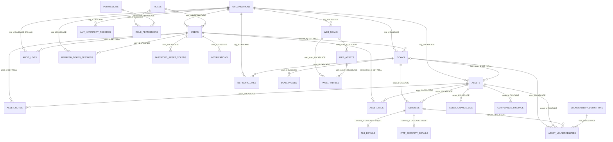
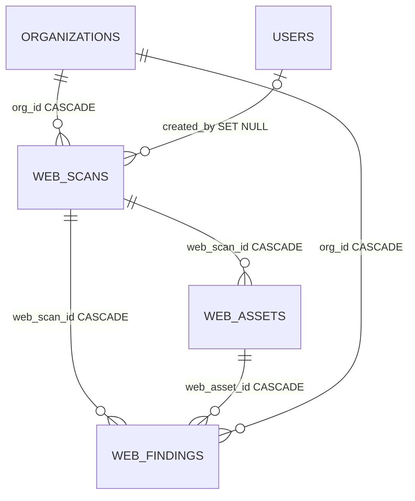
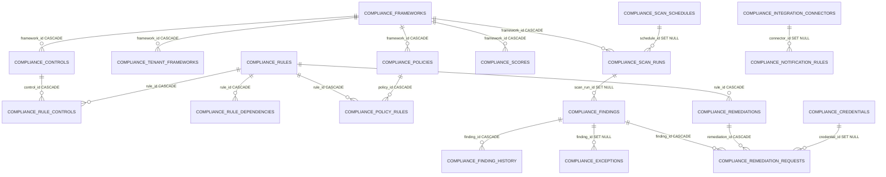

# Database Schema

**CCure-Audit-PRO** — the application database, derived from the SQLAlchemy
models under `Backend/db/models/` and the 32 Alembic revisions under
`Backend/alembic/versions/`.

> Every table, column, key, constraint, index and cascade below was read from a
> model definition. No relationship is inferred from a naming convention: each one
> corresponds to an explicit `ForeignKey` and, where stated, an explicit
> `relationship()`.

---

## 1. Overview

| Metric                    | Value                                                   |
| ------------------------- | ------------------------------------------------------- |
| Tables in `Base.metadata` | **47**                                                  |
| Model modules             | 10 (`db/models/*.py`)                                   |
| Alembic revisions         | 32, linear chain                                        |
| Alembic head              | `c3h4i5j6k7l8`                                          |
| Alembic root              | `7f96fc2fa41a`                                          |
| Engine                    | PostgreSQL (SQLite supported only for isolated tooling) |

### Two databases

| Database                        | Alembic-managed here?         | Contents                                                                                                                                                                                     |
| ------------------------------- | ----------------------------- | -------------------------------------------------------------------------------------------------------------------------------------------------------------------------------------------- |
| Application DB (`DATABASE_URL`) | **Yes** — the 47 tables below | Tenants, users, RBAC, scans, assets, findings, web scans, compliance, topology                                                                                                               |
| `vuln_intel` (`VULN_DB_*`)      | **No**                        | NVD/CVSS/CPE, OSV, MSRC, CSAF, exploit intel, CISA KEV, VulnCheck KEV. Its `alembic_version` names a revision that exists nowhere in this tree; each sync script asserts the tables it needs |

An entity-relationship diagram for the `vuln_intel` schema is kept alongside this
document at [VULN_INTEL_ERD.html](VULN_INTEL_ERD.html). It lived at the
repository root as `Vulnerability_ERD Diagram.html` and nothing linked to it.

### PostgreSQL specifics

`db/base.py` defines `TIMESTAMPTZ = DateTime(timezone=True)` and uses it for
every timestamp column — the schema is timezone-aware throughout. Native types in
use: `JSONB`, `INET`, `MACADDR`, `CIDR`, `ARRAY(Text)`, `Numeric`, `BigInteger`,
`SmallInteger`.

A `connect` event listener enables three extensions on first connection:

```sql
CREATE EXTENSION IF NOT EXISTS pg_trgm;
CREATE EXTENSION IF NOT EXISTS pgcrypto;
CREATE EXTENSION IF NOT EXISTS "uuid-ossp";
```

`pg_trgm` is required — three GIN trigram indexes depend on it
(`idx_assets_hostname_trgm`, `idx_vuln_def_title_trgm`).

### Primary-key convention

IDs are human-readable strings, generated by `db/base.py` unless noted. Several
are **deterministic**, which is load-bearing:

| Generator                                                          | Determinism                                                                                                                                          | Consequence                                                        |
| ------------------------------------------------------------------ | ---------------------------------------------------------------------------------------------------------------------------------------------------- | ------------------------------------------------------------------ |
| `gen_asset_id(org, ip)`                                            | Same org + IP → same id                                                                                                                              | Re-scanning updates the asset in place; `first_seen_at` survives   |
| `gen_service_id(asset_id, port, proto)`                            | Same asset + port + proto → same id                                                                                                                  | `services` is a **current-state projection**, not per-scan history |
| `scans/asset_syncer._resolve_finding_id(org, asset, vuln, family)` | Same asset + vulnerability + source family → same id (`fnd_<asset>_<family>_<vuln>`; a legacy `fnd_<asset>_<vuln>` row of the same family is reused) | A recurring finding keeps its triage state                         |
| `gen_network_link_id(org, a, b)`                                   | Endpoints sorted before formatting                                                                                                                   | A link is the same row regardless of which side reported it        |
| `gen_web_finding_id(asset, type, identity)`                        | SHA-1 of `identity`                                                                                                                                  | Prevents DETECT and AUDIT writing the same finding twice           |

Non-deterministic generators (`gen_user_id`, `gen_scan_id`, `gen_org_token`,
`gen_web_scan_id`, `gen_notification_id`) append a 4-character random suffix.
`audit_logs.id` defaults to `gen_uuid`.

> **NOTE:** Because `services` is a projection, point-in-time port and service
> results live in `scan_phases.summary`. The scan-detail API and both PDF
> generators read that column back rather than reconstructing history from
> `services`.

---

## 2. Entity relationship map



Compliance is a self-contained cluster of 20 tables, diagrammed separately in §9.

---

## 3. Tenancy and RBAC

Source: `Backend/db/models/rbac.py`.

### `organizations`

The tenant boundary. Every user, asset and scan belongs to exactly one.

| Column             | Type          | Null | Default  | Notes                                                    |
| ------------------ | ------------- | ---- | -------- | -------------------------------------------------------- |
| `id`               | `String(100)` | no   | —        | **PK**. `gen_org_id(slug)` → `org_default`               |
| `name`             | `String(255)` | no   | —        | **UNIQUE**                                               |
| `slug`             | `String(100)` | no   | —        | **UNIQUE**                                               |
| `is_active`        | `Boolean`     | no   | `true`   | **Deactivation blocks login, refresh and every request** |
| `settings`         | `JSONB`       | no   | `{}`     | Feature flags — **org_admin-writable**                   |
| `scan_scope_cidrs` | `JSONB`       | yes  | —        | Authorised scan targets. **Superadmin-only**             |
| `created_at`       | `TIMESTAMPTZ` | no   | `utcnow` |                                                          |
| `updated_at`       | `TIMESTAMPTZ` | no   | `utcnow` | `onupdate=utcnow`                                        |

**Relationships:** `users`, `assets`, `scans` — all `cascade="all, delete-orphan"`.
`web_scans`, `web_findings`, `network_links` attach via `backref`.

**`scan_scope_cidrs` is the authorisation boundary on scan targets.** Three
states, all distinct:

| Value   | Meaning                                                                  |
| ------- | ------------------------------------------------------------------------ |
| `NULL`  | Unconfigured. Unrestricted unless `REQUIRE_SCAN_SCOPE=True`, then denied |
| `[]`    | Explicitly deny all scanning for this org                                |
| `[...]` | Scanning permitted only inside these CIDR blocks                         |

`NULL` is not `[]`: the first means nobody has decided yet and exists only so
the migration does not stop every existing organisation from scanning the moment
it lands; the second means somebody decided "none". Populate every org, then set
`REQUIRE_SCAN_SCOPE=True` to remove the ambiguity.

It is a dedicated column rather than a key in `settings` because `settings` is
writable by `org_admin`. Letting a tenant administrator widen their own scan
authorisation is not a restriction. Only a superadmin may write this field, via
`PUT /admin/organizations/{org_id}/scan-scope`.

Child FKs use `ondelete="CASCADE", onupdate="CASCADE"`, so renaming an
organization id propagates through every child row.

### `roles`

| Column           | Type           | Null | Default       | Notes                            |
| ---------------- | -------------- | ---- | ------------- | -------------------------------- |
| `id`             | `SmallInteger` | no   | autoincrement | **PK**                           |
| `name`           | `String(50)`   | no   | —             | **UNIQUE**                       |
| `description`    | `Text`         | yes  | —             |                                  |
| `is_system_role` | `Boolean`      | no   | `false`       | `true` for all five seeded roles |
| `created_at`     | `TIMESTAMPTZ`  | no   | `utcnow`      |                                  |

Seeded rows: `superadmin`, `org_admin`, `analyst`, `viewer`, `scanner`.

### `permissions`

| Column        | Type           | Null | Notes                 |
| ------------- | -------------- | ---- | --------------------- |
| `id`          | `SmallInteger` | no   | **PK**, autoincrement |
| `resource`    | `String(100)`  | no   | e.g. `scans`          |
| `action`      | `String(50)`   | no   | e.g. `execute`        |
| `description` | `Text`         | yes  |                       |

**Constraint:** `UniqueConstraint("resource", "action", name="uq_permissions_resource_action")`.
51 rows are seeded — see [RBAC_Management_Permissions.md](RBAC_Management_Permissions.md).

### `role_permissions`

Many-to-many bridge.

| Column          | Type           | Notes                                                |
| --------------- | -------------- | ---------------------------------------------------- |
| `role_id`       | `SmallInteger` | **PK part**, FK `roles.id` `ON DELETE CASCADE`       |
| `permission_id` | `SmallInteger` | **PK part**, FK `permissions.id` `ON DELETE CASCADE` |

Composite primary key. This is the table `require_permission()` joins on for every
non-superadmin request.

### The RBAC capability's tables (`rbac_*`) — RBAC-1, dark

Seven platform-owned tables for the new, independent RBAC capability
([RBAC_FOUNDATION.md](architecture/RBAC_FOUNDATION.md)). **Nothing reads them on a
request path yet**: the five tables above, with `users.role_id`, remain the
authorization authority until the migration phases (RBAC-3 onward). Added by
migration `a7c1e5b3d9f2`; every foreign key is `ON DELETE RESTRICT`; no module
reads or writes any of them (they ask `ccure_platform.api`).

#### `rbac_permissions`

The catalogue. Written only by catalogue sync; there is no API that writes it.

| Column                         | Type          | Notes                                                                                        |
| ------------------------------ | ------------- | -------------------------------------------------------------------------------------------- |
| `key`                          | `String(120)` | **PK**; `<namespace>.<resource>.<action>`, three segments, no wildcard                       |
| `module`, `resource`, `action` | `String`      | the three segments; `key = module.resource.action` (CHECK)                                   |
| `description`                  | `Text`        | 1–500 characters                                                                             |
| `scope_kind`                   | `String(20)`  | `platform` or `organization`                                                                 |
| `sensitivity`                  | `String(20)`  | `normal` or `privileged` (denials of privileged keys are audited)                            |
| `delegable_to_org_roles`       | `Boolean`     | `false` = may not be held by an organisation-scope role; always `false` for `platform` scope |
| `continuity`                   | `Boolean`     | one of the four frozen continuity keys                                                       |
| `status`                       | `String(20)`  | `active`, `deprecated` (still honoured), `retired` (never granted)                           |
| `replaced_by`                  | `String(120)` | FK `rbac_permissions.key`                                                                    |
| `retired_at`                   | `TIMESTAMPTZ` | set exactly when `status = 'retired'`                                                        |

#### `rbac_roles`

A role is `id` + `key` + `display_name`; **only `id` and `key` are identity, and
neither is ever an authorization input** — `display_name` is a mutable label.
`id`, `key`, `kind`, `assignable_scope`, `org_id`, `managed_by` and `created_at`
are immutable (trigger); no row is ever deleted (trigger).

| Column                                          | Type          | Notes                                                                                                                          |
| ----------------------------------------------- | ------------- | ------------------------------------------------------------------------------------------------------------------------------ |
| `id`                                            | `UUID`        | **PK**, `gen_random_uuid()`; the target of every FK                                                                            |
| `key`                                           | `String(200)` | **UNIQUE**; `platform.<slug>` (system), `custom.platform.<slug>`, `custom.<org_id>.<slug>`                                     |
| `display_name`                                  | `String(100)` | trimmed, no control characters; unique among non-retired roles per namespace (platform, or one organisation), case-insensitive |
| `description`                                   | `Text`        |                                                                                                                                |
| `kind`                                          | `String(20)`  | `system` (code-managed) or `custom`                                                                                            |
| `assignable_scope`                              | `String(20)`  | `platform` or `organization`                                                                                                   |
| `org_id`                                        | `String(100)` | FK `organizations.id`; set exactly for an organisation custom role                                                             |
| `managed_by`                                    | `String(20)`  | `code` (permissions from catalogue sync) or `admin`                                                                            |
| `state`                                         | `String(20)`  | `active` → `retiring` → `retired`; reactivation allowed; transitions checked by trigger                                        |
| `auto_grant_new_permissions`                    | `Boolean`     | platform-scope only; read by sync, which materialises grants as rows — the engine never reads it                               |
| `replaced_by_role_id`                           | `UUID`        | FK `rbac_roles.id`                                                                                                             |
| `retired_at`, `retired_by`, `retirement_reason` | —             | retirement metadata; `retired_at` set exactly when `state = 'retired'`                                                         |
| `revision`                                      | `Integer`     | the latest revision recorded in `rbac_role_revisions`                                                                          |
| `created_by`, `created_at`, `updated_at`        | —             |                                                                                                                                |

#### `rbac_role_revisions`

Append-only (trigger): what a role was called and held, and when. `role_id` FK,
`revision` (unique with `role_id`), `display_name`, `description`,
`permission_set_hash` (SHA-256 of the sorted permission keys), `state`,
`change_kind` (`created`, `renamed`, `described`, `permissions_changed`,
`state_changed`, `retired`, `reactivated`, `synced`), `changed_by`, `changed_at`.

#### `rbac_role_permissions`

Composite PK (`role_id`, `permission_key`), both FKs. A trigger refuses a retired
permission, and a platform-scope or non-delegable permission on an
organisation-scope role. This is what the resolver reads.

#### `rbac_user_roles`

A user holds a role platform-wide or in one organisation; several rows per user is
the multi-role model. **A row is revoked, never rewritten**: its identity columns
are immutable and a revocation cannot be undone (trigger), so the table is the
history. `user_id` FK `users.id`; `role_id` FK; `scope_type` (`platform` /
`organization`) with `scope_org_id` FK (set exactly for `organization`);
`granted_by`, `granted_at`, `expires_at`, `revoked_at`, `revoked_by` (plain actor
ids, not FKs) and `revoke_reason` (`migrated`, `role_retired`, `expired`,
`manual`; set exactly when revoked). A partial unique index allows one live row per
user, role and scope. An insert trigger refuses a non-`active` role, a scope the
role does not declare, an organisation role outside its organisation, and (v1) an
organisation assignment outside the user's own organisation.

#### `rbac_default_roles`

`purpose` (**PK**, `self_registration`) → `role_id` FK, `updated_by`,
`updated_at`. Seeded to the Viewer role so today's self-registration behaviour is
preserved. A trigger requires an active, organisation-assignable role holding no
non-delegable or continuity permission. The registration flow does not read it yet.

#### `rbac_legacy_map`

**Temporary — dropped in RBAC-8.** Maps a legacy `roles.name` to a role key
(`kind='role'`) or a legacy `resource:action` atom to a permission key
(`kind='permission'`, one atom may map to several keys and several atoms to one),
with an optional `behaviour_change` note. Used only by shadow evaluation.

RBAC-2 (migration `b8d2f6a4c0e1`) adds `status` (`mapped`, `replaced`, `retired`) and
`reason`. **Every legacy atom has exactly one status and none is dropped**: a
`retired` atom — one nothing enforces — is a row with **no** `permission_key` (a
partial unique index allows one per atom) so it is preserved with its reason. The
rows are written from `Backend/data/rbac/golden_legacy_mapping.json` by
`scripts/rbac/sync_catalogue.py`; the old atom is never renamed in the legacy tables.

RBAC-2 also tightens `rbac_roles`: the guard trigger now refuses a **state change that
does not advance `revision` in the same statement**, so a role cannot retire or be
reactivated without leaving a revision row.

---

## 4. Identity, sessions and audit

Source: `Backend/db/models/users.py`.

### `users`

| Column                      | Type           | Null | Default  | Notes                                             |
| --------------------------- | -------------- | ---- | -------- | ------------------------------------------------- |
| `id`                        | `String(150)`  | no   | —        | **PK**, `gen_user_id()`                           |
| `org_id`                    | `String(100)`  | no   | —        | FK `organizations.id` CASCADE/CASCADE, indexed    |
| `role_id`                   | `SmallInteger` | no   | —        | FK `roles.id` **`ON DELETE RESTRICT`**, indexed   |
| `username`                  | `String(100)`  | no   | —        | **UNIQUE**, indexed — global, not per-org         |
| `email`                     | `String(320)`  | no   | —        | **UNIQUE**, indexed — global                      |
| `email_canonical`           | `String(320)`  | yes  | —        | **UNIQUE**, indexed — the mailbox `email` reaches |
| `full_name`                 | `String(255)`  | yes  | —        |                                                   |
| `password_hash`             | `String(255)`  | no   | —        | argon2 (`$argon2…`) or bcrypt                     |
| `totp_secret`               | `String(255)`  | yes  | —        | Fernet-encrypted                                  |
| `mfa_enabled`               | `Boolean`      | no   | `false`  |                                                   |
| `mfa_backup_codes`          | `JSONB`        | no   | `[]`     | List of hashes; entries removed on use            |
| `email_otp_hash`            | `String(255)`  | yes  | —        | Cleared on every verify attempt                   |
| `email_otp_expires_at`      | `TIMESTAMPTZ`  | yes  | —        | 5-minute window                                   |
| `is_active`                 | `Boolean`      | no   | `true`   | `false` → 403 on every request                    |
| `is_deleted`                | `Boolean`      | no   | `false`  | Soft delete → 401                                 |
| `is_verified`               | `Boolean`      | no   | `false`  | Mailbox confirmed; login refuses `false`          |
| `last_login_at`             | `TIMESTAMPTZ`  | yes  | —        |                                                   |
| `failed_login_count`        | `Integer`      | no   | `0`      | Lockout at 5                                      |
| `locked_until`              | `TIMESTAMPTZ`  | yes  | —        | now + 15 min on lockout                           |
| `deleted_at`                | `TIMESTAMPTZ`  | yes  | —        |                                                   |
| `approved_at`               | `TIMESTAMPTZ`  | yes  | —        | Admin approval; login refuses `NULL`              |
| `approved_by`               | `String(150)`  | yes  | —        | `users.id` of the approver, or `fixture`/`auto:…` |
| `is_email_flagged`          | `Boolean`      | no   | `false`  | Indexed — drives the approval-queue badge         |
| `email_risk`                | `JSONB`        | no   | `{}`     | Verdict, flags and signals from the domain guard  |
| `flagged_at`                | `TIMESTAMPTZ`  | yes  | —        | When the flag was first raised                    |
| `avatar_url`                | `String(512)`  | yes  | —        |                                                   |
| `preferences`               | `JSONB`        | no   | `{}`     | Theme, defaults, notification settings            |
| `created_at` / `updated_at` | `TIMESTAMPTZ`  | no   | `utcnow` |                                                   |

**Relationships:** `organization`, `role`, `refresh_tokens` (delete-orphan),
`audit_logs` (`passive_deletes=True`), `scans` (`passive_deletes=True`),
`asset_notes`, `asset_tags`.

**Two independent gates on sign-in.** `is_verified` records that someone
controls the mailbox; `approved_at` records that a human with admin rights
decided the account should exist. Both are required, and neither implies the
other — which is why `POST /admin/users/{id}/approve` refuses an unverified
account rather than treating approval as an override. Accounts created through
`POST /admin/users` are stamped with both at creation, since admin provisioning
_is_ the approval; only self-registration ever produces a row with
`approved_at IS NULL`.

Both are checked **after** the password verifies. Checking them first, as an
earlier version did, made each an account-existence oracle: any password at all
would return a 403 distinguishing "disabled", "deleted" and "no such account".

`RESTRICT` on `role_id` means a role cannot be deleted while any user holds it —
which is one reason the RBAC router exposes no delete endpoint.

### `refresh_token_sessions`

| Column        | Type          | Null | Notes                                     |
| ------------- | ------------- | ---- | ----------------------------------------- |
| `id`          | `BigInteger`  | no   | **PK**, autoincrement — high-volume table |
| `user_id`     | `String(150)` | no   | FK `users.id` CASCADE, indexed            |
| `org_id`      | `String(100)` | no   | FK `organizations.id` CASCADE, indexed    |
| `token_jti`   | `String(128)` | no   | **UNIQUE**, indexed — the `jti` claim     |
| `token_hash`  | `String(255)` | no   | **UNIQUE** — SHA-256 of the token         |
| `issued_at`   | `TIMESTAMPTZ` | no   | `utcnow`                                  |
| `expires_at`  | `TIMESTAMPTZ` | no   | Issue + `REFRESH_TOKEN_EXPIRES_DAYS`      |
| `revoked_at`  | `TIMESTAMPTZ` | yes  | Set on logout and on rotation             |
| `replaced_by` | `String(128)` | yes  | New `jti` — the rotation chain            |
| `ip_address`  | `INET`        | yes  | From `get_client_ip`                      |
| `device_info` | `JSONB`       | yes  |                                           |

Both the `jti` **and** the token hash are stored: the `jti` locates the row, the
hash proves the presented token is the one that was issued.

### `password_reset_tokens`

| Column       | Type          | Null | Notes                          |
| ------------ | ------------- | ---- | ------------------------------ |
| `id`         | `BigInteger`  | no   | **PK**, autoincrement          |
| `user_id`    | `String(150)` | no   | FK `users.id` CASCADE, indexed |
| `token_hash` | `String(255)` | no   | **UNIQUE**, indexed — SHA-256  |
| `created_at` | `TIMESTAMPTZ` | no   |                                |
| `expires_at` | `TIMESTAMPTZ` | no   | Created + 15 minutes           |

Single-use: the row is deleted on successful reset. The API lifespan loop purges
expired rows.

### `email_verification_tokens`

| Column       | Type          | Null | Notes                                    |
| ------------ | ------------- | ---- | ---------------------------------------- |
| `id`         | `BigInteger`  | no   | **PK**, autoincrement                    |
| `user_id`    | `String(150)` | no   | FK `users.id` CASCADE, indexed           |
| `token_hash` | `String(255)` | no   | **UNIQUE**, indexed — SHA-256            |
| `email`      | `String(320)` | no   | Address the token was issued for         |
| `created_at` | `TIMESTAMPTZ` | no   |                                          |
| `expires_at` | `TIMESTAMPTZ` | no   | Created + `EMAIL_VERIFICATION_TTL_HOURS` |

Deliberately a **separate table** from `password_reset_tokens` rather than a
`purpose` column on it: reset is the more sensitive of the two flows and already
works, and a shared table would let a bug in one flow mint a token the other
accepts.

Single-use: the row is deleted in the same transaction that sets
`users.is_verified`. Issuing a new token deletes any outstanding ones for the
same user, so only one link is ever live — two would leave a stale link
redeemable from a mailbox that may no longer be under the user's control.

`email` is compared against `users.email` at redemption. A link issued for one
address must not confirm a different one, otherwise changing the address after
requesting a link would let the old mailbox verify an address it never received
mail at.

### `platform_registration_policy`

Source: `Backend/ccure_platform/models/registration_policy.py`. Platform-owned
singleton for the self-registration setting, shared across all tenants.

| Column                      | Type                   | Meaning                                                                          |
| --------------------------- | ---------------------- | -------------------------------------------------------------------------------- |
| `id`                        | integer, primary key   | Always 1; a check constraint enforces the singleton.                             |
| `self_registration_enabled` | nullable boolean       | true/false saves an administrator override; NULL follows the deployment default. |
| `revision`                  | nonnegative integer    | Incremented on every save; stale revisions return 409.                           |
| `updated_at`                | timestamptz, nullable  | Time of the last administrator change.                                           |
| `updated_by`                | varchar(150), nullable | Actor id retained independently of account deletion.                             |

Migration `e5a7c9d1f3b2` creates the row with no override, preserving the existing
deployment policy. Fresh installs that create metadata initialize the row on
the first save with an insert safe for concurrent requests. A save locks the
singleton and commits its change with a `platform_audit_events` record.
The public auth configuration and every signup gate read the same policy on
each request. Database failures return unavailable rather than enabling signup.
This platform configuration is preserved by the clean-development reset.

### `email_domain_rules`

Explicit platform-wide ALLOW / DENY decisions about email domains.

| Column                      | Type          | Null | Default  | Notes                                             |
| --------------------------- | ------------- | ---- | -------- | ------------------------------------------------- |
| `id`                        | `BigInteger`  | no   | —        | **PK**, autoincrement                             |
| `domain`                    | `String(255)` | no   | —        | **UNIQUE**, indexed — registrable form, lowercase |
| `verdict`                   | `String(10)`  | no   | —        | `allow` or `deny`, indexed                        |
| `source`                    | `String(40)`  | no   | `admin`  | `seed`, `admin`, or `approval`                    |
| `reason`                    | `Text`        | yes  | —        | Why this rule exists                              |
| `created_by`                | `String(150)` | yes  | —        | `users.id`, **not** a FK — see below              |
| `created_at` / `updated_at` | `TIMESTAMPTZ` | no   | `utcnow` |                                                   |

**ALLOW always wins**, and that ordering is the reason the table exists. The
blocklist corpus below is maintained by strangers on a schedule nobody here
controls, and it does get things wrong — `qq.com` and Apple Private Relay have
both been listed. One row here overrides any upstream list permanently, which is
what makes enforcement safe to turn on at all.

Seeded with a never-block floor: the major consumer providers, the alias and
forwarding services (allowed on purpose — they forward to a permanent mailbox
somebody actually reads), and this deployment's own domains.

`created_by` is deliberately **not** a foreign key. A rule must outlive the
administrator who wrote it; deleting a leaver's account must never cascade into
re-blocking a customer's email domain.

Rules also match **parent suffixes**, so a rule on `example.co.uk` covers
`mail.example.co.uk` without a second row.

### `disposable_domains`

The merged upstream blocklist corpus. Rebuilt by
`scripts/security/sync_disposable_domains.py`.

| Column          | Type          | Null | Default  | Notes                                      |
| --------------- | ------------- | ---- | -------- | ------------------------------------------ |
| `id`            | `BigInteger`  | no   | —        | **PK**, autoincrement                      |
| `domain`        | `String(255)` | no   | —        | **UNIQUE**, indexed                        |
| `sources`       | `JSONB`       | no   | `[]`     | Which lists named it, for provenance       |
| `first_seen_at` | `TIMESTAMPTZ` | no   | `utcnow` |                                            |
| `last_seen_at`  | `TIMESTAMPTZ` | no   | `utcnow` | Indexed                                    |
| `miss_count`    | `Integer`     | no   | `0`      | Consecutive syncs with no source naming it |

**Kept separate from `email_domain_rules` on purpose.** One holds ~93,000 rows
rebuilt weekly from other people's data; the other holds ~100 rows each
representing a decision somebody made. Merged into one table a sync would be
writing to the rows an administrator edits, and one bad upstream entry could
overwrite a deliberate allow. Kept apart, a sync cannot reach a human decision.

`miss_count` exists because a source returning an error page parses to zero
domains, which is indistinguishable from "this list is now empty". A domain is
retired only after `DISPOSABLE_RETIRE_AFTER_MISSES` consecutive **successful**
syncs without it, and a source below `DISPOSABLE_SYNC_MIN_ROWS_PER_SOURCE` is
rejected outright rather than merged.

Both tables are platform-wide, not org-scoped: a throwaway domain is a throwaway
domain for every tenant, and scoping would mean 93,000 rows per organisation.

### `audit_logs`

Immutable action record. **Hash-partitioned.**

| Column          | Type          | Null | Notes                                      |
| --------------- | ------------- | ---- | ------------------------------------------ |
| `id`            | `String(200)` | no   | **PK part**, `default=gen_uuid`            |
| `org_id`        | `String(100)` | no   | **PK part**, FK `organizations.id` CASCADE |
| `user_id`       | `String(150)` | yes  | FK `users.id` **SET NULL**, indexed        |
| `action`        | `String(100)` | no   | e.g. `user.login`, `REPORT_DOWNLOAD`       |
| `resource_type` | `String(100)` | yes  |                                            |
| `resource_id`   | `String(255)` | yes  |                                            |
| `changes`       | `JSONB`       | yes  |                                            |
| `ip_address`    | `INET`        | yes  |                                            |
| `user_agent`    | `Text`        | yes  |                                            |
| `status`        | `String(20)`  | no   | `success` \| `failure` \| `denied`         |
| `created_at`    | `TIMESTAMPTZ` | no   | `utcnow`                                   |

**Table args:** `Index("ix_audit_logs_action")`, `Index("ix_audit_logs_created")`,
`Index("ix_audit_logs_org_id")`, and
`{"postgresql_partition_by": "HASH (org_id)"}`. `org_id` is part of the primary
key because PostgreSQL requires the partition key in the PK.
`db/migrate_production_schema.py::create_partitions` creates 8 partitions
(`audit_logs_p0` … `p7`, `MODULUS 8`) and skips gracefully if the table exists
unpartitioned.

`user_id` is SET NULL rather than CASCADE: deleting a user must never erase the
record of what they did.

### `platform_audit_events`

The platform's own audit ledger (RBAC-2, migration `b8d2f6a4c0e1`) — for events **no
organisation owns**. `audit_logs` is tenant-bound (`org_id` NOT NULL, hash-partitioned
on it, the chain kept per organisation), so a catalogue sync, a system or
platform-scope role change or the default role being re-pointed cannot be written
there without borrowing an organisation. The rule is: an event with an owner goes to
that organisation's `audit_logs`; one without goes here; nothing is attributed to an
invented organisation (`docs/architecture/RBAC_FOUNDATION.md` §10.4). Written by
`ccure_platform/audit_log/writer.py::log_platform_event`.

| Column                                                          | Type          | Notes                                                                                 |
| --------------------------------------------------------------- | ------------- | ------------------------------------------------------------------------------------- |
| `id`                                                            | `UUID`        | **PK**, `gen_random_uuid()`                                                           |
| `occurred_at`                                                   | `TIMESTAMPTZ` | default `now()`                                                                       |
| `action`                                                        | `String(100)` | e.g. `rbac.catalogue.permission_registered`                                           |
| `severity`                                                      | `String(20)`  | from the same taxonomy as `audit_logs`                                                |
| `actor_kind`                                                    | `String(10)`  | `system` (a label, no account) or `user` (an account id) — CHECKed                    |
| `actor_user_id`, `actor_label`                                  | `String`      | plain values, no foreign key: the record outlives the account                         |
| `actor_org_id`                                                  | `String(100)` | where the actor sat when they acted — **information, never an owner**; no foreign key |
| `resource_type`, `resource_id`, `changes` (JSONB), `request_id` | —             | `changes` is redacted on the way in, like `audit_logs`                                |

There is **no `org_id` column**, which is the point. **Append-only** (a trigger refuses
`UPDATE` and `DELETE`) but **not hash-chained**: extending the per-organisation chain
to a platform chain is a privileged DBA bootstrap and a separate, reviewed step.

---

## 5. Asset registry

Source: `Backend/db/models/assets.py`, `Backend/db/models/amt.py`.

### `assets`

| Column                                 | Type           | Null | Default  | Notes                                           |
| -------------------------------------- | -------------- | ---- | -------- | ----------------------------------------------- |
| `id`                                   | `String(200)`  | no   | —        | **PK**, `gen_asset_id(org, ip)` — deterministic |
| `org_id`                               | `String(100)`  | no   | —        | FK `organizations.id` CASCADE/CASCADE, indexed  |
| `ip_address`                           | `INET`         | yes  | —        |                                                 |
| `mac_address`                          | `MACADDR`      | yes  | —        |                                                 |
| `hostname`                             | `String(255)`  | yes  | —        |                                                 |
| `dns_name`                             | `String(512)`  | yes  | —        |                                                 |
| `fqdn`                                 | `String(512)`  | yes  | —        |                                                 |
| `netbios_name`                         | `String(255)`  | yes  | —        |                                                 |
| `discovery_method`                     | `String(50)`   | yes  | —        |                                                 |
| `response_time_ms`                     | `Float`        | yes  | —        |                                                 |
| `device_category`                      | `String(100)`  | yes  | —        | Indexed                                         |
| `os_family` / `os_name` / `os_version` | `String`       | yes  | —        |                                                 |
| `os_confidence`                        | `SmallInteger` | yes  | —        |                                                 |
| `vendor` / `manufacturer`              | `String(255)`  | yes  | —        |                                                 |
| `subnet`                               | `String(50)`   | yes  | —        |                                                 |
| `vlan_id`                              | `Integer`      | yes  | —        |                                                 |
| `first_seen_at`                        | `TIMESTAMPTZ`  | no   | `utcnow` | **Preserved across re-scans**                   |
| `last_seen_at`                         | `TIMESTAMPTZ`  | no   | `utcnow` | Indexed                                         |
| `last_scan_id`                         | `String(100)`  | yes  | —        | FK `scans.id` **SET NULL** / CASCADE            |
| `risk_score`                           | `SmallInteger` | no   | `0`      |                                                 |
| `risk_level`                           | `String(20)`   | no   | `'info'` |                                                 |
| `vuln_counts`                          | `JSONB`        | no   | `{}`     | GIN-indexed                                     |
| `is_active`                            | `Boolean`      | no   | `true`   |                                                 |
| `is_managed`                           | `Boolean`      | no   | `false`  |                                                 |
| `owner`                                | `String(255)`  | yes  | —        |                                                 |
| `notes_summary`                        | `Text`         | yes  | —        |                                                 |
| `custom_attributes`                    | `JSONB`        | no   | `{}`     | Holds `provenance` per field                    |
| `provenance`                           | `JSONB`        | no   | `{}`     |                                                 |
| `created_at` / `updated_at`            | `TIMESTAMPTZ`  | no   | `utcnow` |                                                 |

**Constraints and indexes**

| Name                         | Kind                 | Definition                              |
| ---------------------------- | -------------------- | --------------------------------------- |
| `uq_assets_org_ip`           | UNIQUE index         | `(org_id, ip_address)`                  |
| `ix_assets_org_mac`          | index                | `(org_id, mac_address)`                 |
| `ix_assets_org_risk`         | index                | `(org_id, risk_score)`                  |
| `ix_assets_last_seen`        | index                | `(last_seen_at)`                        |
| `ix_assets_category`         | index                | `(device_category)`                     |
| `idx_assets_vuln_counts_gin` | GIN                  | `vuln_counts`                           |
| `idx_assets_hostname_trgm`   | GIN + `gin_trgm_ops` | `hostname`                              |
| `ck_assets_risk_score`       | CHECK                | `risk_score >= 0 AND risk_score <= 100` |

**Relationships:** `organization`, `last_scan` (explicit `foreign_keys`),
`tags`, `notes`, `change_log` (ordered `detected_at DESC`), `services`,
`vulnerabilities` — all child collections `cascade="all, delete-orphan"`.

### `asset_tags`

| Column          | Type          | Notes                                   |
| --------------- | ------------- | --------------------------------------- |
| `id`            | `BigInteger`  | **PK**, autoincrement                   |
| `asset_id`      | `String(200)` | FK `assets.id` CASCADE/CASCADE, indexed |
| `tag`           | `String(100)` | Indexed                                 |
| `created_by_id` | `String(150)` | FK `users.id` SET NULL                  |
| `created_at`    | `TIMESTAMPTZ` |                                         |

**Constraint:** `UniqueConstraint("asset_id", "tag", name="uq_asset_tags_asset_tag")`.

### `asset_notes`

| Column                      | Type          | Notes                           |
| --------------------------- | ------------- | ------------------------------- |
| `id`                        | `BigInteger`  | **PK**, autoincrement           |
| `asset_id`                  | `String(200)` | FK `assets.id` CASCADE, indexed |
| `user_id`                   | `String(150)` | FK `users.id` SET NULL          |
| `content`                   | `Text`        | Not null                        |
| `created_at` / `updated_at` | `TIMESTAMPTZ` |                                 |

### `asset_change_log`

Immutable per-field diff between scans; powers the asset timeline UI.

| Column                    | Type          | Notes                           |
| ------------------------- | ------------- | ------------------------------- |
| `id`                      | `BigInteger`  | **PK**, autoincrement           |
| `asset_id`                | `String(200)` | FK `assets.id` CASCADE, indexed |
| `scan_id`                 | `String(100)` | FK `scans.id` SET NULL, indexed |
| `change_type`             | `String(50)`  | Indexed                         |
| `field_name`              | `String(100)` |                                 |
| `old_value` / `new_value` | `JSONB`       |                                 |
| `detected_at`             | `TIMESTAMPTZ` | Indexed                         |

### `mac_vendor_cache`

| Column        | Type          | Notes            |
| ------------- | ------------- | ---------------- |
| `mac_prefix`  | `String(6)`   | **PK** — the OUI |
| `vendor_name` | `String(255)` | Not null         |
| `created_at`  | `TIMESTAMPTZ` | Indexed          |
| `updated_at`  | `TIMESTAMPTZ` |                  |

Shared across every worker so OUI lookups are neither repeated nor rate-limited.
Refreshed by `ccure.tasks.update_mac_vendor_registry`.

### `amt_inventory_records`

Corporate asset-management inventory imported from `assets.json`, used as the
offline reference for coverage and reconciliation.

| Column                                                                                                                    | Type          | Notes                         |
| ------------------------------------------------------------------------------------------------------------------------- | ------------- | ----------------------------- |
| `id`                                                                                                                      | `BigInteger`  | **PK**, autoincrement         |
| `org_id`                                                                                                                  | `String(100)` | FK `organizations.id` CASCADE |
| `mac_address_1`                                                                                                           | `MACADDR`     | Not null                      |
| `mac_address_2`                                                                                                           | `MACADDR`     | Nullable second NIC           |
| `asset_tag`, `asset_name`, `serial`, `vendor`, `asset_type`, `asset_user`, `emp_id`, `status`, `location`, `company_name` | `String`      | Reference attributes          |
| `location_id`                                                                                                             | `Integer`     |                               |
| `created_at` / `updated_at`                                                                                               | `TIMESTAMPTZ` |                               |

**Indexes:** `ix_amt_org_mac1` UNIQUE on `(org_id, mac_address_1)`;
`ix_amt_org_mac2` on `(org_id, mac_address_2)`.

---

## 6. Scans

Source: `Backend/db/models/scans.py`, `Backend/db/models/scan_reports.py`.

### `scans`

| Column                                                                    | Type                      | Null | Default      | Notes                                                                                                                              |
| ------------------------------------------------------------------------- | ------------------------- | ---- | ------------ | ---------------------------------------------------------------------------------------------------------------------------------- |
| `id`                                                                      | `String(100)`             | no   | —            | **PK**, `gen_scan_id()`                                                                                                            |
| `org_id`                                                                  | `String(100)`             | no   | —            | FK `organizations.id` CASCADE, indexed                                                                                             |
| `created_by`                                                              | `String(150)`             | yes  | —            | FK `users.id` **SET NULL**, indexed                                                                                                |
| `scan_no`                                                                 | `BigInteger`              | yes  | —            | Per-org sequence, shown in the UI                                                                                                  |
| `scan_name`                                                               | `String(255)`             | yes  | —            |                                                                                                                                    |
| `target_network`                                                          | `CIDR`                    | yes  | —            |                                                                                                                                    |
| `target_hosts`                                                            | `JSONB`                   | no   | `[]`         |                                                                                                                                    |
| `target_str`                                                              | `String(512)`             | no   | —            | Display/search field                                                                                                               |
| `scan_type`                                                               | `String(50)`              | no   | `'adaptive'` |                                                                                                                                    |
| `pipeline_mode`                                                           | `String(50)`              | no   | `'basic'`    | `basic` \| `asset` \| `vulnerability_audit` \| `credentialed`                                                                      |
| `intensity`                                                               | `String(50)`              | yes  | `'normal'`   |                                                                                                                                    |
| `options`                                                                 | `JSONB`                   | no   | `{}`         | `execution_mode`, `custom_ports`, `exclude_ports`, `passive_first`, `exclude_ot_from_nmap`, `exclude_ips`, SNMP creds. GIN-indexed |
| `status`                                                                  | `String(50)`              | no   | `'queued'`   | Indexed                                                                                                                            |
| `failure_reason`                                                          | `Text`                    | yes  | —            | Surfaced by the UI on failure                                                                                                      |
| `current_task_id`                                                         | `String(100)`             | yes  | —            | Celery id, used by `/stop`                                                                                                         |
| `queued_at`                                                               | `TIMESTAMPTZ`             | no   | `utcnow`     |                                                                                                                                    |
| `started_at` / `completed_at`                                             | `TIMESTAMPTZ`             | yes  | —            |                                                                                                                                    |
| `duration_seconds`                                                        | `Float`                   | yes  | —            |                                                                                                                                    |
| `total_hosts`, `active_hosts`, `total_vulns`                              | `Integer`                 | no   | `0`          |                                                                                                                                    |
| `critical_count`, `high_count`, `medium_count`, `low_count`, `info_count` | `Integer`                 | no   | `0`          |                                                                                                                                    |
| `report_pdf_path`                                                         | `String(512)`             | yes  | —            | Legacy                                                                                                                             |
| `report_technical_path`                                                   | `String(512)`             | yes  | —            | Renamed by `w6b7c8d9e0f1`                                                                                                          |
| `report_executive_path`                                                   | `String(512)`             | yes  | —            | Renamed by `w6b7c8d9e0f1`                                                                                                          |
| `is_archived` / `archived_at`                                             | `Boolean` / `TIMESTAMPTZ` |      | `false`      |                                                                                                                                    |
| `is_deleted` / `deleted_at`                                               | `Boolean` / `TIMESTAMPTZ` |      | `false`      | Recycle bin                                                                                                                        |
| `created_at` / `updated_at`                                               | `TIMESTAMPTZ`             | no   | `utcnow`     |                                                                                                                                    |

**Status lifecycle:** `queued → running → complete | failed | cancelled`, plus the
terminal `unreachable`, set by Phase 1 when every target was down.

**Constraints and indexes**

| Name                    | Kind   | Definition                |
| ----------------------- | ------ | ------------------------- |
| `uq_scans_org_scan_no`  | UNIQUE | `(org_id, scan_no)`       |
| `ix_scans_org_status`   | index  | `(org_id, status)`        |
| `ix_scans_org_created`  | index  | `(org_id, created_at)`    |
| `ix_scans_org_pipeline` | index  | `(org_id, pipeline_mode)` |
| `ix_scans_is_deleted`   | index  | `(is_deleted)`            |
| `idx_scans_options_gin` | GIN    | `options`                 |

**Relationships:** `organization`, `created_by_user`, `phases`
(ordered `phase_order ASC`, delete-orphan), `services` (delete-orphan),
`vulnerabilities` (delete-orphan). `network_links` attaches by backref.

### `scan_phases`

| Column                        | Type           | Null | Default     | Notes                                                            |
| ----------------------------- | -------------- | ---- | ----------- | ---------------------------------------------------------------- |
| `id`                          | `String(200)`  | no   | —           | **PK**, `gen_scan_phase_id(scan_id, phase_key)`                  |
| `scan_id`                     | `String(100)`  | no   | —           | FK `scans.id` CASCADE, indexed                                   |
| `phase_key`                   | `String(50)`   | no   | —           | `host_discovery`, `asset_discovery`, …                           |
| `phase_order`                 | `SmallInteger` | no   | —           | 1–4                                                              |
| `status`                      | `String(50)`   | no   | `'pending'` | `pending → running → complete \| failed \| skipped \| cancelled` |
| `started_at` / `completed_at` | `TIMESTAMPTZ`  | yes  | —           |                                                                  |
| `duration_seconds`            | `Float`        | yes  | —           |                                                                  |
| `hosts_processed`             | `Integer`      | no   | `0`         |                                                                  |
| `summary`                     | `JSONB`        | no   | `{}`        | **The point-in-time result payload**                             |
| `error_message`               | `Text`         | yes  | —           |                                                                  |
| `created_at` / `updated_at`   | `TIMESTAMPTZ`  | no   | `utcnow`    |                                                                  |

**Constraint:** `UniqueConstraint("scan_id", "phase_key", name="uq_scan_phases_scan_phase")`.

`summary` is what `build_legacy_scan_results` and the report generators read.
Keys beginning `_` are stripped by the API (`_public_summary`), so internal
bookkeeping never reaches a client.

### `scan_reports`

A lighter, separate record of generated report files. Not FK-linked to `scans`.

| Column          | Type                      | Default       | Notes                       |
| --------------- | ------------------------- | ------------- | --------------------------- |
| `id`            | `String(36)`              | `uuid4()`     | **PK**                      |
| `scan_id`       | `String(36)`              | —             | Indexed; **no foreign key** |
| `scan_type`     | `String(32)`              | `'network'`   |                             |
| `report_type`   | `String(32)`              | `'executive'` |                             |
| `report_format` | `String(16)`              | `'pdf'`       |                             |
| `min_severity`  | `String(16)`              | `'Info'`      |                             |
| `file_path`     | `String(512)`             | —             | Not null                    |
| `created_at`    | `DateTime(timezone=True)` | `now(utc)`    |                             |

> **NOTE:** This is the only table in the schema that uses a bare UUID primary key
> and a plain `DateTime` rather than the `TIMESTAMPTZ` alias, and its `scan_id` is
> a loose reference with no referential integrity. The authoritative report
> pointers for a network scan are `scans.report_executive_path` and
> `scans.report_technical_path`.

---

### `finding_remediation_events`

One row per thing that happened to a finding's remediation. Added by Phase 18
(GAP-14), migration `d8e9f0a1b2c3`.

**Append-only by convention, and that convention is what auditability rests
on.** Nothing in the product updates or deletes a row here; the workflow writes
one on every assignment, state change, note, acceptance, expiry and
verification. So "who moved this to accepted risk, when, and on whose
authority" is answerable months later even though the finding row itself
carries only the current state.

Shaped after `compliance_finding_history`, which does the same job for
compliance controls — same columns, same reasons, deliberately not the same
table because the two reference different finding models.

| Column        | Type         | Notes                                                                                                                       |
| ------------- | ------------ | --------------------------------------------------------------------------------------------------------------------------- |
| `id`          | varchar(120) | `fre_<sha256(finding)[:16]>_<type>_<timestamp>`                                                                             |
| `finding_id`  | varchar(350) | Part of a **composite** FK with `org_id` — see below                                                                        |
| `org_id`      | varchar(100) | FK `organizations.id`, CASCADE                                                                                              |
| `event_type`  | varchar(32)  | assigned, unassigned, state_changed, note_added, risk_accepted, exception_expired, verified, reopened, sla_set, sla_changed |
| `from_state`  | varchar(32)  | So a timeline reads without replaying every prior row                                                                       |
| `to_state`    | varchar(32)  |                                                                                                                             |
| `actor_id`    | varchar(150) | FK `users.id`, SET NULL. NULL for a system action                                                                           |
| `actor_label` | varchar(64)  | `system:verification`, `system:exception-expiry`                                                                            |
| `note`        | text         |                                                                                                                             |
| `scan_id`     | varchar(100) | The scan that verified or reopened. Its presence is what distinguishes evidence from assertion                              |
| `details`     | JSONB        | Classification, SLA basis, previous owner. **Never a secret** — returned by the history API                                 |
| `occurred_at` | timestamptz  |                                                                                                                             |

**The foreign key to the finding is composite and had to be.**
`asset_vulnerabilities`' actual primary key is `(id, org_id)`, not `id` — a
leftover of the HASH-partition-on-`org_id` design the table was built for,
where a partitioned table must include the partition key in its key. The model
declares only `id`, so this is invisible from the Python side; PostgreSQL
refuses a single-column reference with "no unique constraint matching given
keys". It is the stronger constraint anyway: an event row can only ever point
at a finding **in its own organisation**, enforced by the database rather than
by every query remembering to filter.

**Indexes:** `ix_finding_rem_event_finding` (finding_id, occurred_at) — the
per-finding timeline — and `ix_finding_rem_event_org` (org_id, occurred_at).

**Why not `audit_logs`.** That table is tamper-evident, HASH-partitioned on
`org_id` and subject to retention. It is the right place for "user X called
this endpoint" and the workflow writes there too. It is the wrong place to read
a _finding's_ remediation timeline: retention would eventually remove history
the finding still needs.

### `asset_vulnerabilities` — remediation columns (GAP-14)

Twelve columns added by migration `d8e9f0a1b2c3`, alongside the `status`,
`remediation_notes`, `fixed_at`, `accepted_risk_reason` and `accepted_by` that
already existed.

| Column                 | Type         | Notes                                                     |
| ---------------------- | ------------ | --------------------------------------------------------- |
| `remediation_state`    | varchar(32)  | NOT NULL, default `open`. The workflow — **not** `status` |
| `remediation_owner`    | varchar(150) | FK `users.id`, SET NULL                                   |
| `assigned_at`          | timestamptz  |                                                           |
| `assigned_by`          | varchar(150) | FK `users.id`, SET NULL                                   |
| `sla_due_at`           | timestamptz  | Materialised, so "overdue" is one predicate               |
| `sla_basis`            | varchar(32)  | The severity the deadline came from                       |
| `verified_at`          | timestamptz  | Written **only** by the verification path                 |
| `verified_scan_id`     | varchar(100) | FK `scans.id`, SET NULL. The citation                     |
| `reopened_at`          | timestamptz  | Becomes the SLA anchor for a regression                   |
| `reopened_count`       | integer      | NOT NULL, default 0                                       |
| `exception_expires_at` | timestamptz  | NULL = the acceptance does not expire                     |
| `accepted_at`          | timestamptz  |                                                           |

**`remediation_state` is a second column and not more `status` values.**
`status` is written by the scan sweeps and read by the dashboard, the asset
risk recompute, the findings list and GAP-13's comparison, with roughly a dozen
call sites testing `status == 'open'`. Adding `in_remediation` to it would have
made every one of those queries silently stop counting the finding — so putting
one into remediation would remove it from the dashboard, from the asset's risk
score and from the overdue list.

**`sla_due_at` is deliberately not backfilled** by the migration. A due date
comes from the organisation's own policy, which lives in
`Organization.settings` and which no migration should invent; the findings sync
sets it on the next scan. Backfilling with the shipped defaults would silently
declare thousands of existing findings overdue against a policy the customer
never agreed to.

**Constraint:** `ck_asset_vuln_remediation_state`.
**Indexes:** `ix_asset_vuln_org_remediation` (the summary's GROUP BY),
`ix_asset_vuln_org_sla_due` (the overdue query), `ix_asset_vuln_remediation_owner`,
and `ix_asset_vuln_exception_expiry` — partial, on `exception_expires_at IS NOT NULL`,
because the hourly expiry sweep only ever matches a handful of rows.

### `scan_policies`

Reusable assessment configurations. One row per named, versioned policy that a
scan or a schedule can point at. Added by Phase 17 (GAP-12), migration
`c7d8e9f0a1b2`.

Deliberately separate from `compliance_policies`, whose `framework_id` is a NOT
NULL foreign key into the compliance catalogue: a network scan policy has no
framework and a configuration policy may name several. What _is_ borrowed from
it is the lifecycle — `policy_family_code` + `version_number` under a UNIQUE
constraint, `status` in draft/active/archived, and `superseded_by_policy_id` —
which is what lets a completed scan name the exact configuration that produced
it while the family goes on being edited.

| Column                    | Type         | Notes                                                   |
| ------------------------- | ------------ | ------------------------------------------------------- |
| `id`                      | varchar(100) | `spol_{org_token}_{rand}`                               |
| `org_id`                  | varchar(100) | **NOT NULL** — there is no global scan policy           |
| `created_by`              | varchar(150) | FK `users.id`, ON DELETE SET NULL                       |
| `name`                    | varchar(200) | Unique per tenant, enforced in the router               |
| `description`             | text         |                                                         |
| `policy_family_code`      | varchar(100) | Stable across versions                                  |
| `version_number`          | integer      | `max + 1`; a deleted version is never reissued          |
| `scan_kind`               | varchar(32)  | `network` \| `credentialed` \| `any`                    |
| `config`                  | JSONB        | The whole assessment configuration. **Never a secret.** |
| `status`                  | varchar(20)  | `draft` \| `active` \| `archived`                       |
| `is_enabled`              | boolean      | Operational switch, separate from `status`              |
| `superseded_by_policy_id` | varchar(100) | FK self, ON DELETE SET NULL                             |
| `use_count`               | integer      | Denormalised; warns before an edit. Never decremented   |
| `created_at`              | timestamptz  |                                                         |
| `updated_at`              | timestamptz  | `onupdate`                                              |

**Constraints:** `uq_scan_policy_family_version` (org_id,
policy_family_code, version_number) — scoped to the tenant, unlike
`compliance_policies`, so two organisations may each have a `linux-baseline`
family; `ck_scan_policy_status`; `ck_scan_policy_scan_kind`;
`ck_scan_policy_version_positive`.

**Indexes:** `ix_scan_policies_org_status`, `ix_scan_policies_org_enabled`,
`ix_scan_policies_policy_family_code`, `ix_scan_policies_scan_kind`.

**Why `config` is one JSONB column** rather than a column per setting: the same
reason `scan_schedules.scan_options` is. A later phase's scan kind brings its
own parameters, and a column each means a migration on a table holding customer
policies every time one is added. The schema that matters is enforced in code —
`core/scan_policy/validation.py` refuses an unknown key — so a misspelled
setting is rejected at the API rather than stored and never read.

**A completed scan's configuration is not here.** It is a snapshot inside
`scans.options["scan_policy"]`, sibling of `options.origin` and GAP-13's
`options.assessment_scope`. That is deliberate: the record of what produced a
scan must survive the policy being edited, versioned, archived or deleted, and
a foreign key to this table would not.

### `scan_schedules`

One scheduling rule: what to scan, how often, in whose time zone. Added by
migration `f2a3b4c5d6e7` (Phase 1).

Deliberately separate from `compliance_scan_schedules`, whose `framework_id`
and `policy_id` are NOT NULL foreign keys into the compliance catalogue — a
network scan has no framework. What is **not** duplicated is execution: a due
schedule dispatches the same Celery task the manual API route dispatches.

| Column                                     | Type          | Null                                                                             | Default  | Notes                                                                    |
| ------------------------------------------ | ------------- | -------------------------------------------------------------------------------- | -------- | ------------------------------------------------------------------------ |
| `id`                                       | `String(100)` | no                                                                               | —        | **PK**, `gen_scan_schedule_id()` — `sch_defa_1a2b_x9v1`                  |
| `org_id`                                   | `String(100)` | no                                                                               | —        | FK `organizations.id` CASCADE                                            |
| `created_by`                               | `String(150)` | yes                                                                              | —        | FK `users.id` SET NULL. The identity scheduled scans run as              |
| `name`                                     | `String(200)` | no                                                                               | —        | Unique per org                                                           |
| `description`                              | `Text`        | yes                                                                              | —        |                                                                          |
| `scan_kind`                                | `String(32)`  | no                                                                               | —        | Indexed. `network` and `credentialed` dispatchable; 4 more reserved      |
| `targets`                                  | `JSONB`       | no                                                                               | `[]`     | Re-validated against org scan scope at every dispatch, never trusted     |
| `scan_options`                             | `JSONB`       | no                                                                               | `{}`     | Whatever the manual route accepts, so a new option needs no migration    |
| `credential_id`                            | `String(100)` | yes                                                                              | —        | FK `compliance_credentials.id` SET NULL. **A reference, never a secret** |
| `policy_id`                                | varchar(100)  | FK `scan_policies.id`, ON DELETE SET NULL. NULL = the settings in `scan_options` |
| `recurrence`                               | `String(20)`  | no                                                                               | —        | `once`, `daily`, `weekly`, `monthly`, `custom`                           |
| `timezone`                                 | `String(64)`  | no                                                                               | `UTC`    | IANA name. Not an offset — an offset cannot express daylight saving      |
| `run_at_minute`                            | `Integer`     | no                                                                               | `0`      | Minutes past local midnight, 0–1439                                      |
| `day_of_week`                              | `Integer`     | yes                                                                              | —        | 0 = Monday .. 6 = Sunday, matching `datetime.weekday()`                  |
| `day_of_month`                             | `Integer`     | yes                                                                              | —        | 1–31. A shorter month runs on its last day                               |
| `cron_expression`                          | `String(120)` | yes                                                                              | —        | Permitted **only** when `recurrence = 'custom'`, enforced by CHECK       |
| `starts_at`                                | `TIMESTAMPTZ` | yes                                                                              | —        | The moment, for `once`; the earliest eligible moment otherwise           |
| `is_enabled`                               | `Boolean`     | no                                                                               | `true`   |                                                                          |
| `next_run_at`                              | `TIMESTAMPTZ` | yes                                                                              | —        | NULL means dormant. **Not** treated as due                               |
| `last_run_at`, `last_status`, `last_error` | mixed         | yes                                                                              | —        | Denormalised from the newest run so the list view needs no subquery      |
| `last_scan_id`                             | `String(100)` | yes                                                                              | —        | FK `scans.id` SET NULL                                                   |
| `consecutive_failures`                     | `Integer`     | no                                                                               | `0`      | At 5 the schedule disables itself; any success resets it                 |
| `total_run_count`                          | `BigInteger`  | no                                                                               | `0`      |                                                                          |
| `created_at`, `updated_at`                 | `TIMESTAMPTZ` | no                                                                               | `utcnow` |                                                                          |

**Indexes:** `ix_scan_schedules_org_enabled` (org_id, is_enabled),
`ix_scan_schedules_due` (is_enabled, next_run_at) — the beat query —
`ix_scan_schedules_scan_kind`. No single-column index on `org_id` or
`next_run_at`: both are leftmost columns of a composite above, and a second
index would cost every write and answer nothing the first cannot.

**Constraints:** `uq_scan_schedules_org_name`; `ck_scan_schedule_kind`;
`ck_scan_schedule_recurrence`; `ck_scan_schedule_cron_only_when_custom` — a
cron expression exists exactly when the recurrence is custom, which is what
stops a `cron_expression` column that nothing reads;
`ck_scan_schedule_weekly_needs_weekday`; `ck_scan_schedule_monthly_needs_day`;
`ck_scan_schedule_failures_non_negative`.

### `scan_schedule_runs`

One row per dispatch attempt — **including attempts that failed before a scan
existed**. That is the point: a schedule whose targets fell outside the
organisation's scan scope, or whose credential was deleted, fails before there
is a `Scan` to inspect, and without this row the user sees a schedule that
silently never runs and no reason anywhere.

| Column           | Type          | Null | Default    | Notes                                                        |
| ---------------- | ------------- | ---- | ---------- | ------------------------------------------------------------ |
| `id`             | `String(100)` | no   | —          | **PK**, `gen_scan_schedule_run_id()`                         |
| `schedule_id`    | `String(100)` | no   | —          | FK `scan_schedules.id` CASCADE                               |
| `org_id`         | `String(100)` | no   | —          | FK `organizations.id` CASCADE                                |
| `scan_id`        | `String(100)` | yes  | —          | FK `scans.id` **SET NULL** — NULL when dispatch failed early |
| `triggered_by`   | `String(150)` | yes  | —          | FK `users.id` SET NULL. NULL for a scheduled run             |
| `trigger`        | `String(20)`  | no   | `schedule` | `schedule` or `manual`                                       |
| `status`         | `String(20)`  | no   | —          | `dispatched`, `failed`, `skipped`                            |
| `detail`         | `Text`        | yes  | —          | Why it failed or was skipped, in the operator's language     |
| `celery_task_id` | `String(100)` | yes  | —          | So a stuck run can be traced to a worker                     |
| `triggered_at`   | `TIMESTAMPTZ` | no   | `utcnow`   |                                                              |

**Indexes:** `ix_scan_schedule_runs_schedule` (schedule_id, triggered_at),
`ix_scan_schedule_runs_org` (org_id, triggered_at).
**Constraints:** `ck_scan_schedule_run_status`, `ck_scan_schedule_run_trigger`.

Over quota is recorded as `skipped`, not `failed`, and so does not count toward
the failure threshold that disables a schedule — a working schedule meeting a
plan limit is not a broken schedule.

---

## 7. Services and findings

Source: `Backend/db/models/findings.py`.

### `services`

One open port/service on one asset. A **current-state projection**.

| Column                      | Type          | Null | Default               | Notes                                                               |
| --------------------------- | ------------- | ---- | --------------------- | ------------------------------------------------------------------- |
| `id`                        | `String(200)` | no   | —                     | **PK**, `gen_service_id(asset, port, proto)`                        |
| `scan_id`                   | `String(100)` | no   | —                     | FK `scans.id` CASCADE, indexed                                      |
| `asset_id`                  | `String(200)` | no   | —                     | FK `assets.id` CASCADE, indexed                                     |
| `port`                      | `Integer`     | no   | —                     |                                                                     |
| `protocol`                  | `String(10)`  | no   | `'tcp'`               |                                                                     |
| `state`                     | `String(20)`  | no   | `STATE_OPEN`          |                                                                     |
| `discovery_source`          | `String(30)`  | no   | `SOURCE_NETWORK_SCAN` | Indexed. Added by `x7c8d9e0f1g2`                                    |
| `network_reachable`         | `Boolean`     | yes  | —                     | Added by `x7c8d9e0f1g2`                                             |
| `bind_scope`                | `String(24)`  | yes  | —                     | `all_interfaces` \| `loopback` \| `specific_interface` \| `unknown` |
| `credentialed_confirmed`    | `Boolean`     | no   | `false`               | Host's own socket table agrees                                      |
| `service_name`              | `String(100)` | yes  | —                     | Indexed                                                             |
| `service_product`           | `String(255)` | yes  | —                     |                                                                     |
| `service_version`           | `String(255)` | yes  | —                     |                                                                     |
| `service_extra`             | `String(512)` | yes  | —                     |                                                                     |
| `banner`                    | `Text`        | yes  | —                     |                                                                     |
| `created_at` / `updated_at` | `TIMESTAMPTZ` | no   | `utcnow`              |                                                                     |

**Constraints and indexes**

| Name                                | Kind   | Definition                            |
| ----------------------------------- | ------ | ------------------------------------- |
| `uq_services_scan_asset_port_proto` | UNIQUE | `(scan_id, asset_id, port, protocol)` |
| `ix_services_asset_port`            | index  | `(asset_id, port)`                    |
| `ix_services_scan_asset`            | index  | `(scan_id, asset_id)`                 |
| `ix_services_service_name`          | index  | `(service_name)`                      |
| `ck_service_port`                   | CHECK  | `port >= 1 AND port <= 65535`         |

`bind_scope` + `network_reachable` together separate a genuinely exposed service
from one bound to loopback that nothing off-box can reach — see
`engines/credentialed/coverage.py::correlate_listeners`.

### `tls_details`

One row per TLS-capable service (`service_id` is **UNIQUE**, so the relationship
is `uselist=False`).

| Column                                    | Type          | Notes                                |
| ----------------------------------------- | ------------- | ------------------------------------ |
| `id`                                      | `BigInteger`  | **PK**, autoincrement                |
| `service_id`                              | `String(200)` | FK `services.id` CASCADE, **UNIQUE** |
| `is_enabled`                              | `Boolean`     | default `false`                      |
| `protocol_version`                        | `String(20)`  |                                      |
| `cipher_suite`                            | `String(255)` |                                      |
| `key_bits`                                | `Integer`     |                                      |
| `cert_subject` / `cert_issuer`            | `JSONB`       |                                      |
| `cert_serial`                             | `String(128)` |                                      |
| `cert_not_before` / `cert_not_after`      | `TIMESTAMPTZ` |                                      |
| `cert_is_expired` / `cert_is_self_signed` | `Boolean`     |                                      |
| `cert_san_domains`                        | `JSONB`       | default `[]`                         |
| `cert_fingerprint_sha256`                 | `String(95)`  |                                      |
| `grade`                                   | `String(5)`   |                                      |
| `is_weak_cipher`                          | `Boolean`     | default `false`                      |
| `issues`                                  | `JSONB`       | default `[]`                         |
| `created_at`                              | `TIMESTAMPTZ` |                                      |

### `http_security_details`

| Column                           | Type                  | Notes                                |
| -------------------------------- | --------------------- | ------------------------------------ |
| `id`                             | `BigInteger`          | **PK**, autoincrement                |
| `service_id`                     | `String(200)`         | FK `services.id` CASCADE, **UNIQUE** |
| `status_code`                    | `Integer`             |                                      |
| `server_header` / `content_type` | `String(255)`         |                                      |
| `has_hsts` / `hsts_max_age`      | `Boolean` / `Integer` |                                      |
| `has_csp` / `csp_value`          | `Boolean` / `Text`    |                                      |
| `x_frame_options`                | `String(100)`         |                                      |
| `x_content_type`                 | `Boolean`             |                                      |
| `x_xss_protection`               | `String(100)`         |                                      |
| `referrer_policy`                | `String(100)`         |                                      |
| `permissions_policy`             | `Text`                |                                      |
| `redirects_to_https`             | `Boolean`             |                                      |
| `missing_headers`                | `JSONB`               | default `[]`                         |
| `security_score`                 | `SmallInteger`        |                                      |
| `created_at`                     | `TIMESTAMPTZ`         |                                      |

### `vulnerability_definitions`

The canonical catalog — one row per unique vulnerability **or check**.

Two kinds of row live here, distinguished by `definition_type` (added by
`e1f2a3b4c5d6`). A `cve` row is a published vulnerability written by the
vulnerability feeds; everything else is a check this product defines — a CIS
control, a STIG rule, a weak service ACL, a database privilege finding — none
of which has a CVE. Before that revision `asset_vulnerabilities.vuln_id` was a
NOT NULL foreign key into a CVE-only catalogue, so every finding the product
could record had to _be_ a CVE, and any capability that found something else
needed its own findings table.

Identifiers for non-CVE rows are minted by `core/checks/definitions.py` and
always carry the `CCURE-` vendor prefix — `CCURE-CFG-…`, `CCURE-CHK-…`,
`CCURE-PRV-…` — so a reader who meets one in a report knows it is ours and that
searching NVD for it will return nothing.

| Column                                              | Type           | Null | Default      | Notes                                                                                           |
| --------------------------------------------------- | -------------- | ---- | ------------ | ----------------------------------------------------------------------------------------------- |
| `id`                                                | `String(120)`  | no   | —            | **PK** — `CVE-2024-4577`, or `CCURE-CFG-CIS-WIN2022-2-3-1-1`. Widened from 30 by `e1f2a3b4c5d6` |
| `cve_id`                                            | `String(30)`   | yes  | —            | **UNIQUE**, indexed. Deliberately _not_ widened: only a real CVE goes here                      |
| `definition_type`                                   | `String(20)`   | no   | `'cve'`      | Indexed. `cve` \| `config_check` \| `plugin_check` \| `privilege_check`                         |
| `cwe_ids`                                           | `JSONB`        | no   | `[]`         |                                                                                                 |
| `title`                                             | `String(512)`  | no   | —            | GIN trigram indexed                                                                             |
| `description`                                       | `Text`         | yes  | —            |                                                                                                 |
| `cvss_v2_score` / `cvss_v3_score` / `cvss_v4_score` | `Numeric(3,1)` | yes  | —            |                                                                                                 |
| `cvss_vector`                                       | `String(255)`  | yes  | —            |                                                                                                 |
| `cvss_version`                                      | `String(8)`    | yes  | —            | Separated by `z9e0f1g2h3i4`                                                                     |
| `severity`                                          | `String(20)`   | no   | `'unscored'` | Indexed. `unscored` when no vector is published — a score is never synthesized                  |
| `published_at` / `last_modified_at`                 | `Date`         | yes  | —            |                                                                                                 |
| `references`                                        | `JSONB`        | no   | `[]`         |                                                                                                 |
| `affected_software`                                 | `JSONB`        | no   | `[]`         |                                                                                                 |
| `source`                                            | `String(50)`   | no   | `'nvd'`      | Indexed                                                                                         |
| `is_custom`                                         | `Boolean`      | no   | `false`      |                                                                                                 |
| `created_at` / `updated_at`                         | `TIMESTAMPTZ`  | no   | `utcnow`     |                                                                                                 |

**Indexes:** `ix_vuln_def_severity`, `ix_vuln_def_cvss_v3`,
`ix_vuln_def_published`, `ix_vuln_def_source`, `ix_vuln_def_definition_type`,
`idx_vuln_def_title_trgm` (GIN trigram). **Constraints:** `ck_vuln_cvss_score` — `cvss_v3_score BETWEEN 0.0 AND 10.0`; `ck_vuln_def_severity_canonical` — `severity IN ('critical','high','medium','low','none','unscored')`; `ck_vuln_def_definition_type` — `definition_type IN ('cve','config_check','plugin_check','privilege_check')`; `ck_vuln_def_cve_id_matches_type` — a `cve` row carries `cve_id`, a check row does not.

That last constraint is load-bearing rather than tidy. A configuration check
filed as `definition_type='cve'` would inherit CVE semantics everywhere
downstream — KEV membership, EPSS scoring, CVSS band tables, a "look this up in
NVD" link resolving to nothing — none of which mean anything for a benchmark
control. The constraint makes that state unrepresentable.

### `asset_vulnerabilities`

The finding table: one vulnerability, on one asset, in one scan.

| Column                                            | Type           | Null | Default     | Notes                                                                                                                                         |
| ------------------------------------------------- | -------------- | ---- | ----------- | --------------------------------------------------------------------------------------------------------------------------------------------- |
| `id`                                              | `String(350)`  | no   | —           | **PK part**, `_resolve_finding_id()`                                                                                                          |
| `org_id`                                          | `String(100)`  | no   | —           | **PK part**, FK `organizations.id` CASCADE, indexed                                                                                           |
| `scan_id`                                         | `String(100)`  | no   | —           | FK `scans.id` CASCADE, indexed                                                                                                                |
| `asset_id`                                        | `String(200)`  | no   | —           | FK `assets.id` CASCADE, indexed                                                                                                               |
| `vuln_id`                                         | `String(120)`  | no   | —           | FK `vulnerability_definitions.id` **RESTRICT**, indexed. Widened from 30 by `e1f2a3b4c5d6` so a finding can point at a check as well as a CVE |
| `service_id`                                      | `String(200)`  | yes  | —           | FK `services.id` **SET NULL**                                                                                                                 |
| `severity`                                        | `String(20)`   | yes  | —           | Indexed                                                                                                                                       |
| `cvss_score`                                      | `Numeric(3,1)` | yes  | —           |                                                                                                                                               |
| `status`                                          | `String(50)`   | no   | `'open'`    | Indexed                                                                                                                                       |
| `source_family`                                   | `String(50)`   | no   | `'unknown'` | Indexed. `network_service` \| `credentialed` \| …                                                                                             |
| `evidence_source`                                 | `String(50)`   | no   | `'unknown'` | Indexed                                                                                                                                       |
| `proof` / `plugin_output` / `evidence`            | `Text`         | yes  | —           | Verbatim scanner output                                                                                                                       |
| `confidence`                                      | `String(16)`   | yes  | —           | `Confirmed` \| `Potential` \| …                                                                                                               |
| `qod`                                             | `Integer`      | yes  | —           | Quality of detection, 0–100                                                                                                                   |
| `detection_method`                                | `String(40)`   | yes  | —           | e.g. `CONFIG_CHECK`                                                                                                                           |
| `detected_version`                                | `String(160)`  | yes  | —           |                                                                                                                                               |
| `cvss_vector`                                     | `String(200)`  | yes  | —           |                                                                                                                                               |
| `cvss_version`                                    | `String(8)`    | yes  | —           |                                                                                                                                               |
| `attack_surface`                                  | `String(16)`   | yes  | —           |                                                                                                                                               |
| `in_kev`                                          | `Boolean`      | no   | `false`     | Indexed. **CISA KEV only**                                                                                                                    |
| `kev_due_date`                                    | `Date`         | yes  | —           | BOD 22-01 deadline                                                                                                                            |
| `epss_score` / `epss_percentile`                  | `Numeric(7,5)` | yes  | —           |                                                                                                                                               |
| `has_exploit`                                     | `Boolean`      | no   | `false`     | Public exploit exists — not proof of exploitability                                                                                           |
| `exploit_sources`                                 | `ARRAY(Text)`  | yes  | —           | ExploitDB / Metasploit / Nuclei / KEV                                                                                                         |
| `verified_exploit`                                | `Boolean`      | no   | `false`     | Reproducible per ExploitDB, or VulnCheck canary                                                                                               |
| `canary_confirmed`                                | `Boolean`      | no   | `false`     | Observed against VulnCheck honeypots                                                                                                          |
| `ransomware_linked`                               | `Boolean`      | no   | `false`     |                                                                                                                                               |
| `vendor_advisory_id`                              | `String(100)`  | yes  | —           | CSAF advisory id                                                                                                                              |
| `vendor_advisory_url`                             | `Text`         | yes  | —           |                                                                                                                                               |
| `vendor_remediation`                              | `Text`         | yes  | —           | Always prefixed with the advisory id                                                                                                          |
| `first_scan_id`                                   | `String(64)`   | yes  | —           |                                                                                                                                               |
| `component`                                       | `String(200)`  | yes  | —           | Added by `a1f2g3h4i5j6`                                                                                                                       |
| `component_version`                               | `String(160)`  | yes  | —           |                                                                                                                                               |
| `component_fixed_version`                         | `String(160)`  | yes  | —           | Added by `b2g3h4i5j6k7`                                                                                                                       |
| `remediation_notes`                               | `Text`         | yes  | —           |                                                                                                                                               |
| `fixed_at`                                        | `TIMESTAMPTZ`  | yes  | —           |                                                                                                                                               |
| `accepted_risk_reason`                            | `Text`         | yes  | —           |                                                                                                                                               |
| `accepted_by`                                     | `String(150)`  | yes  | —           | FK `users.id` SET NULL                                                                                                                        |
| `first_found_at` / `last_found_at` / `created_at` | `TIMESTAMPTZ`  | no   | `utcnow`    |                                                                                                                                               |

**Composite primary key:** `(id, org_id)` — `org_id` participates because this
table is declared partitionable by hash on `org_id` in
`create_partitions`.

**Constraints and indexes**

| Name                               | Kind          | Definition                                                         |
| ---------------------------------- | ------------- | ------------------------------------------------------------------ |
| `uq_asset_vuln_scan_asset_cve`     | UNIQUE        | `(org_id, scan_id, asset_id, vuln_id)`                             |
| `ix_asset_vuln_asset_id`           | index         | `(asset_id)`                                                       |
| `ix_asset_vuln_vuln_id`            | index         | `(vuln_id)`                                                        |
| `ix_asset_vuln_severity`           | index         | `(severity)`                                                       |
| `ix_asset_vuln_status`             | index         | `(status)`                                                         |
| `ix_asset_vuln_source_family`      | index         | `(source_family)`                                                  |
| `ix_asset_vuln_evidence_source`    | index         | `(evidence_source)`                                                |
| `ix_asset_vuln_first_found`        | index         | `(first_found_at)`                                                 |
| `ck_asset_vuln_severity_canonical` | CHECK         | `severity IN ('critical','high','medium','low','none','unscored')` |
| `idx_asset_vuln_verified_exploit`  | partial index | `(verified_exploit) WHERE verified_exploit`                        |
| `idx_asset_vuln_canary`            | partial index | `(canary_confirmed) WHERE canary_confirmed`                        |
| `ix_asset_vuln_severity_status`    | index         | `(severity, status)` — every dashboard load                        |
| `ix_asset_vuln_component`          | index         | `(asset_id, component)`                                            |
| `idx_asset_vuln_component_fix`     | index         | `(component, component_fixed_version)`                             |

`RESTRICT` on `vuln_id` prevents deleting a catalog entry that findings still
reference. `SET NULL` on `service_id` keeps the finding when the service
projection is re-pointed.

The two partial indexes are partial because triage sorts on them and both are
highly selective — a few dozen rows out of a few thousand.

The last five are declared in **both** the model and a migration
(`c3h4i5j6k7l8`, `z9e0f1g2h3i4`, `a1f2g3h4i5j6`, `b2g3h4i5j6k7`), which is
required rather than redundant — see §11, "Bootstrap versus upgrade".
`z9e0f1g2h3i4` also creates a single-column `ix_asset_vuln_in_kev`, which the
model deliberately does **not** repeat: `in_kev` already carries `index=True`,
so the models produce an equivalent index under SQLAlchemy's own name
(`ix_asset_vulnerabilities_in_kev`) and a second one would only cost writes.

> **IMPORTANT:** `in_kev` means **CISA KEV** and nothing else. VulnCheck KEV lives
> in its own table in `vuln_intel` precisely so that a compliance report reading
> "in KEV" always implies a real BOD 22-01 fix-by date.

---

## 8. Notifications and topology

### `notifications`

Source: `Backend/db/models/notifications.py`.

| Column            | Type          | Null | Default  | Notes                                                                        |
| ----------------- | ------------- | ---- | -------- | ---------------------------------------------------------------------------- |
| `id`              | `String(200)` | no   | —        | **PK**, `gen_notification_id()`                                              |
| `user_id`         | `String(150)` | no   | —        | FK `users.id` CASCADE, indexed                                               |
| `type`            | `String(50)`  | no   | —        |                                                                              |
| `category`        | `String(50)`  | no   | —        | `scan` \| `security` \| `system` \| `admin`                                  |
| `title`           | `String(255)` | no   | —        |                                                                              |
| `message`         | `Text`        | no   | —        |                                                                              |
| `is_read`         | `Boolean`     | no   | `false`  | Indexed                                                                      |
| `related_scan_id` | `String(100)` | yes  | —        | **No FK** — deliberately loose so purging a scan does not delete its history |
| `related_data`    | `JSONB`       | yes  | `{}`     | GIN-indexed                                                                  |
| `action_url`      | `String(512)` | yes  | —        |                                                                              |
| `created_at`      | `TIMESTAMPTZ` | no   | `utcnow` | Indexed                                                                      |
| `read_at`         | `TIMESTAMPTZ` | yes  | —        |                                                                              |

**Indexes:** `idx_user_read_created` on `(user_id, is_read, created_at)`;
`idx_user_category` on `(user_id, category)`; `idx_notifications_data_gin` GIN on
`related_data`.

### `network_links`

Source: `Backend/db/models/topology.py`. One discovered adjacency.

| Column                                          | Type          | Notes                                                                        |
| ----------------------------------------------- | ------------- | ---------------------------------------------------------------------------- |
| `id`                                            | `String(200)` | **PK**, `gen_network_link_id()` — endpoint keys sorted, so undirected-stable |
| `org_id`                                        | `String(100)` | FK `organizations.id` CASCADE                                                |
| `scan_id`                                       | `String(100)` | FK `scans.id` CASCADE                                                        |
| `source_key` / `target_key`                     | `String(200)` | Canonical endpoint identity (`mac`, `ip:…`, `name:…`)                        |
| `source_mac` / `target_mac`                     | `String(50)`  | Plain `String`, **not** `MACADDR`                                            |
| `source_port` / `target_port`                   | `String(100)` | Interface names                                                              |
| `source_ip` / `target_ip`                       | `String(50)`  |                                                                              |
| `source_asset_id` / `target_asset_id`           | `String(200)` | FK `assets.id` **SET NULL**                                                  |
| `source_port_desc` / `target_port_desc`         | `String(255)` |                                                                              |
| `vlan_id`                                       | `Integer`     |                                                                              |
| `speed_bps`                                     | `BigInteger`  |                                                                              |
| `link_type`                                     | `String(50)`  | default `'physical'`                                                         |
| `observed_types`                                | `String(100)` | Which protocols saw it: `lldp`, `cdp`, `edp`, `arp`, `fdb`                   |
| `first_seen_at` / `last_seen_at` / `created_at` | `TIMESTAMPTZ` | `last_seen_at` indexed                                                       |

**Indexes:** `ix_network_links_org_id`, `ix_network_links_scan_id`,
`ix_network_links_org_last_seen` on `(org_id, last_seen_at)`.

The MAC columns are plain `String`, not `MACADDR`, on purpose: an LLDP chassis ID
or CDP device ID is frequently a hostname rather than a MAC, and querying a
`MACADDR` column with a non-MAC value raises and poisons the transaction rather
than returning no rows.

---

## 9. Web application scanning

Source: `Backend/db/models/web_scans.py`.



### `web_scans`

| Column group     | Columns                                                                                                                                                                 |
| ---------------- | ----------------------------------------------------------------------------------------------------------------------------------------------------------------------- |
| Identity         | `id` **PK** (`wsc_…`), `org_id` FK CASCADE, `created_by` FK SET NULL, `scan_name`                                                                                       |
| Target           | `target_url` `Text` not null, `target_domain` `String(512)` not null, `scan_scope` `JSONB`, `auth_config` `JSONB`, `options` `JSONB`, `rate_limit` `Integer` default 10 |
| Recon output     | `waf_detected` `String(100)`, `tech_stack` `JSONB` (GIN), `subdomains` `JSONB`                                                                                          |
| Lifecycle        | `status` (indexed, default `queued`), `pipeline_phase` (default `queued`), `failure_reason`, `current_task_id`, `authorization_confirmed` `Boolean` default `false`     |
| Per-phase status | `recon_status`, `crawl_status`, `detect_status`, `audit_status` — each `String(50)` default `pending`                                                                   |
| Timing           | `queued_at`, `started_at`, `completed_at`, `duration_seconds`, plus `{recon,crawl,detect,audit}_{started,completed}_at`                                                 |
| Counts           | `total_endpoints`, `total_findings`, `critical_count`, `high_count`, `medium_count`, `low_count`, `info_count`                                                          |
| Reports          | `report_pdf_path`, `report_json_path`                                                                                                                                   |
| Lifecycle flags  | `is_archived` / `archived_at`, `is_deleted` / `deleted_at`                                                                                                              |
| Audit            | `created_at`, `updated_at`                                                                                                                                              |

**Indexes:** `ix_web_scans_org_status`, `ix_web_scans_org_created`,
`ix_web_scans_domain`, `ix_web_scans_is_deleted`, `idx_web_scans_options_gin`
(GIN), `idx_web_scans_tech_gin` (GIN).

`authorization_confirmed` records that the operator asserted authority to scan the
target — a legal control, persisted with the scan.

### `web_assets`

One discovered endpoint: URL + method + parameters.

| Column                                                  | Type                | Notes                                                        |
| ------------------------------------------------------- | ------------------- | ------------------------------------------------------------ |
| `id`                                                    | `String(250)`       | **PK**, `gen_web_asset_id()` — deterministic per (scan, URL) |
| `web_scan_id`                                           | `String(100)`       | FK `web_scans.id` CASCADE, indexed                           |
| `url`                                                   | `Text`              | Not null                                                     |
| `method`                                                | `String(10)`        | default `GET`                                                |
| `content_type`                                          | `String(255)`       |                                                              |
| `response_code`                                         | `SmallInteger`      |                                                              |
| `parameters`                                            | `JSONB`             | GIN-indexed                                                  |
| `auth_required`, `is_api`, `is_form`, `has_file_upload` | `Boolean`           | default `false`; each drives detection targeting             |
| `technology`                                            | `JSONB`             | GIN-indexed                                                  |
| `source`                                                | `String(50)`        | default `crawler`; indexed                                   |
| `response_size` / `response_time`                       | `Integer` / `Float` |                                                              |
| `response_headers`                                      | `JSONB`             |                                                              |
| `created_at` / `updated_at`                             | `TIMESTAMPTZ`       |                                                              |

**Constraint:** `uq_web_assets_scan_url_method` UNIQUE on
`(web_scan_id, url, method)`. **Indexes:** `ix_web_assets_scan_id`,
`ix_web_assets_source`, `ix_web_assets_auth_req`, plus the two GIN indexes.

### `web_findings`

| Column group   | Columns                                                                                                                                                        |
| -------------- | -------------------------------------------------------------------------------------------------------------------------------------------------------------- |
| Identity       | `id` **PK** (`wfn_…`), `web_scan_id` FK CASCADE, `web_asset_id` FK CASCADE nullable, `org_id` FK CASCADE indexed                                               |
| Classification | `finding_type`, `title` `String(512)`, `description`, `severity` default `info`, `cvss_score` `Float`, `cvss_vector`                                           |
| Provenance     | `detected_by` default `nuclei`, `template_id`, `matched_at`                                                                                                    |
| Evidence       | `request_method`, `request_url`, `request_headers`, `request_body`, `response_code`, `response_headers`, `response_body`, `payload_used`                       |
| Mapping        | `owasp_category`, `compliance_tags` `JSONB` (GIN), `cve_id` indexed                                                                                            |
| Triage         | `status` default `open`, `is_verified`, `false_positive_reason`, `accepted_risk_reason`, `accepted_by` FK `users.id` SET NULL, `remediation_notes`, `fixed_at` |
| Timing         | `first_found_at`, `last_found_at`, `created_at`, `updated_at`                                                                                                  |

**Constraint:** `ck_web_finding_cvss_score` — `cvss_score BETWEEN 0.0 AND 10.0`.
**Indexes:** `ix_web_findings_scan_id`, `ix_web_findings_asset_id`,
`ix_web_findings_severity`, `ix_web_findings_type`, `ix_web_findings_status`,
`ix_web_findings_owasp`, `ix_web_findings_template`, `ix_web_findings_tool`,
`idx_web_findings_tags_gin`.

Full HTTP request and response are stored so a finding is reproducible;
`WebScanConfig.MAX_RESPONSE_BODY_SIZE` (default 10 240 bytes) caps the evidence.

### `web_parameters`

The attack surface at parameter granularity — one first-class row per
(endpoint, location, name), carrying its own coverage. Makes the surface
queryable in SQL (every endpoint exposing an untested parameter of a given
name), which the `web_assets.parameters` JSONB blob and the options-embedded
coverage ledger cannot. Populated by the DETECT phase from the finalised ledger.

| Column                      | Type          | Notes                                                                     |
| --------------------------- | ------------- | ------------------------------------------------------------------------- |
| `id`                        | `String(300)` | **PK**, `gen_web_parameter_id()` — deterministic per (asset, loc, name)   |
| `web_scan_id`               | `String(100)` | FK `web_scans.id` CASCADE, indexed                                        |
| `web_asset_id`              | `String(250)` | FK `web_assets.id` CASCADE, indexed                                       |
| `org_id`                    | `String(50)`  | FK `organizations.id` CASCADE, indexed (cross-scan tenant queries)        |
| `location`                  | `String(20)`  | `query`/`form`/`json`/`path`/`cookie`/`header`/`soap` (CHECK-constrained) |
| `name`                      | `String(255)` | Parameter name, indexed                                                   |
| `source`                    | `String(50)`  | default `crawler`                                                         |
| `tested`                    | `Boolean`     | default `false`, indexed — coverage status                                |
| `tested_by`                 | `JSONB`       | GIN-indexed — engines that tested it                                      |
| `skipped_reason`            | `String(255)` | Why an untested parameter was not reached                                 |
| `created_at` / `updated_at` | `TIMESTAMPTZ` |                                                                           |

**Constraint:** `uq_web_parameters_asset_loc_name` UNIQUE on
`(web_asset_id, location, name)`; `ck_web_parameters_location` CHECK.
**Indexes:** `ix_web_parameters_scan_id`, `ix_web_parameters_asset_id`,
`ix_web_parameters_org_id`, `ix_web_parameters_name`, `ix_web_parameters_tested`,
`ix_web_parameters_tested_by_gin` (GIN).

### `web_forms`

A discovered HTML form as a first-class site-map entity — the richest single
source of write-side attack surface, so it earns its own row rather than a
`is_form` flag on `web_assets`.

| Column                      | Type          | Notes                                  |
| --------------------------- | ------------- | -------------------------------------- |
| `id`                        | `String(250)` | **PK**, `gen_web_form_id()`            |
| `web_scan_id`               | `String(100)` | FK `web_scans.id` CASCADE, indexed     |
| `org_id`                    | `String(50)`  | FK `organizations.id` CASCADE, indexed |
| `action_url`                | `Text`        | Where the form submits                 |
| `method`                    | `String(10)`  | default `GET`                          |
| `page_url`                  | `Text`        | The page the form was found on         |
| `inputs`                    | `JSONB`       | `[{"name","type"}, …]`                 |
| `input_count`               | `Integer`     |                                        |
| `has_file_upload`           | `Boolean`     | indexed                                |
| `has_password`              | `Boolean`     |                                        |
| `source`                    | `String(50)`  | default `crawler`                      |
| `created_at` / `updated_at` | `TIMESTAMPTZ` |                                        |

**Constraint:** `uq_web_forms_scan_action_method` UNIQUE on
`(web_scan_id, action_url, method)`. **Indexes:** `ix_web_forms_scan_id`,
`ix_web_forms_org_id`, `ix_web_forms_file_upload`.

### `web_api_operations`

A discovered REST/GraphQL/SOAP operation as a first-class site-map entity — the
API inventory Acunetix/Invicti put front and centre.

| Column                      | Type          | Notes                                                |
| --------------------------- | ------------- | ---------------------------------------------------- |
| `id`                        | `String(250)` | **PK**, `gen_web_api_operation_id()`                 |
| `web_scan_id`               | `String(100)` | FK `web_scans.id` CASCADE, indexed                   |
| `org_id`                    | `String(50)`  | FK `organizations.id` CASCADE, indexed               |
| `kind`                      | `String(20)`  | `rest`/`graphql`/`soap` (CHECK-constrained), indexed |
| `identity`                  | `String(512)` | Stable per-scan identity, e.g. `GET /api/users/{id}` |
| `url`                       | `Text`        |                                                      |
| `method`                    | `String(10)`  | default `POST`                                       |
| `operation_name`            | `String(255)` | e.g. `deleteUser`, `GetUser`                         |
| `spec_source`               | `String(50)`  | `openapi`/`graphql`/`wsdl`                           |
| `parameters`                | `JSONB`       | parameter model for the operation                    |
| `secured`                   | `Boolean`     | spec declared auth, or NULL when unknown             |
| `created_at` / `updated_at` | `TIMESTAMPTZ` |                                                      |

**Constraint:** `uq_web_api_ops_scan_kind_identity` UNIQUE on
`(web_scan_id, kind, identity)`; `ck_web_api_ops_kind` CHECK. **Indexes:**
`ix_web_api_ops_scan_id`, `ix_web_api_ops_org_id`, `ix_web_api_ops_kind`.

---

## 10. Compliance engine

Source: `Backend/db/models/compliance.py` — 20 tables.



### Catalog

| Table                          | PK                              | Key columns                                                                                                                                                                                                                                         | Constraints                                                                                                                                                                                                                                          |
| ------------------------------ | ------------------------------- | --------------------------------------------------------------------------------------------------------------------------------------------------------------------------------------------------------------------------------------------------- | ---------------------------------------------------------------------------------------------------------------------------------------------------------------------------------------------------------------------------------------------------- |
| `compliance_frameworks`        | `id` `String(100)`              | `tenant_id` FK orgs (nullable → global), `code`, `name`, `version`, `is_active`                                                                                                                                                                     | `uq_compliance_framework_code_tenant` on `(code, tenant_id)`                                                                                                                                                                                         |
| `compliance_tenant_frameworks` | `id`                            | `tenant_id`, `framework_id`, `is_enabled`, `enabled_by`, `enabled_at`                                                                                                                                                                               | `uq_tenant_framework` on `(tenant_id, framework_id)`                                                                                                                                                                                                 |
| `compliance_controls`          | `id`                            | `framework_id`, `control_number`, `theme`, `title`, `description`, `scannability`, `scan_module_hint`, `crosswalk` `JSONB`, `evidence_checklist` `JSONB`, `tags` `JSONB`, `saq_profiles` `JSONB`, `sdf_scope`, `privacy_role`                       | `uq_framework_control_number`; `ck_control_theme` (127-value enum); `ck_control_scannability` ∈ `auto`/`semi_auto`/`manual`                                                                                                                          |
| `compliance_rules`             | `id`                            | `rule_family_code` (indexed), `version_number`, `check_type`, `evidence_source`, `target_platform`, `check_definition` `JSONB`, `severity`, `severity_weight`, `tags`, `status`, `superseded_by_rule_id` self-FK, `remediation_id` FK (`use_alter`) | `uq_rule_family_version`; `ck_rule_check_type` ∈ `registry`/`file_content`/`port_state`/`tls_config`/`service_status`/`api_response`/`command_output`; `ck_rule_target_platform`; `ck_rule_severity`; `ck_rule_status` ∈ `draft`/`active`/`archived` |
| `compliance_rule_dependencies` | `(rule_id, depends_on_rule_id)` | `dependency_type` default `prerequisite`                                                                                                                                                                                                            | Composite PK, both FKs CASCADE                                                                                                                                                                                                                       |
| `compliance_rule_controls`     | `(rule_id, control_id)`         | —                                                                                                                                                                                                                                                   | Composite PK, junction                                                                                                                                                                                                                               |
| `compliance_remediations`      | `id`                            | `rule_id` FK CASCADE, `recommendation_text`, `fix_type`, `fix_command`, `fix_target_path`, `documentation_url`, `estimated_score_impact_pct` `Numeric(5,2)`, `requires_reboot`                                                                      | `ck_remediation_fix_type` ∈ `manual`/`script`/`config_template`                                                                                                                                                                                      |
| `compliance_policies`          | `id`                            | `framework_id`, `tenant_id`, `policy_family_code`, `version_number`, `name`, `target_platform`, `status`, `superseded_by_policy_id` self-FK, `tags`, `is_active`, `created_by`                                                                      | `uq_policy_family_version`; `ck_policy_target_platform`; `ck_policy_status`                                                                                                                                                                          |
| `compliance_policy_rules`      | `(policy_id, rule_id)`          | —                                                                                                                                                                                                                                                   | Composite PK, junction                                                                                                                                                                                                                               |

Rules and policies are **versioned and immutable**: a change creates a new
`version_number` in the same `*_family_code`, and the old row is marked
`archived` with `superseded_by_*_id` pointing forward. `remediation_id` uses
`use_alter=True` because rules and remediations reference each other.

### Execution and verdicts

| Table                        | PK                 | Key columns                                                                                                                                                                                                                                                                                                                                                                                                                              | Constraints                                                                                                                                                                                                                                                                                                                                                           |
| ---------------------------- | ------------------ | ---------------------------------------------------------------------------------------------------------------------------------------------------------------------------------------------------------------------------------------------------------------------------------------------------------------------------------------------------------------------------------------------------------------------------------------- | --------------------------------------------------------------------------------------------------------------------------------------------------------------------------------------------------------------------------------------------------------------------------------------------------------------------------------------------------------------------- |
| `compliance_scan_schedules`  | `id`               | `tenant_id`, `framework_id`, `policy_id`, `scope` `JSONB`, `frequency`, `cron_expression`, `notify_on`, `notify_channels`, `is_active`, `next_run_at`, `last_run_at`                                                                                                                                                                                                                                                                     | `ck_schedule_frequency` ∈ `daily`/`weekly`/`monthly`/`quarterly`/`continuous`; `ck_schedule_notify_on` ∈ `always`/`on_failure_only`/`on_score_drop`                                                                                                                                                                                                                   |
| `compliance_scan_runs`       | `id`               | `tenant_id`, `framework_id`, `policy_id`, `schedule_id`, `initiated_by`, `scope` `JSONB`, `status`, `created_at`, `error_message`, `started_at`, `finished_at`, `is_finalized`, `cde_scope`, `sdf_scope`, `privacy_role`                                                                                                                                                                                                                 | `ck_run_status` ∈ `queued`/`running`/`completed`/`failed`/`not_assessed` (scope resolved to no assets — nothing evaluated; migration `d6e7f8a9b0c2`)                                                                                                                                                                                                                  |
| `compliance_findings`        | `id` `String(250)` | `scan_run_id` SET NULL, `tenant_id`, `asset_id` FK `assets.id` CASCADE, `control_id` FK **RESTRICT**, `rule_id` FK **RESTRICT**, `source`, `status`, `evidence` `JSONB`, `evidence_file_ids` `JSONB`, `justification`, `owner` FK `users.id` SET NULL, `next_review_at`, `attested_by`, `remediation_applied_by`, `remediation_applied_at`, `first_seen`, `last_seen` (indexed), `reviewed_at`, `cde_scope`, `sdf_scope`, `privacy_role` | `ck_finding_source` ∈ `auto_scan`/`manual_attestation`; `ck_finding_status` ∈ `pass`/`fail`/`not_applicable`/`manual_review`/`exception`/`remediation_applied`/`pending_reverify`. Composite indexes `ix_compliance_findings_asset` `(asset_id, control_id)`, `ix_compliance_findings_tenant_status` `(tenant_id, status)`, `ix_compliance_findings_rule` `(rule_id)` |
| `compliance_finding_history` | `id`               | `finding_id` CASCADE indexed, `status`, `changed_at`, `changed_by`, `source`, `note`                                                                                                                                                                                                                                                                                                                                                     | `ck_history_source` adds `remediation`, `exception_granted`, `exception_expired`                                                                                                                                                                                                                                                                                      |
| `compliance_exceptions`      | `id`               | `tenant_id`, `control_id` CASCADE, `finding_id` SET NULL, `reason`, `compensating_control`, `requested_by` (**not null**), `approved_by`, `status`, `expires_at` (**not null**)                                                                                                                                                                                                                                                          | `ck_exception_status` ∈ `pending`/`approved`/`rejected`/`expired`                                                                                                                                                                                                                                                                                                     |
| `compliance_scores`          | `id`               | `tenant_id`, `framework_id`, `scan_run_id`, `asset_id`, `theme`, `total_controls`, `applicable_controls`, `pass_count`, `fail_count`, `na_count`, `pending_count`, `score_pct` `Numeric(5,2)`, `weighted_score_pct`                                                                                                                                                                                                                      | `ck_score_theme` — same 127-value theme enum. Composite index `ix_compliance_scores_lookup` `(tenant_id, framework_id, asset_id)`                                                                                                                                                                                                                                     |

`RESTRICT` on `control_id` and `rule_id` prevents deleting a control or rule that
verdicts still point at. Waivers are time-bounded by construction: `expires_at`
is `nullable=False`.

### Configuration and remediation workflow

| Table                                    | PK   | Key columns                                                                                                                                                                                                                                                                                                | Constraints                                                                                                                                                                                                                                                                                                       |
| ---------------------------------------- | ---- | ---------------------------------------------------------------------------------------------------------------------------------------------------------------------------------------------------------------------------------------------------------------------------------------------------------- | ----------------------------------------------------------------------------------------------------------------------------------------------------------------------------------------------------------------------------------------------------------------------------------------------------------------- |
| `compliance_evidence_files`              | `id` | `tenant_id` CASCADE indexed, `control_id` FK `compliance_controls.id` CASCADE, `finding_id` FK SET NULL, `filename`, `content_type`, `size_bytes`, `sha256`, `storage_path`, `uploaded_by`, `uploaded_at`                                                                                                  | Uploaded audit evidence backing a manual attestation. Bytes live on disk under a tenant-scoped directory (`COMPLIANCE_EVIDENCE_DIR`); the row carries the SHA-256 so an auditor can confirm a file is the one that was reviewed. Composite index `ix_compliance_evidence_files_control` `(tenant_id, control_id)` |
| `compliance_evidence_retention_policies` | `id` | `tenant_id`, `framework_id`, `retain_years` default 7, `archive_after_years`, `encrypt_at_rest` default `true`, `immutable_storage`, `updated_by`, `updated_at`                                                                                                                                            | —                                                                                                                                                                                                                                                                                                                 |
| `compliance_integration_connectors`      | `id` | `tenant_id`, `connector_type`, `config` `JSONB`, `is_active`, `created_by`, `created_at`                                                                                                                                                                                                                   | `ck_connector_type` ∈ `jira`/`servicenow`/`splunk`/`webhook`/`active_directory`/`entra_id`/`edr_generic`                                                                                                                                                                                                          |
| `compliance_notification_rules`          | `id` | `tenant_id`, `framework_id`, `trigger_type`, `threshold_value`, `notify_channels`, `action_type`, `integration_connector_id` SET NULL, `is_active`                                                                                                                                                         | `ck_notif_trigger_type` ∈ `score_below_threshold`/`control_failed`/`exception_expiring`/`schedule_failed`; `ck_notif_action_type` ∈ `notify`/`create_incident`/`create_ticket`                                                                                                                                    |
| `compliance_credentials`                 | `id` | `tenant_id`, `name`, `username`, `encrypted_password`, `encrypted_key_content`, `port` default 22, `auth_method`, `created_at`, `updated_at`                                                                                                                                                               | `uq_compliance_credentials_name_tenant`; `ck_compliance_credential_auth_method` ∈ `password`/`key`; `ck_compliance_credential_auth` — **`password` requires `encrypted_password`, `key` requires `encrypted_key_content`**                                                                                        |
| `compliance_remediation_requests`        | `id` | `tenant_id`, `finding_id` CASCADE indexed, `remediation_id` CASCADE indexed, `credential_id` SET NULL, `requested_by`, `approved_by`, `status`, `emergency_bypass`, `execution_log`, plus inline `username`/`encrypted_password`/`encrypted_key_content`/`port`/`auth_method`, `created_at`, `reviewed_at` | `ck_remediation_request_status` ∈ `pending_approval`/`approved`/`rejected`/`executed`/`failed`                                                                                                                                                                                                                    |

`ck_compliance_credential_auth` is a database-level guarantee that a credential
row can never claim an auth method whose secret is absent. Secrets are
AES-256-GCM ciphertext produced by `core/security_crypto.py`; the database never
holds plaintext.

---

## 11. Migration history

32 revisions in a single linear chain, root `7f96fc2fa41a` → head `c3h4i5j6k7l8`.

| #   | Revision       | Purpose                                                                 |
| --- | -------------- | ----------------------------------------------------------------------- |
| 1   | `7f96fc2fa41a` | Initial schema                                                          |
| 2   | `a1b2c3d4e5f6` | Org scan-quota columns                                                  |
| 3   | `b3d4e5f6h7i8` | `scans.current_task_id`                                                 |
| 4   | `c4e5f6g7h8i9` | `services.updated_at`                                                   |
| 5   | `d5e6f7g8h9i0` | Finding source fields                                                   |
| 6   | `e6f7g8h9i0j1` | Global per-org scan numbers                                             |
| 7   | `f7g8h9i0j1k2` | `dashboard:read` permission                                             |
| 8   | `g8h9i0j1k2l3` | Web scan tables                                                         |
| 9   | `h9i0j1k2l3m4` | Fix web scan missing columns                                            |
| 10  | `i0j1k2l3m4n5` | `password_reset_tokens`                                                 |
| 11  | `j1k2l3m4n5o6` | AMT inventory records + provenance                                      |
| 12  | `k2l3m4n5o6p7` | Compliance tables                                                       |
| 13  | `l3m4n5o6p7q8` | Credentials + remediation requests                                      |
| 14  | `m4n5o6p7q8r9` | Index on `compliance_findings.last_seen`                                |
| 15  | `n5o6p7q8r9s0` | Expand theme constraints; crosswalk/evidence columns                    |
| 16  | `o6p7q8r9s0t1` | CIS Controls v8.1 themes + `tags`                                       |
| 17  | `p7q8r9s0t1u2` | SOC 2 Type II TSC themes                                                |
| 18  | `q8r9s0t1u2v3` | CERT-In 2022 + CCMP themes                                              |
| 19  | `r9s0t1u2v3w4` | PCI-DSS v4.0 themes + CDE scoping                                       |
| 20  | `s0t1u2v3w4x5` | DPDP 2023 + GDPR themes, `sdf_scope`                                    |
| 21  | `t1u2v3w4x5y6` | NIST SP 800-53 Rev. 5 themes                                            |
| 22  | `u2v3w4x5y6z7` | IEC 62443 themes                                                        |
| 23  | `v3w4x5y6z7a8` | NIST SP 800-82 Rev. 3 themes                                            |
| 24  | `v4w5x6y7z8a9` | NERC CIP themes                                                         |
| 25  | `v5a6b7c8d9e0` | NIS 2 Directive themes                                                  |
| 26  | `w6b7c8d9e0f1` | Rename report path columns to name the audience                         |
| 27  | `x7c8d9e0f1g2` | Service discovery provenance and reachability                           |
| 28  | `y8d9e0f1g2h3` | Asset data hygiene (float latency, null placeholders)                   |
| 29  | `z9e0f1g2h3i4` | Finding fidelity: canonical severity, CVSS version separation           |
| 30  | `a1f2g3h4i5j6` | `asset_vulnerabilities.component`                                       |
| 31  | `b2g3h4i5j6k7` | `component_fixed_version`                                               |
| 32  | `c3h4i5j6k7l8` | Exploit evidence and vendor advisories on findings                      |
| 33  | `c2d3e4f5a6b7` | Email domain guard (rules table, disposable corpus)                     |
| 34  | `d3e4f5a6b7c8` | Compliance: scan-run timestamps, SoA attestation fields, evidence files |

`Backend/alembic.ini` leaves `sqlalchemy.url` empty — the URL comes from
`alembic/env.py`, which reads `AppConfig.DATABASE_URL`.

Migration `f6a8c0e2b4d7` (12 October 2026, after `e5a7c9d1f3b2`) removes
the five retired organisation subscription columns. Existing organisation
identities, foreign keys, scope, settings and assessment data are preserved.
Rollback requires a pre-migration backup; the removed values cannot be
reconstructed by a downgrade.

### Bootstrap versus upgrade

`db/migrate_production_schema.py::run_alembic_migrations()` branches on whether
the `public` schema has any tables:

- **Empty database** → `Base.metadata.create_all()`, then `create_partitions()`,
  then `alembic stamp heads`.
- **Existing database** → `alembic upgrade heads`.

CI additionally proves reversibility: `alembic downgrade <rev>@-1` for every head
followed by `alembic upgrade heads`. The history has several heads since Phase
11.3 — Audit's, and one per core module (`policy_pro`, `rank`), each module's
branch in `<package>/migrations/` and creating only its own schema.

> **IMPORTANT — the failure mode this branch creates.** A migration's `upgrade()`
> never runs on a fresh install; the schema comes from `Base.metadata` and Alembic
> is merely stamped. The two paths therefore diverge in both directions, and each
> direction breaks `downgrade()` in its own way:
>
> - **Migration declares it, model does not** → the object is absent on a fresh
>   install, and an unconditional `op.drop_index` / `op.drop_constraint` fails
>   with `UndefinedObject`.
> - **Model declares it, migration does not** → the object is present only on a
>   fresh install, where it can obstruct a downgrade that alters the column it
>   covers. `idx_web_assets_tech_gin` is GIN over `web_assets.technology`, and
>   converting that column back to `VARCHAR` in `h9i0j1k2l3m4` failed with
>   _"data type character varying has no default operator class for access method
>   gin"_ until the downgrade learned to drop the index first.
>
> This is what broke CI's rollback check on `c3h4i5j6k7l8`, and it was not
> isolated. A full descent from head to base on a `create_all()` database now
> succeeds; before, it failed at the first of these:
>
> | Migration      | Object                                                               | Resolution                                                                                                                          |
> | -------------- | -------------------------------------------------------------------- | ----------------------------------------------------------------------------------------------------------------------------------- |
> | `c3h4i5j6k7l8` | `idx_asset_vuln_verified_exploit`, `idx_asset_vuln_canary`           | Added to the model; drops made `IF EXISTS`                                                                                          |
> | `z9e0f1g2h3i4` | `ix_asset_vuln_severity_status`                                      | Added to the model; drop made `IF EXISTS`                                                                                           |
> | `z9e0f1g2h3i4` | `ck_asset_vuln_severity_canonical`, `ck_vuln_def_severity_canonical` | Added to the models via `SEVERITY_CANONICAL_SQL`; drops made `IF EXISTS`                                                            |
> | `z9e0f1g2h3i4` | `ix_asset_vuln_in_kev`                                               | Drop made `IF EXISTS` only — see below                                                                                              |
> | `a1f2g3h4i5j6` | `ix_asset_vuln_component`                                            | Added to the model; drop made `IF EXISTS`                                                                                           |
> | `b2g3h4i5j6k7` | `idx_asset_vuln_component_fix`                                       | Added to the model; drop made `IF EXISTS`                                                                                           |
> | `k2l3m4n5o6p7` | 17 `ix_compliance_*` indexes                                         | 4 composites added to the models; all 17 `drop_index` calls removed as redundant — the tables are dropped in the same `downgrade()` |
> | `g8h9i0j1k2l3` | 6 web-scan indexes, incl. `ix_web_findings_web_scan_id`              | All 6 `drop_index` calls removed as redundant                                                                                       |
> | `h9i0j1k2l3m4` | `fk_web_findings_web_asset_id`, `idx_web_assets_tech_gin`            | Drop made `IF EXISTS`; GIN index dropped before the type change                                                                     |
>
> One object is deliberately **not** added to the models:
>
> - `ix_asset_vuln_in_kev` — `in_kev` already carries `index=True`, so the models
>   produce an equivalent index under SQLAlchemy's own name. A second index on the
>   same column would only cost writes. The same reasoning applies to the eleven
>   single-column `ix_compliance_*` indexes.
>
> The two severity CHECK constraints **were** added, after a data audit
> established it was safe. `scans/asset_syncer.py` is the sole writer of both
> columns and applies `severity_from_score(...).lower()` at each of its two write
> sites; `severity_from_score` can return only six values, and lowercased they are
> exactly the constraint's allowed set. All 261,193 live rows across both tables
> already conform. Verified on a bootstrapped database: all six canonical values
> insert, and `Critical`, `Info`, `HIGH`, `bogus` and `''` are each rejected by
> the named constraint. `asset_vulnerabilities.severity` is nullable and a CHECK
> passes on NULL, so a finding whose severity was never determined is unaffected.
>
> `tests/repo/test_schema_drift.py` does not catch this class of drift — it checks only
> the model-ahead-of-database direction and deliberately ignores index and
> constraint noise.

### Additive `ensure_*` helpers

Four idempotent helpers run at application startup and from the bootstrap script,
outside Alembic: `ensure_user_schema()` (`db/models/users.py`),
`ensure_scan_schema()` (`db/models/scans.py`), `ensure_topology_schema()`
(`db/models/topology.py`), `ensure_mac_vendor_schema()` (`db/models/assets.py`).
They add columns that were introduced without a migration and are safe to re-run.

`Backend/tests/repo/test_schema_drift.py::test_models_have_no_unmigrated_changes`
asserts that the models and the migrated schema agree.

---

## 12. Persistence behaviour in application services

| Service                        | Module                                                                                              | Behaviour                                                                                                                                                                                                                         |
| ------------------------------ | --------------------------------------------------------------------------------------------------- | --------------------------------------------------------------------------------------------------------------------------------------------------------------------------------------------------------------------------------- |
| Scan payload → normalized rows | `scans/asset_syncer.py` — `sync_host_discovery`, `sync_asset_discovery`, `sync_vulnerability_audit` | Identity resolution, then upsert into `assets`, `services`, `asset_vulnerabilities`. Field-level provenance is ranked by `_DEVICE_SIGNAL_PRIORITY` (credentialed 110 → ttl 20) so a weaker signal cannot overwrite a stronger one |
| Credentialed services          | `scans/asset_syncer.py::upsert_credentialed_services`                                               | Writes `discovery_source`, `bind_scope`, `credentialed_confirmed`                                                                                                                                                                 |
| Scan and phase lifecycle       | `scans/db_helpers.py` — `create_scan`, `update_scan_phase1`, …                                      | Owns `scans` and `scan_phases` transitions and report-path columns                                                                                                                                                                |
| Progress                       | `scans/progress.py`                                                                                 | DB-backed progress, readable from any worker                                                                                                                                                                                      |
| Cancellation                   | `core/scan_control.py`                                                                              | **Always opens its own short-lived session** — reading through the task's session returned a stale identity-map row and the Stop button silently did nothing                                                                      |
| Read model                     | `scans/legacy_json_builder.py::build_legacy_scan_results`                                           | Rebuilds the phase-keyed payload from `scan_phases.summary`                                                                                                                                                                       |
| Audit                          | `core/audit.py::log_audit_event`                                                                    | Appends to `audit_logs`; callers commit                                                                                                                                                                                           |
| Compliance evidence            | `core/compliance_evidence.py`                                                                       | Translates scans/findings into rule-check payloads, cached for `EPL_CACHE_TTL` = 300 s                                                                                                                                            |

> **CAUTION:** `Backend/tests/` truncates `organizations` and `users` CASCADE,
> which reaches `scans`, `scan_phases`, `assets`, `services`,
> `asset_change_log`, `audit_logs` and `notifications`. Three guards in
> `Backend/tests/conftest.py` restrict the test database to names matching
> `^pytest_`/`_pytest`/`_pytest_db`, reject a `FORBIDDEN_DB_NAMES` list, and
> refuse any database holding rows unless it carries the
> `_pytest_scratch_marker` sentinel table. Take a dump before any destructive
> operation: `scripts/backup_db.sh --skip-reference-data`.

---

## 13. Related documents

- [SYSTEM_ARCHITECTURE.md](SYSTEM_ARCHITECTURE.md)
- [BACKEND_API_REFERENCE.md](BACKEND_API_REFERENCE.md)
- [RBAC_Management_Permissions.md](RBAC_Management_Permissions.md)
- [SCAN_ENGINE_DEEP_DIVE.md](SCAN_ENGINE_DEEP_DIVE.md)
- [DEVELOPER_SETUP_GUIDE.md](DEVELOPER_SETUP_GUIDE.md)
