# CCure-Audit-PRO — Database Schema Reference

> Generated directly from `Backend/db/models/*.py` and `Backend/db/base.py`. The application targets **PostgreSQL** in production (JSONB, INET, MACADDR, CIDR, GIN/trigram indexes) with a SQLite fallback for local development/tests.

## 1. ID Conventions ("Stripe-style" readable IDs)

Instead of opaque UUIDs, most primary keys are short, human-readable strings generated by helper functions in `db/base.py`.

| Entity             | Format                                         | Example                                   |
| ------------------ | ---------------------------------------------- | ----------------------------------------- |
| Organization       | `org_{slug}`                                   | `org_acme_corp`                           |
| User               | `usr_{org_token}_{username}_{4rand}`           | `usr_defa_1a2b3c4d_pankaj_x9v1`           |
| Scan               | `scn_{org_token}_{ddmonyy}_{4rand}`            | `scn_defa_1a2b3c4d_07may25_x9v1`          |
| ScanPhase          | `sph_{scan_id}_{phase_key}`                    | `sph_scn_def_07may25_x9v1_host_discovery` |
| Asset              | `ast_{org_token}_{ip}` (deterministic)         | `ast_defa_1a2b3c4d_192_168_1_5`           |
| Service            | `svc_{asset_id}_{port}_{proto}`                | `svc_ast_defa_..._22_tcp`                 |
| AssetVulnerability | `fnd_{asset_id}_{vuln_id}`                     | `fnd_ast_def_192.168.1.5_CVE-2024-4577`   |
| Notification       | `ntf_{user}_{type}_{4rand}`                    | `ntf_usr_defa..._scan_complete_x9v1`      |
| AuditLog           | `aud_{org_token}_{action}_{4rand}`             | `aud_defa_1a2b3c4d_scan_created_x9v1`     |
| WebScan            | `wsc_{org_token}_{ddmonyy}_{4rand}`            | `wsc_defa_1a2b3c4d_24may26_x9v1`          |
| WebAsset           | `was_{scan_short}_{url_hash8}` (deterministic) | `was_wsc_defa_24may26_a1b2c3d4`           |
| WebFinding         | `wfn_{asset_short}_{type}_{4rand}`             | `wfn_was_wsc_defa_xss_k8m2`               |

`Role` and `Permission` use `SmallInteger` autoincrement PKs (system-seeded). High-volume child tables (`TLSDetail`, `HttpSecurityDetail`, `AssetTag`, `AssetNote`, `AssetChangeLog`, `AMTInventoryRecord`, `RefreshTokenSession`, `PasswordResetToken`) use `BigInteger` autoincrement PKs.

All timestamp columns use `TIMESTAMPTZ` (timezone-aware UTC). PostgreSQL extensions `pg_trgm`, `pgcrypto`, and `uuid-ossp` are enabled on first connect (best-effort; failures are suppressed for SQLite).

## 2. Entity-Relationship Overview

```mermaid
erDiagram
    ORGANIZATIONS ||--o{ USERS : "has"
    ORGANIZATIONS ||--o{ SCANS : "has"
    ORGANIZATIONS ||--o{ ASSETS : "has"
    ORGANIZATIONS ||--o{ WEB_SCANS : "has"
    ORGANIZATIONS ||--o{ ASSET_VULNERABILITIES : "scopes"
    ROLES ||--o{ USERS : "assigned to"
    ROLES ||--o{ ROLE_PERMISSIONS : "has"
    PERMISSIONS ||--o{ ROLE_PERMISSIONS : "granted via"
    USERS ||--o{ REFRESH_TOKEN_SESSIONS : "owns"
    USERS ||--o{ AUDIT_LOGS : "performs"
    USERS ||--o{ SCANS : "creates"
    SCANS ||--o{ SCAN_PHASES : "has"
    SCANS ||--o{ SERVICES : "discovers"
    SCANS ||--o{ ASSET_VULNERABILITIES : "produces"
    ASSETS ||--o{ ASSET_TAGS : "tagged"
    ASSETS ||--o{ ASSET_NOTES : "annotated"
    ASSETS ||--o{ ASSET_CHANGE_LOG : "history"
    ASSETS ||--o{ SERVICES : "exposes"
    ASSETS ||--o{ ASSET_VULNERABILITIES : "affected by"
    SERVICES ||--o| TLS_DETAILS : "1:1"
    SERVICES ||--o| HTTP_SECURITY_DETAILS : "1:1"
    VULNERABILITY_DEFINITIONS ||--o{ ASSET_VULNERABILITIES : "defines"
    WEB_SCANS ||--o{ WEB_ASSETS : "discovers"
    WEB_SCANS ||--o{ WEB_FINDINGS : "produces"
    WEB_ASSETS ||--o{ WEB_FINDINGS : "linked"

    ORGANIZATIONS ||--o{ COMPLIANCE_TENANT_FRAMEWORKS : "installs"
    ORGANIZATIONS ||--o{ COMPLIANCE_POLICIES : "defines"
    ORGANIZATIONS ||--o{ COMPLIANCE_SCAN_RUNS : "runs"
    ORGANIZATIONS ||--o{ COMPLIANCE_FINDINGS : "scopes"
    ORGANIZATIONS ||--o{ COMPLIANCE_EXCEPTIONS : "grants"
    ORGANIZATIONS ||--o{ COMPLIANCE_SCORES : "tracks"
    ORGANIZATIONS ||--o{ COMPLIANCE_CREDENTIALS : "registers"
    ORGANIZATIONS ||--o{ COMPLIANCE_REMEDIATION_REQUESTS : "creates"

    COMPLIANCE_FRAMEWORKS ||--o{ COMPLIANCE_TENANT_FRAMEWORKS : "configured in"
    COMPLIANCE_FRAMEWORKS ||--o{ COMPLIANCE_CONTROLS : "has"
    COMPLIANCE_FRAMEWORKS ||--o{ COMPLIANCE_POLICIES : "linked"
    COMPLIANCE_FRAMEWORKS ||--o{ COMPLIANCE_SCAN_RUNS : "evaluated in"

    COMPLIANCE_CONTROLS ||--o{ COMPLIANCE_RULE_CONTROLS : "groups"
    COMPLIANCE_CONTROLS ||--o{ COMPLIANCE_FINDINGS : "evaluated on"
    COMPLIANCE_CONTROLS ||--o{ COMPLIANCE_EXCEPTIONS : "waived for"

    COMPLIANCE_RULES ||--o{ COMPLIANCE_RULE_CONTROLS : "mapped to"
    COMPLIANCE_RULES ||--o{ COMPLIANCE_POLICY_RULES : "included in"
    COMPLIANCE_RULES ||--o{ COMPLIANCE_FINDINGS : "triggers"
    COMPLIANCE_RULES ||--o{ COMPLIANCE_REMEDIATIONS : "defines"
    COMPLIANCE_RULES ||--o{ COMPLIANCE_RULE_DEPENDENCIES : "depends on"

    COMPLIANCE_POLICIES ||--o{ COMPLIANCE_POLICY_RULES : "comprises"
    COMPLIANCE_POLICIES ||--o{ COMPLIANCE_SCAN_RUNS : "targets"

    COMPLIANCE_SCAN_RUNS ||--o{ COMPLIANCE_FINDINGS : "produces"
    COMPLIANCE_SCAN_RUNS ||--o{ COMPLIANCE_SCORES : "records"

    ASSETS ||--o{ COMPLIANCE_FINDINGS : "evaluated"
    ASSETS ||--o{ COMPLIANCE_SCORES : "scored"

    COMPLIANCE_FINDINGS ||--o{ COMPLIANCE_FINDING_HISTORY : "tracks"
    COMPLIANCE_FINDINGS ||--o{ COMPLIANCE_EXCEPTIONS : "waived"
    COMPLIANCE_FINDINGS ||--o{ COMPLIANCE_REMEDIATION_REQUESTS : "remediated by"

    COMPLIANCE_REMEDIATIONS ||--o{ COMPLIANCE_REMEDIATION_REQUESTS : "applied in"
```

## 3. RBAC & Multi-Tenancy Tables

### `organizations`

| Column                     | Type                             | Notes                                                |
| -------------------------- | -------------------------------- | ---------------------------------------------------- |
| `id`                       | `String(100)` PK                 | `org_{slug}`                                         |
| `name`                     | `String(255)` unique             |                                                      |
| `slug`                     | `String(100)` unique             | URL-safe identifier                                  |
| `plan`                     | `String(50)` default `community` | `community / pro / enterprise` — drives quota limits |
| `max_assets`               | `Integer` default 500            |                                                      |
| `max_users`                | `Integer` default 10             |                                                      |
| `max_scans_per_day`        | `Integer` nullable               | Per-org override of plan daily scan quota            |
| `max_concurrent_scans`     | `Integer` nullable               | Per-org override of plan concurrency limit           |
| `is_active`                | `Boolean` default `true`         | Deactivation blocks all member logins                |
| `settings`                 | `JSONB` default `{}`             | Per-org feature flags                                |
| `created_at`, `updated_at` | `TIMESTAMPTZ`                    |                                                      |

Relationships: `users`, `assets`, `scans` (all `cascade="all, delete-orphan"`).

### `roles`

System-seeded. 5 roles are seeded: `superadmin`, `org_admin`, `analyst`, `viewer`, `scanner`.

| Column           | Type                            | Notes                         |
| ---------------- | ------------------------------- | ----------------------------- |
| `id`             | `SmallInteger` PK autoincrement |                               |
| `name`           | `String(50)` unique             |                               |
| `description`    | `Text`                          |                               |
| `is_system_role` | `Boolean` default `false`       | All 5 seeded roles are `true` |
| `created_at`     | `TIMESTAMPTZ`                   |                               |

### `permissions`

Atomic `resource × action` permission tokens. **51 permissions** are seeded (40 core + 11 compliance, see `RBAC_Management_Permissions.md`).

| Column        | Type                            | Notes                                                            |
| ------------- | ------------------------------- | ---------------------------------------------------------------- |
| `id`          | `SmallInteger` PK autoincrement |                                                                  |
| `resource`    | `String(100)`                   | e.g. `scans`, `assets`, `findings`, `compliance`                 |
| `action`      | `String(50)`                    | e.g. `create`, `read`, `read_all`, `update`, `delete`, `execute` |
| `description` | `Text`                          |                                                                  |

Unique constraint: `(resource, action)`.

### `role_permissions`

Many-to-many bridge. Composite PK `(role_id, permission_id)`, both `ON DELETE CASCADE`.

## 4. User & Session Tables

### `users`

| Column                     | Type                                                       | Notes                                             |
| -------------------------- | ---------------------------------------------------------- | ------------------------------------------------- |
| `id`                       | `String(150)` PK                                           | `usr_{org_token}_{username}_{4rand}`              |
| `org_id`                   | `String(100)` FK → `organizations.id`, `ON UPDATE CASCADE` |                                                   |
| `role_id`                  | `SmallInteger` FK → `roles.id` `ON DELETE RESTRICT`        |                                                   |
| `username`                 | `String(100)` unique                                       |                                                   |
| `email`                    | `String(320)` unique                                       | normalized via `auth/email_utils.normalize_email` |
| `full_name`                | `String(255)` nullable                                     |                                                   |
| `password_hash`            | `String(255)`                                              | Argon2 (preferred) or bcrypt                      |
| `is_active`                | `Boolean` default `true`                                   | admin soft-lock                                   |
| `is_deleted`               | `Boolean` default `false`                                  | soft-delete (moved to Deleted Users)              |
| `is_verified`              | `Boolean` default `false`                                  |                                                   |
| `last_login_at`            | `TIMESTAMPTZ` nullable                                     |                                                   |
| `failed_login_count`       | `Integer` default 0                                        | >=5 triggers 15-minute lock                       |
| `locked_until`             | `TIMESTAMPTZ` nullable                                     |                                                   |
| `deleted_at`               | `TIMESTAMPTZ` nullable                                     |                                                   |
| `avatar_url`               | `String(512)` nullable                                     |                                                   |
| `preferences`              | `JSONB` default `{}`                                       | theme, default_scan_type, alert flags, timezone   |
| `created_at`, `updated_at` | `TIMESTAMPTZ`                                              |                                                   |

Relationships: `organization`, `role`, `refresh_tokens` (cascade), `audit_logs`, `scans`, `asset_notes`, `asset_tags`.

### `refresh_token_sessions`

| Column                    | Type                                           | Notes                          |
| ------------------------- | ---------------------------------------------- | ------------------------------ |
| `id`                      | `BigInteger` PK autoincrement                  |                                |
| `user_id`                 | `String(150)` FK → `users.id`, cascade         |                                |
| `org_id`                  | `String(100)` FK → `organizations.id`, cascade |                                |
| `token_jti`               | `String(128)` unique                           | JWT `jti` claim                |
| `token_hash`              | `String(255)` unique                           | SHA-256 of raw refresh token   |
| `issued_at`, `expires_at` | `TIMESTAMPTZ`                                  |                                |
| `revoked_at`              | `TIMESTAMPTZ` nullable                         |                                |
| `replaced_by`             | `String(128)` nullable                         | `jti` of the rotated successor |
| `ip_address`              | `INET` nullable                                |                                |
| `device_info`             | `JSONB` nullable, default `{}`                 |                                |

`is_valid` property: `revoked_at is None AND expires_at > now`.

### `audit_logs`

Immutable SOC 2 / ISO 27001 / PCI-DSS / HIPAA audit trail. Hash-partitioned by `org_id` in PostgreSQL (8 partitions).

| Column          | Type                                                            | Notes                                                         |
| --------------- | --------------------------------------------------------------- | ------------------------------------------------------------- |
| `id`            | `String(200)` PK                                                | default `gen_uuid`                                            |
| `org_id`        | `String(100)` FK → `organizations.id`, **part of composite PK** |                                                               |
| `user_id`       | `String(150)` FK → `users.id` `SET NULL`, nullable              |                                                               |
| `action`        | `String(100)`                                                   | e.g. `user.login`, `scan.created`, `organization.deactivated` |
| `resource_type` | `String(100)` nullable                                          |                                                               |
| `resource_id`   | `String(255)` nullable                                          |                                                               |
| `changes`       | `JSONB` nullable                                                | old/new value diff                                            |
| `ip_address`    | `INET` nullable                                                 |                                                               |
| `user_agent`    | `Text` nullable                                                 |                                                               |
| `status`        | `String(20)` default `success`                                  | `success / failure / denied`                                  |
| `created_at`    | `TIMESTAMPTZ` indexed                                           |                                                               |

### `password_reset_tokens`

| Column       | Type                                   | Notes                |
| ------------ | -------------------------------------- | -------------------- |
| `id`         | `BigInteger` PK autoincrement          |                      |
| `user_id`    | `String(150)` FK → `users.id`, cascade |                      |
| `token_hash` | `String(255)` unique                   | SHA-256 of raw token |
| `created_at` | `TIMESTAMPTZ`                          |                      |
| `expires_at` | `TIMESTAMPTZ`                          | 15-minute lifetime   |

Purged daily by the background cleanup loop in `main.py`.

## 5. Network Scan Tables

### `scans`

One row per scan session.

| Column                                                                                   | Type                                           | Notes                                                            |
| ---------------------------------------------------------------------------------------- | ---------------------------------------------- | ---------------------------------------------------------------- |
| `id`                                                                                     | `String(100)` PK                               | `scn_{org_token}_{ddmonyy}_{4rand}`                              |
| `org_id`                                                                                 | `String(100)` FK → `organizations.id`, cascade |                                                                  |
| `created_by`                                                                             | `String(150)` FK → `users.id` `SET NULL`       |                                                                  |
| `scan_no`                                                                                | `BigInteger` nullable                          | per-org sequential display number                                |
| `scan_name`                                                                              | `String(255)` nullable                         |                                                                  |
| `target_network`                                                                         | `CIDR` nullable                                |                                                                  |
| `target_hosts`                                                                           | `JSONB` default `[]`                           |                                                                  |
| `target_str`                                                                             | `String(512)`                                  | human-readable target summary                                    |
| `scan_type`                                                                              | `String(50)` default `adaptive`                |                                                                  |
| `pipeline_mode`                                                                          | `String(50)` default `basic`                   | `basic / asset / vulnerability_audit`                            |
| `intensity`                                                                              | `String(50)` default `normal`                  |                                                                  |
| `options`                                                                                | `JSONB` default `{}`                           | execution_mode, custom_ports, discovery_intensity (GIN-indexed)  |
| `status`                                                                                 | `String(50)` default `queued`, indexed         | `queued → running → complete / failed / cancelled / unreachable` |
| `failure_reason`                                                                         | `Text` nullable                                |                                                                  |
| `current_task_id`                                                                        | `String(100)` nullable                         | active Celery task ID, used for revocation                       |
| `queued_at`, `started_at`, `completed_at`                                                | `TIMESTAMPTZ`                                  |                                                                  |
| `duration_seconds`                                                                       | `Float` nullable                               |                                                                  |
| `total_hosts`, `active_hosts`                                                            | `Integer` default 0                            |                                                                  |
| `total_vulns`, `critical_count`, `high_count`, `medium_count`, `low_count`, `info_count` | `Integer` default 0                            | denormalized for dashboard speed                                 |
| `report_pdf_path`, `report_xml_path`, `report_json_path`                                 | `String(512)` nullable                         |                                                                  |
| `is_archived`, `archived_at`                                                             | `Boolean / TIMESTAMPTZ`                        | Archived Scans view                                              |
| `is_deleted`, `deleted_at`                                                               | `Boolean / TIMESTAMPTZ`                        | Recycle Bin                                                      |
| `created_at`, `updated_at`                                                               | `TIMESTAMPTZ`                                  |                                                                  |

Constraints: unique `(org_id, scan_no)`; indexes on `(org_id, status)`, `(org_id, created_at)`, `(org_id, pipeline_mode)`, `is_deleted`, GIN on `options`.

### `scan_phases`

One row per phase within a scan.

| Column                       | Type                                   | Notes                                                                      |
| ---------------------------- | -------------------------------------- | -------------------------------------------------------------------------- |
| `id`                         | `String(200)` PK                       | `sph_{scan_id}_{phase_key}`                                                |
| `scan_id`                    | `String(100)` FK → `scans.id`, cascade |                                                                            |
| `phase_key`                  | `String(50)`                           | `host_discovery`, `asset_discovery`, `vulnerability_audit`                 |
| `phase_order`                | `SmallInteger`                         | 1, 2, 3                                                                    |
| `status`                     | `String(50)` default `pending`         | `pending → running → complete / failed / skipped / cancelled`              |
| `started_at`, `completed_at` | `TIMESTAMPTZ` nullable                 |                                                                            |
| `duration_seconds`           | `Float` nullable                       |                                                                            |
| `hosts_processed`            | `Integer` default 0                    |                                                                            |
| `summary`                    | `JSONB` default `{}`                   | phase-specific summary (keys starting `_` are stripped from API responses) |
| `error_message`              | `Text` nullable                        |                                                                            |
| `created_at`, `updated_at`   | `TIMESTAMPTZ`                          |                                                                            |

Unique: `(scan_id, phase_key)`.

## 6. Asset Registry Tables

### `assets`

Persistent identity record for every discovered host — survives across scans.

| Column                                         | Type                                           | Notes                                                |
| ---------------------------------------------- | ---------------------------------------------- | ---------------------------------------------------- |
| `id`                                           | `String(200)` PK                               | `ast_{org_token}_{ip}` — deterministic per (org, IP) |
| `org_id`                                       | `String(100)` FK → `organizations.id`, cascade |                                                      |
| `ip_address`                                   | `INET`                                         |                                                      |
| `mac_address`                                  | `MACADDR` nullable                             |                                                      |
| `hostname`, `dns_name`, `fqdn`, `netbios_name` | `String` nullable                              |                                                      |
| `discovery_method`                             | `String(50)` nullable                          |                                                      |
| `response_time_ms`                             | `Integer` nullable                             |                                                      |
| `device_category`                              | `String(100)` nullable, indexed                | from `core/device_classifier.py`                     |
| `os_family`, `os_name`, `os_version`           | `String` nullable                              |                                                      |
| `os_confidence`                                | `SmallInteger` nullable                        |                                                      |
| `vendor`, `manufacturer`                       | `String(255)` nullable                         | from OUI lookup                                      |
| `subnet`                                       | `String(50)` nullable                          |                                                      |
| `vlan_id`                                      | `Integer` nullable                             |                                                      |
| `first_seen_at`, `last_seen_at`                | `TIMESTAMPTZ`                                  |                                                      |
| `last_scan_id`                                 | `String(100)` FK → `scans.id` `SET NULL`       |                                                      |
| `risk_score`                                   | `SmallInteger` default 0                       | 0–100 (CHECK constraint)                             |
| `risk_level`                                   | `String(20)` default `info`                    | `Critical / High / Medium / Low / Info`              |
| `vuln_counts`                                  | `JSONB` default `{}`                           | `{critical, high, medium, low}` (GIN-indexed)        |
| `is_active`                                    | `Boolean` default `true`                       | seen recently                                        |
| `is_managed`                                   | `Boolean` default `false`                      | known/managed device                                 |
| `owner`                                        | `String(255)` nullable                         | reconciled from AMT inventory                        |
| `notes_summary`                                | `Text` nullable                                |                                                      |
| `custom_attributes`, `provenance`              | `JSONB` default `{}`                           |                                                      |
| `created_at`, `updated_at`                     | `TIMESTAMPTZ`                                  |                                                      |

Indexes: unique partial `(org_id, ip_address)`; `(org_id, mac_address)`; `(org_id, risk_score)`; `last_seen_at`; `device_category`; GIN on `vuln_counts`; trigram GIN on `hostname`. CHECK: `risk_score BETWEEN 0 AND 100`.

### `asset_tags`

| Column          | Type                                     | Notes |
| --------------- | ---------------------------------------- | ----- |
| `id`            | `BigInteger` PK autoincrement            |       |
| `asset_id`      | `String(200)` FK → `assets.id`, cascade  |       |
| `tag`           | `String(100)` indexed                    |       |
| `created_by_id` | `String(150)` FK → `users.id` `SET NULL` |       |
| `created_at`    | `TIMESTAMPTZ`                            |       |

Unique: `(asset_id, tag)`.

### `asset_notes`

| Column                     | Type                                     | Notes |
| -------------------------- | ---------------------------------------- | ----- |
| `id`                       | `BigInteger` PK autoincrement            |       |
| `asset_id`                 | `String(200)` FK → `assets.id`, cascade  |       |
| `user_id`                  | `String(150)` FK → `users.id` `SET NULL` |       |
| `content`                  | `Text`                                   |       |
| `created_at`, `updated_at` | `TIMESTAMPTZ`                            |       |

### `asset_change_log`

Immutable differential-scan history ("What's New / Changed" view).

| Column                   | Type                                     | Notes                                           |
| ------------------------ | ---------------------------------------- | ----------------------------------------------- |
| `id`                     | `BigInteger` PK autoincrement            |                                                 |
| `asset_id`               | `String(200)` FK → `assets.id`, cascade  |                                                 |
| `scan_id`                | `String(100)` FK → `scans.id` `SET NULL` |                                                 |
| `change_type`            | `String(50)` indexed                     | e.g. `port_opened`, `port_closed`, `os_changed` |
| `field_name`             | `String(100)` nullable                   |                                                 |
| `old_value`, `new_value` | `JSONB` nullable                         |                                                 |
| `detected_at`            | `TIMESTAMPTZ` indexed                    |                                                 |

## 7. Findings & Service Inventory Tables

### `services`

One row per `(scan, asset, port, protocol)`.

| Column                                                                | Type                                    | Notes                           |
| --------------------------------------------------------------------- | --------------------------------------- | ------------------------------- |
| `id`                                                                  | `String(200)` PK                        | `svc_{asset_id}_{port}_{proto}` |
| `scan_id`                                                             | `String(100)` FK → `scans.id`, cascade  |                                 |
| `asset_id`                                                            | `String(200)` FK → `assets.id`, cascade |                                 |
| `port`                                                                | `Integer`                               | CHECK `1–65535`                 |
| `protocol`                                                            | `String(10)` default `tcp`              |                                 |
| `state`                                                               | `String(20)` default `open`             |                                 |
| `service_name`, `service_product`, `service_version`, `service_extra` | `String` nullable                       | from `nmap -sV`                 |
| `banner`                                                              | `Text` nullable                         |                                 |
| `created_at`, `updated_at`                                            | `TIMESTAMPTZ`                           |                                 |

Unique: `(scan_id, asset_id, port, protocol)`. Indexes: `(asset_id, port)`, `(scan_id, asset_id)`, `service_name`.

### `tls_details` (1:1 with `services`)

| Column                                   | Type                                              | Notes          |
| ---------------------------------------- | ------------------------------------------------- | -------------- |
| `id`                                     | `BigInteger` PK autoincrement                     |                |
| `service_id`                             | `String(200)` FK → `services.id`, cascade, unique |                |
| `is_enabled`                             | `Boolean` default `false`                         |                |
| `protocol_version`                       | `String(20)` nullable                             | e.g. `TLSv1.3` |
| `cipher_suite`                           | `String(255)` nullable                            |                |
| `key_bits`                               | `Integer` nullable                                |                |
| `cert_subject`, `cert_issuer`            | `JSONB` nullable                                  |                |
| `cert_serial`                            | `String(128)` nullable                            |                |
| `cert_not_before`, `cert_not_after`      | `TIMESTAMPTZ` nullable                            |                |
| `cert_is_expired`, `cert_is_self_signed` | `Boolean` nullable                                |                |
| `cert_san_domains`                       | `JSONB` default `[]`                              |                |
| `cert_fingerprint_sha256`                | `String(95)` nullable                             |                |
| `grade`                                  | `String(5)` nullable                              | `A`–`F`        |
| `is_weak_cipher`                         | `Boolean` default `false`                         |                |
| `issues`                                 | `JSONB` default `[]`                              |                |
| `created_at`                             | `TIMESTAMPTZ`                                     |                |

### `http_security_details` (1:1 with `services`)

| Column                          | Type                                              | Notes |
| ------------------------------- | ------------------------------------------------- | ----- |
| `id`                            | `BigInteger` PK autoincrement                     |       |
| `service_id`                    | `String(200)` FK → `services.id`, cascade, unique |       |
| `status_code`                   | `Integer` nullable                                |       |
| `server_header`, `content_type` | `String(255)` nullable                            |       |
| `has_hsts`                      | `Boolean` default `false`                         |       |
| `hsts_max_age`                  | `Integer` nullable                                |       |
| `has_csp`                       | `Boolean` default `false`                         |       |
| `csp_value`                     | `Text` nullable                                   |       |
| `x_frame_options`               | `String(100)` nullable                            |       |
| `x_content_type`                | `Boolean` default `false`                         |       |
| `x_xss_protection`              | `String(100)` nullable                            |       |
| `referrer_policy`               | `String(100)` nullable                            |       |
| `permissions_policy`            | `Text` nullable                                   |       |
| `redirects_to_https`            | `Boolean` default `false`                         |       |
| `missing_headers`               | `JSONB` default `[]`                              |       |
| `security_score`                | `SmallInteger` nullable                           | 0–100 |
| `created_at`                    | `TIMESTAMPTZ`                                     |       |

### `vulnerability_definitions`

Canonical CVE catalog (sourced from the separate `vuln_intel` PostgreSQL database, referenced here for findings).

| Column                                            | Type                                 | Notes                                                                         |
| ------------------------------------------------- | ------------------------------------ | ----------------------------------------------------------------------------- |
| `id`                                              | `String(30)` PK                      | e.g. `CVE-2024-4577`, `CCURE-CUSTOM-001`                                      |
| `cve_id`                                          | `String(30)` unique, nullable        |                                                                               |
| `cwe_ids`                                         | `JSONB` default `[]`                 |                                                                               |
| `title`                                           | `String(512)`                        |                                                                               |
| `description`                                     | `Text` nullable                      |                                                                               |
| `cvss_v2_score`, `cvss_v3_score`, `cvss_v4_score` | `Numeric(3,1)` nullable              | CHECK `0.0–10.0`                                                              |
| `cvss_vector`                                     | `String(255)` nullable               |                                                                               |
| `severity`                                        | `String(20)` default `info`, indexed | `Critical / High / Medium / Low / Info`                                       |
| `published_at`, `last_modified_at`                | `Date` nullable                      |                                                                               |
| `references`, `affected_software`                 | `JSONB` default `[]`                 |                                                                               |
| `source`                                          | `String(50)` default `nvd`           | `nvd`, `kev`, `custom` — `source=="kev"` is the proxy for CISA KEV membership |
| `is_custom`                                       | `Boolean` default `false`            |                                                                               |
| `created_at`, `updated_at`                        | `TIMESTAMPTZ`                        |                                                                               |

Indexes: `severity`, `cvss_v3_score`, `published_at`, `source`; trigram GIN on `title` for fuzzy search.

> **Note:** There is no `epss_score`, `in_kev`, or `has_exploit` column in this model. The `/findings` and `/dashboard/top-cves` endpoints compute these at request time: `in_kev` from `source == "kev"`, and `epss_score`/`has_exploit` via live lookup against the separate `vuln_intel` database (`core/cve_database.py`), defaulting to `0.0`/`False` when unavailable.

### `asset_vulnerabilities` (the "Finding")

| Column                                          | Type                                                                    | Notes                      |
| ----------------------------------------------- | ----------------------------------------------------------------------- | -------------------------- |
| `id`                                            | `String(350)` **composite PK part 1**                                   | `fnd_{asset_id}_{vuln_id}` |
| `org_id`                                        | `String(100)` FK → `organizations.id`, **composite PK part 2**, cascade |                            |
| `scan_id`                                       | `String(100)` FK → `scans.id`, cascade                                  |                            |
| `asset_id`                                      | `String(200)` FK → `assets.id`, cascade                                 |                            |
| `vuln_id`                                       | `String(30)` FK → `vulnerability_definitions.id` `ON DELETE RESTRICT`   |                            |
| `service_id`                                    | `String(200)` FK → `services.id` `SET NULL`, nullable                   |                            |
| `severity`                                      | `String(20)` nullable, indexed                                          |                            |
| `cvss_score`                                    | `Numeric(3,1)` nullable                                                 |                            |
| `status`                                        | `String(50)` default `open`, indexed                                    | `open / accepted / fixed`  |
| `source_family`, `evidence_source`              | `String(50)`, indexed                                                   |                            |
| `proof`, `plugin_output`                        | `Text` nullable                                                         |                            |
| `remediation_notes`                             | `Text` nullable                                                         |                            |
| `fixed_at`                                      | `TIMESTAMPTZ` nullable                                                  |                            |
| `accepted_risk_reason`                          | `Text` nullable                                                         |                            |
| `accepted_by`                                   | `String(150)` FK → `users.id` `SET NULL`                                |                            |
| `first_found_at`, `last_found_at`, `created_at` | `TIMESTAMPTZ`                                                           |                            |

Unique: `(org_id, scan_id, asset_id, vuln_id)`.

## 8. Notifications

### `notifications`

| Column                  | Type                                   | Notes                                                                                    |
| ----------------------- | -------------------------------------- | ---------------------------------------------------------------------------------------- |
| `id`                    | `String(200)` PK                       | `ntf_{user}_{type}_{4rand}`                                                              |
| `user_id`               | `String(150)` FK → `users.id`, cascade |                                                                                          |
| `type`                  | `String(50)`                           | `scan_completed`, `scan_failed`, `vulnerability_found`, `system_message`, `admin_notice` |
| `category`              | `String(50)`                           | `scan`, `security`, `system`, `admin`                                                    |
| `title`, `message`      | `String(255)` / `Text`                 |                                                                                          |
| `is_read`               | `Boolean` default `false`              |                                                                                          |
| `related_scan_id`       | `String(100)` nullable                 |                                                                                          |
| `related_data`          | `JSONB` nullable (GIN-indexed)         |                                                                                          |
| `action_url`            | `String(512)` nullable                 |                                                                                          |
| `created_at`, `read_at` | `TIMESTAMPTZ`                          |                                                                                          |

## 9. AMT Reconciliation

### `amt_inventory_records`

Offline reference inventory uploaded via `POST /assets/import-amt`.

| Column                                                                                                                    | Type                                           | Notes                   |
| ------------------------------------------------------------------------------------------------------------------------- | ---------------------------------------------- | ----------------------- |
| `id`                                                                                                                      | `BigInteger` PK autoincrement                  |                         |
| `org_id`                                                                                                                  | `String(100)` FK → `organizations.id`, cascade |                         |
| `mac_address_1`                                                                                                           | `MACADDR`                                      | primary correlation key |
| `mac_address_2`                                                                                                           | `MACADDR` nullable                             | secondary NIC           |
| `asset_tag`, `asset_name`, `serial`, `vendor`, `asset_type`, `asset_user`, `emp_id`, `status`, `location`, `company_name` | `String` nullable                              |                         |
| `location_id`                                                                                                             | `Integer` nullable                             |                         |
| `created_at`, `updated_at`                                                                                                | `TIMESTAMPTZ`                                  |                         |

Indexes: unique `(org_id, mac_address_1)`; `(org_id, mac_address_2)`.

## 10. Web Application Scan Tables

### `web_scans`

| Column                                                                                                         | Type                                           | Notes                                              |
| -------------------------------------------------------------------------------------------------------------- | ---------------------------------------------- | -------------------------------------------------- |
| `id`                                                                                                           | `String(100)` PK                               | `wsc_{org_token}_{ddmonyy}_{4rand}`                |
| `org_id`                                                                                                       | `String(100)` FK → `organizations.id`, cascade |                                                    |
| `created_by`                                                                                                   | `String(150)` FK → `users.id` `SET NULL`       |                                                    |
| `scan_name`                                                                                                    | `String(255)` nullable                         |                                                    |
| `target_url`                                                                                                   | `Text`                                         |                                                    |
| `target_domain`                                                                                                | `String(512)`, indexed                         |                                                    |
| `scan_scope`                                                                                                   | `JSONB` default `{}`                           | `include_subdomains`, `exclude_paths`, `max_depth` |
| `auth_config`                                                                                                  | `JSONB` default `{}`                           | auth type + credential references                  |
| `options`                                                                                                      | `JSONB` default `{}` (GIN-indexed)             | scan flags, `_launch` idempotency key              |
| `rate_limit`                                                                                                   | `Integer` default 10                           | requests/second                                    |
| `waf_detected`                                                                                                 | `String(100)` nullable                         |                                                    |
| `tech_stack`                                                                                                   | `JSONB` default `[]` (GIN-indexed)             | `[{name, version, category}]`                      |
| `subdomains`                                                                                                   | `JSONB` default `[]`                           |                                                    |
| `status`                                                                                                       | `String(50)` default `queued`, indexed         | `queued → running → complete / failed / cancelled` |
| `pipeline_phase`                                                                                               | `String(50)` default `queued`                  |                                                    |
| `failure_reason`                                                                                               | `Text` nullable                                |                                                    |
| `current_task_id`                                                                                              | `String(100)` nullable                         |                                                    |
| `authorization_confirmed`                                                                                      | `Boolean` default `false`                      | **required** before dispatch                       |
| `recon_status`, `crawl_status`, `detect_status`, `audit_status`                                                | `String(50)` default `pending`                 |                                                    |
| `queued_at`, `started_at`, `completed_at`                                                                      | `TIMESTAMPTZ`                                  |                                                    |
| `duration_seconds`                                                                                             | `Float` nullable                               |                                                    |
| Per-phase timing fields (8 columns)                                                                            | `TIMESTAMPTZ` nullable                         | `recon_started_at`, `recon_completed_at`, etc.     |
| `total_endpoints`, `total_findings`, `critical_count`, `high_count`, `medium_count`, `low_count`, `info_count` | `Integer` default 0                            |                                                    |
| `report_pdf_path`, `report_json_path`                                                                          | `String(512)` nullable                         |                                                    |
| `is_archived`, `archived_at`, `is_deleted`, `deleted_at`                                                       | `Boolean` / `TIMESTAMPTZ`                      |                                                    |
| `created_at`, `updated_at`                                                                                     | `TIMESTAMPTZ`                                  |                                                    |

### `network_links`

L2/L3 topology network connections harvested via LLDP, CDP, ARP, and SNMP bridge tables.

| Column                            | Type                                    | Notes                                              |
| --------------------------------- | --------------------------------------- | -------------------------------------------------- |
| `id`                              | `String(100)` PK                        | `nlnk_` prefix                                     |
| `org_id`                          | `String(100)` FK → `organizations.id`   |                                                    |
| `scan_id`                         | `String(100)` FK → `scans.id`, Nullable |                                                    |
| `source_mac`, `destination_mac`   | `String(50)`                            | Source and destination hardware addresses          |
| `source_ip`, `destination_ip`     | `String(50)`                            | Source and destination IP addresses                |
| `source_port`, `destination_port` | `String(100)`                           | Interface port names (e.g. `GigabitEthernet0/1`)   |
| `link_type`                       | `String(50)`                            | `lldp`, `cdp`, `arp`, `snmp_fdb`, `subnet_cluster` |
| `confidence`                      | `Float`                                 | Topology correlation confidence score              |
| `created_at`, `updated_at`        | `TIMESTAMPTZ`                           |                                                    |

### `mac_vendor_cache`

OUI hardware vendor lookup cache table supporting offline/air-gapped MAC address vendor identification.

| Column        | Type           | Notes                                   |
| ------------- | -------------- | --------------------------------------- |
| `mac_prefix`  | `String(8)` PK | OUI prefix (e.g. `00:50:56`, uppercase) |
| `vendor_name` | `String(255)`  | Hardware manufacturer vendor name       |
| `created_at`  | `TIMESTAMPTZ`  | Cache insertion timestamp               |
| `updated_at`  | `TIMESTAMPTZ`  | Periodic background update timestamp    |

### `web_assets`

Discovered endpoints (URL + method + params). One domain can have hundreds.

| Column                                                  | Type                                       | Notes                                                                 |
| ------------------------------------------------------- | ------------------------------------------ | --------------------------------------------------------------------- |
| `id`                                                    | `String(250)` PK                           | `was_{scan_short}_{url_hash8}` — deterministic                        |
| `web_scan_id`                                           | `String(100)` FK → `web_scans.id`, cascade |                                                                       |
| `url`                                                   | `Text`                                     |                                                                       |
| `method`                                                | `String(10)` default `GET`                 |                                                                       |
| `content_type`                                          | `String(255)` nullable                     |                                                                       |
| `response_code`                                         | `SmallInteger` nullable                    |                                                                       |
| `parameters`                                            | `JSONB` default `{}`                       | `{query:[...], body:[...], headers:[...]}`                            |
| `auth_required`, `is_api`, `is_form`, `has_file_upload` | `Boolean` default `false`                  |                                                                       |
| `technology`                                            | `JSONB` default `[]`                       |                                                                       |
| `source`                                                | `String(50)` default `crawler`             | `crawler / js_parse / ffuf / swagger / sitemap / robots_txt / manual` |
| `response_size`                                         | `Integer` nullable                         | bytes                                                                 |
| `response_time`                                         | `Float` nullable                           | seconds                                                               |
| `response_headers`                                      | `JSONB` default `{}`                       |                                                                       |
| `created_at`, `updated_at`                              | `TIMESTAMPTZ`                              |                                                                       |

### `web_findings`

DAST vulnerability with full HTTP evidence.

| Column                                                               | Type                                                  | Notes                                                                                                                                                                                                                              |
| -------------------------------------------------------------------- | ----------------------------------------------------- | ---------------------------------------------------------------------------------------------------------------------------------------------------------------------------------------------------------------------------------- |
| `id`                                                                 | `String(350)` PK                                      | `wfn_{asset_short}_{type}_{4rand}`                                                                                                                                                                                                 |
| `web_scan_id`                                                        | `String(100)` FK → `web_scans.id`, cascade            |                                                                                                                                                                                                                                    |
| `web_asset_id`                                                       | `String(250)` FK → `web_assets.id`, cascade, nullable |                                                                                                                                                                                                                                    |
| `org_id`                                                             | `String(100)` FK → `organizations.id`, cascade        |                                                                                                                                                                                                                                    |
| `finding_type`                                                       | `String(50)` indexed                                  | `xss, sqli, ssrf, misconfig, exposed_panel, default_creds, tls_issue, cors, cve, open_redirect, file_inclusion, xxe, information_disclosure, csrf, idor, command_injection, path_traversal, header_injection, technology_detected` |
| `title`, `description`                                               | `String(512)` / `Text`                                |                                                                                                                                                                                                                                    |
| `severity`                                                           | `String(20)` default `info`, indexed                  |                                                                                                                                                                                                                                    |
| `cvss_score`                                                         | `Float` nullable                                      | CHECK `0.0–10.0`                                                                                                                                                                                                                   |
| `cvss_vector`                                                        | `String(255)` nullable                                |                                                                                                                                                                                                                                    |
| `detected_by`                                                        | `String(50)` default `nuclei`, indexed                | `nuclei / sqlmap / playwright / sslyze / ffuf / custom / crawler`                                                                                                                                                                  |
| `template_id`                                                        | `String(255)` nullable, indexed                       | Nuclei template ID                                                                                                                                                                                                                 |
| `matched_at`                                                         | `Text` nullable                                       |                                                                                                                                                                                                                                    |
| Full HTTP evidence fields                                            | `Text` nullable                                       | `request_method`, `request_url`, `request_headers`, `request_body`, `response_code`, `response_headers`, `response_body` (≤10KB), `payload_used`                                                                                   |
| `owasp_category`                                                     | `String(100)` nullable, indexed                       | e.g. `A03:2021 – Injection`                                                                                                                                                                                                        |
| `compliance_tags`                                                    | `JSONB` default `[]` (GIN-indexed)                    | e.g. `["PCI-DSS-6.5.1", "SOC2-CC6.1"]`                                                                                                                                                                                             |
| `cve_id`                                                             | `String(30)` nullable, indexed                        |                                                                                                                                                                                                                                    |
| `status`                                                             | `String(50)` default `open`, indexed                  | `open / confirmed / false_positive / accepted_risk / fixed / reopened`                                                                                                                                                             |
| `is_verified`                                                        | `Boolean` default `false`                             | tool confirmed exploitability                                                                                                                                                                                                      |
| `false_positive_reason`, `accepted_risk_reason`, `remediation_notes` | `Text` nullable                                       |                                                                                                                                                                                                                                    |
| `accepted_by`                                                        | `String(150)` FK → `users.id` `SET NULL`              |                                                                                                                                                                                                                                    |
| `fixed_at`                                                           | `TIMESTAMPTZ` nullable                                |                                                                                                                                                                                                                                    |
| `first_found_at`, `last_found_at`, `created_at`, `updated_at`        | `TIMESTAMPTZ`                                         |                                                                                                                                                                                                                                    |

## 11. Default-Seeded Data

`db/migrate_production_schema.py` seeds on first boot (idempotent):

- **5 roles**: `superadmin`, `org_admin`, `analyst`, `viewer`, `scanner` (`is_system_role=true`).
- **51 permissions** across resources: `scans`, `assets`, `findings`, `reports`, `users`, `credentials`, `settings`, `dashboard`, `roles`, `organizations`, `audit`, `compliance`.
- **Role-permission assignments** per the matrix in `RBAC_Management_Permissions.md`.
- A **default organization**: `name="superadmin"`, `slug="KING"` → `id="org_king"`, `plan="pro"`, `max_assets=10000`, `max_users=100`.
- If `DEFAULT_ADMIN_EMAIL`/`DEFAULT_ADMIN_PASSWORD` env vars are set and no matching user exists, a `superadmin` user is created in the `default`-slug organization.
- `POST /auth/register` lazily creates a `"self-service"`-slug org (`Self-Service Users`, plan `community`) on the first public self-registration.

## 12. Policy Compliance Tables

These tables support the Multi-Tenant Policy Compliance Engine (ISO 27001, etc.) defined in `db/models/compliance.py`.

### `compliance_frameworks`

Saves global or tenant-specific security standards and compliance frameworks.
| Column | Type | Notes |
|---|---|---|
| `id` | `String(100)` PK | e.g. `cfw_iso27001_2022` |
| `tenant_id` | `String(100)` FK → `organizations.id`, Nullable | null = global framework, otherwise org-owned custom framework |
| `code` | `String(50)` | unique code, e.g. `ISO27001_2022` |
| `name` | `String(255)` | full display name, e.g. `ISO/IEC 27001:2022` |
| `version` | `String(50)` | framework version |
| `is_active` | `Boolean` | default `true` |
| `created_at` | `TIMESTAMPTZ` | |

### `compliance_tenant_frameworks`

Stores tenant installations of frameworks from the framework marketplace.
| Column | Type | Notes |
|---|---|---|
| `id` | `String(100)` PK | unique identifier |
| `tenant_id` | `String(100)` FK → `organizations.id` | scope boundary |
| `framework_id` | `String(100)` FK → `compliance_frameworks.id` | installed framework |
| `is_enabled` | `Boolean` | default `true` |
| `enabled_by` | `String(150)` FK → `users.id` | installer user ID |
| `enabled_at` | `TIMESTAMPTZ` | |

### `compliance_controls`

Defines specific security controls within each framework.
| Column | Type | Notes |
|---|---|---|
| `id` | `String(100)` PK | e.g. `cct_iso27001_2022_8_24` |
| `framework_id` | `String(100)` FK → `compliance_frameworks.id` | framework catalog link |
| `control_number` | `String(50)` | e.g. `8.24` (unique per framework) |
| `theme` | `String(10)` | check constraint: `ORG`, `PPL`, `PHY`, `TECH` |
| `title` | `String(255)` | control summary |
| `description` | `Text` | full control text |
| `scannability` | `String(20)` | check constraint: `auto`, `semi_auto`, `manual` |
| `scan_module_hint` | `String(100)` | |

### `compliance_rules`

Defines technical checks/criteria to verify controls. Seeded rules are immutable and versioned.
| Column | Type | Notes |
|---|---|---|
| `id` | `String(100)` PK | rule ID |
| `rule_family_code` | `String(100)` | check group code, e.g. `CONFIG-SMBV1` |
| `version_number` | `Integer` | default 1 |
| `check_type` | `String(50)` | constraint: `registry`, `file_content`, `port_state`, `tls_config`, `service_status`, `api_response`, `command_output` |
| `evidence_source` | `String(50)` | collectors, e.g. `services_ports`, `ssh_audit` |
| `target_platform` | `String(50)` | constraint: `windows`, `linux`, `network_device`, `cloud`, `any` |
| `check_definition` | `JSONB` | structured verification rules (operators, expected values) |
| `severity` | `String(20)` | constraint: `critical`, `high`, `medium`, `low`, `info` |
| `severity_weight` | `Integer` | default 5 |
| `tags` | `JSONB` | |
| `status` | `String(20)` | constraint: `draft`, `active`, `archived` |
| `superseded_by_rule_id` | `String(100)` FK → `compliance_rules.id` | for version rolling |
| `remediation_id` | `String(100)` FK → `compliance_remediations.id` | |

### `compliance_rule_dependencies`

Specifies check execution ordering dependencies (rules that must pass before this rule is run).
| Column | Type | Notes |
|---|---|---|
| `rule_id` | `String(100)` PK, FK → `compliance_rules.id` | target rule |
| `depends_on_rule_id` | `String(100)` PK, FK → `compliance_rules.id` | prerequisite rule |
| `dependency_type` | `String(50)` | default `prerequisite` |

### `compliance_rule_controls`

Many-to-many bridge mapping rules to framework controls.
| Column | Type | Notes |
|---|---|---|
| `rule_id` | `String(100)` PK, FK → `compliance_rules.id` | |
| `control_id` | `String(100)` PK, FK → `compliance_controls.id` | |

### `compliance_remediations`

Actionable remediation guides and automated scripts corresponding to failed rules.
| Column | Type | Notes |
|---|---|---|
| `id` | `String(100)` PK | |
| `rule_id` | `String(100)` FK → `compliance_rules.id` | target rule |
| `recommendation_text` | `Text` | narrative advice |
| `fix_type` | `String(50)` | check constraint: `manual`, `script`, `config_template` |
| `fix_command` | `Text` | executable shell script/commands |
| `fix_target_path` | `String(512)` | |
| `documentation_url` | `String(512)` | external reference URL |
| `estimated_score_impact_pct` | `Numeric(5, 2)` | |
| `requires_reboot` | `Boolean` | default `false` |

### `compliance_policies`

Custom baseline profiles defining a subset of framework rules active for a tenant scan.
| Column | Type | Notes |
|---|---|---|
| `id` | `String(100)` PK | e.g. `cpl_org1_baseline_v1` |
| `framework_id` | `String(100)` FK → `compliance_frameworks.id` | |
| `tenant_id` | `String(100)` FK → `organizations.id`, Nullable | null = global default template policy |
| `policy_family_code` | `String(100)` | unique baseline slug |
| `version_number` | `Integer` | default 1 |
| `name` | `String(255)` | policy name |
| `target_platform` | `String(50)` | constraint: `windows`, `linux`, `network_device`, `cloud`, `database`, `any` |
| `description` | `Text` | |
| `status` | `String(20)` | constraint: `draft`, `active`, `archived` |
| `superseded_by_policy_id` | `String(100)` FK → `compliance_policies.id` | |
| `tags` | `JSONB` | |
| `is_active` | `Boolean` | default `true` |
| `created_by` | `String(150)` FK → `users.id` | creator |
| `created_at` | `TIMESTAMPTZ` | |

### `compliance_policy_rules`

Many-to-many bridge mapping active rules to a policy baseline.
| Column | Type | Notes |
|---|---|---|
| `policy_id` | `String(100)` PK, FK → `compliance_policies.id` | |
| `rule_id` | `String(100)` PK, FK → `compliance_rules.id` | |

### `compliance_scan_schedules`

Stores automated recurring scan schedulers for policies.
| Column | Type | Notes |
|---|---|---|
| `id` | `String(100)` PK | |
| `tenant_id` | `String(100)` FK → `organizations.id` | |
| `framework_id` | `String(100)` FK → `compliance_frameworks.id` | |
| `policy_id` | `String(100)` FK → `compliance_policies.id` | |
| `scope` | `JSONB` | targeted assets (IP arrays or tags) |
| `frequency` | `String(50)` | constraint: `daily`, `weekly`, `monthly`, `quarterly`, `continuous` |
| `cron_expression` | `String(100)` | |
| `notify_on` | `String(50)` | constraint: `always`, `on_failure_only`, `on_score_drop` |
| `notify_channels` | `JSONB` | e.g. `["email", "slack"]` |
| `is_active` | `Boolean` | default `true` |
| `next_run_at`, `last_run_at` | `TIMESTAMPTZ` | scheduling state |

### `compliance_scan_runs`

Immutable audit log representing compliance scans.
| Column | Type | Notes |
|---|---|---|
| `id` | `String(100)` PK | `csr_` prefix |
| `tenant_id` | `String(100)` FK → `organizations.id` | |
| `framework_id` | `String(100)` FK → `compliance_frameworks.id` | |
| `policy_id` | `String(100)` FK → `compliance_policies.id` | |
| `schedule_id` | `String(100)` FK → `compliance_scan_schedules.id` | |
| `initiated_by` | `String(150)` FK → `users.id` | |
| `scope` | `JSONB` | snapshot of scope at runtime |
| `status` | `String(50)` | constraint: `queued`, `running`, `completed`, `failed` |
| `started_at`, `finished_at` | `TIMESTAMPTZ` | |
| `is_finalized` | `Boolean` | default `false` |

### `compliance_findings`

Represents the current verdict status of a control on a target host.
| Column | Type | Notes |
|---|---|---|
| `id` | `String(250)` PK | `cfnd_{org4}_{asset8}_{control8}_{rule8}` |
| `scan_run_id` | `String(100)` FK → `compliance_scan_runs.id` | latest scan producing this finding |
| `tenant_id` | `String(100)` FK → `organizations.id` | |
| `asset_id` | `String(200)` FK → `assets.id` | evaluated host |
| `control_id` | `String(100)` FK → `compliance_controls.id` | |
| `rule_id` | `String(100)` FK → `compliance_rules.id`, Nullable | |
| `source` | `String(50)` | constraint: `auto_scan`, `manual_attestation` |
| `status` | `String(50)` | constraint: `pass`, `fail`, `not_applicable`, `manual_review`, `exception`, `remediation_applied`, `pending_reverify` |
| `evidence` | `JSONB` | key-value evidence dictionary supporting the verdict |
| `evidence_file_ids` | `JSONB` | links to uploaded evidence attachments |
| `attested_by` | `String(150)` FK → `users.id` | user performing manual attestation |
| `remediation_applied_by` | `String(150)` FK → `users.id` | |
| `remediation_applied_at` | `TIMESTAMPTZ` | |
| `first_seen`, `last_seen` | `TIMESTAMPTZ` | tracking dates |
| `reviewed_at` | `TIMESTAMPTZ` | |

### `compliance_finding_history`

Chronological audit ledger of control state changes.
| Column | Type | Notes |
|---|---|---|
| `id` | `String(100)` PK | `cfh_` prefix |
| `finding_id` | `String(250)` FK → `compliance_findings.id` | linked finding |
| `status` | `String(50)` | verdict value |
| `changed_at` | `TIMESTAMPTZ` | event date |
| `changed_by` | `String(150)` FK → `users.id` | operator |
| `source` | `String(50)` | constraint: `auto_scan`, `manual_attestation`, `remediation`, `exception_granted`, `exception_expired` |
| `note` | `Text` | change log audit details |

### `compliance_exceptions`

Waivers and exemptions approved by compliance officers.
| Column | Type | Notes |
|---|---|---|
| `id` | `String(100)` PK | `cex_` prefix |
| `tenant_id` | `String(100)` FK → `organizations.id` | |
| `control_id` | `String(100)` FK → `compliance_controls.id` | |
| `finding_id` | `String(250)` FK → `compliance_findings.id` | |
| `reason` | `Text` | business/operational reason |
| `compensating_control` | `Text` | offset controls |
| `requested_by` | `String(150)` FK → `users.id` | analyst |
| `approved_by` | `String(150)` FK → `users.id` | compliance officer / admin |
| `status` | `String(50)` | constraint: `pending`, `approved`, `rejected`, `expired` |
| `expires_at` | `TIMESTAMPTZ` | expiration deadline |

### `compliance_scores`

Calculated compliance baseline posture score caching.
| Column | Type | Notes |
|---|---|---|
| `id` | `String(100)` PK | `csc_` prefix |
| `tenant_id` | `String(100)` FK → `organizations.id` | |
| `framework_id` | `String(100)` FK → `compliance_frameworks.id` | |
| `scan_run_id` | `String(100)` FK → `compliance_scan_runs.id` | |
| `asset_id` | `String(200)` FK → `assets.id`, Nullable | null = Org-level summary |
| `theme` | `String(10)` | constraint: `ORG`, `PPL`, `PHY`, `TECH`, Nullable |
| `total_controls` | `Integer` | |
| `applicable_controls` | `Integer` | |
| `pass_count`, `fail_count` | `Integer` | |
| `na_count`, `pending_count` | `Integer` | |
| `score_pct` | `Numeric(5, 2)` | simple score percentage |
| `weighted_score_pct` | `Numeric(5, 2)` | risk-weighted score percentage |

### `compliance_evidence_retention_policies`

Evidence retention configurations.
| Column | Type | Notes |
|---|---|---|
| `id` | `String(100)` PK | |
| `tenant_id` | `String(100)` FK → `organizations.id`, Nullable | |
| `framework_id` | `String(100)` FK → `compliance_frameworks.id`, Nullable | |
| `retain_years` | `Integer` | default 7 years |
| `archive_after_years` | `Integer` | |
| `encrypt_at_rest` | `Boolean` | default `true` |
| `immutable_storage` | `Boolean` | default `false` (WORM enforcement) |
| `updated_by` | `String(150)` FK → `users.id` | |
| `updated_at` | `TIMESTAMPTZ` | |

### `compliance_integration_connectors`

External systems connector integration registrations.
| Column | Type | Notes |
|---|---|---|
| `id` | `String(100)` PK | |
| `tenant_id` | `String(100)` FK → `organizations.id` | |
| `connector_type` | `String(50)` | constraint: `jira`, `servicenow`, `splunk`, `webhook`, `active_directory`, `entra_id`, `edr_generic` |
| `config` | `JSONB` | host configurations, API keys, tokens |
| `is_active` | `Boolean` | default `true` |
| `created_by` | `String(150)` FK → `users.id` | |
| `created_at` | `TIMESTAMPTZ` | |

### `compliance_notification_rules`

Automated routing rules mapping failed checks to alerts.
| Column | Type | Notes |
|---|---|---|
| `id` | `String(100)` PK | |
| `tenant_id` | `String(100)` FK → `organizations.id` | |
| `framework_id` | `String(100)` FK → `compliance_frameworks.id`, Nullable | |
| `trigger_type` | `String(50)` | constraint: `score_below_threshold`, `control_failed`, `exception_expiring`, `schedule_failed` |
| `threshold_value` | `Numeric(5, 2)` | |
| `notify_channels` | `JSONB` | channels, e.g. `["email", "slack"]` |
| `action_type` | `String(50)` | constraint: `notify`, `create_incident`, `create_ticket` |
| `integration_connector_id` | `String(100)` FK → `compliance_integration_connectors.id` | |
| `is_active` | `Boolean` | default `true` |

### `compliance_credentials`

Secure credentials storage for scan targets.
| Column | Type | Notes |
|---|---|---|
| `id` | `String(100)` PK | `crd_` prefix |
| `tenant_id` | `String(100)` FK → `organizations.id` | |
| `name` | `String(255)` | unique name per tenant |
| `username` | `String(150)` | SSH / login user |
| `encrypted_password` | `Text` | Fernet encrypted |
| `encrypted_key_content` | `Text` | Fernet encrypted private key |
| `port` | `Integer` | default 22 |
| `auth_method` | `String(50)` | constraint: `password`, `key` |
| `created_at`, `updated_at` | `TIMESTAMPTZ` | |

### `compliance_remediation_requests`

Maker-Checker approvals queue for remediation script execution.
| Column | Type | Notes |
|---|---|---|
| `id` | `String(100)` PK | `crrq_` prefix |
| `tenant_id` | `String(100)` FK → `organizations.id` | |
| `finding_id` | `String(250)` FK → `compliance_findings.id` | failing finding target |
| `remediation_id` | `String(100)` FK → `compliance_remediations.id` | remediation target script |
| `credential_id` | `String(100)` FK → `compliance_credentials.id` | |
| `requested_by` | `String(150)` FK → `users.id` | Maker user |
| `approved_by` | `String(150)` FK → `users.id` | Checker user |
| `status` | `String(50)` | constraint: `pending_approval`, `approved`, `rejected`, `executed`, `failed` |
| `emergency_bypass` | `Boolean` | default `false` (restricted to admins) |
| `execution_log` | `Text` | stdout / stderr logs |
| `username` | `String(150)` | decrypted temporarily |
| `encrypted_password` | `Text` | decrypted temporarily |
| `encrypted_key_content` | `Text` | decrypted temporarily |
| `port` | `Integer` | |
| `auth_method` | `String(50)` | |
| `created_at`, `reviewed_at` | `TIMESTAMPTZ` | |
