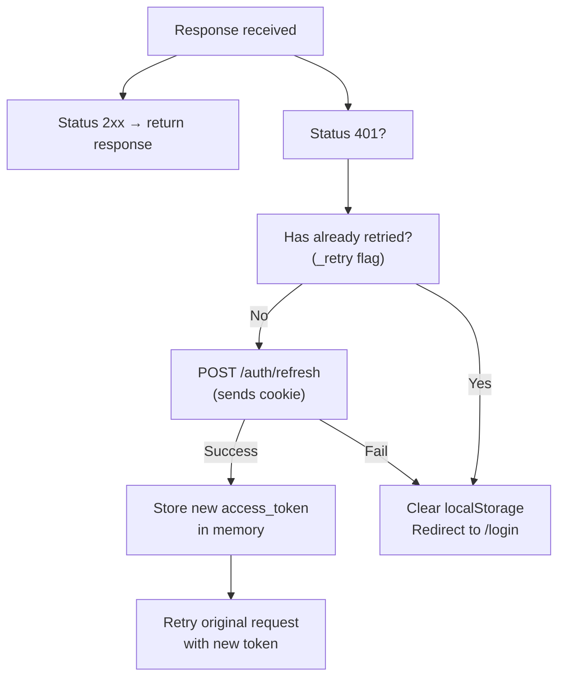

# CCure-Audit-PRO — Frontend Architecture

> Sources: `Frontend/src/App.jsx`, `Frontend/src/context/*`, `Frontend/src/api/*`, `Frontend/src/auth/*`, `Frontend/src/components/*`, `Frontend/src/modules/*`, `Frontend/src/pages/*`, `Frontend/package.json`, `Frontend/vite.config.js`.

## 1. Technology Stack

| Technology       | Version | Role                                         |
| ---------------- | ------- | -------------------------------------------- |
| React            | 18.3.1  | UI framework (functional components + hooks) |
| Vite             | 5.2.11  | Build tool + dev server                      |
| react-router-dom | 6.23.1  | Client-side routing                          |
| axios            | 1.7.2   | HTTP client with interceptors                |

> **Note:** The frontend uses **no external UI component library, no charting library, and no Tailwind CSS**. All styling is custom CSS (multiple `.css` files under `src/styles/` and `src/modules/web-scanning/styles/`). Charts and UI components are built directly with React + CSS.

## 2. Application Entry Point

```
Frontend/
├── src/
│   ├── App.jsx                    ← Route definitions + PrivateRoute wrapper
│   ├── main.jsx                   ← React root render (StrictMode)
│   ├── api/
│   │   ├── axiosInstance.js       ← HTTP client with auth interceptors
│   │   ├── authApi.js             ← /auth endpoint calls
│   │   ├── scanApi.js             ← /scan + /scans endpoint calls
│   │   ├── assetsApi.js           ← /assets endpoint calls
│   │   ├── findingsApi.js         ← /findings endpoint calls
│   │   ├── dashboardApi.js        ← /dashboard endpoint calls
│   │   ├── adminApi.js            ← /admin/* endpoint calls
│   │   └── notificationsApi.js    ← /notifications endpoint calls
│   ├── auth/
│   │   └── permissions.js         ← Client-side RBAC helpers
│   ├── context/
│   │   ├── AuthContext.jsx        ← Session state, login/logout, /auth/me
│   │   ├── ScanContext.jsx        ← In-progress scan pipeline state
│   │   └── PreferencesContext.jsx ← Theme, display defaults
│   ├── components/
│   │   ├── PrivateRoute.jsx       ← Route guard (auth + RBAC)
│   │   ├── layout/
│   │   │   ├── AppLayout.jsx      ← Main shell (sidebar nav, topbar)
│   │   │   ├── NotificationsPanel.jsx
│   │   │   ├── ProfileModal.jsx
│   │   │   ├── ChangePasswordModal.jsx
│   │   │   ├── SettingsDrawer.jsx
│   │   │   ├── HelpPanel.jsx
│   │   │   ├── ScanStepper.jsx
│   │   │   └── Modal.jsx
│   │   └── [shared UI components]
│   ├── modules/
│   │   └── web-scanning/          ← DAST scanning module (self-contained)
│   │       ├── WebScanningRoutes.jsx
│   │       ├── api/webScansApi.js
│   │       ├── hooks/useScanPolling.js
│   │       ├── pages/
│   │       │   ├── WebDashboard.jsx
│   │       │   ├── NewWebScan.jsx
│   │       │   ├── ScanList.jsx
│   │       │   ├── ScanDetail.jsx
│   │       │   ├── FindingsExplorer.jsx
│   │       │   └── AssetInventory.jsx
│   │       └── styles/web-scanning.css
│   └── pages/
│       ├── Login.jsx
│       ├── Register.jsx
│       ├── ForgotPassword.jsx
│       ├── ResetPassword.jsx
│       ├── Dashboard.jsx
│       ├── SecurityDashboard.jsx
│       ├── SecurityReports.jsx
│       ├── VulnerabilityBrowser.jsx
│       ├── ComplianceWorkspace.jsx
│       ├── AssetRegistry.jsx
│       ├── AssetDetail.jsx
│       ├── ScanHistory.jsx
│       ├── ArchivedScans.jsx
│       ├── RecycleBin.jsx
│       ├── scan/
│       │   ├── NewScan.jsx
│       │   ├── Phase1Results.jsx
│       │   ├── Phase2Results.jsx
│       │   ├── Phase3Results.jsx
│       │   ├── CredentialedScan.jsx
│       │   └── CredentialedResults.jsx
│       └── admin/
│           ├── UserManagement.jsx
│           ├── RoleManagement.jsx
│           ├── OrganizationManagement.jsx
│           ├── AuditLogs.jsx
│           ├── DeletedUsers.jsx
│           └── AMTIntegration.jsx
```

## 3. Route Definitions (`App.jsx`)

All routes are defined with `react-router-dom v6` `<Routes>` + `<Route>` elements. Protected routes are wrapped in `<PrivateRoute>`.

### Public Routes

| Path               | Component            | Notes                        |
| ------------------ | -------------------- | ---------------------------- |
| `/login`           | `Login.jsx`          |                              |
| `/register`        | `Register.jsx`       |                              |
| `/forgot-password` | `ForgotPassword.jsx` |                              |
| `/reset-password`  | `ResetPassword.jsx`  | Token from email query param |

### Protected Routes (authentication required)

All of the routes below are rendered inside the authenticated shell. The top-level `<PrivateRoute>` wrapper is the entry gate; most routes do not carry an additional permission prop in [Frontend/src/App.jsx](Frontend/src/App.jsx), so they are simply protected by authentication. The admin routes below are wrapped in additional permission checks.

| Path                                 | Component                    | Route guard          | Notes                                                 |
| ------------------------------------ | ---------------------------- | -------------------- | ----------------------------------------------------- |
| `/`                                  | `SecurityDashboard.jsx`      | auth only            | Default landing page                                  |
| `/dashboard`                         | `SecurityDashboard.jsx`      | auth only            | Alias for `/`                                         |
| `/scan`                              | `Dashboard.jsx`              | auth only            | Scan launcher dashboard                               |
| `/reports`                           | `SecurityReports.jsx`        | auth only            |                                                       |
| `/vulnerabilities`                   | `VulnerabilityBrowser.jsx`   | auth only            |                                                       |
| `/assets`                            | `AssetRegistry.jsx`          | auth only            |                                                       |
| `/assets/:id`                        | `AssetDetail.jsx`            | auth only            |                                                       |
| `/history`                           | `ScanHistory.jsx`            | auth only            | Primary scan history route                            |
| `/monitor`                           | `ScanHistory.jsx`            | auth only            | Same page, mode=monitor                               |
| `/archived`                          | `ArchivedScans.jsx`          | auth only            | Primary archived scans route                          |
| `/recycle-bin`                       | `RecycleBin.jsx`             | auth only            |                                                       |
| `/scan/new`                          | `NewScan.jsx`                | auth only            |                                                       |
| `/scan/host-discovery`               | `Phase1Results.jsx`          | auth only            | Alias for phase 1 results                             |
| `/scan/asset-discovery`              | `Phase2Results.jsx`          | auth only            | Alias for phase 2 results                             |
| `/scan/vulnerability-audit`          | `Phase3Results.jsx`          | auth only            | Alias for phase 3 results                             |
| `/scan/:scanId/phase1`               | `Phase1Results.jsx`          | auth only            | Per-scan phase 1 results                              |
| `/scan/:scanId/phase2`               | `Phase2Results.jsx`          | auth only            | Per-scan phase 2 results                              |
| `/scan/:scanId/phase3`               | `Phase3Results.jsx`          | auth only            | Per-scan phase 3 results                              |
| `/scan/active/:scanId`               | `NewScan.jsx`                | auth only            | Active scan progress view                             |
| `/scan/credentialed`                 | `CredentialedScan.jsx`       | auth only            |                                                       |
| `/scan/credentialed/results`         | `CredentialedResults.jsx`    | auth only            |                                                       |
| `/scan/:scanId/credentialed`         | `CredentialedScan.jsx`       | auth only            | Per-scan credentialed view                            |
| `/scan/:scanId/credentialed-results` | `CredentialedResults.jsx`    | auth only            |                                                       |
| `/web-scans/*`                       | `WebScanningRoutes.jsx`      | auth only            | DAST sub-routes (see below)                           |
| `/compliance`                        | `ComplianceWorkspace.jsx`    | auth only            | No route-level permission gate in the current App.jsx |
| `/admin/audit-logs`                  | `AuditLogs.jsx`              | `audit:read`         |                                                       |
| `/admin/amt`                         | `AMTIntegration.jsx`         | `assets:update`      |                                                       |
| `/admin/users`                       | `UserManagement.jsx`         | `users:read`         |                                                       |
| `/admin/users/deleted`               | `DeletedUsers.jsx`           | `users:read`         |                                                       |
| `/admin/roles`                       | `RoleManagement.jsx`         | `roles:read`         |                                                       |
| `/admin/organizations`               | `OrganizationManagement.jsx` | `organizations:read` | superadmin-only route wrapper                         |

#### Nested Web-Scan Routes

The web-scanning module is mounted under `/web-scans/*` and uses its own nested route tree in [Frontend/src/modules/web-scanning/WebScanningRoutes.jsx](Frontend/src/modules/web-scanning/WebScanningRoutes.jsx).

| Path                      | Component              | Notes                                   |
| ------------------------- | ---------------------- | --------------------------------------- |
| `/web-scans/dashboard`    | `WebDashboard.jsx`     | Summary/dashboard experience            |
| `/web-scans/list`         | `ScanList.jsx`         | Paginated scan list                     |
| `/web-scans/new`          | `NewWebScan.jsx`       | Multi-step creation wizard              |
| `/web-scans/:id`          | `ScanDetail.jsx`       | Details + live progress                 |
| `/web-scans/:id/findings` | `FindingsExplorer.jsx` | Finding explorer for a specific scan    |
| `/web-scans/:id/assets`   | `AssetInventory.jsx`   | Endpoints/assets discovered by the scan |

Any unknown web-scan path falls back to `/web-scans/dashboard`.

### Redirect Routes (legacy compatibility)

| From                  | To                          |
| --------------------- | --------------------------- |
| `/scan-history`       | `/history`                  |
| `/archived-scans`     | `/archived`                 |
| `/scan/advanced-scan` | `/scan/vulnerability-audit` |
| `*` (catch-all)       | `/`                         |

## 4. `<PrivateRoute>` Component

[Frontend/src/components/PrivateRoute.jsx](Frontend/src/components/PrivateRoute.jsx) is the central route guard. It accepts the following props:

| Prop                 | Type                          | Behavior                                             |
| -------------------- | ----------------------------- | ---------------------------------------------------- |
| _(no special prop)_  | —                             | Requires authentication only (redirects to `/login`) |
| `requiredPermission` | `{ resource, action }`        | User must have this single permission                |
| `requiredAny`        | `Array<{ resource, action }>` | User must have at least one of these permissions     |
| `requiredAll`        | `Array<{ resource, action }>` | User must have ALL of these permissions              |
| `superadminOnly`     | `boolean`                     | Only the `superadmin` role can access                |

If the permission check fails but the user is authenticated, the component redirects to one of several fallback routes rather than logging the user out. The current fallback order is `/dashboard`, `/history`, `/reports`, `/admin/users`, `/admin/audit-logs`, and finally `/login`.

Logic outline:

```jsx
const authorized =
  (!superadminOnly || isSuperAdmin(user)) &&
  (!requiredPermission || canPermission(user, requiredPermission)) &&
  (!requiredAny || canAny(user, requiredAny)) &&
  (!requiredAll || canAll(user, requiredAll));

if (!authorized) {
  return <Navigate to={fallbackPathFor(user, location.pathname)} replace />;
}
```

## 5. State Management

CCure-Audit-PRO uses React Context exclusively (no Redux/Zustand). Three top-level contexts wrap the application in `main.jsx`.

### `AuthContext` (`context/AuthContext.jsx`)

The central session state. Access token stored **in memory only** (module-level variable in `src/api/tokenStorage.js` — `let accessToken = null`). Only `activeOrgId` (for superadmin org switching) is persisted in `localStorage`. No tokens are written to `localStorage` or `sessionStorage`.

**State:**

```js
{
  user: {
    id, username, email, full_name, role, org_id,
    permissions: [{ resource, action }]
  } | null,
  loading: boolean,         // true during initial /auth/me fetch
  isAuthenticated: boolean
}
```

**Actions:**

- `login(credentials)` — calls `POST /auth/login`, stores tokens, sets `user` state
- `logout()` — calls `POST /auth/logout`, clears localStorage, resets state
- `refreshUser()` — re-fetches `GET /auth/me` and updates `user` state (used after admin changes user's role)

On mount, `AuthContext` reads `access_token` from localStorage and calls `GET /auth/me` to validate and hydrate `user`. If `/auth/me` returns 401, the token is cleared and the user is treated as unauthenticated.

### `ScanContext` (`context/ScanContext.jsx`)

Tracks the state of an in-progress network scan pipeline. Used by `NewScan.jsx`, `Phase1Results.jsx`, `Phase2Results.jsx`, `Phase3Results.jsx`, and `ScanStepper.jsx` (sidebar progress indicator).

**State:**

```js
{
  scanId: string | null,
  currentPhase: 1 | 2 | 3 | null,
  phase1Results: object | null,
  phase2Results: object | null,
  phase3Results: object | null,
  isRunning: boolean,
  pipelineMode: "basic" | "asset" | "vulnerability_audit"
}
```

**Actions:** `startScan(scanId, pipelineMode)`, `setPhaseResults(phase, results)`, `resetScan()`

### `PreferencesContext` (`context/PreferencesContext.jsx`)

User display preferences synced with `user.preferences` JSONB (persisted via `PUT /user/profile`).

**State:** `{ theme: "dark" | "light", defaultScanType, rowsPerPage, timezone }`

## 6. HTTP Client (`src/api/axiosInstance.js`)

A configured axios instance is the single outbound HTTP client. It is imported by all API modules.

**Base configuration:**

```js
const axiosInstance = axios.create({
  baseURL: import.meta.env.VITE_API_BASE_URL || "", // empty = same-origin proxy
  withCredentials: true, // required for refresh_token cookie
  headers: { "Content-Type": "application/json" },
});
```

### Request Interceptor

Applied to every outgoing request:

1. Reads `access_token` from in-memory `tokenStorage` (`getAccessToken()` — stored as a module-level variable, never in localStorage).
2. Attaches `Authorization: Bearer <token>` header.
3. Reads `activeOrgId` from `localStorage`; appends `?org_id=<activeOrgId>` as a query parameter if present (used by superadmin switching org context).

### Response Interceptor (Silent Token Refresh)

Applied to every response:



The `_retry` flag prevents infinite loops (if the retry also returns 401, the user is logged out).

#### Concurrent Request Queuing During Refresh

To handle race conditions where multiple parallel requests fail with a `401` simultaneously (e.g., during page initialization), the response interceptor implements a request queuing mechanism:

1. The first request to receive a `401` triggers `isRefreshing = true` and dispatches the `/auth/refresh` call.
2. Subsequent `401` requests are intercepted, their execution is suspended, and they are pushed into a `refreshSubscribers` callback queue.
3. Once the single refresh call successfully resolves, the new access token is stored in-memory, all queued subscribers are notified with the new token, and their original requests are retried concurrently.
4. If the refresh call fails, the queue is aborted, the user is logged out, and they are redirected to `/login`.

### Separate Refresh Client

A **second** axios instance (`refreshClient`) is used exclusively for `POST /auth/refresh`. It does **not** carry the interceptors of the main instance — this prevents recursive refresh loops.

## 7. RBAC on the Frontend (`src/auth/permissions.js`)

The frontend mirrors the backend permission model with helper functions that read the role permission set embedded in the `/auth/me` response. The current implementation uses `user.role.permissions` rather than a flat `user.permissions` array and treats `superadmin` as an unconditional bypass.

```js
export const isSuperAdmin = (user) =>
  normalizeRoleName(user?.role?.name) === "superadmin";

export const can = (user, resource, action) => {
  if (isSuperAdmin(user)) return true;

  const normalizedResource = String(resource || "")
    .trim()
    .toLowerCase();
  const key = permissionKey({ resource: normalizedResource, action });
  if (!key) return false;

  const permissionSet = getPermissionSet(user);
  return (
    permissionSet.has(key) || permissionSet.has(`${normalizedResource}:manage`)
  );
};

export const canAny = (user, permissions = []) =>
  permissions.some((permission) => canPermission(user, permission));

export const canAll = (user, permissions = []) =>
  permissions.every((permission) => canPermission(user, permission));
```

These helpers are used by [Frontend/src/components/PrivateRoute.jsx](Frontend/src/components/PrivateRoute.jsx) and by individual pages/components to hide or disable actions that the current role should not see. The backend remains the authoritative enforcement point.

## 8. Real-Time Communication

### WebSocket (Scan Progress)

The scan UI uses the native browser `WebSocket` API for live progress. The network-scan flow still uses the per-scan progress endpoint, while the web-scanning module uses a separate ticket-based socket at `/web-scans/{id}/progress`.

```js
const { ticket } = await webScansApi.getProgressTicket();
const ws = new WebSocket(webScansApi.getProgressSocketUrl(scanId, ticket));

ws.onmessage = (event) => {
  const progress = JSON.parse(event.data);
  setProgress(progress);
};
```

The ticket is obtained from `POST /auth/ticket` and appended as the `ticket` query parameter. The backend validates that ticket and sends the initial snapshot plus subsequent Redis Pub/Sub updates. If the socket fails, the UI can fall back to polling `GET /web-scans/{id}` or `GET /scans/{id}` depending on the subsystem.

### Server-Sent Events (Scan History)

`ScanHistory.jsx` uses the `EventSource` API to consume `GET /scans/events`:

```js
const es = new EventSource(`${API_URL}/scans/events?scope=active`, {
  withCredentials: true,
});
es.addEventListener("scans", (e) => {
  setScanList(JSON.parse(e.data).scans);
});
es.addEventListener("heartbeat", () => {});
es.onerror = () => {
  es.close();
  // fall back to polling GET /scans
};
```

### SSE Notifications

`AppLayout.jsx` opens `GET /notifications/stream` on login. New notification events update the unread-count badge and inject items into the `NotificationsPanel`.

## 9. AppLayout Shell (`components/layout/AppLayout.jsx`)

`AppLayout` is the persistent chrome (sidebar + topbar) that wraps every authenticated page. It is rendered by the route tree via `<Outlet />`.

**Responsibilities:**

- Renders the collapsible sidebar navigation (visibility of each item gated by permissions from `AuthContext`)
- Displays the `ScanStepper` component (active scan pipeline progress indicator) when `ScanContext.isRunning === true`
- Opens `NotificationsPanel` (slide-in drawer) and subscribes to the notifications SSE stream
- Opens `ProfileModal`, `ChangePasswordModal`, `SettingsDrawer`, `HelpPanel` modals
- Manages sidebar collapsed/expanded state (stored in `localStorage`)
- Top org-switcher dropdown (visible only to `superadmin`) sets `localStorage.activeOrgId` and re-fetches `/auth/me` context

## 10. Build Configuration

### `vite.config.js`

```js
export default defineConfig({
  plugins: [react()],
  server: {
    host: true,
    port: 3000,
    proxy: {
      "/auth": "http://localhost:8000",
      "/scan": "http://localhost:8000",
      "/scans": "http://localhost:8000",
      "/web-scans": "http://localhost:8000",
      "/reports": "http://localhost:8000",
      "/admin": "http://localhost:8000",
      "/dashboard": "http://localhost:8000",
      "/assets": "http://localhost:8000",
      "/findings": "http://localhost:8000",
      "/notifications": "http://localhost:8000",
    },
  },
});
```

The dev-server proxy forwards each API path prefix **directly** to FastAPI on `localhost:8000` — there is **no `/api` path prefix rewrite**. The SPA calls `/auth/login`, `/scan/new`, etc. directly. `VITE_API_BASE_URL` defaults to an empty string (same-origin), which makes the proxy transparent. In production, the nginx gateway performs the same direct forwarding.

### Environment Variables (Frontend)

Declared in `Frontend/.env.local` (not committed):

| Variable            | Default             | Notes                                                                                                                      |
| ------------------- | ------------------- | -------------------------------------------------------------------------------------------------------------------------- |
| `VITE_API_BASE_URL` | `""` (empty string) | Backend API base URL. Empty = same-origin (works with Vite dev proxy + nginx). Set to full URL only if running standalone. |

## 11. Key Page Components

### `NewScan.jsx` (`pages/scan/NewScan.jsx`)

Step-by-step wizard:

1. **Target entry** — CIDR/IP/range input with validation, pipeline mode selector (`basic` / `asset` / `vulnerability_audit`), intensity selectors (`discovery_intensity`, `port_scan_intensity`)
2. **Quota check** — calls `GET /scan/quota` before submission; blocks if quota exceeded
3. **Launch** — calls `POST /scan/host-discovery`; stores `scanId` in `ScanContext`; navigates to `Phase1Results.jsx`

### `Phase1/2/3Results.jsx`

Each results page:

1. Opens a WebSocket (`/scans/{id}/progress`) and displays a live progress bar
2. On completion, renders the phase results summary
3. In `automatic` pipeline mode, the backend auto-chains to the next phase; in `manual` mode, the page shows a "Run Phase 2" / "Run Phase 3" button which calls the appropriate phase endpoint
4. Updates `ScanContext` with the completed phase results for the `ScanStepper` sidebar indicator

### `NewWebScan.jsx` (`modules/web-scanning/pages/NewWebScan.jsx`)

Multi-step form:

1. Target URL + scan name
2. Scope configuration (subdomains, excluded paths, max depth)
3. Auth configuration (session cookie, HTTP basic, form-based)
4. Scan options (SQLi/XSS enable, Nuclei severity filter, rate limit)
5. **Authorization confirmation step** — user must explicitly check "I confirm I am authorized to test this target" (`authorization_confirmed: true` in the request body)
6. Launch → navigates to `ScanDetail.jsx`

### `Dashboard.jsx` / `SecurityDashboard.jsx`

Both pages call multiple `/dashboard/*` endpoints in parallel (`Promise.all`) and render Recharts chart components. `SecurityDashboard` has a more analyst-focused layout emphasising the OWASP scorecard, compliance mapping, and top-CVE table.

### `ComplianceWorkspace.jsx` (`pages/ComplianceWorkspace.jsx`)

The compliance interface is a comprehensive, standalone auditing dashboard:

1. **Framework Marketplace**: Allows installing/uninstalling security standards (e.g. ISO 27001) for the tenant.
2. **Posture Scorecards**: Visualizes compliance scores using custom CSS gauges for simple and risk-weighted percentages across four quadrants (Organizational, People, Physical, Technical).
3. **Statement of Applicability (SoA) Checklist**: Renders a complete interactive checklist of controls. Analysts can select controls to view technical check rules or record manual attestations.
4. **Exception Waiver Approvals**: Interface to submit exception waiver requests, complete with compensating control documentation and expiration dates. Compliance officers can approve or reject these waivers.
5. **Remediation script execution (Maker-Checker queue)**: Analysts can submit request tickets to execute automated remediation scripts. Admins/checkers can view the queue, inspect script contents, verify targets, and approve execution or rollback changes.
6. **Reports Download**: Provides options to download SoA or executive summaries in PDF or Word (DOCX) formats.
