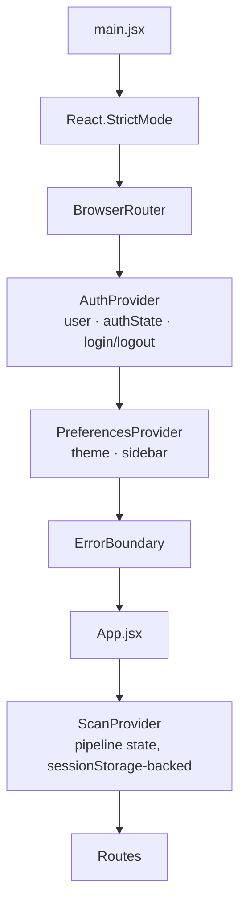
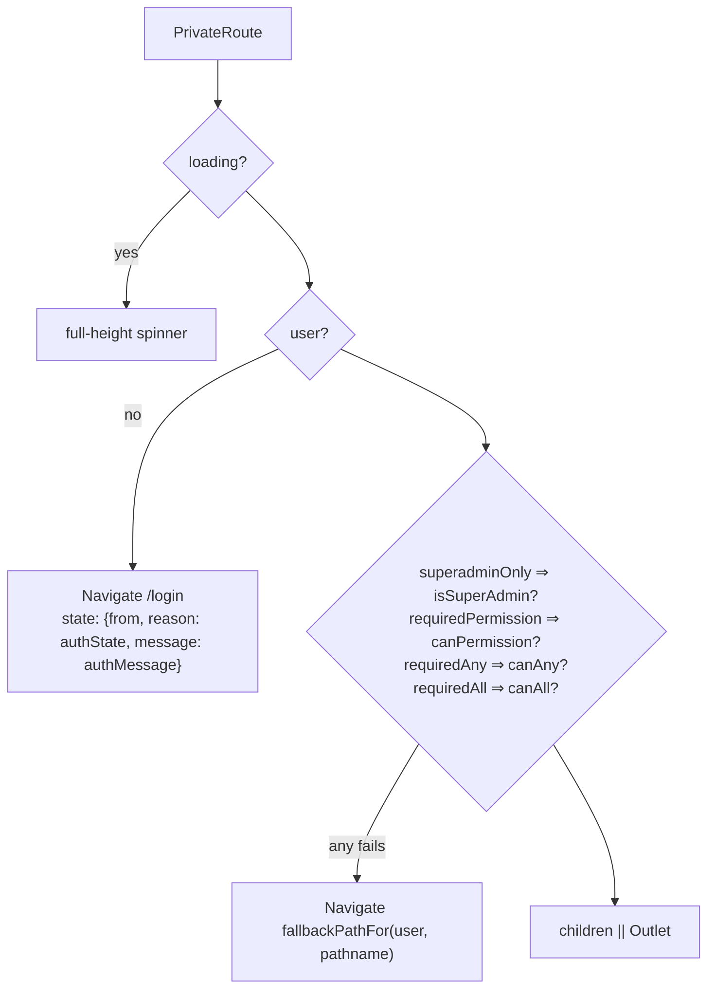

# Frontend Architecture

**CCure-Audit-PRO** — the React single-page application in `Frontend/`, traced
from `main.jsx` through routing, state, the API layer and the integration
contract with the backend.

---

## 1. Stack

| Concern           | Choice                                               | Version                        |
| ----------------- | ---------------------------------------------------- | ------------------------------ |
| UI library        | React                                                | `^18.3.1`                      |
| Router            | react-router-dom                                     | `^6.23.1`                      |
| HTTP client       | axios                                                | `^1.7.2`                       |
| Build tool        | Vite                                                 | `^5.2.11`                      |
| React plugin      | `@vitejs/plugin-react`                               | `^4.3.0`                       |
| Test runner       | Vitest + jsdom                                       | `^1.6.0` / `^24.0.0`           |
| Testing utilities | `@testing-library/react`, `/jest-dom`, `/user-event` | `^15.0.7`, `^6.4.5`, `^14.5.2` |
| Graph rendering   | vis-network + vis-data                               | `^9.1.9` / `^7.1.9`            |

`package.json` declares `"type": "module"`, name `ccure-audit-pro-unified`,
version `2.0.0`.

> **NOTE:** There is **no** TypeScript, no Redux, no React Query, no CSS framework
> and no component library. State is React Context plus browser storage; styling
> is 16 hand-written CSS files under `src/styles/` plus one module-scoped sheet.

---

## 2. Directory layout

```
Frontend/
├── index.html                 Vite entry; loads Inter from Google Fonts
├── vite.config.js             Dev server :3000, 11 proxy prefixes, Vitest config
├── jsconfig.json              @/* → src/*
├── .eslintrc.json             eslint:recommended + react + react-hooks
├── .env.local                 VITE_API_BASE_URL (git-ignored in practice)
├── Dockerfile                 node:20-slim build → nginx:stable-alpine
├── nginx.conf                 SPA history fallback
└── src/
    ├── main.jsx               Provider composition
    ├── App.jsx                All route definitions
    ├── api/                   10 modules — the entire HTTP surface
    ├── auth/permissions.js    Client-side RBAC evaluation
    ├── components/            common/ · layout/ · admin/ · scan/ · assets/ · auth/
    ├── config/scanConfig.js   Pipeline ↔ phase mapping (mirrors the backend)
    ├── context/               AuthContext · PreferencesContext · ScanContext
    ├── hooks/useDebounce.js
    ├── modules/web-scanning/  Self-contained DAST feature module
    ├── pages/                 15 top-level pages + scan/ (7) + admin/ (6)
    ├── styles/                16 stylesheets
    ├── utils/date.js
    └── __tests__/             Vitest suites
```

---

## 3. Entry point and provider composition

`src/main.jsx`:

```jsx
ReactDOM.createRoot(document.getElementById("root")).render(
  <React.StrictMode>
    <BrowserRouter>
      <AuthProvider>
        <PreferencesProvider>
          <ErrorBoundary>
            <App />
          </ErrorBoundary>
        </PreferencesProvider>
      </AuthProvider>
    </BrowserRouter>
  </React.StrictMode>,
);
```

`App.jsx` adds `<ScanProvider>` around `<Routes>`.



Ordering is load-bearing: `PreferencesProvider` calls `useAuth()` and only fetches
preferences once `isAuthenticated` is true, so it must sit inside `AuthProvider`.

> **NOTE:** `App.jsx`'s header comment states that `BrowserRouter` and
> `AuthProvider` are already in `main.jsx` and must not be re-wrapped.

Two distinct error boundaries exist. They were both named `ErrorBoundary`,
which made an import written from memory pick the wrong one silently, so they
are named for their role now:
`components/common/RootErrorBoundary.jsx` (app-level, used in `main.jsx`) and
`components/common/PanelErrorBoundary.jsx` (inline, used by `WebScanningRoutes`).

---

## 4. Routing

All routes are declared in `src/App.jsx`. Public routes sit outside the guard;
everything else is nested under `<Route element={<PrivateRoute />}>`.

### Public

| Path               | Component                  |
| ------------------ | -------------------------- |
| `/login`           | `pages/Login.jsx`          |
| `/register`        | `pages/Register.jsx`       |
| `/forgot-password` | `pages/ForgotPassword.jsx` |
| `/reset-password`  | `pages/ResetPassword.jsx`  |

### Protected — core

| Path                 | Component                    | Notes                                           |
| -------------------- | ---------------------------- | ----------------------------------------------- |
| `/` and `/dashboard` | `SecurityDashboard`          | SOC overview; the application home              |
| `/scan`              | `Dashboard`                  | Scan-template picker (moved here from `/`)      |
| `/assets`            | `AssetRegistry`              | `?tab=services` and `?tab=tls` select sub-views |
| `/assets/:id`        | `AssetDetail`                |                                                 |
| `/vulnerabilities`   | `VulnerabilityBrowser`       |                                                 |
| `/monitor`           | `ScanHistory mode="monitor"` | Active scans                                    |
| `/history`           | `ScanHistory mode="history"` | Full history                                    |
| `/scan-history`      | → redirect to `/history`     | Legacy alias                                    |
| `/archived`          | `ArchivedScans`              |                                                 |
| `/archived-scans`    | → redirect to `/archived`    | Legacy alias                                    |
| `/recycle-bin`       | `RecycleBin`                 |                                                 |
| `/reports`           | `SecurityReports`            | `?tab=executive`, `?tab=trends`                 |
| `/compliance`        | `ComplianceWorkspace`        |                                                 |
| `/topology`          | `NetworkMap`                 |                                                 |
| `*`                  | → redirect to `/`            | Catch-all                                       |

### Protected — scan pipeline

| Path                                                   | Component                                           |
| ------------------------------------------------------ | --------------------------------------------------- |
| `/scan/new`                                            | `scan/NewScan`                                      |
| `/scan/active/:scanId`                                 | `scan/NewScan`                                      |
| `/scan/host-discovery`                                 | `scan/Phase1Results`                                |
| `/scan/asset-discovery`                                | `scan/Phase2Results`                                |
| `/scan/vulnerability-audit`                            | `scan/Phase3Results`                                |
| `/scan/advanced-scan`                                  | → redirect to `/scan/vulnerability-audit`           |
| `/scan/credentialed`                                   | `scan/CredentialedScan`                             |
| `/scan/credentialed/results`                           | `scan/CredentialedResults`                          |
| `/scan/:scanId/phase1` · `/phase2` · `/phase3`         | `Phase1Results` · `Phase2Results` · `Phase3Results` |
| `/scan/:scanId/credentialed` · `/credentialed-results` | `CredentialedScan` · `CredentialedResults`          |
| `/scan/topology-map` · `/scan/:scanId/topology-map`    | `scan/NetworkMap`                                   |

### Protected — permission-gated admin

Each is wrapped in a **nested** `PrivateRoute` carrying `requiredPermission`:

| Path                   | Component                      | `requiredPermission` |
| ---------------------- | ------------------------------ | -------------------- |
| `/admin/audit-logs`    | `admin/AuditLogs`              | `audit:read`         |
| `/admin/amt`           | `admin/AMTIntegration`         | `assets:update`      |
| `/admin/users`         | `admin/UserManagement`         | `users:read`         |
| `/admin/users/deleted` | `admin/DeletedUsers`           | `users:read`         |
| `/admin/organizations` | `admin/OrganizationManagement` | `organizations:read` |
| `/admin/roles`         | `admin/RoleManagement`         | `roles:read`         |

> **IMPORTANT:** The `/admin/amt` guard uses `assets:update`, but the backend
> endpoint it drives (`POST /assets/import-amt`) requires `settings:update` — and
> the sidebar item for the same page gates on `settings:update`. A role holding
> `assets:update` without `settings:update` reaches the page and gets a 403 on
> upload. The backend is authoritative.

### Feature module

`/web-scans/*` renders `modules/web-scanning/WebScanningRoutes.jsx`, which owns its
own nested router, its own `ErrorBoundary` and its own stylesheet:

| Sub-path       | Component                 |
| -------------- | ------------------------- |
| `dashboard`    | `WebDashboard`            |
| `list`         | `ScanList`                |
| `new`          | `NewWebScan`              |
| `:id`          | `ScanDetail`              |
| `:id/findings` | `FindingsExplorer`        |
| `:id/assets`   | `AssetInventory`          |
| `*`            | → redirect to `dashboard` |

---

## 5. Route guards

`src/components/auth/PrivateRoute.jsx`:

```jsx
export default function PrivateRoute({ children, requiredPermission,
                                       requiredAny, requiredAll,
                                       superadminOnly = false }) { ... }
```



`fallbackPathFor` walks an ordered candidate list and returns the first path the
user can actually reach, excluding the one they were denied:

| Order    | Path                | Required permission |
| -------- | ------------------- | ------------------- |
| 1        | `/dashboard`        | `scans:execute`     |
| 2        | `/history`          | `scans:read`        |
| 3        | `/reports`          | `reports:read`      |
| 4        | `/admin/users`      | `users:read`        |
| 5        | `/admin/audit-logs` | `audit:read`        |
| fallback | `/login`            | —                   |

A denied user therefore lands somewhere useful rather than on a dead end or a
redirect loop.

`PrivateRoute` is covered by `src/__tests__/components/auth/PrivateRoute.test.jsx`.

---

## 6. Permission evaluation

`src/auth/permissions.js` — a faithful mirror of `auth/rbac.py`:

```javascript
const normalizeRoleName = (r = "") => String(r||"").trim().toLowerCase().replace(/\s+/g, "_");

export const isSuperAdmin = (user) => normalizeRoleName(user?.role?.name) === "superadmin";
export const isOrgAdmin  = (user) => normalizeRoleName(user?.role?.name) === "org_admin";
export const hasRole     = (user, roleName) => normalizeRoleName(user?.role?.name) === normalizeRoleName(roleName);

export const getPermissionSet = (user) =>
  new Set((user?.role?.permissions || []).map(permissionKey).filter(Boolean));

export const can = (user, resource, action) => {
  if (isSuperAdmin(user)) return true;
  const key = permissionKey({ resource, action });
  if (!key) return false;
  const set = getPermissionSet(user);
  return set.has(key) || set.has(`${resource}:manage`);
};

export const canPermission = (user, permission) => { ... };
export const canAny  = (user, permissions = []) => permissions.some(...);
export const canAll  = (user, permissions = []) => permissions.every(...);
export const denyMessage = "You do not have permission to perform this action.";
```

`permissionKey()` accepts either a `"resource:action"` string or a
`{resource, action}` object, lowercasing and trimming both parts.

Two properties worth stating:

- **Superadmin bypass** matches the backend exactly.
- **`resource:manage` wildcard** — `can()` accepts it, but no such atom is seeded
  server-side (none of the 51 uses a `manage` action). The branch is dead today,
  and would silently widen every client-side check for a resource if such an atom
  were ever added.

The permission set comes from `GET /auth/me` → `role.permissions[]`, which is the
same list `role_permissions` produced server-side.

Covered by `src/__tests__/auth/permissions.test.js`.

---

## 7. State management

Three contexts, each with a distinct persistence strategy.

| Context              | Scope                   | Persistence                                                                         | Hook               |
| -------------------- | ----------------------- | ----------------------------------------------------------------------------------- | ------------------ |
| `AuthContext`        | Session and identity    | Access token in memory; refresh in HttpOnly cookie; `activeOrgId` in `localStorage` | `useAuth()`        |
| `PreferencesContext` | Theme and layout        | Server (`/user/preferences`); `sidebarCollapsed` mirrored to `localStorage`         | `usePreferences()` |
| `ScanContext`        | In-flight scan pipeline | `sessionStorage` under 27 `cc_*` keys                                               | `useScan()`        |

### `AuthContext`

Exposes `{ user, authState, authMessage, loading, isAuthenticated, login,
register, logout, refreshUser }`.

`authState` is the state machine described in
[AUTHENTICATION_AND_AUTHORIZATION.md](AUTHENTICATION_AND_AUTHORIZATION.md) §12:
`loading` → `authenticated` | `anonymous` | `expired`.

Two background behaviours run only while `authState === "authenticated"`:

- `setInterval(refreshActiveSession, 20 * 60 * 1000)` — a proactive refresh inside
  the 30-minute access-token lifetime.
- A `visibilitychange` listener that refreshes when the tab becomes visible and
  more than 10 minutes have elapsed — the laptop-woke-from-sleep case.

`syncActiveOrgId(user)` writes `localStorage.activeOrgId`: for a superadmin it
seeds the value only if absent (so a chosen tenant survives a reload); for everyone
else it is pinned to `user.org_id`, and removed entirely when there is no user.

A `window` listener for the custom `auth:logout` event moves the context to
`expired` or `anonymous` when the axios interceptor forces a logout.

`login()` returns the raw response so a caller can detect
`data.status === "mfa_required"` and route to the MFA step **without** the context
transitioning to `authenticated`.

### `PreferencesContext`

Loads `GET /user/preferences` when authenticated. `applyTheme(theme)` sets or
removes `data-theme="dark"` on `document.documentElement`, which
`styles/dark-mode.css` keys off. `sidebar_collapsed` is mirrored into
`localStorage` as a fallback for the pre-authentication render.

### `ScanContext`

The scan pipeline's client-side state machine, persisted across page refreshes.

```javascript
export const PIPELINE_STATES = {
  IDLE,
  DISCOVERY,
  PORT_SCAN,
  VULN_SCAN,
  TOPOLOGY_MAP,
  REPORT_READY,
  COMPLETE,
  ERROR,
  CANCELLED,
  PAUSED,
};
```

Persisted `sessionStorage` keys (`SS_KEYS`, 27 entries): `cc_scanId`, `cc_scanNo`,
`cc_target`, `cc_scanType`, `cc_pipelineMode`, `cc_phase1Hosts`,
`cc_phase1Summary`, `cc_phase2Hosts`, `cc_phase2Summary`, `cc_phase2Results`,
`cc_phase3Results`, `cc_phase3Summary`, `cc_phase3AuditResults`, `cc_saveStatus`,
`cc_pipelineState`, `cc_pipelineError`, `cc_pipelinePhaseTimings`, `cc_intensity`,
`cc_osDetection`, `cc_discoveryIntensity`, `cc_portScanIntensity`,
`cc_autoRunAdvancedSingleTarget`, `cc_portScanMode`, `cc_customPorts`,
`cc_portProfile`, `cc_excludePorts`, `cc_excludeIps`.

`sessionStorage` (not `localStorage`) is the right choice here: a scan in progress
belongs to one tab, and a second tab should not inherit it. `ssGet`/`ssSet`/`ssClear`
wrap every access in `try/catch` so storage being unavailable degrades to
in-memory state rather than crashing.

`useScan()` throws if used outside `<ScanProvider>`.

### `config/scanConfig.js`

The client-side mirror of the backend's `PIPELINE_PHASES`:

| Mode                  | `phases`    | Label               | Badge                                      |
| --------------------- | ----------- | ------------------- | ------------------------------------------ |
| `basic`               | `[1]`       | Basic Network Scan  | Phase 1 Only                               |
| `asset`               | `[1, 2]`    | Asset Discovery     | Phase 1 → 2. Carries `alwaysRestart: true` |
| `vulnerability_audit` | `[1, 2, 3]` | Vulnerability Audit | Full Pipeline                              |
| `advanced`            | `[1, 2, 3]` | Vulnerability Audit | Alias of the above                         |

`PHASES` maps phase number → `{id, label, route}`: 1 Host Discovery
`/scan/host-discovery`, 2 Port Scan `/scan/asset-discovery`, 3 Vulnerability Audit
`/scan/vulnerability-audit`, 4 Network Topology `/scan/topology-map`.
Helpers: `getScanPipeline(mode)` (throws on unknown), `isPhaseEnabled(mode, phase)`,
`buildPhasePayload(...)`.

> **NOTE:** The client lists `basic` as `[1]` while the backend's `PIPELINE_PHASES`
> lists `[1, 4]`. Both are correct for their purpose: Phase 4 (topology) is an
> optional bolt-on the backend chains only when SNMP credentials are present, and
> `get_terminal_phase()` excludes it from completion logic.

---

## 8. API integration layer

Ten modules under `src/api/` plus one inside the web-scanning module. Every call
goes through `axiosInstance` (or, for SSE, `fetch` carrying the same token).

| Module                                    | Covers                                                                                                                                                                |
| ----------------------------------------- | --------------------------------------------------------------------------------------------------------------------------------------------------------------------- |
| `axiosInstance.js`                        | The shared client, both interceptors, `authSession`                                                                                                                   |
| `tokenStorage.js`                         | In-memory access-token custody                                                                                                                                        |
| `auth.js`                                 | login, verifyMfa, sendEmailOtp, enable/confirm/disableMfa, register, getCurrentUser, refreshSession, logout, checkUsername, checkEmail, forgotPassword, resetPassword |
| `admin.js`                                | Users, roles, organizations, audit logs                                                                                                                               |
| `assets.js`                               | Registry, services, certificates, coverage, reconciliation, tags, notes, AMT import                                                                                   |
| `findings.js`                             | List, grouped, detail, status, notes                                                                                                                                  |
| `dashboard.js`                            | All 12 network dashboard widgets                                                                                                                                      |
| `notifications.js`                        | List, summary, read, delete, `streamNotificationEvents`                                                                                                               |
| `scans.js`                                | History CRUD, quota, report delete, `streamScanEvents`                                                                                                                |
| `user.js`                                 | Profile, preferences, password, sessions                                                                                                                              |
| `credentialedScan.js`                     | `parseTargets`, `runCredentialedScan`                                                                                                                                 |
| `modules/web-scanning/api/webScansApi.js` | `webScansApi` + `webDashboardApi`                                                                                                                                     |

### `axiosInstance`

```javascript
const baseURL = import.meta.env.VITE_API_BASE_URL || "";
const axiosInstance = axios.create({
  baseURL, withCredentials: true,
  headers: { "Content-Type": "application/json" },
});
const refreshClient = axios.create({ baseURL, withCredentials: true, ... });
```

`refreshClient` is a **separate instance with no interceptors**, so a failing
refresh cannot recurse into the 401 handler.

**Request interceptor** — attaches `Authorization: Bearer <token>` when a token
exists, then injects `params.org_id` from `localStorage.activeOrgId` unless the
caller already set `org_id`. This is why nearly every backend endpoint accepts an
optional `org_id`.

**Response interceptor** — a single-flight 401 refresh:

```mermaid
sequenceDiagram
    participant R1 as Request A
    participant R2 as Request B
    participant I as Interceptor
    participant API

    R1->>I: 401
    I->>I: isRefreshing = true
    I->>API: POST /auth/refresh (refreshClient)
    R2->>I: 401 (concurrent)
    I->>I: subscribeTokenRefresh(cb) — B waits
    API-->>I: { access_token }
    I->>I: setAuthTokens(); notify subscribers
    I->>API: retry A with new token
    I->>API: retry B with new token
```

Bypassed URLs whose 401 is a real answer rather than expiry: `/auth/login`,
`/auth/refresh`, `/auth/register`, `/auth/forgot-password`, `/auth/reset-password`.
Requests already carrying `_retry` are not retried again.

On refresh failure: subscribers are notified with `null`, then
`forceLogout("expired")` stashes the current path in
`sessionStorage.postLoginRedirect`, clears the token and `activeOrgId`, and
dispatches the `auth:logout` custom event.

### `tokenStorage`

The access token lives in one module-scope variable — not `localStorage`, not
`sessionStorage`, not a JS-readable cookie. It does not survive a reload, which is
precisely why `AuthContext` calls `refreshSession()` on boot: the HttpOnly refresh
cookie is the durable half and JavaScript never sees it.

### API call style

Two conventions coexist and are worth recognising when reading a page:

```javascript
// api/dashboard.js, api/user.js, api/notifications.js — unwrap in the module
export const getProfile = () =>
  axiosInstance.get("/user/profile").then((r) => r.data);

// api/scans.js, api/assets.js, api/findings.js — return the axios response
export const getScan = (id) => api.get(`/scans/${id}`);
```

---

## 9. Real-time integration

Three mechanisms, matching the three the backend exposes.

### SSE — scan history

`api/scans.js::streamScanEvents({ scope, skip, limit, interval, created_by,
search, status, signal, onEvent })`.

The browser's native `EventSource` cannot set an `Authorization` header, and the
backend gates `/scans/events` on `require_permission("scans","read")` — so the
client uses `fetch()` with `Accept: text/event-stream`, `credentials: "include"`,
an `AbortSignal`, and a manual `ReadableStream` reader:

```javascript
const reader = response.body.getReader();
const decoder = new TextDecoder();
let buffer = "";
while (!signal?.aborted) {
  const { value, done } = await reader.read();
  if (done) break;
  buffer += decoder.decode(value, { stream: true });
  const messages = buffer.split(/\r?\n\r?\n/);
  buffer = messages.pop() || "";
  messages
    .filter(Boolean)
    .map(parseSseMessage)
    .forEach((p) => onEvent?.(p));
}
```

`parseSseMessage` splits `event:` and `data:` lines and `JSON.parse`s the joined
data. Consumer: `pages/ScanHistory.jsx`.

### SSE — notifications

`api/notifications.js::streamNotificationEvents({ signal, onEvent })` — identical
mechanism against `/notifications/stream`. Consumer:
`components/layout/AppLayout.jsx`, which drives the notification bell badge.

### WebSocket — scan progress

Four consumers open `WS /scans/{id}/progress` or `WS /web-scans/{id}/progress`:

| File                                           | Purpose                                           |
| ---------------------------------------------- | ------------------------------------------------- |
| `pages/scan/NewScan.jsx`                       | Live Phase 1/2 progress during a running pipeline |
| `pages/scan/Phase3Results.jsx`                 | Live Phase 3 progress (`buildScanProgressUrl`)    |
| `pages/scan/CredentialedResults.jsx`           | Live credentialed-audit progress                  |
| `modules/web-scanning/hooks/useScanPolling.js` | Live DAST phase progress                          |

Each first calls `POST /auth/ticket`, then appends `?ticket=<jwt>` to the socket
URL. `useScanPolling(scanId, intervalMs = 5000)` combines a WebSocket with a
polling fallback, tracking `liveStatus` (`connecting` / connected / …),
`liveEvents`, a reconnect timer and a terminal-state flag so polling stops once
the scan finishes.

---

## 10. Layout and shared components

### `AppLayout`

`components/layout/AppLayout.jsx` is the authenticated shell: sidebar, header,
notification stream, profile dropdown and modals.

`SIDEBAR_SECTIONS` is a five-section declarative model filtered per user by
`canSeeNavItem(user, item)` — `item.permission` must pass `canPermission`, and
`item.requiredAny` must pass `canAny`. Two items carry live badges:
**Active Scans** (`badgeKey: "runningScans"`, info) and **Vulnerabilities**
(`badgeKey: "criticalCount"`, danger).

| Section        | Items and gates                                                                                                                                                                                       |
| -------------- | ----------------------------------------------------------------------------------------------------------------------------------------------------------------------------------------------------- |
| Overview       | Security Dashboard `dashboard:read` · Executive Report `reports:read`                                                                                                                                 |
| Scanning       | Scan Templates `scans:execute` · Active Scans `scans:read` · Scan History `scans:read` · Archived Scans _any of_ `scans:restore`/`scans:recycle` · Recycle Bin _any of_ `scans:restore`/`scans:purge` |
| Intelligence   | Vulnerabilities `findings:read` · Asset Registry `assets:read` · Services & Ports `assets:read` · TLS / Certificates `assets:read` · Network Topology `scans:read`                                    |
| Reports        | Security Reports `reports:read` · Compliance `reports:read` · Risk Trends `reports:read`                                                                                                              |
| Administration | User Management `users:read` · Deleted Users `users:read` · Organizations `organizations:read` · Roles & Permissions `roles:read` · AMT Integration `settings:update` · Audit Logs `audit:read`       |

> **IMPORTANT:** The Compliance nav item is gated on `reports:read`, but every
> `/compliance/*` backend endpoint requires `compliance:read`. A role holding one
> without the other sees a link that 403s.

`AppLayout` also special-cases superadmins (`isSuperAdmin(user)`) for the
organization switcher that writes `localStorage.activeOrgId`.

### Component inventory

| Directory            | Components                                                                                                                      |
| -------------------- | ------------------------------------------------------------------------------------------------------------------------------- |
| `components/common/` | `Button`, `CVELink`, `ConfirmDialog`, `EmptyState`, `ErrorBoundary`, `FormField`, `Loader`, `RoleSelector`, `Skeleton`, `Toast` |
| `components/layout/` | `AppLayout`, `ChangePasswordModal`, `HelpPanel`, `Modal`, `NotificationsPanel`, `ProfileModal`, `ScanStepper`, `SettingsDrawer` |
| `components/admin/`  | `AuditLogDetailsModal`, `OrganizationForm`, `UserForm`, `UserTable`                                                             |
| `components/scan/`   | `ExportPanel`, `RiskBadge`, `ScanQuotaBar`                                                                                      |
| `components/assets/` | `AuditTimeline`                                                                                                                 |
| `components/auth/`   | `AuthHeroPanel`, `AuthIcons`, `AuthTrustFooter`                                                                                 |
| `components/` (root) | `ErrorBoundary`, `PrivateRoute`                                                                                                 |

`Skeleton` and `Loader` are the two loading primitives; `EmptyState` covers the
no-data case; `Toast` and `ConfirmDialog` cover feedback and destructive
confirmation.

---

## 11. Pages

| Group                         | Pages                                                                                                                 |
| ----------------------------- | --------------------------------------------------------------------------------------------------------------------- |
| Auth                          | `Login`, `Register`, `ForgotPassword`, `ResetPassword`                                                                |
| Dashboards                    | `SecurityDashboard`, `Dashboard` (scan launcher)                                                                      |
| Inventory                     | `AssetRegistry`, `AssetDetail`, `VulnerabilityBrowser`                                                                |
| Scan lifecycle                | `ScanHistory`, `ArchivedScans`, `RecycleBin`                                                                          |
| Reporting                     | `SecurityReports`, `ComplianceWorkspace`                                                                              |
| `pages/scan/`                 | `NewScan`, `Phase1Results`, `Phase2Results`, `Phase3Results`, `CredentialedScan`, `CredentialedResults`, `NetworkMap` |
| `pages/admin/`                | `UserManagement`, `DeletedUsers`, `OrganizationManagement`, `RoleManagement`, `AuditLogs`, `AMTIntegration`           |
| `modules/web-scanning/pages/` | `WebDashboard`, `ScanList`, `NewWebScan`, `ScanDetail`, `FindingsExplorer`, `AssetInventory`                          |

`NetworkMap` renders the `/topology/map` graph with **vis-network**, consuming the
`{nodes, edges}` payload directly — the backend emits vis-network-compatible
shapes specifically so no translation layer is needed.

---

## 12. Error handling and loading states

| Layer               | Mechanism                                                                                                                                                                  |
| ------------------- | -------------------------------------------------------------------------------------------------------------------------------------------------------------------------- |
| Render errors       | `ErrorBoundary` at the app root and again inside `WebScanningRoutes`                                                                                                       |
| HTTP 401            | Axios interceptor: single-flight refresh, then forced logout                                                                                                               |
| Other HTTP errors   | Handled per page; the backend's `{success, error_code, message, request_id}` envelope means `error.response.data.message` is always populated                              |
| Auth loading        | `PrivateRoute` renders a full-height spinner while `authState === "loading"`                                                                                               |
| Data loading        | `Loader` and `Skeleton` per page                                                                                                                                           |
| Empty results       | `EmptyState`                                                                                                                                                               |
| Destructive actions | `ConfirmDialog`                                                                                                                                                            |
| Transient feedback  | `Toast`                                                                                                                                                                    |
| Session expiry      | `authState = "expired"` with the message _"Your session expired. Please sign in again."_, and `sessionStorage.postLoginRedirect` restores the intended page after re-login |

---

## 13. Build and runtime configuration

### Environment variables

| Variable            | Used by            | Effect                                                                                                              |
| ------------------- | ------------------ | ------------------------------------------------------------------------------------------------------------------- |
| `VITE_API_BASE_URL` | `axiosInstance.js` | API base URL. **Empty string means same-origin**, which is what makes the Vite dev proxy and the nginx gateway work |

`Frontend/.env.local` sets it for local dev. `docker-compose.yml` passes it both as
a **build arg** and an environment variable, defaulting to `/api`.

> **CAUTION:** Vite inlines `import.meta.env.*` at build time. Changing
> `VITE_API_BASE_URL` requires `docker compose build frontend`; restarting the
> container has no effect.

### Vite dev server

`vite.config.js`: `host: true`, `port: 3000`, and eleven proxy prefixes to
`http://localhost:8000` — `/auth`, `/scan`, `/scans`, `/web-scans`, `/reports`,
`/admin`, `/dashboard`, `/assets`, `/findings`, `/notifications`, `/topology`.

> **NOTE:** `/user`, `/compliance` and `/api` are **not** proxied. Profile,
> preferences, session, compliance and NVD-admin calls therefore need
> `VITE_API_BASE_URL` pointed at the backend explicitly during local development,
> or those requests hit the Vite server and 404.

Test configuration lives in the same file: `globals: true`, `environment: "jsdom"`,
`setupFiles: ["./src/__tests__/setupTests.js"]`.

### Scripts

| Command           | Effect                                          |
| ----------------- | ----------------------------------------------- |
| `npm run dev`     | Vite dev server on `:3000` with the proxy above |
| `npm run build`   | Production bundle into `dist/`                  |
| `npm run preview` | Serve the built bundle locally                  |
| `npm test`        | `vitest run`                                    |

There is **no `lint` script** in `package.json`, although `.eslintrc.json` exists
and both pre-commit and CI invoke ESLint. CI's `npm run lint` step is written as
`npm run lint || echo "Lint warnings found"`, so the missing script does not fail
the build.

### Container build

```dockerfile
FROM node:20-slim AS build
COPY package*.json ./ && RUN npm install
COPY . . && ARG VITE_API_BASE_URL=/api && RUN npm run build

FROM nginx:stable-alpine AS runtime
COPY --from=build /app/dist /usr/share/nginx/html
COPY nginx.conf /etc/nginx/conf.d/default.conf
```

`nginx.conf` provides the SPA history fallback so a deep link like
`/scan/:id/phase2` reloads correctly.

---

## 14. Tests

| File                                              | Covers                                                           |
| ------------------------------------------------- | ---------------------------------------------------------------- |
| `__tests__/auth/permissions.test.js`              | `can`, `canAny`, `canAll`, superadmin bypass, role normalisation |
| `__tests__/components/auth/PrivateRoute.test.jsx` | Loading, redirect, permission gating, fallback selection         |
| `__tests__/pages/scan/NewScan.test.jsx`           | Scan launch form and pipeline wiring                             |
| `__tests__/pages/scan/NetworkMap.test.jsx`        | Topology graph rendering                                         |
| `__tests__/setupTests.js`                         | `@testing-library/jest-dom` matchers                             |

Run with `npm test` (`vitest run`).

---

## 15. Backend integration summary

Every frontend API call maps to a registered route, with **one exception**:

| Frontend call                                           | Backend                                                                                        |
| ------------------------------------------------------- | ---------------------------------------------------------------------------------------------- |
| `webScansApi.deleteScan(id)` → `DELETE /web-scans/{id}` | **Not implemented** — `/web-scans/{scan_id}` is registered for `GET` only, so this returns 405 |

Backend routes with no frontend consumer: `/scan/host`, `/scan/range`,
`/scan/subnet`, `/scan/subnets`, `/scan/phases` (the SPA drives the
phase-selective endpoints instead), `/api/workflow-example`, and
`/assets/debug-reconcile`.

Contract points where the two sides must stay aligned:

| Contract              | Frontend                                        | Backend                                                            |
| --------------------- | ----------------------------------------------- | ------------------------------------------------------------------ |
| Login field name      | `{email, password}`                             | `LoginRequest.email`                                               |
| Permission list shape | `role.permissions[] = [{resource, action}]`     | `/auth/me` `RoleOut.permissions`                                   |
| Tenant selector       | `params.org_id` from `localStorage.activeOrgId` | `_resolve_org(user, requested_org)` — honoured for superadmin only |
| Pipeline modes        | `SCAN_PIPELINES` keys                           | `PIPELINE_PHASES` keys + the `advanced` alias                      |
| Discovery intensity   | `cc_discoveryIntensity` → `discovery_intensity` | `light` \| `normal` \| `deep`, asset pipeline only                 |
| Report formats        | `fmt=JSON` / `XML` / `CSV`                      | `_FORMAT_ALIASES`; unknown values now 400                          |
| Topology graph        | vis-network `{nodes, edges}`                    | `get_topology_graph()` emits exactly that                          |
| WebSocket auth        | `?ticket=` from `POST /auth/ticket`             | `_get_websocket_user`, 60-second `type="ticket"` JWT               |
| SSE auth              | `fetch` + `Authorization` header                | `require_permission` / `get_current_user`                          |

---

## 16. Related documents

- [SYSTEM_ARCHITECTURE.md](SYSTEM_ARCHITECTURE.md)
- [BACKEND_API_REFERENCE.md](BACKEND_API_REFERENCE.md)
- [AUTHENTICATION_AND_AUTHORIZATION.md](AUTHENTICATION_AND_AUTHORIZATION.md)
- [RBAC_Management_Permissions.md](RBAC_Management_Permissions.md)
- [DEVELOPER_SETUP_GUIDE.md](DEVELOPER_SETUP_GUIDE.md)
