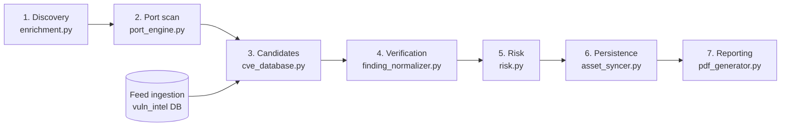

# CCure-Audit-PRO — Pipeline Data Integrity Audit

> Sources verified directly from code: `Backend/core/discovery/enrichment.py`, `Backend/engines/port/port_engine.py`, `Backend/core/nmap/wrapper.py`, `Backend/core/models.py`, `Backend/core/utils.py`, `Backend/core/cve_database.py`, `Backend/core/vuln_intel.py`, `Backend/engines/vulnerability/`, `Backend/scans/finding_normalizer.py`, `Backend/core/risk.py`, `Backend/scans/asset_syncer.py`, `Backend/scans/nvd_sync.py`, `Backend/orchestrator/scan_orchestrator.py`, `Backend/pdf_generator.py`.

## Why this document exists

Defects in this pipeline were historically found and fixed at the point where they became _visible_ —
usually the report, because that is where a human reads the output. A fix applied there corrects the
symptom without establishing that the stage which produced the bad data is now correct. The same
wrong value keeps being produced; a later stage just stops displaying it.

This audit walks the pipeline in execution order and, for each stage, records four things:

| Question                 | What a passing answer looks like                                                         |
| ------------------------ | ---------------------------------------------------------------------------------------- |
| **Purpose**              | One responsibility, stated in a sentence. If it takes two, the module is doing two jobs. |
| **Guarantees**           | What a consumer may rely on without re-checking.                                         |
| **Assumptions consumed** | What it takes on trust from upstream — each one is a defect waiting to happen.           |
| **Verified how**         | The test that keeps the guarantee true.                                                  |

**The rule this audit applies:** a stage may not require its consumers to compensate for it. If a
downstream module has to re-parse, re-derive, or second-guess what it was handed, the contract is
wrong, not the consumer.

Findings are rated by what they cost: a **silent false negative** (a real vulnerability never
reported — the worst outcome, because the output looks clean), a **silent false positive** (a
non-issue persisted as fact), or a **contract leak** (the stage works but forces downstream
compensation).

## Pipeline at a glance

---

## Stage 1 — Discovery enrichment (`core/discovery/enrichment.py`)

**Purpose:** identify live hosts and collect identity signals (hostname, MAC, NetBIOS, mDNS, OS
hints). It had acquired two further jobs: registering open ports, and attaching CVE candidates.

| Finding                                                                                                                                                                                                       | Type                  | Status                                                                                             |
| ------------------------------------------------------------------------------------------------------------------------------------------------------------------------------------------------------------- | --------------------- | -------------------------------------------------------------------------------------------------- |
| **D1** — `enrich_host` called `lookup_cve()` and extended `result["cves"]`. Discovery has no version evidence and cannot verify anything, yet on a discovery-only scan those candidates reached the registry. | Silent false positive | **Fixed.** Candidate generation removed; discovery reports observations only.                      |
| **D2** — ports registered with placeholder `product`/`version` from a cheap connect-and-read, which then blocked the real fingerprint (see P1).                                                               | Contract leak         | **Fixed.** Records are labelled `fingerprint_source="connect_probe"` and are outranked by Stage 2. |

**Guarantee now:** every port record states how strongly it is evidenced, and discovery asserts
nothing it did not observe.

---

## Stage 2 — Port scan (`engines/port/port_engine.py`, `core/models.py`)

**Purpose:** determine which ports are open and identify the service behind each one. This stage is
the origin of every fact verification later depends on — the highest-leverage stage in the pipeline.

| Finding                                                                                                                                                                                                                                                                          | Type                      | Status                                                                                                                       |
| -------------------------------------------------------------------------------------------------------------------------------------------------------------------------------------------------------------------------------------------------------------------------------- | ------------------------- | ---------------------------------------------------------------------------------------------------------------------------- |
| **P1** — first writer wins: `_apply_nmap_ports` skipped any port already on the host, so a discovery-registered port (137, 139, 161, 445, 502, 5353, OT ports) permanently blocked Nmap's product, version and CPE. Verification then had no version and withheld every finding. | **Silent false negative** | **Fixed.** `_record_port` merges by evidence rank; identification comes from the better-evidenced observation, either order. |
| **P2** — `full_version` concatenated product + version + extra into one string, stored as `version`; every consumer re-extracted a version from prose by regex.                                                                                                                  | Contract leak             | **Fixed.** `product`, `version`, `extra` stay discrete; `version_precision` is recorded where the measurement happens.       |
| **P3** — `NmapPortResult.cpe` (the scanner's own product identity) was never copied onto the port record, forcing downstream product matching to tokenise banner text.                                                                                                           | Contract leak             | **Fixed.** CPEs are carried on `PortResult.cpe` and consumed by Stages 3 and 4.                                              |
| **P4** — the port scanner ran `lookup_cve()` per port and attached candidates, which the vulnerability phase then generated again.                                                                                                                                               | Contract leak             | **Fixed.** Removed; this engine identifies services and does not assess them.                                                |

**Guarantee now:** _every open port carries either an exact version or an explicit statement of what
the version pins down, plus the scanner's CPE where one exists, and later, better evidence always
replaces earlier, weaker evidence._ Held by `tests/test_pipeline_contracts.py`.

---

## Stage 3 — Candidate generation (`core/cve_database.py`, `core/vuln_intel.py`, `plugins/cve_engine.py`)

**Purpose:** given an identified service, return the CVEs that could apply, for verification to narrow.

| Finding                                                                                                                              | Type                      | Status                                                                                                                               |
| ------------------------------------------------------------------------------------------------------------------------------------ | ------------------------- | ------------------------------------------------------------------------------------------------------------------------------------ |
| **C1** — selection matched `LIKE '%term%'` against vendor and product, so `ssh` matched openssh, libssh, libssh2 and dropbear alike. | Contract leak             | **Fixed.** Where the scanner supplied CPEs, selection is `LOWER(cpe.product) = …`; banner-token matching remains only as a fallback. |
| **C2** — the 200-row cap, ordered by KEV → EPSS → CVSS, could truncate the applicable CVE before verification ever saw it.           | **Silent false negative** | **Fixed.** Exact-identity selection returns only that product's CVEs, under a 2000-row cap; name matching keeps the tight 200 cap.   |
| **C3** — truncation was invisible.                                                                                                   | Silent false negative     | **Fixed.** Reaching the cap logs a warning and marks every returned record `enumeration_truncated`.                                  |
| **C4** — three lookups per port (banner, version string, service name) plus the port-scan set, deduplicated afterwards.              | Contract leak             | **Fixed.** One lookup per service on the strongest available key; each candidate is bound to the port it came from.                  |

**Vendor is deliberately not part of the selection key.** Nmap still identifies nginx as
`igor_sysoev` where NVD reassigned it to `f5`; requiring both to agree would drop every nginx CVE.
Product names come from the same CPE dictionary on both sides and survive vendor reassignment.

---

## Stage 4 — Verification (`scans/finding_normalizer.py`)

**Purpose:** decide which candidates the observed evidence supports.

Runs inside the vulnerability phase (not at report time), so host records carry verified findings
from the moment they leave the engine, with withheld candidates retained and explained. Previously
fixed here: evaluation stopped at the first non-matching CPE entry (ruling records out on feed
ordering alone), and active-probe findings classified as unverifiable because they carry no CPE data.

Now consuming the Stage 2 contract:

- product identity is decided by **comparing CPEs** before interpreting banner text; a missing
  identity match falls through to token matching rather than being read as a disproof, so the
  identifier can only ever add matches;
- version precision recorded at measurement is preferred over re-deriving it from the string.

---

## Stage 5 — Risk scoring (`core/risk.py`)

**Purpose:** rank hosts by exposure. Scores from verified severity counts rather than a per-record
`cvss_score` field that active-check findings never carried, and floors the risk _level_ at the worst
verified finding — the score ranks hosts, the level classifies one.

---

## Stage 6 — Persistence (`scans/asset_syncer.py`)

| Finding                                                                                                            | Type             | Status                                                                                                                                        |
| ------------------------------------------------------------------------------------------------------------------ | ---------------- | --------------------------------------------------------------------------------------------------------------------------------------------- |
| **S1** — `get_cve_details` was called once per (host, finding), an N+1 pattern.                                    | Performance      | **Fixed.** Memoised per sync; a CVE present on several hosts is fetched once.                                                                 |
| **S2** — per-candidate suppression is not persisted, so a report _rebuilt later_ from the database cannot list it. | Known limitation | **Accepted deliberately.** Counts are recorded on the phase summary; the alternative is ~1870 rows per host per scan. Revisit as a JSON blob. |

Findings already persisted from before verification moved are closed automatically on the next scan
of that asset, since the syncer closes findings not seen in the current scan.

---

## Stage 7 — Reporting (`pdf_generator.py`, `csv_generator.py`)

Sound, and no longer load-bearing for correctness: it re-verifies whatever it is handed, which keeps
pre-verification payloads and credentialed audits working, but it is not where filtering happens.
Table headers rendered dark-on-navy (Paragraph cells ignore a `TEXTCOLOR` table command) — fixed,
with a contrast test.

---

## Stage 8 — Credentialed pipeline (`core/tasks.py`, `engines/credentialed/`)

**Purpose:** audit a host over an authenticated session and match installed package versions against
published ranges. It never runs the vulnerability engine, so it did not benefit from scan-time
verification.

| Finding                                                                                                                                                                                                                                      | Type                      | Status                                                                                                         |
| -------------------------------------------------------------------------------------------------------------------------------------------------------------------------------------------------------------------------------------------- | ------------------------- | -------------------------------------------------------------------------------------------------------------- |
| **X1** — findings were only filtered when the PDF was rendered, after the severity summary, the asset sync and the dashboard counts had been computed from the unfiltered list.                                                              | Silent false positive     | **Fixed.** `verify_credentialed_report()` runs where the audit produces its findings; the same implementation. |
| **X2** — a package finding on a host that also has listening services fell through to the network matching path, where a package not exposed on any port looks like a product the host does not run. Every version-matched finding was lost. | **Silent false negative** | **Fixed.** Credentialed records are tagged as package findings during reshaping, so the package path is used.  |

---

## Cross-cutting — suppression reasons (`scans/finding_normalizer.py`)

**F1** — the withheld reason was inferred from which fields happened to be populated: a finding that
carried a detected version was reported as "the version falls outside the vulnerable range" even when
it had actually been ruled out because the product was never found on the host. **Fixed:**
`classify_detection` now returns the basis for its verdict (`version_outside_range`,
`product_absent`, `platform_mismatch`) and the reason states what the check actually decided.

---

## Stage 9 — Dashboard counters (`scans/db_helpers.py`)

**F2** — the denormalized `critical/high/medium/low` counts on the scan row were tallied from each
record's raw `severity` string, which is whatever the feed said. The report recomputes severity from
the published vector, so the two disagreed for any record whose feed rating differs from its vector,
and records carrying a vector but no severity string counted as nothing at all. **Fixed:** counters
read the verified severity breakdown, falling back to the old tally for payloads that predate it.

---

## Feed ingestion (`scans/nvd_sync.py`, the `vuln_intel` database)

Two stores exist, and they are not the same one:

- Candidate selection and the report's feed-age line read the **`cve` / `cpe` tables** in
  `vuln_intel`. Nothing in this repository creates or populates them — they are loaded externally, so
  the CPE ranges every verdict depends on come from outside the application.
- `sync_nvd_to_vuln_intel` (the admin "NVD sync") writes **`vulnerability_definitions`**, used for
  catalogue enrichment of already-persisted findings.
- The shape it writes (`CpeMatch.model_dump()`: `cpe23_uri`, snake*case bounds, `vulnerable`) \_is*
  understood by verification, so records arriving that way are verifiable.

**Partly addressed.** `get_nvd_sync_status()` now reports both stores — the catalogue count it writes
_and_ the scanner feed's CVE count and last-modified date — so drift is visible instead of assumed
away. Previously an operator could run a sync, watch the count rise, and conclude the scanner's data
had been refreshed when it had not.

**Still open, and a decision rather than a defect:** which store is canonical, and whether the other
should derive from it. That determines whether the external loader stays in the picture, so it is not
something to settle by patching.

---

## Reviewed, no defect found

- `core/device_classifier.py` — single responsibility (device category from OT probe, credentialed OS,
  port profile and OUI signals). Does not consume CVE data, so verification does not change it.
- `core/asset_correlation.py` — passes `cves`, risk score and risk level through to the asset record
  unchanged; it derives nothing of its own, so it inherits verified data automatically.

## Still not audited

- `core/compliance_*` and the web-scanning module (`web_pdf_generator.py`,
  `modules/web-scanning/`), which is a separate pipeline with its own scanner and report path.

---

## Stage 10 — Compliance (`core/compliance_evidence.py`, `core/compliance_tasks.py`)

**Purpose:** translate scan results into normalized evidence, and evaluate framework rules against it.

| Finding                                                                                                                                                                                                                                                                                 | Type                  | Status                                                                                                                        |
| --------------------------------------------------------------------------------------------------------------------------------------------------------------------------------------------------------------------------------------------------------------------------------------- | --------------------- | ----------------------------------------------------------------------------------------------------------------------------- |
| **K1** — the evidence adapter counted **every** `AssetVulnerability` row for an asset, including ones the syncer had closed as `fixed` and ones an approver had formally `accepted`. A host that had remediated every critical still failed "no critical vulnerabilities", permanently. | Silent false positive | **Fixed.** Only `status == "open"` findings are evidence of a current condition.                                              |
| **K2** — severity was read from the catalogue row (the feed's label for the CVE in general) rather than from the finding recorded for that host (recomputed from the published vector). The two disagree often enough to flip a control's verdict.                                      | Contract leak         | **Fixed.** The finding's own severity and score are preferred, with the catalogue as fallback.                                |
| **K3** — an evidence source with no adapter returned `{}`. Every key then looked absent, and an absent key evaluated to **fail** — so an unsupported or not-yet-collected source reported the asset as non-compliant rather than unassessed.                                            | Silent false positive | **Fixed.** Unavailable evidence is marked as such and recorded as `manual_review` with the reason, never as a failed control. |

The mirror of the credentialed fix: an unassessed host is not a clean host, and an unassessed control
is not a failed one. Both directions produce findings nobody can act on.

---

## Stage 11 — Web scanning (`core/web/`)

**Purpose:** DAST assessment of web targets, feeding the same asset registry, dashboards and
compliance evidence as the network scans.

| Finding                                                                                                                                                                                                                                            | Type                  | Status                                                                                                                      |
| -------------------------------------------------------------------------------------------------------------------------------------------------------------------------------------------------------------------------------------------------- | --------------------- | --------------------------------------------------------------------------------------------------------------------------- |
| **W1** — `_CVSS_APPROX` manufactured a CVSS score from the severity label when a nuclei template published none (`high` → 7.5). That invented number flowed into risk aggregation, the API and compliance evidence as though it had been measured. | Silent false positive | **Fixed.** No score is substituted; `cvss_score` stays `None` and `cvss_scored` records whether a real score was published. |

The template's **severity** is a genuine rating and is kept. Only the fabricated score is gone. This
brings the web pipeline in line with the network report's stated contract — "no score is estimated or
substituted" — which it was the only module violating.

---

## Stage 12 — Credentialed version matching (`engines/credentialed/vuln_matcher.py`)

Found by running a live credentialed audit against a real Windows 11 host (193 packages).

**V1 — the version parser silently discarded components it could not read**, and this produced both
failure modes at once on the same host:

| Installed string               | Old parse | Result                                                                                                |
| ------------------------------ | --------- | ----------------------------------------------------------------------------------------------------- |
| `ad 9.0.14` (AnyDesk)          | `(0, 14)` | Below every fixed release → **10 false findings**, 3 of them Critical, against a patched 9.x install. |
| `V2.12 Sp0 Upd0` (Siemens UMC) | `(12,)`   | 12 > 2.15 → **8 real findings missed**, including a Critical RCE.                                     |
| `""` (no version registered)   | `(0,)`    | Below every fixed release → every CVE for that product would match.                                   |

Windows `DisplayVersion` values carry vendor prose, Siemens ships service-pack notation, and some
products register no version at all. Splitting on separators and dropping whatever failed `int()`
turned all three into confidently comparable, wrong numbers.

**Fixed at source.** The parser reads the dotted numeric run from wherever it sits in the string and
returns an **empty tuple** when there is none; every comparison returns False on an unreadable
version, so no ordering is asserted in either direction. A finding now requires a version that could
actually be read. Live re-run: the 10 AnyDesk false positives are gone and the 8 Siemens UMC findings
are correctly reported against fixed versions 2.15.1.1–2.15.2.1.

This is the credentialed counterpart of the network side's CPE-vendor problem, and like that one it
was only visible against real inventory data.

---

## Stage 13 — Credentialed package identity (`engines/credentialed/package_identity.py`)

The coverage half of the credentialed audit, developed against a live Windows inventory of 193
packages. A host calls its software "Google Chrome"; NVD indexes it as `google:chrome`. Nothing
matches until those two naming schemes are reconciled, and both directions of getting it wrong were
observed on the same host.

| Finding                                                                                                                                                                                                                                                           | Type                      | Status                                                                                                                                                                                                                        |
| ----------------------------------------------------------------------------------------------------------------------------------------------------------------------------------------------------------------------------------------------------------------- | ------------------------- | ----------------------------------------------------------------------------------------------------------------------------------------------------------------------------------------------------------------------------- |
| **P5** — matching loose name fragments against product **OR vendor**. "Google Chrome" hit nothing, so a host running Chrome 138 showed no Chrome CVEs; meanwhile a vendor hit attached every CVE that vendor ever published to one package.                       | Both directions           | **Fixed.** Candidates are proposed from display name + publisher and validated against the CPE dictionary.                                                                                                                    |
| **P6** — the registry query already selected `Publisher` and the collector discarded it — the vendor half of every CPE identity, thrown away at capture.                                                                                                          | Contract leak             | **Fixed.** Captured as `vendor` on each package.                                                                                                                                                                              |
| **P7** — resolution alone is not enough: an installer carries the installer's version. "MySQL Installer 1.6.12" resolved to `oracle:mysql` and matched server CVEs fixed in 5.6; "Visual Studio Build Tools 18.7.4" matched a CPE numbered by year.               | Silent false positive     | **Fixed.** An identity is dropped when the installed version is outside the product's published version space (5th–95th percentile of bound majors — min/max was tried first and one stray `1.0` bound on mysql defeated it). |
| **P8** — the CPE query capped results at 5,000 rows **across all products**, ordered by exploitation likelihood. Chrome alone has ~35,000 rows, so eight real Siemens findings were silently truncated away by a browser that happened to be installed alongside. | **Silent false negative** | **Fixed.** Rows are allocated per identity via `ROW_NUMBER() PARTITION BY (vendor, product)`, and reaching the cap is logged with the products affected.                                                                      |
| **P9** — two matching paths, chosen by package count: ≥50 packages used batch matching, fewer used per-package matching with different logic. Which findings appeared depended on how much software the host had installed.                                       | Contract leak             | **Fixed.** One path, which is also two queries instead of N.                                                                                                                                                                  |

**Live result on the same host, through the fixes:** 10 findings, all false (AnyDesk) → 8 findings,
all real but incomplete → **20 findings across 4 products** (Chrome 138, Siemens UMC V2.12, TIA
Administrator V3.0, Nmap 7.95), with truncation now reported rather than silent.

### Stage 13 follow-up — both stated limits resolved

The two limitations recorded above were re-examined and neither was acceptable: both were
false-negative risks, and both had a real fix rather than a mitigation.

**Row cap (P8 residual).** The cap was a symptom of fetching rows that could never match. Of Chrome's
35,391 CPE rows, **29,833 pin one exact release** — a pinned row applies only when the installed
version _is_ that release. Those are now excluded in SQL (`split_part(cpe_uri, ':', 6) = :installed`),
leaving ~5,600 rows for the largest product. With the noise gone the cap was raised to 25,000, sized
against the real dictionary, so it is a safety valve rather than a silent filter — and reaching it is
still logged with the product named.

**Version-space guard.** The percentile trim was doing two unrelated jobs, and the second one was
wrong: it rejected software that was merely old, which is what an audit exists to find. The two
problems now use the signal that actually identifies each:

- a **companion package** — installer, updater, redistributable — is identified by its _name_, before
  any version is compared. "MySQL Installer" is not MySQL whatever its version says.
- a **different numbering scheme** — 18.7.4 against year-based CPE versions — is identified by the
  version space, which can now use the full published range because companions no longer reach it.

**Verified against the same host.** Chrome findings rose 8 → 790 → **1,736** as each truncation was
removed. An independent query over the CPE table returns exactly 1,736 distinct Chrome CVEs with an
upper bound above major 138, and 3,603 with bounds at or below it that are correctly not reported.
The matcher and the database agree exactly.

> **Consequence worth planning for.** Correct output for a browser twelve major versions behind is
> ~1,700 findings for one package. That is accurate, not noisy matching — but a finding list is the
> wrong shape for it. The executive remediation plan already groups by upgrade target and collapses
> these into a single action ("upgrade Google Chrome to 150.0.7871.47"); the technical finding list
> does not. Consolidating per (package, fixed version) in the finding list is a reporting decision,
> not a correctness one, and is the natural next step.

---

## Stage 14 — Presenting findings that one upgrade resolves (`pdf_generator.py`)

Correct matching produced ~1,700 findings for one browser on a real host. The matching was right; the
presentation was not, and the consequence was more than cosmetic.

| Finding                                                                                                                                                                                                                                                                                                                     | Type                       | Status                                                                  |
| --------------------------------------------------------------------------------------------------------------------------------------------------------------------------------------------------------------------------------------------------------------------------------------------------------------------------- | -------------------------- | ----------------------------------------------------------------------- |
| **R1** — one card per CVE. The technical report renders at most `MAX_DETAIL_CARDS` (400) finding cards, so a browser twelve versions behind consumed the entire budget and **an ICS component carrying a Critical never appeared in the document**. The reader also could not see that the whole host needed four upgrades. | **Misleading by omission** | **Fixed.** Findings a single upgrade resolves are rendered as one card. |

Grouping is keyed on the **upgrade target**, not the fixed version: an administrator performs one
upgrade, and keying on the version produced 76 Chrome cards for what is a single action. The group
carries the highest boundary any of its findings requires — the same rule the executive remediation
plan already applied, so the two documents cannot disagree about how much work there is.

The card states what a reader needs to prioritise the action: the number of CVEs it clears, the worst
severity, the severity spread, anything known-exploited, and the highest exploitation probability
with the CVE that carries it. Groups below three findings render individually — two CVEs read better
as two entries than as a group of two.

**This is presentation only.** The per-CVE findings remain the record: they are still counted in the
host index and severity distribution, still written to the database individually, still tracked for
KEV and per-finding remediation status. A test asserts that regrouping returns exactly the same set
of findings.

**Verified on the live credentialed audit of a real host:** 1,747 findings → **5 cards**, the Siemens
Critical second in the document rather than past the cut, and the technical report down from 785 KB
to 101 KB.
