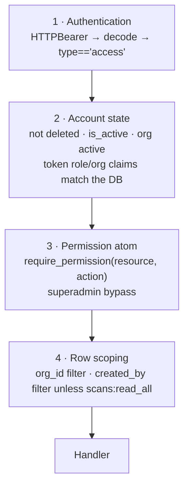

# RBAC, Roles and Permissions

**CCure-Audit-PRO** — the complete authorization model, derived from
`Backend/db/migrate_production_schema.py` (definitions and grants),
`Backend/auth/rbac.py` (enforcement), every `require_permission(...)` call site,
and `Frontend/src/auth/permissions.js` (client-side mirror).

---

## 1. Verified counts

| Metric                                            | Verified value | Source                                                  |
| ------------------------------------------------- | -------------- | ------------------------------------------------------- |
| Permission atoms defined                          | **51**         | `PERMISSIONS` list in `db/migrate_production_schema.py` |
| Resources                                         | **12**         | Distinct first element of each atom                     |
| System roles                                      | **5**          | `SYSTEM_ROLES` list                                     |
| Permission atoms actually enforced by an endpoint | **44**         | Every distinct `require_permission()` argument pair     |
| Atoms defined but never enforced                  | **7**          | See §6                                                  |

> **IMPORTANT:** Earlier revisions of this document reported **46** permissions,
> and the regeneration brief anticipated **40**. Both figures are wrong against
> the current tree. The implemented count is **51**, confirmed by parsing the
> `PERMISSIONS` list directly:
>
> ```
> scans 10 · assets 5 · findings 3 · reports 3 · users 4 · credentials 3
> settings 2 · dashboard 1 · roles 4 · organizations 4 · audit 3 · compliance 11
> = 53
> ```
>
> The source code is authoritative. Any figure other than 51 in any document,
> comment or UI string is stale.

### Grants per role

| Role         | Atoms granted | How                                                                    |
| ------------ | ------------- | ---------------------------------------------------------------------- |
| `superadmin` | **51** (all)  | `ROLE_PERMISSIONS["superadmin"] = "*"` — every seeded atom is inserted |
| `org_admin`  | **44**        | Explicit list                                                          |
| `analyst`    | **22**        | Explicit list                                                          |
| `viewer`     | **8**         | Explicit list                                                          |
| `scanner`    | **4**         | Explicit list                                                          |

Every atom in every explicit list resolves to a defined `(resource, action)`
pair — there are no dangling grants.

---

## 2. Roles

`SYSTEM_ROLES` in `db/migrate_production_schema.py`. All five are seeded with
`is_system_role = True` and are created idempotently on every application start
(`seed_rbac` in the lifespan hook).

| Role         | Seeded description                                                                | Intended use                                                                                              |
| ------------ | --------------------------------------------------------------------------------- | --------------------------------------------------------------------------------------------------------- |
| `superadmin` | Full platform access — not bound to any specific organization.                    | Platform operator. Bypasses `require_permission` entirely and may cross tenant boundaries with `?org_id=` |
| `org_admin`  | Full access within their Organization: manage users, assets, scans, and reports.  | Tenant administrator                                                                                      |
| `analyst`    | Can run scans, view all results within their org, and generate reports.           | Day-to-day security analyst. **Default role for self-registration**                                       |
| `viewer`     | Read-only access: view dashboards and existing scan history. Cannot run scans.    | Auditor, stakeholder                                                                                      |
| `scanner`    | API service account: can submit scan jobs and read back results programmatically. | Machine integration                                                                                       |

Two behaviours make role handling asymmetric:

- **Superadmin bypass.** `require_permission()._guard` returns immediately when
  `role.name.lower() == "superadmin"`, before any `role_permissions` query. The
  same short-circuit exists client-side in `permissions.js::can`.
- **No role at all.** A user whose `role` relationship is `None` gets HTTP 403
  with _"Your account does not have a role assigned."_ `users.role_id` is
  `nullable=False` with `ON DELETE RESTRICT`, so this is defence in depth rather
  than a reachable state.

---

## 3. The 51 permission atoms

Each row is one `(resource, action, description)` tuple, in source order. The
"Enforced at" column lists every route that consumes the atom via
`Depends(require_permission(resource, action))`.

### `scans` — 10 atoms

| Atom                     | Seeded description                                     | Enforced at                                                                                                                                                                                                              |
| ------------------------ | ------------------------------------------------------ | ------------------------------------------------------------------------------------------------------------------------------------------------------------------------------------------------------------------------ |
| `scans:create`           | Create and start new scan sessions                     | _(granted; no endpoint consumes it — see §6)_                                                                                                                                                                            |
| `scans:read`             | View your own scan history and results                 | `GET /scan/quota`, `GET /scan/progress/{scan_id}`, `GET /scans`, `GET /scans/events`, `GET /scans/{scan_id}`, `GET /topology/map`, `GET /topology/map/{scan_id}`; WebSocket ticket check                                 |
| `scans:read_all`         | View all scan history within the organization          | Not a dependency — evaluated in code by `_user_can_read_all_scans` (`scans/router.py`) and `_can_read_all_org_scans` (`routers/reports.py`) to widen row visibility beyond `created_by == self`                          |
| `scans:update`           | Modify scan configuration                              | _(granted; no endpoint consumes it)_                                                                                                                                                                                     |
| `scans:archive`          | Move scans to the archived area                        | `POST /scans/{scan_id}/archive`                                                                                                                                                                                          |
| `scans:restore`          | Restore archived or recycled scans                     | `POST /scans/{scan_id}/restore`                                                                                                                                                                                          |
| `scans:recycle`          | Move scans to the recycle bin                          | `DELETE /scans/{scan_id}`                                                                                                                                                                                                |
| `scans:purge`            | Permanently delete recycled scans                      | `DELETE /scans/{scan_id}/purge`                                                                                                                                                                                          |
| `scans:execute`          | Trigger scan execution via API                         | `POST /scan/host-discovery`, `/scan/asset-discovery`, `/scan/vulnerability-audit`, `/scan/phases`, `/scan/host`, `/scan/range`, `/scan/subnet`, `/scan/subnets`, `POST /scan/credentialed`, `POST /scans/{scan_id}/stop` |
| `scans:cancel`           | Cancel an in-progress scan                             | _(granted; `POST /scans/{scan_id}/stop` uses `scans:execute` instead)_                                                                                                                                                   |
| `scan_schedules:create`  | Create scheduled and recurring scans                   | `POST /scan-schedules`                                                                                                                                                                                                   |
| `scan_schedules:read`    | View scan schedules and their run history              | `GET /scan-schedules`, `/scan-schedules/{schedule_id}`, `/scan-schedules/{schedule_id}/runs`, `/scan-schedules/timezones`                                                                                                |
| `scan_schedules:update`  | Edit, enable or disable scan schedules                 | `PATCH /scan-schedules/{schedule_id}`, `POST /scan-schedules/{schedule_id}/enable`                                                                                                                                       |
| `scan_schedules:delete`  | Delete scan schedules                                  | `DELETE /scan-schedules/{schedule_id}`                                                                                                                                                                                   |
| `scan_schedules:execute` | Trigger a scheduled scan immediately (Run Now)         | `POST /scan-schedules/{schedule_id}/run-now`                                                                                                                                                                             |
| `credentials:create`     | Store scan credentials (SSH and Windows)               | `POST /credentials`                                                                                                                                                                                                      |
| `credentials:read`       | List credential profiles — never the secrets           | `GET /credentials`, `/credentials/{credential_id}`, `/credentials/types`                                                                                                                                                 |
| `credentials:update`     | Edit stored credential profiles                        | `PATCH /credentials/{credential_id}`                                                                                                                                                                                     |
| `credentials:validate`   | Authenticate a stored credential against a target host | `POST /credentials/{credential_id}/validate`                                                                                                                                                                             |
| `credentials:delete`     | Remove stored credential profiles                      | `DELETE /credentials/{credential_id}`                                                                                                                                                                                    |

> **NOTE:** `scans:read_all` is real and load-bearing even though it never appears
> as a route dependency. Without it, `GET /scans` adds
> `Scan.created_by == user.id` to the query, and requesting another user's scans
> returns 403. It is what separates "my scans" from "the organization's scans".

### `assets` — 5 atoms

| Atom            | Seeded description                   | Enforced at                                                                                                                                                                                                                                                        |
| --------------- | ------------------------------------ | ------------------------------------------------------------------------------------------------------------------------------------------------------------------------------------------------------------------------------------------------------------------ |
| `assets:create` | Manually add assets to the registry  | _(granted; no endpoint consumes it)_                                                                                                                                                                                                                               |
| `assets:read`   | View asset inventory and details     | `GET /assets`, `/assets/debug-reconcile`, `/assets/certificates`, `/assets/services`, `/assets/services/assets`, `/assets/coverage-stats`, `/assets/reconciliation/drilldown`, `/assets/{asset_id}`, `/assets/{asset_id}/services`, `/assets/{asset_id}/changelog` |
| `assets:update` | Edit asset metadata, tags, and notes | `PATCH /assets/{asset_id}`, `POST /assets/{asset_id}/tags`, `DELETE /assets/{asset_id}/tags/{tag}`, `POST /assets/{asset_id}/notes`; frontend route `/admin/amt`                                                                                                   |
| `assets:delete` | Remove assets from the registry      | _(granted; no endpoint consumes it)_                                                                                                                                                                                                                               |
| `assets:export` | Export asset list to CSV/JSON        | _(granted; export is served through `/assets/reconciliation/drilldown?export=true`, gated on `assets:read`)_                                                                                                                                                       |

### `findings` — 3 atoms

| Atom              | Seeded description                                  | Enforced at                                                                                                            |
| ----------------- | --------------------------------------------------- | ---------------------------------------------------------------------------------------------------------------------- |
| `findings:read`   | View vulnerability findings                         | `GET /findings`, `GET /findings/grouped/by-component`, `GET /findings/{finding_id}`, `GET /assets/{asset_id}/findings` |
| `findings:update` | Update finding status (accept, suppress, remediate) | `PATCH /findings/{finding_id}/status`, `PATCH /findings/{finding_id}/notes`                                            |
| `findings:export` | Export findings to CSV/JSON/PDF                     | _(granted; CSV/PDF export runs through `/reports/download/{scan_id}`, gated on `reports:read`)_                        |

### `reports` — 3 atoms

| Atom             | Seeded description        | Enforced at                                                                                                                                                                       |
| ---------------- | ------------------------- | --------------------------------------------------------------------------------------------------------------------------------------------------------------------------------- |
| `reports:create` | Generate reports          | _(granted; generation happens automatically at scan completion)_                                                                                                                  |
| `reports:read`   | View and download reports | `GET /reports/download/{scan_id}` — via `_require_reports_read`, a manual `role_permissions` query rather than the dependency, because the route uses `get_current_user_flexible` |
| `reports:delete` | Delete generated reports  | `DELETE /reports/{scan_id}` — via `_require_reports_delete`                                                                                                                       |

### `users` — 4 atoms

| Atom           | Seeded description                 | Enforced at                                                                                                                                   |
| -------------- | ---------------------------------- | --------------------------------------------------------------------------------------------------------------------------------------------- |
| `users:create` | Invite and create user accounts    | `POST /admin/users`                                                                                                                           |
| `users:read`   | List and view user accounts        | `GET /admin/users`                                                                                                                            |
| `users:update` | Edit user details and roles        | `PUT /admin/users/{user_id}`, `PATCH .../role`, `PATCH .../status`, `PATCH .../organization`, `POST .../reset-password`, `POST .../reset-mfa` |
| `users:delete` | Deactivate or delete user accounts | `DELETE /admin/users/{user_id}`, `POST /admin/users/{user_id}/restore`, `DELETE /admin/users/{user_id}/purge`                                 |

### `credentials` — 3 atoms

| Atom                 | Seeded description                                | Enforced at                                                                              |
| -------------------- | ------------------------------------------------- | ---------------------------------------------------------------------------------------- |
| `credentials:create` | Store scan credentials                            | _(granted; the compliance credential routes use `compliance:manage_integrations`)_       |
| `credentials:read`   | List stored credential profiles (not the secrets) | _(granted; `GET /compliance/credentials` uses `compliance:read`)_                        |
| `credentials:delete` | Remove stored credential profiles                 | _(granted; `DELETE /compliance/credentials/{id}` uses `compliance:manage_integrations`)_ |

> **CAUTION:** The `credentials:*` family predates the compliance credential
> store and is currently vestigial. Credential management is governed by
> `compliance:read` and `compliance:manage_integrations`. Granting
> `credentials:*` to a role therefore confers nothing.

### `settings` — 2 atoms

| Atom              | Seeded description                             | Enforced at                                                                   |
| ----------------- | ---------------------------------------------- | ----------------------------------------------------------------------------- |
| `settings:read`   | View organization settings                     | _(granted; no endpoint consumes it)_                                          |
| `settings:update` | Change organization settings and feature flags | `POST /assets/import-amt`; frontend nav item and route guard for `/admin/amt` |

### `dashboard` — 1 atom

| Atom             | Seeded description                    | Enforced at                     |
| ---------------- | ------------------------------------- | ------------------------------- |
| `dashboard:read` | View the security analytics dashboard | All 15 `/dashboard/*` endpoints |

Added by migration `f7g8h9i0j1k2`.

### `roles` — 4 atoms

| Atom           | Seeded description                | Enforced at                                                  |
| -------------- | --------------------------------- | ------------------------------------------------------------ |
| `roles:read`   | View system roles and permissions | `GET /admin/roles`, `GET /admin/roles/{role_id}/permissions` |
| `roles:create` | Create custom roles               | **Never** — no endpoint exists                               |
| `roles:update` | Modify role permissions           | **Never** — no endpoint exists                               |
| `roles:delete` | Delete custom roles               | **Never** — no endpoint exists                               |

> **IMPORTANT:** `routers/admin_rbac.py` is read-only. Custom roles cannot be
> created, modified or deleted through the API in the current implementation. The
> five system roles and their grants come from `seed_rbac()`, which runs on every
> application start. `users.role_id` also carries `ON DELETE RESTRICT`, so a role
> in use could not be deleted even if an endpoint existed.

### `organizations` — 4 atoms

| Atom                   | Seeded description           | Enforced at                                                                                                     |
| ---------------------- | ---------------------------- | --------------------------------------------------------------------------------------------------------------- |
| `organizations:read`   | View organizations           | `GET /admin/organizations`                                                                                      |
| `organizations:create` | Create new organizations     | `POST /admin/organizations`                                                                                     |
| `organizations:update` | Update organization settings | `PUT /admin/organizations/{org_id}`, `PATCH /admin/organizations/{org_id}/status`                               |
| `organizations:delete` | Delete organizations         | **Atom not consulted** — `DELETE /admin/organizations/{org_id}` enforces superadmin in the handler body instead |

> **NOTE:** `DELETE /admin/organizations/{org_id}` is the single admin route whose
> dependency is `Depends(get_current_user)` rather than
> `Depends(require_permission(...))`. It is **not unguarded**: the handler opens
> with `if _role_name(current_user) != "superadmin": raise HTTPException(403, ...)`,
> and then refuses to delete the caller's own organization or the last remaining
> one. The effective access level matches the grant. What differs is the
> _mechanism_ — the `organizations:delete` atom is never read, so revoking it from
> superadmin would have no effect, and the route is invisible to any audit that
> enumerates `require_permission` call sites. Deleting an organization cascades to
> its users, assets, scans, web scans, audit logs, refresh sessions, AMT records
> and network links, so aligning it with the rest of the router is worth doing.

### `audit` — 3 atoms

| Atom           | Seeded description                 | Enforced at                                                           |
| -------------- | ---------------------------------- | --------------------------------------------------------------------- |
| `audit:read`   | View the immutable audit log       | `GET /admin/audit-logs`; frontend route guard for `/admin/audit-logs` |
| `audit:export` | Export the audit log as CSV or PDF | `GET /admin/audit-logs/export`                                        |
| `audit:purge`  | Preview audit-log retention        | seeded for completeness; the route uses `require_role("superadmin")`  |

`audit:purge` is seeded but **granted to no role explicitly** — superadmin
reaches it through `*`. `GET /admin/audit-logs/retention/preview` guards with
`require_role("superadmin")` rather than the permission, because a purge is not
tenant-scoped in effect and a permission check cannot express that: superadmin
holds every permission, so any permission an org_admin also held would let them
through. **No endpoint deletes an audit row** — execution is the beat schedule
or `scripts/audit/purge_audit_retention.py --apply`, so it needs host access
as well as the role.

`audit:export` is separate from `audit:read` on purpose: taking a copy of the
trail off the platform is a different act from reading it on screen, and it is
audited as one (`audit.log_exported`, severity HIGH). It is a **permission**
rather than a superadmin role check because the export is tenant-scoped — the
opposite of `/admin/email-domains`, whose rules are platform-wide.

### `compliance` — 11 atoms

| Atom                             | Seeded description                                      | Enforced at                                                                                                                                                                                          |
| -------------------------------- | ------------------------------------------------------- | ---------------------------------------------------------------------------------------------------------------------------------------------------------------------------------------------------- |
| `compliance:read`                | View compliance dashboards and findings                 | `GET /compliance/marketplace`, `/policies`, `/policies/{id}/rules`, `/findings`, `/summary`, `/gap-analysis`, `/credentials`, `/remediations/requests`, and all 13 `/compliance/reports/*` endpoints |
| `compliance:scan`                | Trigger manual compliance scans                         | `POST /compliance/scans`                                                                                                                                                                             |
| `compliance:manage_schedules`    | Manage recurring compliance scan schedules              | _(granted; schedules are managed by `compliance.run_scheduled_scans` and direct rows — no endpoint consumes the atom)_                                                                               |
| `compliance:attest`              | Record manual control attestation and evidence          | `POST /compliance/controls/{control_id}/attest`, `POST /compliance/findings/{id}/exception`                                                                                                          |
| `compliance:remediate`           | Apply remediation scripts and status updates            | `POST /compliance/findings/{id}/remediate`, `POST /compliance/remediations/requests/{id}/cancel`, `POST /compliance/remediations/requests/{id}/rollback`                                             |
| `compliance:manage_rules`        | Create and edit compliance policies and rules           | `PUT /compliance/rules/{id}`, `POST /compliance/policies`                                                                                                                                            |
| `compliance:manage_frameworks`   | Install and configure compliance frameworks             | `POST /compliance/marketplace/{framework_id}/install`, `POST /compliance/marketplace/{framework_id}/uninstall`                                                                                       |
| `compliance:manage_retention`    | Configure compliance evidence retention policies        | _(granted; no endpoint consumes it)_                                                                                                                                                                 |
| `compliance:manage_integrations` | Configure compliance notifications and integrations     | `POST /compliance/credentials`, `DELETE /compliance/credentials/{id}`                                                                                                                                |
| `compliance:approve_exception`   | Approve or reject compliance exception waivers          | `PATCH /compliance/exceptions/{id}`, `POST /compliance/remediations/requests/{id}/approve`                                                                                                           |
| `compliance:export_report`       | Export Statement of Applicability and executive reports | _(granted; the report endpoints use `compliance:read`)_                                                                                                                                              |

> **IMPORTANT:** `compliance:approve_exception` also gates remediation approval.
> That is the maker–checker separation: a user with `compliance:remediate` can
> _request_ a remediation but cannot approve their own request unless they also
> hold `compliance:approve_exception`. `analyst` holds `remediate` but not
> `approve_exception`; `org_admin` holds both.

---

## 4. Permission matrix

`✔` granted · `—` not granted. Superadmin holds all 51 by definition
(`ROLE_PERMISSIONS["superadmin"] = "*"`).

| Atom                             |                   superadmin                   |                                                         org_admin                                                         | analyst | viewer | scanner |
| -------------------------------- | :--------------------------------------------: | :-----------------------------------------------------------------------------------------------------------------------: | :-----: | :----: | :-----: |
| `scans:create`                   |                       ✔                       |                                                            ✔                                                             |   ✔    |   —    |   ✔    |
| `scans:read`                     |                       ✔                       |                                                            ✔                                                             |   ✔    |   ✔   |   ✔    |
| `scans:read_all`                 |                       ✔                       |                                                            ✔                                                             |   ✔    |   ✔   |    —    |
| `scans:update`                   |                       ✔                       |                                                            ✔                                                             |    —    |   —    |    —    |
| `scans:archive`                  |                       ✔                       |                                                            ✔                                                             |    —    |   —    |    —    |
| `scans:restore`                  |                       ✔                       |                                                            ✔                                                             |    —    |   —    |    —    |
| `scans:recycle`                  |                       ✔                       |                                                            ✔                                                             |    —    |   —    |    —    |
| `scans:purge`                    |                       ✔                       |                                                            ✔                                                             |    —    |   —    |    —    |
| `scans:execute`                  |                       ✔                       |                                                            ✔                                                             |   ✔    |   —    |   ✔    |
| `scans:cancel`                   |                       ✔                       |                                                            ✔                                                             |   ✔    |   —    |    —    |
| `scan_schedules:create`          |                       ✔                       |                                                            ✔                                                             |   ✔    |   —    |    —    |
| `scan_schedules:read`            |                       ✔                       |                                                            ✔                                                             |   ✔    |   ✔   |    —    |
| `scan_schedules:update`          |                       ✔                       |                                                            ✔                                                             |   ✔    |   —    |    —    |
| `scan_schedules:delete`          |                       ✔                       |                                                            ✔                                                             |    —    |   —    |    —    |
| `scan_schedules:execute`         |                       ✔                       |                                                            ✔                                                             |   ✔    |   —    |    —    |
| `scan_schedules:create`          |      Create scheduled and recurring scans      |                                                  `POST /scan-schedules`                                                   |
| `scan_schedules:read`            |   View scan schedules and their run history    | `GET /scan-schedules`, `/scan-schedules/{schedule_id}`, `/scan-schedules/{schedule_id}/runs`, `/scan-schedules/timezones` |
| `scan_schedules:update`          |     Edit, enable or disable scan schedules     |                    `PATCH /scan-schedules/{schedule_id}`, `POST /scan-schedules/{schedule_id}/enable`                     |
| `scan_schedules:delete`          |             Delete scan schedules              |                                          `DELETE /scan-schedules/{schedule_id}`                                           |
| `scan_schedules:execute`         | Trigger a scheduled scan immediately (Run Now) |                                       `POST /scan-schedules/{schedule_id}/run-now`                                        |
| `assets:create`                  |                       ✔                       |                                                            ✔                                                             |    —    |   —    |    —    |
| `assets:read`                    |                       ✔                       |                                                            ✔                                                             |   ✔    |   ✔   |    —    |
| `assets:update`                  |                       ✔                       |                                                            ✔                                                             |   ✔    |   —    |    —    |
| `assets:delete`                  |                       ✔                       |                                                            ✔                                                             |    —    |   —    |    —    |
| `assets:export`                  |                       ✔                       |                                                            ✔                                                             |   ✔    |   —    |    —    |
| `findings:read`                  |                       ✔                       |                                                            ✔                                                             |   ✔    |   ✔   |    —    |
| `findings:update`                |                       ✔                       |                                                            ✔                                                             |   ✔    |   —    |    —    |
| `findings:export`                |                       ✔                       |                                                            ✔                                                             |   ✔    |   —    |    —    |
| `reports:create`                 |                       ✔                       |                                                            ✔                                                             |   ✔    |   —    |    —    |
| `reports:read`                   |                       ✔                       |                                                            ✔                                                             |   ✔    |   ✔   |    —    |
| `reports:delete`                 |                       ✔                       |                                                            ✔                                                             |    —    |   —    |    —    |
| `users:create`                   |                       ✔                       |                                                            ✔                                                             |    —    |   —    |    —    |
| `users:read`                     |                       ✔                       |                                                            ✔                                                             |    —    |   —    |    —    |
| `users:update`                   |                       ✔                       |                                                            ✔                                                             |    —    |   —    |    —    |
| `users:delete`                   |                       ✔                       |                                                            ✔                                                             |    —    |   —    |    —    |
| `credentials:create`             |                       ✔                       |                                                            ✔                                                             |    —    |   —    |    —    |
| `credentials:read`               |                       ✔                       |                                                            ✔                                                             |   ✔    |   —    |   ✔    |
| `credentials:delete`             |                       ✔                       |                                                            ✔                                                             |    —    |   —    |    —    |
| `settings:read`                  |                       ✔                       |                                                            ✔                                                             |   ✔    |   ✔   |    —    |
| `settings:update`                |                       ✔                       |                                                            ✔                                                             |    —    |   —    |    —    |
| `dashboard:read`                 |                       ✔                       |                                                            ✔                                                             |   ✔    |   ✔   |    —    |
| `roles:read`                     |                       ✔                       |                                                            ✔                                                             |    —    |   —    |    —    |
| `roles:create`                   |                       ✔                       |                                                             —                                                             |    —    |   —    |    —    |
| `roles:update`                   |                       ✔                       |                                                             —                                                             |    —    |   —    |    —    |
| `roles:delete`                   |                       ✔                       |                                                             —                                                             |    —    |   —    |    —    |
| `organizations:read`             |                       ✔                       |                                                             —                                                             |    —    |   —    |    —    |
| `organizations:create`           |                       ✔                       |                                                             —                                                             |    —    |   —    |    —    |
| `organizations:update`           |                       ✔                       |                                                             —                                                             |    —    |   —    |    —    |
| `organizations:delete`           |                       ✔                       |                                                             —                                                             |    —    |   —    |    —    |
| `audit:read`                     |                       ✔                       |                                                            ✔                                                             |    —    |   —    |    —    |
| `audit:export`                   |                       ✔                       |                                                            ✔                                                             |    —    |   —    |    —    |
| `compliance:read`                |                       ✔                       |                                                            ✔                                                             |   ✔    |   ✔   |    —    |
| `compliance:scan`                |                       ✔                       |                                                            ✔                                                             |   ✔    |   —    |    —    |
| `compliance:manage_schedules`    |                       ✔                       |                                                            ✔                                                             |   ✔    |   —    |    —    |
| `compliance:attest`              |                       ✔                       |                                                            ✔                                                             |   ✔    |   —    |    —    |
| `compliance:remediate`           |                       ✔                       |                                                            ✔                                                             |   ✔    |   —    |    —    |
| `compliance:manage_rules`        |                       ✔                       |                                                            ✔                                                             |    —    |   —    |    —    |
| `compliance:manage_frameworks`   |                       ✔                       |                                                            ✔                                                             |    —    |   —    |    —    |
| `compliance:manage_retention`    |                       ✔                       |                                                            ✔                                                             |    —    |   —    |    —    |
| `compliance:manage_integrations` |                       ✔                       |                                                            ✔                                                             |    —    |   —    |    —    |
| `compliance:approve_exception`   |                       ✔                       |                                                            ✔                                                             |    —    |   —    |    —    |
| `compliance:export_report`       |                       ✔                       |                                                            ✔                                                             |   ✔    |   —    |    —    |
| **Total**                        |                     **51**                     |                                                          **44**                                                           | **22**  | **8**  |  **4**  |

The seven atoms `org_admin` lacks are exactly the four `organizations:*` and the
three mutating `roles:*` — the platform-level controls that must stay with the
superadmin.

---

## 5. Capability matrix by workflow

Derived by intersecting the grants above with the enforcement points in §3.

| Capability                                | superadmin | org_admin | analyst | viewer | scanner |
| ----------------------------------------- | :--------: | :-------: | :-----: | :----: | :-----: |
| Launch a network scan                     |     ✔     |    ✔     |   ✔    |   —    |   ✔    |
| Launch a credentialed scan                |     ✔     |    ✔     |   ✔    |   —    |   ✔    |
| Stop a running scan                       |     ✔     |    ✔     |   ✔    |   —    |   ✔    |
| See the whole org's scans                 |     ✔     |    ✔     |   ✔    |   ✔   |    —    |
| See only own scans                        |     —      |     —     |    —    |   —    |   ✔    |
| Archive / recycle / restore / purge scans |     ✔     |    ✔     |    —    |   —    |    —    |
| View asset registry                       |     ✔     |    ✔     |   ✔    |   ✔   |    —    |
| Edit asset tags and notes                 |     ✔     |    ✔     |   ✔    |   —    |    —    |
| Import AMT inventory                      |     ✔     |    ✔     |    —    |   —    |    —    |
| View findings                             |     ✔     |    ✔     |   ✔    |   ✔   |    —    |
| Triage findings                           |     ✔     |    ✔     |   ✔    |   —    |    —    |
| Download reports                          |     ✔     |    ✔     |   ✔    |   ✔   |    —    |
| Delete reports                            |     ✔     |    ✔     |    —    |   —    |    —    |
| View dashboards                           |     ✔     |    ✔     |   ✔    |   ✔   |    —    |
| View network topology                     |     ✔     |    ✔     |   ✔    |   ✔   |   ✔    |
| Manage users                              |     ✔     |    ✔     |    —    |   —    |    —    |
| View roles                                |     ✔     |    ✔     |    —    |   —    |    —    |
| Manage organizations                      |     ✔     |     —     |    —    |   —    |    —    |
| Read the audit log                        |     ✔     |    ✔     |    —    |   —    |    —    |
| Run compliance scans                      |     ✔     |    ✔     |   ✔    |   —    |    —    |
| Attest controls / request waivers         |     ✔     |    ✔     |   ✔    |   —    |    —    |
| Request remediation                       |     ✔     |    ✔     |   ✔    |   —    |    —    |
| **Approve** remediation or waivers        |     ✔     |    ✔     |    —    |   —    |    —    |
| Install compliance frameworks             |     ✔     |    ✔     |    —    |   —    |    —    |
| Manage compliance credentials             |     ✔     |    ✔     |    —    |   —    |    —    |
| Cross-tenant access via `?org_id=`        |     ✔     |     —     |    —    |   —    |    —    |
| Web application scanning (all operations) |     ✔     |    ✔     |   ✔    |   ✔   |   ✔    |

> **CAUTION:** The `/web-scans` router uses `Depends(get_current_user)` on all
> eight operations and enforces only organization scoping inside each handler.
> Any authenticated user — including `viewer` — can start, cancel and triage web
> application scans. If DAST is meant to be privileged, `require_permission` needs
> to be added there.

Topology is likewise gated on `scans:read`, which `scanner` holds, so a service
account can read the topology graph.

---

## 6. Defined but not enforced

Seven atoms are defined, seeded and granted but no code path consumes them:

| Atom                          | Why it is unreachable                                      |
| ----------------------------- | ---------------------------------------------------------- | ------------------------------------------------------------------------------------------------------------------------- |
| `scans:create`                | Scan creation is authorized by `scans:execute`             |
| `scans:update`                | No endpoint modifies a scan's configuration after creation |
| `scans:cancel`                | `POST /scans/{scan_id}/stop` uses `scans:execute`          |
| `scan_schedules:create`       | Create scheduled and recurring scans                       | `POST /scan-schedules`                                                                                                    |
| `scan_schedules:read`         | View scan schedules and their run history                  | `GET /scan-schedules`, `/scan-schedules/{schedule_id}`, `/scan-schedules/{schedule_id}/runs`, `/scan-schedules/timezones` |
| `scan_schedules:update`       | Edit, enable or disable scan schedules                     | `PATCH /scan-schedules/{schedule_id}`, `POST /scan-schedules/{schedule_id}/enable`                                        |
| `scan_schedules:delete`       | Delete scan schedules                                      | `DELETE /scan-schedules/{schedule_id}`                                                                                    |
| `scan_schedules:execute`      | Trigger a scheduled scan immediately (Run Now)             | `POST /scan-schedules/{schedule_id}/run-now`                                                                              |
| `assets:create`               | No manual asset-creation endpoint                          |
| `assets:delete`               | No asset-deletion endpoint                                 |
| `settings:read`               | No settings-read endpoint                                  |
| `compliance:manage_retention` | Retention policies have rows but no route                  |

A further eight atoms are _effectively_ unreachable because the matching
functionality is gated on a different atom: `assets:export`, `findings:export`,
`reports:create`, `credentials:create`, `credentials:read`, `credentials:delete`,
`compliance:manage_schedules`, `compliance:export_report`. And three —
`roles:create`, `roles:update`, `roles:delete` — describe functionality that does
not exist.

Combining these: **44** atoms appear as a `require_permission()` argument pair
somewhere in the codebase (`scans:read_all` is counted here because it is queried
directly rather than injected); the remaining 7 are inert.

None of this is a security hole on its own — an unenforced grant confers nothing.
It matters because the roles UI at `/admin/roles` shows users a capability list
that overstates what the role can actually do.

---

## 7. Enforcement mechanics

### `require_permission(resource, action)`

`Backend/auth/rbac.py`. A dependency factory returning a `_guard` that:

1. Resolves the user through `Depends(get_current_user)`.
2. Returns 403 _"Your account does not have a role assigned."_ if `user.role` is
   falsy.
3. **Returns the user immediately if `role.name.lower() == "superadmin"`.**
4. Otherwise queries:

```sql
SELECT 1 FROM role_permissions rp
JOIN permissions p ON p.id = rp.permission_id
WHERE rp.role_id = :role_id AND p.resource = :resource AND p.action = :action
LIMIT 1;
```

5. On absence, logs at WARNING (`"RBAC denied: user %s (role=%s) lacks %s:%s."`)
   and raises 403 naming the role and the missing atom.

The check is a live database read on every request, so revoking a grant takes
effect on the next call — no token invalidation required.

### `require_role(allowed_roles)`

Also defined in `auth/rbac.py`, accepting a role name or sequence, comparing
case-insensitively, and raising 403 listing the required roles.

> **NOTE:** `require_role` has **zero call sites** in the current codebase.
> A repository-wide grep finds it only in its own definition and in the module
> docstring's usage example. All dependency-level authorization is
> permission-based. Role names _are_ consulted in code, but through ad-hoc
> helpers rather than this factory.

### Ad-hoc role checks

Five modules test the role name directly instead of using a dependency:

| Location                                                                                   | Check                                                | Effect                                                                |
| ------------------------------------------------------------------------------------------ | ---------------------------------------------------- | --------------------------------------------------------------------- |
| `scans/router.py::_is_superadmin` / `_resolve_org`                                         | `role == "superadmin"`                               | Honour `?org_id=` cross-tenant override                               |
| `routers/phase_scans.py::_is_superadmin` / `_resolve_org`                                  | same                                                 | same                                                                  |
| `routers/findings.py::_is_superadmin`                                                      | same                                                 | same                                                                  |
| `routers/reports.py::_is_superadmin`                                                       | same                                                 | Bypass the org and ownership filter                                   |
| `routers/audit.py::_is_superadmin`                                                         | same                                                 | Widen audit-log visibility                                            |
| `routers/topology.py::_ORG_WIDE_ROLES = {"superadmin", "org_admin"}`                       | role membership                                      | Read any scan's topology in the org; others need `created_by == self` |
| `routers/credentialed.py`                                                                  | `role == "superadmin"`                               | Honour `?org_id=`                                                     |
| `routers/admin_nvd.py::_verify_admin`                                                      | local admin check on `get_current_user_flexible`     | Gates the NVD sync routes — **and is defective**, see below           |
| `scans/router.py::_user_can_read_all_scans`, `routers/reports.py::_can_read_all_org_scans` | direct `role_permissions` query for `scans:read_all` | Widen row visibility                                                  |

> **NOTE:** `routers/topology.py` is the only place a role name other than
> `superadmin` grants authority. `org_admin` is treated as org-wide there by name,
> not by permission atom — so a custom role with equivalent permissions would not
> inherit the behaviour.

> **CAUTION:** `routers/admin_nvd.py::_verify_admin` is broken and denies
> everyone. It evaluates
> `getattr(user, "is_superadmin", False) or getattr(user, "role", "") in ("superadmin", "org_admin")`.
> `User` has no `is_superadmin` attribute, and `user.role` is a **`Role` ORM
> object** rather than a string, so both terms are always `False` and both
> `/api/v1/admin/*` routes return 403 for every caller including superadmins.
> The correct form is `(getattr(user.role, "name", "") or "").lower() in (...)`
> — or `Depends(require_permission("settings", "update"))`. This is the clearest
> illustration of why ad-hoc role checks are worse than the dependency: the same
> mistake is impossible inside `require_permission`, which reads `role.name`.

### Layered authorization

Every protected request passes up to four gates:



Gate 4 is what makes `viewer` in tenant A unable to see tenant B's data even
though both hold identical atoms.

---

## 8. Client-side mirror

`Frontend/src/auth/permissions.js` re-implements the same evaluation against the
`role.permissions` array returned by `GET /auth/me`:

```javascript
export const can = (user, resource, action) => {
  if (isSuperAdmin(user)) return true; // same bypass
  const key = `${resource}:${action}`.toLowerCase();
  const set = getPermissionSet(user);
  return set.has(key) || set.has(`${resource}:manage`); // wildcard form
};
```

Helpers: `isSuperAdmin`, `isOrgAdmin`, `hasRole`, `getPermissionSet`, `can`,
`canPermission`, `canAny`, `canAll`, and the shared string `denyMessage`.

> **NOTE:** `can()` also accepts a `resource:manage` wildcard. **No such atom is
> seeded** — the 51 defined atoms contain no `manage` action for any resource.
> The branch is dead against the current backend, but it means adding a
> `<resource>:manage` atom server-side would immediately grant every client-side
> check for that resource.

Role-name normalisation matters and is done consistently: both `permissions.js`
and `AuthContext.jsx` lowercase and replace whitespace with `_`, so `"Org Admin"`
and `"org_admin"` compare equal.

### Where the frontend enforces

**Route guards** — `App.jsx` wraps admin routes in a nested `PrivateRoute`:

| Route                                  | `requiredPermission` |
| -------------------------------------- | -------------------- |
| `/admin/audit-logs`                    | `audit:read`         |
| `/admin/amt`                           | `assets:update`      |
| `/admin/users`, `/admin/users/deleted` | `users:read`         |
| `/admin/organizations`                 | `organizations:read` |
| `/admin/roles`                         | `roles:read`         |

`PrivateRoute` also supports `requiredAny`, `requiredAll` and `superadminOnly`,
and on denial redirects to the first candidate the user _can_ reach
(`/dashboard` → `/history` → `/reports` → `/admin/users` → `/admin/audit-logs` →
`/login`) rather than dead-ending.

**Navigation** — `components/layout/AppLayout.jsx` filters `SIDEBAR_SECTIONS`
through `canSeeNavItem`:

| Section        | Item                                                 | Gate                                            |
| -------------- | ---------------------------------------------------- | ----------------------------------------------- |
| Overview       | Security Dashboard                                   | `dashboard:read`                                |
| Overview       | Executive Report                                     | `reports:read`                                  |
| Scanning       | Scan Templates                                       | `scans:execute`                                 |
| Scanning       | Active Scans, Scan History                           | `scans:read`                                    |
| Scanning       | Archived Scans                                       | `requiredAny`: `scans:restore`, `scans:recycle` |
| Scanning       | Recycle Bin                                          | `requiredAny`: `scans:restore`, `scans:purge`   |
| Intelligence   | Vulnerabilities                                      | `findings:read`                                 |
| Intelligence   | Asset Registry, Services & Ports, TLS / Certificates | `assets:read`                                   |
| Intelligence   | Network Topology                                     | `scans:read`                                    |
| Reports        | Security Reports, Compliance, Risk Trends            | `reports:read`                                  |
| Administration | User Management, Deleted Users                       | `users:read`                                    |
| Administration | Organizations                                        | `organizations:read`                            |
| Administration | Roles & Permissions                                  | `roles:read`                                    |
| Administration | AMT Integration                                      | `settings:update`                               |
| Administration | Audit Logs                                           | `audit:read`                                    |

> **IMPORTANT:** Two nav items diverge from the backend. "Compliance" is gated on
> `reports:read` but every `/compliance/*` endpoint requires `compliance:read`; a
> role holding one without the other sees a link that 403s. And the `/admin/amt` > **route guard** uses `assets:update` while the **nav item** uses
> `settings:update` — which is what the backend endpoint
> (`POST /assets/import-amt`) actually requires. Prefer the backend's answer.

Client-side gating is a usability layer. Every check is repeated server-side, and
the server is authoritative.

---

## 9. Managing roles and permissions in practice

### Reading the current state

| Question                 | How                                                                                                                                                            |
| ------------------------ | -------------------------------------------------------------------------------------------------------------------------------------------------------------- |
| What roles exist?        | `GET /admin/roles` (needs `roles:read`)                                                                                                                        |
| What can a role do?      | `GET /admin/roles/{role_id}/permissions`                                                                                                                       |
| What can _I_ do?         | `GET /auth/me` → `role.permissions[]`                                                                                                                          |
| What is in the database? | `SELECT r.name, p.resource, p.action FROM role_permissions rp JOIN roles r ON r.id = rp.role_id JOIN permissions p ON p.id = rp.permission_id ORDER BY 1,2,3;` |
| Verification script      | `Backend/scripts/verification/verify_permissions.py`                                                                                                           |

### Changing a user's role

`PATCH /admin/users/{user_id}/role` with `users:update`. The change takes effect
on the user's **next request**, not their next login: `require_permission` reads
`role_permissions` live, and `_load_auth_context_from_payload` rejects an access
token whose `role` claim no longer matches the database row with 401 _"Token role
scope no longer matches the user account"_ — forcing a refresh that mints a
correctly-claimed token.

### Adding a permission atom

There is no API for this. The procedure is:

1. Append the `(resource, action, description)` tuple to `PERMISSIONS` in
   `db/migrate_production_schema.py`.
2. Add the `"resource:action"` string to each role's list in `ROLE_PERMISSIONS`.
3. Add an Alembic revision if existing deployments need the row backfilled
   (`f7g8h9i0j1k2` is the worked example for `dashboard:read`).
4. Apply `Depends(require_permission("resource", "action"))` at the call site.
5. Update this document — `Backend/tests/repo/test_docs_integrity.py::test_rbac_permissions_documented`
   fails CI otherwise.
6. Restart the API; `seed_rbac()` inserts the new atom and grants idempotently.

`seed_rbac` also carries one removal: it deletes any legacy `scans:delete`
permission and its grants, because that atom was replaced by the
`recycle`/`purge` pair.

---

## 10. Findings and recommendations

Ordered by risk, all verified against the current tree.

| #   | Finding                                                                                                                                                                                                | Severity                                           | Recommendation                                                                            |
| --- | ------------------------------------------------------------------------------------------------------------------------------------------------------------------------------------------------------ | -------------------------------------------------- | ----------------------------------------------------------------------------------------- |
| 1   | `_verify_admin` in `routers/admin_nvd.py` compares a `Role` object against strings and reads a non-existent `is_superadmin` attribute, so both `/api/v1/admin/*` routes return 403 to **every** caller | **Functional defect** — the feature is unreachable | Compare `role.name`, or switch to `require_permission("settings", "update")`              |
| 2   | All eight `/web-scans` operations are gated only on authentication, so `viewer` can start and cancel DAST scans                                                                                        | Over-permissive                                    | Introduce `webscans:*` atoms or reuse `scans:execute` / `scans:read`                      |
| 3   | `DELETE /admin/organizations/{org_id}` enforces superadmin in the handler body rather than through `require_permission`, so `organizations:delete` is never consulted                                  | Consistency, not exposure                          | Add `Depends(require_permission("organizations", "delete"))` alongside the existing check |
| 4   | Seven atoms are defined and granted but never enforced; a further eleven are effectively inert                                                                                                         | Misleading                                         | Either wire them up or remove them, so `/admin/roles` stops overstating capability        |
| 5   | `require_role()` is dead code                                                                                                                                                                          | Cleanliness                                        | Remove it, or convert the ad-hoc `_is_superadmin` helpers to use it                       |
| 6   | `routers/topology.py` grants org-wide read by the literal role name `org_admin`                                                                                                                        | Fragile                                            | Replace with a `scans:read_all` check, matching `scans/router.py`                         |
| 7   | The frontend gates Compliance nav on `reports:read` while the API requires `compliance:read`                                                                                                           | UX                                                 | Change the nav gate to `compliance:read`                                                  |
| 8   | The `/admin/amt` route guard uses `assets:update`; the endpoint requires `settings:update`                                                                                                             | UX                                                 | Align the guard with the endpoint                                                         |
| 9   | `permissions.js` honours a `resource:manage` wildcard that no seeded atom provides                                                                                                                     | Latent                                             | Remove the branch, or seed the atoms deliberately                                         |
| 10  | Roles are immutable through the API while `roles:create/update/delete` exist                                                                                                                           | Misleading                                         | Document the constraint in the UI, or build the endpoints                                 |

---

## 11. Related documents

- [AUTHENTICATION_AND_AUTHORIZATION.md](AUTHENTICATION_AND_AUTHORIZATION.md) — the full auth trace
- [BACKEND_API_REFERENCE.md](BACKEND_API_REFERENCE.md) — per-endpoint permission column
- [DATABASE_SCHEMA.md](DATABASE_SCHEMA.md) — `roles`, `permissions`, `role_permissions`
- [FRONTEND_ARCHITECTURE.md](FRONTEND_ARCHITECTURE.md) — guards and navigation
- [SYSTEM_ARCHITECTURE.md](SYSTEM_ARCHITECTURE.md)
