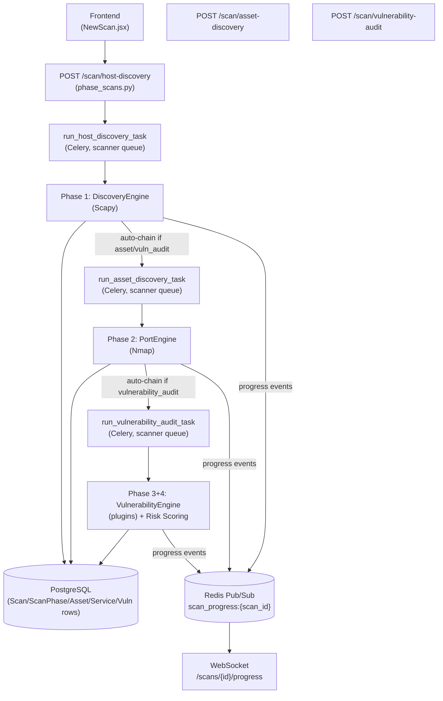
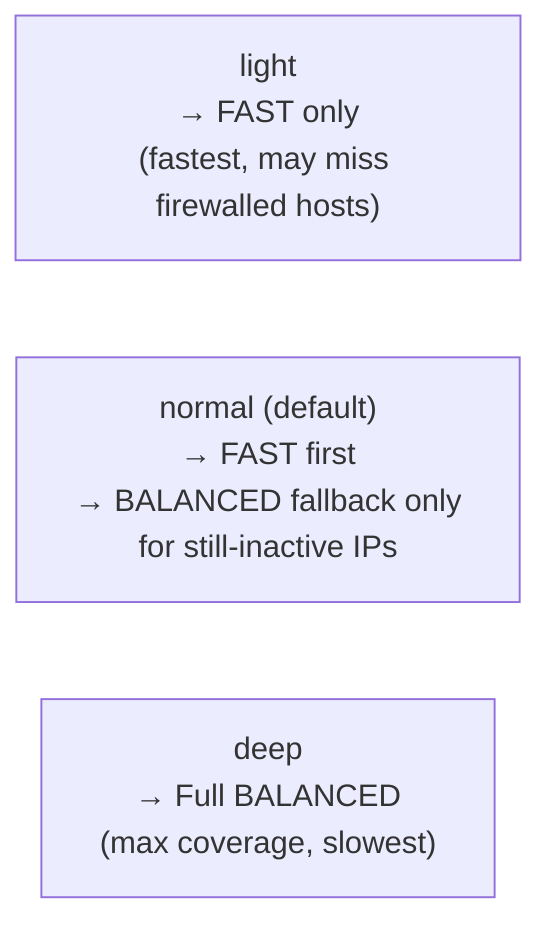
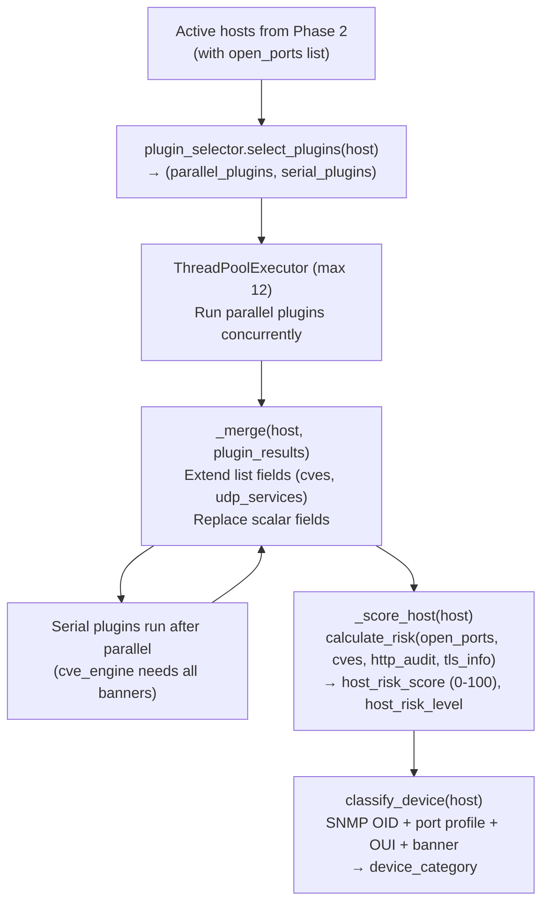

# CCure-Audit-PRO — Scan Engine Deep Dive

> Sources: `Backend/orchestrator/scan_orchestrator.py`, `Backend/core/discovery/engine.py`, `Backend/core/discovery/profiles.py`, `Backend/engines/port/port_engine.py`, `Backend/engines/vulnerability/vulnerability_engine.py`, `Backend/engines/vulnerability/plugin_selector.py`, `Backend/engines/vulnerability/plugins/*`, `Backend/engines/credentialed/*`, `Backend/core/tasks.py`.

## 1. Network Scan Pipeline Overview

The network scanner is a **frontend-orchestrated, phase-selective Celery pipeline**. The three phases map directly to three Celery tasks (`run_host_discovery_task`, `run_asset_discovery_task`, `run_vulnerability_audit_task`) dispatched to the `scanner` queue. Each task chains to the next automatically when `execution_mode = "automatic"` and the pipeline mode includes the subsequent phase.



A `Scan` row is created by the Phase 1 API handler **before** the task is dispatched (ensuring the scan record exists even if the worker is briefly unavailable). `ScanPhase` rows are written by the tasks themselves.

---

## 2. Phase 1 — Host Discovery

**Engine:** `core/discovery/engine.py` — `DiscoveryEngine`
**Technology:** Scapy (raw sockets — requires root/Administrator)
**Task:** `core/tasks.run_host_discovery_task`

### Discovery Profiles

Three `DiscoveryProfile` objects are defined in `core/discovery/profiles.py`:

| Profile      | Name                | Techniques (in order)               | Timeout | Retries | Concurrency | Enrichment                             | Stealth auto-escalation |
| ------------ | ------------------- | ----------------------------------- | ------- | ------- | ----------- | -------------------------------------- | ----------------------- |
| `FAST`       | Basic Network Scan  | ARP, NBNS, TCP_CONN                 | 0.8s    | 0       | 256         | Yes (NetBIOS/mDNS hostname resolution) | No                      |
| `BALANCED`   | Asset Discovery     | ARP, ICMP, TCP_SYN, UDP_PROBE       | 1.5s    | 1       | 100         | No (Nmap Phase 2 covers this)          | No                      |
| `AGGRESSIVE` | Vulnerability Audit | ARP, ICMP, TCP_SYN, UDP_PROBE, NBNS | 2.0s    | 2       | 50          | Yes (SNMP/mDNS/NetBIOS)                | Yes                     |

**Technique descriptions:**

| Technique   | Description                                          |
| ----------- | ---------------------------------------------------- |
| `ARP`       | L2 broadcast — fastest for LAN segments              |
| `ICMP`      | ICMP echo + timestamp — TTL provides OS hint         |
| `TCP_SYN`   | Raw TCP SYN (Scapy, requires root)                   |
| `TCP_CONN`  | Async TCP connect — does not require root            |
| `UDP_PROBE` | DNS/SNMP/NTP/DHCP probes                             |
| `NBNS`      | NetBIOS Name Service (UDP 137) — hostname resolution |

### Pipeline Mode → Profile Mapping

| `pipeline_mode`       | Profile Used                                                           |
| --------------------- | ---------------------------------------------------------------------- |
| `basic`               | `FAST` (always; unless `scan_type="fast"` also set, then still `FAST`) |
| `asset`               | Intensity-aware (see below)                                            |
| `vulnerability_audit` | `AGGRESSIVE`                                                           |

### `discovery_intensity` for Asset Pipeline

The `discovery_intensity` parameter (only meaningful for `pipeline_mode=asset`) controls Phase 1 behavior:



**Normal intensity merge logic (`_merge_fast_balanced_results`):**

1. If FAST found the host active → keep the FAST result (no wasted bandwidth).
2. If FAST missed it but BALANCED found it → use BALANCED result.
3. If both report inactive → prefer the result with more populated fields; always preserve any MAC/vendor data available.

The Phase 1 summary includes `discovery_intensity`, `discovery_profile`, and (for `normal` intensity) `fallback_targets_count` / `fallback_active_hosts` for transparency.

### Output

Each discovered host is returned as a structured dict:

```json
{
  "ip_address": "192.168.1.5",
  "is_active": true,
  "mac_address": "aa:bb:cc:dd:ee:ff",
  "vendor": "Dell Inc.",
  "hostname": "WORKSTATION-01",
  "response_time_ms": 12,
  "discovery_method": "arp",
  "os_family": "Windows",
  "open_ports": []
}
```

OS inference runs on the raw discovery results (`core.risk.infer_os_from_host`) before persisting.

---

## 3. Phase 2 — Asset Discovery (Port Scanning)

**Engine:** `engines/port/port_engine.py` — `PortEngine`
**Technology:** Nmap via `python-nmap`
**Task:** `core/tasks.run_asset_discovery_task`

`PortEngine` accepts the list of active hosts from Phase 1 and performs Nmap service detection (`-sV`) + optional OS fingerprinting (`-O`, controlled by `os_detection` parameter). It uses `NmapScanner` (wrapper around `python-nmap`) and respects the `port_scan_intensity`:

| Intensity          | Port Profile                  | Description                              |
| ------------------ | ----------------------------- | ---------------------------------------- |
| `light`            | Top 100 ports                 | Fast scan, fewer ports                   |
| `normal` (default) | Top 1000 ports (Nmap default) | Balanced port coverage                   |
| `deep`             | All 65535 ports               | Full port range — comprehensive but slow |

Custom ports can be specified via the `custom_ports` parameter (e.g. `"22,80,443,8000-8080"`), which overrides the intensity-based port selection.

### Output per host

Each active host from Phase 1 is enriched with:

```json
{
  "open_ports": [
    {
      "port": 22,
      "protocol": "tcp",
      "state": "open",
      "service": "ssh",
      "product": "OpenSSH",
      "version": "8.9p1",
      "extra": "Ubuntu Linux; protocol 2.0",
      "banner": "SSH-2.0-OpenSSH_8.9p1"
    }
  ],
  "os_name": "Ubuntu 22.04",
  "os_family": "Linux",
  "os_confidence": 95
}
```

Results are persisted as `Service` rows in the database, and `Asset` rows are upserted (deterministic `ast_` ID from `(org_id, ip_address)`).

Progress is published to Redis per host: `{"phase": 2, "progress": {"scanned_hosts": N, "total_hosts": M, "status": "running"}}`.

### Phase Coordination & Race Prevention

To prevent raw socket conflicts, network resource exhaustion, and scan inaccuracies (race conditions):

1. **Sequential Phase Chaining**: Celery tasks are chained sequentially: Phase 1 (`run_host_discovery`) resolves active IPs first; Phase 2 (`run_asset_discovery`) runs Nmap port scanning; and Phase 3 (`run_vulnerability_audit`) runs vulnerability checks.
2. **Database State Handshake**: Phase 3 does not probe ports on its own; it reads the open port metadata enriched by Nmap from the database. This ensures vulnerability probes are targeted only at verified open ports, avoiding slow socket timeouts on closed ports and preventing port scans from running in parallel with active vulnerability checks on the same host interface.

---

## 4. Phase 3 — Vulnerability Audit

**Engine:** `engines/vulnerability/vulnerability_engine.py` — `VulnerabilityEngine`
**Technology:** Custom Python plugins (pure stdlib + optional Scapy for ICMP)
**Task:** `core/tasks.run_vulnerability_audit_task`

Phase 3 runs a dynamic plugin system against every **active** host from Phase 2 using a `ThreadPoolExecutor` with up to 20 concurrent host workers.

### VulnerabilityEngine.run() Flow



---

## 5. Plugin System (`engines/vulnerability/plugin_selector.py`)

The plugin selector implements **dynamic, per-host plugin selection** based on which ports are open. A plugin runs only when one of its trigger ports is detected as open — eliminating false-positive noise and reducing scan time on hosts with few open ports. The runtime implementation in [Backend/engines/vulnerability/plugin_selector.py](Backend/engines/vulnerability/plugin_selector.py) uses lazy imports and omits failed plugins without crashing the worker.

### Plugin Dispatch Table (`_PORT_MAP`)

| Port(s)                             | Plugins Triggered                                                   |
| ----------------------------------- | ------------------------------------------------------------------- |
| 443, 8443                           | `tls_scanner`, `heartbleed_probe`                                   |
| 465, 993, 995                       | `tls_scanner`                                                       |
| 80, 8080                            | `http_analyzer`, `heartbleed_probe`                                 |
| 8000, 8888                          | `http_analyzer`                                                     |
| 22                                  | `ssh_probe`, `default_creds`                                        |
| 445                                 | `smb_probe`, `eternalblue_probe`                                    |
| 139                                 | `smb_probe`                                                         |
| 21                                  | `ftp_checker`, `default_creds`                                      |
| 23                                  | `default_creds`                                                     |
| 53                                  | `dns_probe`                                                         |
| 389, 636                            | `ldap_probe`                                                        |
| 6379 (Redis)                        | `default_creds`                                                     |
| 27017 (MongoDB)                     | `default_creds`                                                     |
| 1883 (MQTT)                         | `default_creds`                                                     |
| 11211 (Memcached)                   | `default_creds`                                                     |
| 3306 (MySQL)                        | `default_creds`                                                     |
| 5432 (PostgreSQL)                   | `default_creds`                                                     |
| 502, 102, 20000, 44818, 47808, 4840 | _(reserved ICS/SCADA ports — plugin hooks reserved, no plugin yet)_ |

### Always-Run Plugins (`_ALWAYS_RUN`)

Run on every host regardless of open ports: `snmp_probe`, `udp_scanner`, `icmp_probe`

### Serial (Last) Plugins (`_SERIAL_LAST`)

Must run after all parallel plugins complete (needs aggregated banners): `cve_engine`

### Lazy Loading & Fault Isolation

Plugins are loaded via `importlib.import_module` on first use and cached in `_plugin_cache`. A plugin that fails to import (e.g., missing optional dependency) is logged at WARNING level and silently omitted from all subsequent scans without crashing the worker.

---

## 6. All Vulnerability Plugins

### `tls_scanner`

**Trigger:** ports 443, 8443, 465, 993, 995
Probes the first available TLS-capable port. Extracts: protocol version (`TLSv1.2/1.3`), cipher suite, key bits, certificate subject/issuer/SAN/serial/fingerprint/expiry, self-signed flag, expired flag, TLS grade (`A`–`F`), weak cipher detection, and issues list.
Returns: `tls_info` dict.

### `http_analyzer`

**Trigger:** ports 80, 8080, 8000, 8888
Deep HTTP security analyzer. Actively probes:

1. Security headers: HSTS, CSP, X-Frame-Options, X-Content-Type-Options, X-XSS-Protection, Referrer-Policy, Permissions-Policy
2. Server version banner disclosure (with CVE correlation)
3. Common admin panel detection (router login pages, phpMyAdmin, etc.)
4. Directory listing detection
5. HTTP Basic Auth bypass attempt on protected resources
6. Exposed sensitive paths (`/.env`, `/backup`, `/phpinfo.php`, etc.)
7. HTTP method enumeration (PUT/DELETE enabled?)
8. Cookie security flags (HttpOnly, Secure, SameSite)
   Returns: `http_audit` dict.

### `ssh_probe`

**Trigger:** port 22
Reads SSH banner and performs key-exchange negotiation (pure stdlib, no paramiko). Detects weak KEX algorithms (`diffie-hellman-group1-sha1`, `diffie-hellman-group14-sha1`), weak encryption ciphers (`arcfour`, `3des-cbc`, `blowfish-cbc`), and weak MAC algorithms (`hmac-md5`, `hmac-sha1-96`).
Returns: `ssh_info` dict + optional `cves` list.

### `smb_probe`

**Trigger:** ports 445, 139
Sends a minimal SMBv1 Negotiate request (no external SMB library). Detects SMBv1 vs SMBv2/3 support and null-session acceptance. Handles modern Windows 10/11 responses which reply with SMB2 magic (`\xfeSMB`) rather than SMBv1 (`\xffSMB`).
Returns: `smb_info` dict + optional `cves` list.

### `eternalblue_probe`

**Trigger:** port 445
Active MS17-010 / EternalBlue vulnerability detection. Sends three non-exploiting detection checks:

1. **SMBv1 Enabled** — Negotiate protocol dialect index check
2. **SMB Signing Disabled** — Security Mode byte in Negotiate response
3. **MS17-010 Fingerprint** — Malformed Trans2 SESSION_SETUP (vulnerable systems return `STATUS_INVALID_PARAMETER`)
   No exploit payload is sent — pure detection.
   Returns: `smb_ms17010_info` dict + optional `cves` list.

### `ftp_checker`

**Trigger:** port 21
Deep FTP probe:

1. Tests anonymous login (`anonymous` / `anonymous@`)
2. Tests well-known weak credentials
3. Checks if anonymous session can `STOR` (write access)
4. Extracts + CVE-matches version from banner
5. Detects cleartext credential transmission risk
   Returns: `ftp_info` dict.

### `dns_probe`

**Trigger:** port 53
Checks:

- **Zone Transfer (AXFR)** — TCP AXFR request; if not `REFUSED` → likely permits zone dumps (High severity)
- **Open Recursion** — resolves external names with `RD=1`; potential DDoS amplifier (Medium severity)
  Returns: `dns_info` dict + optional `cves` list.

### `ldap_probe`

**Trigger:** ports 389, 636
Checks:

- **Anonymous Bind** — LDAP BindRequest with empty DN/password; `resultCode=0` = unauthenticated access
- **RootDSE query** — if anonymous bind succeeds, queries root DSE to estimate exposed directory size
  Returns: `ldap_info` dict + optional `cves` list.

### `heartbleed_probe`

**Trigger:** ports 443, 8443, 80, 8080
Two active exploit-condition probes:

- **Heartbleed (CVE-2014-0160)** — Sends TLS ClientHello with Heartbeat extension, then malformed HeartbeatRequest (payload_length=0x4000 / actual payload=0 bytes). Vulnerable OpenSSL returns padded heap memory in HeartbeatResponse.
- **ShellShock (CVE-2014-6271)** — Injects `() { :;}; echo SHELLSHOCK_PROBE_CCURE` into HTTP User-Agent, Referer, and Cookie headers. Response body check for the echo string confirms CGI execution.
  Returns: `heartbleed_info` and/or `shellshock_info` dicts + `cves` list.

### `snmp_probe`

**Trigger:** Always runs (regardless of open ports, UDP-based)
Deep SNMP enumeration (pure stdlib, no net-snmp):

1. Community string discovery — 15 strings tried in frequency order (`public`, `private`, etc.) using sysDescr OID `1.3.6.1.2.1.1.1.0`
2. System group enumeration — sysObjectID (enterprise OID → vendor/device type), sysName, sysLocation, sysContact, sysUpTime
3. Interface table (ifTable) — ifDescr, ifType, ifPhysAddress, ifOperStatus for indices 1–16
4. IP address table (ipAddrTable) — reveals all IP addresses bound to interfaces (multi-homed devices)
5. Device-type OIDs — ipForwarding, ifNumber, Bridge MIB (feeds device classifier)
   Returns: `snmp_info` dict.

### `udp_scanner`

**Trigger:** Always runs
Probes 9 UDP services (pure stdlib): DNS (53), DHCP (67), TFTP (69), Kerberos (88), NTP (123), SNMP (161), LDAP (389), IKE/IPsec (500), mDNS (5353).
Returns: `udp_services` list of discovered service dicts.

### `icmp_probe`

**Trigger:** Always runs (requires Scapy + root)
Sends ICMP type-13 Timestamp request. Reveals hosts that don't filter ICMP properly; provides OS hints. Silently skipped if Scapy is unavailable.
Returns: `icmp_info` dict.

### `default_creds`

**Trigger:** ports 22, 21, 23, 6379, 27017, 1883, 11211, 3306, 5432, 80, 443
Non-intrusive, read-only default credential checks:

- **FTP (21)** — anonymous login (RFC 959 §9.1)
- **Telnet (23)** — presence flag (Telnet itself is a critical finding)
- **Redis (6379)** — `INFO server` command without AUTH
- **MongoDB (27017)** — unauthenticated `listDatabases`
- **MQTT (1883)** — CONNECT packet with empty credentials
- **HTTP (80/443)** — HTTP Basic Auth with 10 common default credential pairs
- **Memcached (11211)** — `STATS` without auth
  Returns: `default_creds_info` dict + optional `cves` list.

### `cve_engine` (serial — runs last)

**Trigger:** Always — serial (after all parallel plugins complete so all banners are available)
Matches port banners (service_name, service_product, service_version, banner text) against the local CVE hint table in `core/utils.lookup_cve`. Returns matched CVE findings with severity, CVSS score, and remediation hints.
Returns: `cves` list of CVE dicts.

---

## 7. Phase 4 — Risk Scoring

Risk scoring runs as part of `VulnerabilityEngine._score_host()` immediately after all plugins complete for each host — it is not a separate Celery task.

```python
score, level = calculate_risk(
    open_ports = host["open_ports"],
    cves       = host["cves"],
    http_audit = host.get("http_audit", {}),
    tls_info   = host.get("tls_info", {}),
)
host["host_risk_score"] = score   # 0–100
host["host_risk_level"] = level   # Critical / High / Medium / Low / Info
```

`core/risk.calculate_risk` weights:

- Number of CVEs by severity (Critical weighted highest)
- Presence of dangerous open ports (Telnet 23, SMBv1, RDP 3389, etc.)
- TLS grade (F/expired cert adds risk)
- HTTP security header deficiencies (HSTS missing, etc.)
- CVSS score maximum across all detected CVEs

The resulting `risk_score` (0–100) and `risk_level` are persisted on the `Asset` row (upsert) and returned in the scan results.

CVE deduplication (`core/risk.deduplicate_cves`) runs before scoring to avoid double-counting the same CVE from multiple plugins.

---

## 8. Device Classification (`core/device_classifier.py`)

After all plugins complete, `classify_device(host)` is called. It combines:

- **SNMP OUI / sysObjectID** — vendor-specific OIDs for routers, switches, printers
- **Port profile** — specific combinations of open ports (e.g., 80+8443+3306 = database server; 514+23 = network device)
- **OUI (MAC prefix) lookup** (`core/oui_lookup.py`) — vendor/manufacturer identification from MAC address
- **Banner text signals** — product/version strings from SSH, HTTP, SMB, FTP banners

Output `device_category` values: `workstation`, `server`, `router`, `switch`, `firewall`, `printer`, `iot`, `phone`, `camera`, `nas`, `unknown`.

---

## 9. SSH Credentialed Scan (`engines/credentialed/`)

Independent from the network scan pipeline. Dispatched by `POST /scan/credentialed`, runs as `run_credentialed_scan_task` in the `scanner` Celery queue.

**Components:**

- `engines/credentialed/ssh_scanner.py` — Paramiko SSH connection manager
- `engines/credentialed/linux_collector.py` — Linux/Unix system information collection
- `engines/credentialed/windows_collector.py` — Windows system information collection (via PowerShell/cmd over SSH)
- `engines/credentialed/vuln_matcher.py` — CVE matching against collected software inventory

**OS Auto-detection flow (`_detect_os` in `routers/credentialed.py`):**

5 lightweight probes run in priority order (stops at first confident match):

1. `ver` — cmd.exe native (returns "Microsoft Windows" on Windows)
2. `cmd /c ver` — explicit cmd (for shells that default to PowerShell)
3. `$env:OS` — PowerShell (returns `Windows_NT`)
4. `uname -s` — Linux/macOS/BSD (returns `LINUX`, `DARWIN`, etc.)
5. `[Environment]::OSVersion.Platform` — PowerShell v5+ cross-platform

Falls back to `linux` if all 5 probes are inconclusive.

**Data collected (Linux):**

- OS release (`/etc/os-release`, `/etc/issue`)
- Kernel version (`uname -r`)
- Installed packages (`dpkg -l`, `rpm -qa`, `pip list`, `npm ls -g`)
- Running services (`systemctl list-units`, `ps aux`)
- Open ports (`ss -tlnp`, `netstat -tlnp`)
- Users (`/etc/passwd`, `last`, `who`)
- File permissions (`find / -perm /4000` for SUID binaries)
- Network config (`ip addr`, `ip route`, `cat /etc/resolv.conf`)
- Sudo config (`sudo -l`)
- Cron jobs (`crontab -l`, `/etc/cron*`)

**Data collected (Windows):**

- OS version, patch level, build number
- Installed software (`Get-ItemProperty HKLM:\Software\...`)
- Windows updates / hotfixes (`Get-HotFix`)
- Running services (`Get-Service`)
- Open ports (`netstat -an`, `Get-NetTCPConnection`)
- Local users and groups
- PowerShell execution policy
- Windows Defender status

All collected data is passed to `VulnMatcher` which cross-references against the `vuln_intel` CVE database and the local CVE hint table to produce a list of findings, which are then persisted as scan results.

---

## 10. Web Application Scan Pipeline

**Orchestrator:** `orchestrator/web_orchestrator.py` — `WebScanOrchestrator`
**Tasks:** `core/web/tasks.py`
**Queues:** `web_recon`, `web_crawl`, `web_dast`, `web_audit`

### Phase 1 — RECON (`run_web_recon_task`, queue `web_recon`)

- **Subdomain enumeration** via `subfinder`
- **WAF detection** — identifies Cloudflare, Imperva, AWS WAF, etc.
- **Technology fingerprinting** — identifies frameworks, CMS, JS libraries, server software from headers, HTML, and response patterns
- **Sitemap / robots.txt parsing** — seeds the crawler URL list

Outputs persisted to `WebScan`: `waf_detected`, `tech_stack`, `subdomains`. Chains to `run_web_crawl_task`.

### Phase 2 — CRAWL (`run_web_crawl_task`, queue `web_crawl`)

- **Playwright-based spidering** — JavaScript-rendered pages, form discovery, SPA navigation
- **ffuf brute-force discovery** — common path wordlist for hidden endpoints
- **API route discovery** — Swagger/OpenAPI endpoint parsing, JS analysis for API calls
- **Sensitive file detection** — `.env`, `backup.zip`, `phpinfo.php`, etc. (creates `WebFinding` rows)

Outputs: discovered `WebAsset` rows (URL + method + parameters + classification). Chains to `run_web_detect_task`.

### Phase 3 — DETECT (`run_web_detect_task`, queue `web_dast`)

Active vulnerability detection:

- **Nuclei templates** — template-based detection for CVEs, misconfigs, exposed panels, default credentials
- **SQLMap integration** — SQL injection detection on parameterized endpoints
- **Custom checks** — CORS misconfiguration, HTTP method abuse, header injection

`WebFinding` rows are persisted with full HTTP evidence (request/response). Chains to `run_web_audit_task`.

### Phase 4 — AUDIT (`run_web_audit_task`, queue `web_audit`)

- **sslyze TLS audit** — deep certificate and TLS configuration analysis
- **Compliance mapping** — maps findings to OWASP Top 10 categories and compliance tags (PCI-DSS, SOC2)
- **Risk scoring** — aggregate risk score based on finding severity distribution

`WebScan` status set to `complete`, final stats denormalized into `WebScan` columns.

### Task Time Limits

| Phase  | `soft_time_limit` | `time_limit`    |
| ------ | ----------------- | --------------- |
| RECON  | 1800s (30 min)    | 2400s (40 min)  |
| CRAWL  | 3600s (60 min)    | 4200s (70 min)  |
| DETECT | 7200s (120 min)   | 8400s (140 min) |
| AUDIT  | 1800s (30 min)    | 2400s (40 min)  |

Cancellation check (`_check_cancelled`) is performed at the start of each task and after the main processing, so a user-initiated `POST /web-scans/{id}/stop` can interrupt the pipeline at a phase boundary.
