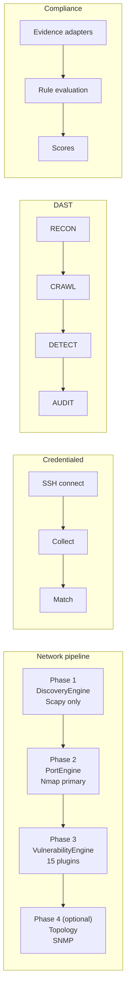
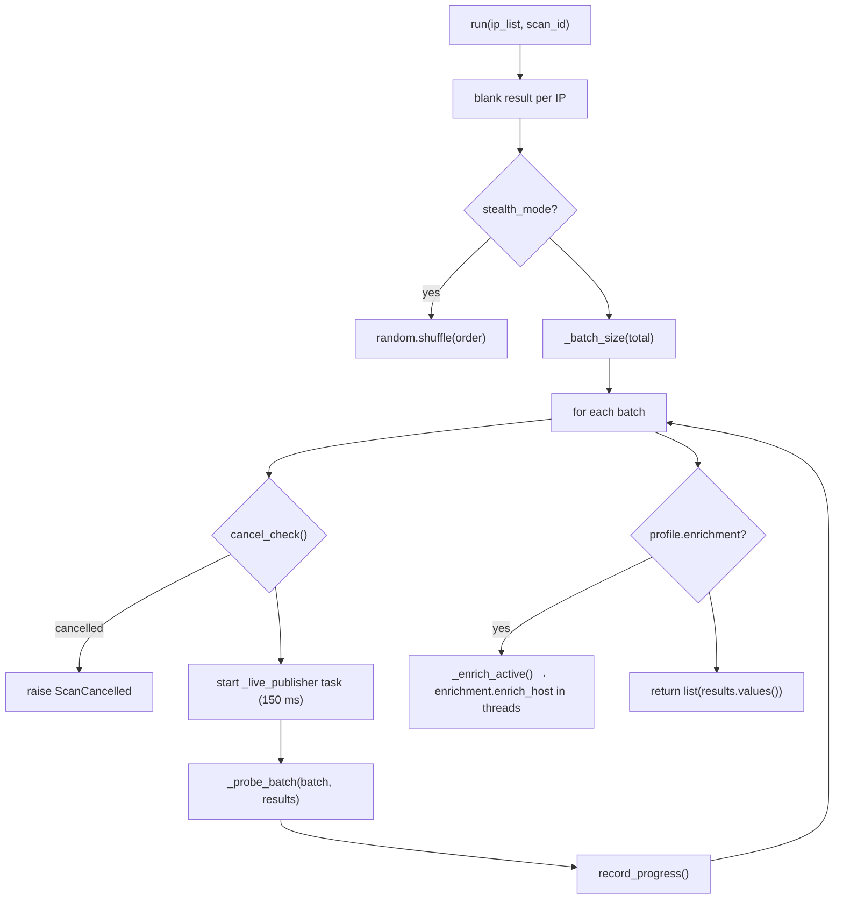
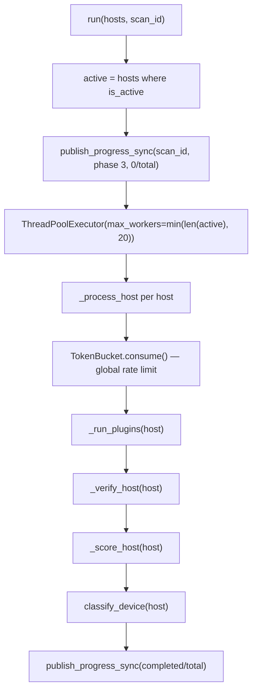
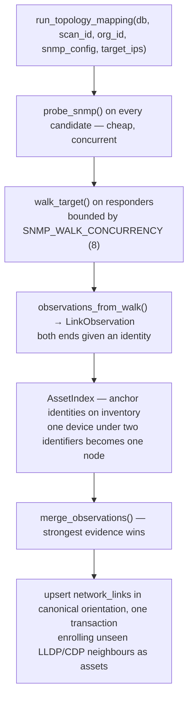
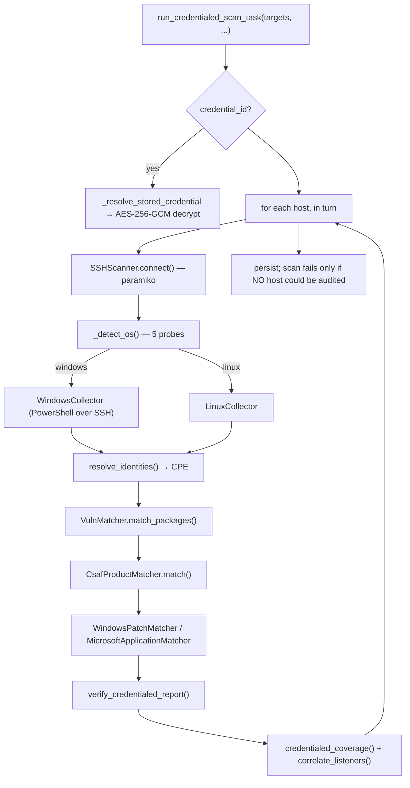
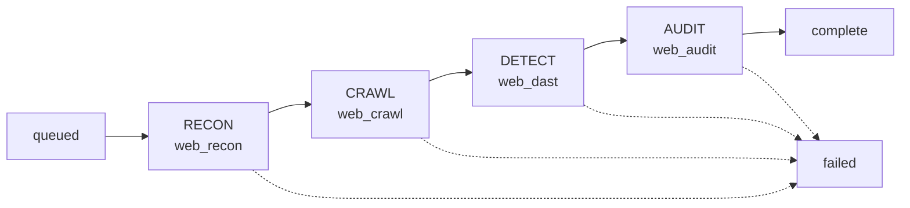

# Scan Engine Deep Dive

**CCure-Audit-PRO** — every implemented scanning path, traced from the API entry
point through the orchestrator into each engine, plugin, probe and wrapper.

> The Nmap/NSE path is **not** the whole architecture. This document covers four
> independent pipelines and, within the network pipeline, three engines and
> fifteen vulnerability plugins. Every module named here exists on disk; every
> constant is quoted from source.

---

## Contents

1. [Scanning paths at a glance](#1-scanning-paths-at-a-glance)
2. [ScanOrchestrator](#2-scanorchestrator)
3. [Phase 1 — DiscoveryEngine](#3-phase-1--discoveryengine)
4. [Phase 2 — PortEngine and NmapScanner](#4-phase-2--portengine-and-nmapscanner)
5. [Phase 3 — VulnerabilityEngine](#5-phase-3--vulnerabilityengine)
6. [Plugin architecture](#6-plugin-architecture)
7. [Plugin reference — all fifteen](#7-plugin-reference--all-fifteen)
8. [Verification and risk scoring](#8-verification-and-risk-scoring)
9. [Phase 4 — Topology mapping](#9-phase-4--topology-mapping)
10. [Credentialed audit engine](#10-credentialed-audit-engine)
11. [Web application (DAST) engine](#11-web-application-dast-engine)
12. [Compliance evaluation engine](#12-compliance-evaluation-engine)
13. [Vulnerability intelligence](#13-vulnerability-intelligence)
14. [Cross-cutting concerns](#14-cross-cutting-concerns)
15. [Test targets and expected results](#15-test-targets-and-expected-results)

---

## 1. Scanning paths at a glance

| Path                   | Orchestrator                                | Engines / tools                                                                                                          | Queue                                             | Findings written to                           |
| ---------------------- | ------------------------------------------- | ------------------------------------------------------------------------------------------------------------------------ | ------------------------------------------------- | --------------------------------------------- |
| Network scan           | `orchestrator/scan_orchestrator.py`         | DiscoveryEngine (Scapy), PortEngine → NmapScanner, VulnerabilityEngine (15 plugins)                                      | `scanner`                                         | `assets`, `services`, `asset_vulnerabilities` |
| Credentialed audit     | `core/tasks.py::run_credentialed_scan_task` | SSHScanner + Linux/Windows collectors, VulnMatcher, CsafProductMatcher, WindowsPatchMatcher, MicrosoftApplicationMatcher | `scanner`                                         | Same tables, `source_family="credentialed"`   |
| Topology mapping       | `core/topology/engine.py`                   | SNMP client (ARP/LLDP/CDP/EDP/FDB)                                                                                       | `scanner`                                         | `network_links`, plus asset enrolment         |
| Web application (DAST) | `orchestrator/web_orchestrator.py`          | subfinder, Playwright, ffuf, Nuclei, SQLMap, SSLyze, WAF detector                                                        | `web_recon`, `web_crawl`, `web_dast`, `web_audit` | `web_assets`, `web_findings`                  |
| Compliance             | `core/compliance_tasks.py`                  | Rule evaluation over `ComplianceEvidenceProvider`                                                                        | `compliance`                                      | `compliance_findings`, `compliance_scores`    |



---

## 2. ScanOrchestrator

`Backend/orchestrator/scan_orchestrator.py` (1 436 lines). One entry point for
every network scan type.

### Construction

```python
ScanOrchestrator(silent=True, reports_dir=None, intensity="normal",
                 rate_limit=200.0, stealth_mode=False)
```

It resolves the platform and privilege level via `PrivilegeManager`, constructs an
`AssetCorrelationEngine`, coerces `intensity` into `ScanIntensity` (falling back to
`NORMAL` on an unknown value), and — when `PDF_AVAILABLE` — builds a
`ScanReportGenerator` rooted at `Backend/reports`.

### Public surface

| Method                                                                          | Phase | Async                                   | Purpose                                                                            |
| ------------------------------------------------------------------------------- | ----- | --------------------------------------- | ---------------------------------------------------------------------------------- |
| `run_host_discovery_only`                                                       | 1     | yes                                     | Host discovery; intensity-aware for the `asset` pipeline                           |
| `run_asset_discovery_only`                                                      | 2     | yes                                     | Port scanning and service detection                                                |
| `run_vulnerability_audit_only`                                                  | 3+4   | **no** — called via `asyncio.to_thread` | Nmap pre-enrichment, plugins, verification, scoring                                |
| `run_phases`                                                                    | 1→3   | yes                                     | Runs a phase combination in one call                                               |
| `scan_single_host` / `scan_ip_range` / `scan_subnet` / `scan_subnets_of_subnet` | 1     | yes                                     | Backward-compatible entry points for `/scan/host`, `/range`, `/subnet`, `/subnets` |
| `generate_phase_report`                                                         | —     | no                                      | Delegates to `ScanReportGenerator.generate`                                        |
| `_expand_targets` (static)                                                      | —     | no                                      | Also called directly by `routers/credentialed.py`                                  |

The four traditional methods all delegate to `run_host_discovery_only` with
`pipeline_mode="vulnerability_audit"`, so every discovery technique is active
regardless of which legacy endpoint was used.

### Target expansion and exclusion

`_expand_targets(targets, custom_exclude_list)` resolves each target through
`InputValidator.resolve_target`, expands CIDRs via `ipaddress.ip_network(...).hosts()`
and ranges via `InputValidator.expand_ip_range`, drops anything
`_is_blacklisted`, and de-duplicates while preserving order
(`list(dict.fromkeys(...))`).

`_is_blacklisted` tests each IP against `AppConfig.SCAN_IP_BLACKLIST` (parsed from
the `SCAN_IP_BLACKLIST` env var at import) **and** the per-scan
`exclude_ips` list parsed by `_parse_exclude_ips`. Unparseable entries are
skipped silently rather than failing the scan.

### Phase 1 branch

```python
if pipeline_mode != "asset":
    profile = FAST if scan_type == "fast" else profile_for_pipeline(pipeline_mode)
    # ... single DiscoveryEngine pass ...
else:
    return await self._run_asset_phase1(..., discovery_intensity=...)
```

`scan_type == "fast"` is the Basic Scan's "Light Mode" toggle and forces FAST
regardless of pipeline. Output formatting differs by mode:

| Mode                  | Formatter                                      | Registers with `AssetCorrelationEngine`? |
| --------------------- | ---------------------------------------------- | ---------------------------------------- |
| `basic`               | `HostResult.to_basic_dict()`                   | no                                       |
| `vulnerability_audit` | `HostResult.to_phase1_dict()`                  | yes                                      |
| `asset`               | `to_basic_dict()` (inside `_run_asset_phase1`) | no at Phase 1; yes at Phase 2            |

Phase 1 also writes explicit **coverage disclaimers** into both `summary` and
`metadata`:

```python
discovery_coverage = {
    "port_range": "Not scanned — host discovery policy does not scan ports",
    "service_detection": "Not performed",
    "os_detection": "Passive inference from discovery responses" | "Not performed",
    "scanner": f"Built-in host discovery ({profile.name} profile)",
    "timing_template": f"{profile.name} discovery profile",
}
```

Stating this matters more than it looks: a report whose coverage reads "not
recorded" invites the reader to assume those checks ran and found nothing.

### Phase 2 orchestration

`run_asset_discovery_only` does considerably more than call `PortEngine`:

1. Normalises host records (`_normalize_host_record`) — canonical `ip`/`ip_address`,
   lowercase colon-separated MACs via `_normalize_mac`, a `method` field.
2. Applies the IP exclusion list again.
3. Registers hosts with `AssetCorrelationEngine`.
4. **Passive-first filter** — when `passive_first` is set, hosts whose
   `device_category` is already resolved _or_ whose `vendor` is known are skipped
   for active port scanning and logged. This is the OT-safety lever.
5. **Backs up `vendor`, `mac_address` and Phase 1 `open_ports` per IP** before
   calling PortEngine, because PortEngine mutates the host dicts in place.
6. Runs `PortEngine.run(active_for_scan, scan_id=...)`.
7. `_apply_os_inference(..., ot_enrichment=True)` on scanned hosts,
   `ot_enrichment=False` on skipped ones.
8. **Restores and merges** the backup: vendor and MAC are re-applied if Phase 1
   had them, and Phase 1 ports missing from the Phase 2 result are appended
   (also updating `port_states`).
9. For `vulnerability_audit` only: `_preserve_vendor_from_registry` and
   `enrich_port_scan_results`.
10. Publishes `port_engine.scan_configuration()` into **both** `summary` and
    `metadata` — the summary is what gets persisted with the phase, so a report
    regenerated later can still state what the scan covered.

Step 5/8 exists because vendor data was being silently lost between phases; the
`AssetCorrelationEngine` module docstring records the original symptom
("Phase 1: Vendor populated ✅ / Phase 2: Vendor LOST ❌").

### Phase 3 orchestration

```python
self._nmap_pre_enrich(active_hosts, exclude_ot_from_nmap=...)   # SEQUENTIAL
vuln_engine = VulnerabilityEngine(rate_limit=self.rate_limit)
vuln_engine.run(active_hosts, scan_id=scan_id)
self._apply_os_inference(active_hosts, ot_enrichment=True)
self.asset_engine.enrich_vulnerability_findings(active_hosts)
```

> **IMPORTANT:** Nmap enrichment runs **before** the plugins, not in parallel with
> them. The previous `ThreadPoolExecutor` arrangement created a race where
> vulnerability plugins probed ports before Nmap had written service, version and
> banner data — producing empty Product, Version and Banner fields in results.
> The method `_run_nmap_and_vuln_parallel` was removed; a comment marks its grave.

`_nmap_pre_enrich` runs `NmapScanner.full_scan(ip, ports=open_port_nums)` per host
in a pool capped at `min(len(hosts), 20)`, restricted to ports Phase 2 already
found open. When `exclude_ot_from_nmap` is true it removes the OT port set
`{502, 102, 44818, 47808, 20000, 4840, 2404, 18245, 9600, 5007, 2455}` first, and
returns without scanning if nothing remains.

Two subtleties in the enrichment merge:

- Results are written through `PortResult(...).to_dict()` and `_record_port`, the
  same evidence-ranked contract PortEngine uses. Writing `full_version` (product +
  version + extra concatenated) straight into `version` put prose where a
  comparable version belongs, bypassed the ranked merge, and let a deeper scan
  overwrite a better fingerprint with a worse one while dropping the CPE.
- OS results are accepted only at `accuracy >= 75`, and **SNMP wins over Nmap**:
  if `host["os_evidence"] == "snmp_sysdescr"` the Nmap guess is stored under
  `os_guess_nmap` instead of overwriting. An Nmap TCP/IP fingerprint infers a
  kernel _range_; SNMP `sysDescr` is the device stating its exact build.

Phase 3 summary carries `candidates_evaluated` and `candidates_suppressed` totals
so a report rebuilt from the database can state how many candidates were examined
to arrive at the findings it shows.

---

## 3. Phase 1 — DiscoveryEngine

`Backend/core/discovery/engine.py` (655 lines).

**Architecture contract, quoted from the module docstring:** Scapy only —
ARP, ICMP, TCP SYN, UDP. No Nmap calls. No port scanning.

### Profiles

`core/discovery/profiles.py` defines a `Technique` enum
(`ARP`, `ICMP`, `TCP_SYN`, `TCP_CONN`, `UDP_PROBE`, `NBNS`), a `DiscoveryProfile`
dataclass, and three instances:

| Profile      | Techniques                          | Timeout | Retries | Concurrency | Enrichment | OT enrich | Stealth auto |
| ------------ | ----------------------------------- | ------- | ------- | ----------- | ---------- | --------- | ------------ |
| `FAST`       | ARP, NBNS, TCP_CONN                 | 0.8 s   | 0       | 256         | ✔         | ✘         | ✘            |
| `BALANCED`   | ARP, ICMP, TCP_SYN, UDP_PROBE       | 1.5 s   | 1       | 100         | ✘          | ✘         | ✘            |
| `AGGRESSIVE` | ARP, ICMP, TCP_SYN, UDP_PROBE, NBNS | 2.0 s   | 2       | 50          | ✔         | ✔        | ✔           |

`profile_for_pipeline()`: `basic → FAST`, `asset → BALANCED`,
`advanced`/`vulnerability_audit` → `AGGRESSIVE`. `get_profile()` additionally
accepts the profile names themselves and defaults to BALANCED with a warning.

AGGRESSIVE has _lower_ concurrency than FAST on purpose — more thorough per host,
smaller blast radius.

### Execution model



**Batch sizing** (`_batch_size`): ≤20 → all; ≤100 → 50; ≤254 → 128; ≤510 → 256;
≤1024 → 512; otherwise 1024.

**Cancellation** is polled between batches via `make_cancel_check(scan_id)` from
`core/scan_control.py`. It cannot be checked in the hot path without cost, and the
host worker's threads pool makes `revoke(terminate=True)` ineffective, so
between-batch polling is what bounds a cancelled scan.

**Live progress** — an `asyncio` task publishes to Redis every 150 ms whenever the
active-host count grows, sending an `hosts` array of `{ip_address, hostname,
mac_address, vendor, response_time, is_active}` so the UI populates rows as they
are found.

### Zone-aware probing

`_probe_batch` splits the batch into three zones when `separate_lan_wan` is set:
**LAN** (inside a local subnet), **corporate** (private but routed), **internet**
(public). Each technique then applies where it makes sense:

| Technique       | LAN                                                                                                       | Corporate                                                                  | Internet                        |
| --------------- | --------------------------------------------------------------------------------------------------------- | -------------------------------------------------------------------------- | ------------------------------- |
| **ARP**         | ✔ primary (raw only)                                                                                     | ✘                                                                          | ✘                               |
| **ICMP**        | only against already-active hosts, for TTL                                                                | ✔ primary                                                                 | ✘                               |
| **TCP SYN**     | ✘                                                                                                         | fallback on hosts ICMP missed: ports `22, 135, 139, 445, 3389, 8080, 5985` | ports `80, 443, 22, 8080, 8443` |
| **UDP probe**   | only against active hosts: ports `53, 67, 123, 161, 500, 1900`, timeout ≥ 2 s                             | ✘                                                                          | ✘                               |
| **TCP connect** | final fallback for anything still inactive: ports `80, 443, 22, 8080, 8443, 135, 139, 445, 3389, 21, 111` | same                                                                       | same                            |
| **NBNS**        | any active host                                                                                           | same                                                                       | same                            |
| **ARP cache**   | every active host, best-effort MAC without root                                                           | same                                                                       | same                            |

Two deliberate restrictions: LAN ICMP runs only against _already-active_ hosts
(ARP has already answered the liveness question, so ICMP is only there for the
TTL), and LAN UDP runs only against active hosts because Layer-3 `sr()` against a
dead LAN host causes severe ARP timeout cascades.

`can_raw = self.has_priv and SCAPY_AVAILABLE` gates ARP, ICMP, TCP SYN and UDP.
Without privileges only TCP connect, NBNS and ARP-cache lookup run — which is why
the worker must run as root/Administrator, and why Windows needs Npcap.

Technique modules live in `core/discovery/techniques/`: `arp.py`, `arp_cache.py`,
`icmp.py`, `nbns.py`, `tcp_conn.py`, `tcp_syn.py`, `udp_probe.py`, `ot_probes.py`.

### Enrichment (AGGRESSIVE and FAST)

`core/discovery/enrichment.py::enrich_host(ip, result, ot_enrichment, register_ports)`
runs on confirmed-active hosts when `profile.enrichment` is true. It gathers
reverse DNS, mDNS service names, the NetBIOS computer name, SNMP device
classification (`_SNMP_OIDS`: `ip_forwarding`, `bridge_mib`, `sys_obj_id`) and
TCP-options OS fingerprinting. Each probe is independently guarded so one failure
does not block the rest, and `_ot_protocol_probes` runs against OT ports through a
dedicated 128-worker pool when `ot_enrichment` is set.

> **CAUTION:** When adding a probe here, pass the real transport to
> `_register_open_port(..., protocol="udp")`. SNMP, mDNS and NetBIOS-NS are UDP;
> recording them as TCP claims an open TCP port that is usually filtered, and that
> claim reaches the asset registry and the reports.

### Hostname resolution priority

`ScanOrchestrator._format_host` resolves the hostname in a fixed order, because
live sources beat stale DNS:

1. NetBIOS computer name (live UDP-137 response)
2. mDNS `.local` name
3. `hostname` already set during discovery
4. DNS PTR via `socket.gethostbyaddr` — logged at debug as a possibly-stale fallback
5. `input_hostname` argument
6. `"Unknown"`

Confidence is derived from confirmations: `High` if ≥ 2 confirmations or ARP
answered, `Medium` for exactly one, `Low` otherwise, `N/A` if inactive.

### Passive layer-2 discovery

`engines/discovery/l2_sniffer.py::sniff_l2_infrastructure(timeout)` passively
sniffs CDP/LLDP/STP multicast frames
(`_L2_MCAST_MACS = {01:00:0c:cc:cc:cc, 01:80:c2:00:00:0e, 01:80:c2:00:00:00,
01:00:0c:cc:cc:cd}`) to discover switches on the same broadcast domain. It uses a
daemon thread plus a `threading.Event` hard-stop because Scapy's own `timeout`
relies on `select()` waking, which on a quiet network with a BPF filter can block
indefinitely on Windows.

---

## 4. Phase 2 — PortEngine and NmapScanner

### PortEngine

`Backend/engines/port/port_engine.py` (892 lines).

```python
PortEngine(intensity=ScanIntensity, os_detection=True, custom_ports=None,
           exclude_ports=None, exclude_ot_from_nmap=True)
```

`run(hosts, scan_id)` filters to active hosts, then:

1. `_scan_with_nmap(active)` when `NMAP_AVAILABLE`, else `_scan_fallback(active)`
   (async TCP connect + Scapy UDP) with a warning logged.
2. `_lightweight_snmp_check(active)`.
3. `_ot_enrichment_check(active)` — dynamic OT identity probes on open SCADA ports.

> **NOTE:** PortEngine **does not generate CVE candidates**. That was removed: a
> port scan cannot verify what it matches, and it was producing candidates keyed
> on bare service names that Phase 3 then generated a second time. Candidate
> generation now happens in exactly one place, `cve_engine`.

**Port selection** (`_port_list`):

| Condition               | Ports                                                |
| ----------------------- | ---------------------------------------------------- | ------------------- |
| `custom_ports` supplied | Exactly those                                        |
| `intensity == LIGHT`    | `set(SCAN_PORTS_QUICK)                               | set(SCAN_PORTS_OT)` |
| otherwise (NORMAL/DEEP) | `range(1, 1025)` plus every `PORT_DB` key above 1024 |

Then `exclude_ports` is subtracted, and when `exclude_ot_from_nmap` is set the OT
port set `{502, 102, 44818, 47808, 20000, 4840, 2404, 18245, 9600, 5007, 2455}` is
subtracted as well.

**`scan_configuration()`** publishes what the scan actually ran with — `port_range`
(prose), `ports_probed_spec` (machine-readable, so a later phase can tell a port
that was probed and stayed silent from one never probed), `timing_template`,
`scanner`, and `service_detection` (`"Enabled (banner and probe fingerprinting)"`
for NORMAL/DEEP or custom ports, `"Not performed (port state only)"` otherwise).
The engine is the only component that knows these values, so it publishes them
rather than leaving the report to assume a default.

**Service identity merge** — `_IDENTITY_FIELDS = ("service", "product", "version",
"extra", "cpe", "version_precision", "fingerprint_source")`. `PortResult` carries
an `evidence_rank`, and higher-ranked evidence wins when two observations of the
same port disagree. Ordering decides, not arrival: a discovery-time
connect-and-read must never displace a service-detection result.

### NmapScanner

`Backend/core/nmap/wrapper.py` (1 033 lines). **All** Nmap access goes through
this module — no `nmap.PortScanner()` and no `subprocess(["nmap", ...])` anywhere
else, and XML parsing lives here and nowhere else.

| Element      | Detail                                                                                                                                                                                                                       |
| ------------ | ---------------------------------------------------------------------------------------------------------------------------------------------------------------------------------------------------------------------------- |
| Availability | `_NMAP_BINARY = shutil.which("nmap")`; `NMAP_AVAILABLE = _NMAP_BINARY is not None`                                                                                                                                           |
| Result types | `NmapPortResult` (with `full_version`), `NmapOSMatch`, `NmapScanResult` (with `open_ports`, `best_os`)                                                                                                                       |
| Modes        | `detect_services(target, ports)` — service + version + banner; `full_scan(target, ports)` — service + OS + NSE scripts; `scan_hosts(targets, intensity, with_services, with_os, ports, exclude_ports, exclude_ot_from_nmap)` |
| Execution    | `_run` / `_run_multi` / `_run_subprocess`; parsing via `_parse_python_nmap` or `_parse_xml`                                                                                                                                  |
| Concurrency  | `_NmapProcessLimiter` — a Redis-backed token limiter bounded by `MAX_NMAP_PROCESSES` (default 20), waiting up to `NMAP_PROCESS_WAIT_TIMEOUT` (900 s)                                                                         |
| Caching      | Redis, keyed on `(target, ports, mode)`, TTL `NMAP_CACHE_TTL_HOURS` (72), toggled by `NMAP_CACHE_ENABLED`                                                                                                                    |
| Privilege    | `NmapScanner(sudo=...)`; `_nmap_pre_enrich` sets `sudo = platform.system() != "Windows"`                                                                                                                                     |
| Unavailable  | `_unavailable_result(target)` — a structured empty result, never an exception                                                                                                                                                |

The design note in the module explains the division of labour: Nmap's `-sS` sends
roughly 10× more packets/sec than an async TCP connect loop, `-sV` carries a
4 500-probe service database, and `-O` carries 2 600+ OS signatures — none of
which is worth reimplementing in Scapy. Conversely, Scapy owns Phase 1 because
raw ARP/ICMP/SYN discovery does not need any of that.

---

## 5. Phase 3 — VulnerabilityEngine

`Backend/engines/vulnerability/vulnerability_engine.py` (248 lines).

```python
VulnerabilityEngine(rate_limit=200.0)      # → core.utils.TokenBucket
engine.run(hosts, scan_id=None) -> list[dict]
```

### Per-host pipeline



`_run_plugins` obtains `(parallel, serial)` from `select_plugins(host)` and:

- runs the parallel set in a nested pool of `min(len(parallel), 12)` workers,
  merging each result as it completes;
- then runs the serial set **in list order**, one at a time.

`_merge` extends list fields (`cves`, `udp_services`) and replaces everything else.

Plugin exceptions are caught and logged at **debug** level in both phases. That is
deliberate — a failing optional probe must not abort a host — but it is also why a
broken plugin can look registered while never executing. See §6 for the contract
that makes this failure mode concrete.

### Rate limiting

A single `TokenBucket(rate=rate_limit)` is consumed once per host, so the engine
bounds how fast it starts new hosts rather than throttling individual packets.
`ScanOrchestrator` passes its own `rate_limit` (default 200.0) through.

---

## 6. Plugin architecture

`Backend/engines/vulnerability/plugin_selector.py` (201 lines).

### The contract

Every plugin module exposes:

```python
def run(ip: str, open_ports: List[int], **kwargs) -> Dict
```

and returns a dict whose keys are merged onto the host record. Recognised keys:
`tls_info`, `http_audit`, `ssh_info`, `smb_info`, `snmp_info`, `udp_services`,
`icmp_info`, `cves`, `dns_info`, `ldap_info`, `heartbleed_info`,
`shellshock_info`, `smb_ms17010_info`, `default_creds_info`, `ftp_info`.

> **IMPORTANT — the two-argument trap.** Parallel plugins are invoked as
> `plugin.run(ip, open_ports)`. **Serial plugins are invoked with three
> arguments**: `plugin.run(ip, open_ports, port_dets)`. A serial plugin written
> with a two-argument `run` raises `TypeError`, the engine catches plugin
> exceptions at debug level, and the plugin appears registered while never
> executing. `nuclei_probe` and `cve_engine` are the serial plugins.

### Lazy loading

`_load(name)` imports `engines.vulnerability.plugins.<name>` through `importlib`,
caches the module (or `None` on failure) in `_plugin_cache`, and logs a **warning**
on `ImportError` or any other exception. A broken plugin is skipped for all scans
instead of crashing the scanner at startup.

`plugins/__init__.py` additionally imports all fifteen eagerly, which is what makes
an import error visible during development.

### Selection

```python
def select_plugins(host) -> (parallel, serial)
```

Open ports are collected from **both** `host["open_ports"]` and
`host["udp_services"]`, so a UDP-only service still triggers its plugin.

**Always-run (parallel):** `_ALWAYS_RUN = ["snmp_probe", "udp_scanner", "icmp_probe"]`

**Port-gated dispatch table** — `_PORT_MAP`:

| Port(s)                              | Plugins                                                                    |
| ------------------------------------ | -------------------------------------------------------------------------- |
| 443, 8443                            | `tls_scanner`, `heartbleed_probe`                                          |
| 465, 993, 995                        | `tls_scanner`                                                              |
| 80, 8080                             | `http_analyzer`, `heartbleed_probe`                                        |
| 8000, 8888                           | `http_analyzer`                                                            |
| 22                                   | `ssh_probe`, `default_creds`                                               |
| 445                                  | `smb_probe`, `eternalblue_probe`                                           |
| 139                                  | `smb_probe`                                                                |
| 21                                   | `ftp_checker`, `default_creds`                                             |
| 23                                   | `default_creds`                                                            |
| 53                                   | `dns_probe`                                                                |
| 389, 636                             | `ldap_probe`                                                               |
| 6379, 27017, 1883, 11211, 3306, 5432 | `default_creds`                                                            |
| 502, 102, 20000, 44818, 47808, 4840  | _(empty — reserved ICS hooks; the port engine handles OT protocol probes)_ |

**Serial, in order:** `_SERIAL_LAST = ["nuclei_probe", "cve_engine"]`

Nuclei runs serially because it drives one subprocess covering every open port at
once; running it in the parallel pool would put several hundred template requests
in contention with the socket probes. Serial execution also bounds the load one
scan puts on a target, which matters far more on OT equipment than the wall-clock
saving. It is ordered **ahead of** `cve_engine` so that a vulnerability Nuclei
_demonstrated_ is already present when the version-inference pass runs, rather
than arriving after it as a second opinion.

### Adding a plugin

1. Create `engines/vulnerability/plugins/my_plugin.py` with a `run()` matching the
   contract.
2. Import it in `plugins/__init__.py` and add it to `__all__`.
3. Register it in `plugin_selector._PORT_MAP` (or `_ALWAYS_RUN` / `_SERIAL_LAST`).

No change to `vulnerability_engine.py` is required.

---

## 7. Plugin reference — all fifteen

Common to every plugin: **input** is `(ip, open_ports)` — plus `port_details` for
the two serial plugins; **output** is a dict merged onto the host record;
**errors** are swallowed by the engine and logged at debug; **persistence** happens
downstream in `scans/asset_syncer.py`, never in the plugin.

### 7.1 `cve_engine` — CVE candidate generation _(serial, always)_

|                  |                                                                                 |
| ---------------- | ------------------------------------------------------------------------------- |
| **Purpose**      | The **only** stage that produces CVE candidates                                 |
| **Entry**        | `run(ip, open_ports, port_details=None) -> {"cves": [...]}`                     |
| **Trigger**      | Always, as the last serial plugin                                               |
| **Dependencies** | `core.utils.lookup_cve`, `core.risk.deduplicate_cves`, `core.constants.PORT_DB` |

For each `PortResult` in `port_details` it picks the strongest identification
available, in this order:

1. **the scanner's CPEs** — an exact product identity, so the candidate set is the
   CVEs published against that product and nothing else;
2. **the banner text**;
3. **the service name** — the weakest key, kept only so a port with no fingerprint
   is not silently skipped.

Each candidate is tagged with `port` and `protocol` from the source
`PortResult`, so verification can bind it to that service rather than searching the
host for something that fits. With no `port_details` it falls back to
`PORT_DB[port]["service"]`; those candidates carry no version evidence and will be
withheld by verification unless something else confirms them.

> **NOTE:** No package hint is attached on a network scan. It was a regex guess at
> a package name from banner text, carried no more information than the CPE and
> service fields already carry, and downstream it was strong enough to make a
> network finding look like a package-manager result.

### 7.2 `nuclei_probe` — active template verification _(serial)_

|               |                                                                                    |
| ------------- | ---------------------------------------------------------------------------------- |
| **Purpose**   | The only findings in the network pipeline that are **proven** rather than inferred |
| **Entry**     | `run(ip, open_ports, port_details)`; `available()` reports binary presence         |
| **Grade**     | `active_check` → `DetectionMethod.CONFIG_CHECK`, **QoD 99, Confirmed**             |
| **Binary**    | `NUCLEI_BINARY` (default `nuclei` on PATH)                                         |
| **Templates** | `NUCLEI_TEMPLATES` (default `~/nuclei-templates`)                                  |

Configuration constants:

| Constant           | Env var              | Default                          |
| ------------------ | -------------------- | -------------------------------- |
| `_SEVERITIES`      | `NUCLEI_SEVERITIES`  | `critical,high,medium`           |
| `_TIMEOUT_SECONDS` | `NUCLEI_TIMEOUT`     | `900`                            |
| `_RATE_LIMIT`      | `NUCLEI_RATE_LIMIT`  | `150`                            |
| `_CONCURRENCY`     | `NUCLEI_CONCURRENCY` | `50`                             |
| `_EXCLUDED_TAGS`   | —                    | `dos,fuzz,intrusive,brute-force` |

**Four things measured the hard way, each of which produced zero findings before
it was fixed:**

- **Three-argument `run`.** A two-argument signature raises `TypeError` and the
  plugin never executes while appearing registered.
- **Do not allow-list web ports.** An allow-list gave a web server on 8099 only a
  bare `host:port` target, so the HTTP templates — most of the corpus — never
  engaged. Everything not in `_NON_HTTP_PORTS` (a 33-port set: 22, 23, 25, 53, 88,
  110, 111, 123, 135, 137, 138, 139, 143, 161, 162, 389, 445, 464, 465, 500, 514,
  587, 636, 993, 995, 1433, 1521, 3268, 3269, 3306, 3389, 5060, 5432, 5900, 5985,
  5986, 6379, 11211, 27017) now gets a URL target too, with `https://` for ports in
  `_TLS_PORTS = {443, 4443, 8443, 9443, 2087, 2095, 10443, 8834}`.
- **Do not run the full corpus.** ~13 510 templates exceeded 600 s against one host
  and returned nothing, which reads as "verified, nothing found". The default
  `critical,high,medium` is ~7 460 templates; most of the excluded mass is `info`,
  which is technology _detection_ — grading "nginx present" as Confirmed at QoD 99
  would bury the real findings.
- **`-exclude-tags dos,fuzz,intrusive,brute-force` and `-no-interactsh` are not
  optional.** This scans production and OT hosts: an audit that causes an outage is
  worse than the finding it would have produced, and out-of-band callbacks leak
  target identity off-site and need egress OT segments lack.

Measured runtimes: 129 s for one web port, 289 s for three ports at
`critical,high`. Nuclei ships overlapping templates, so one exposed `.env`
legitimately matches `generic-env`, `laravel-env` and `codeigniter-env` — three
rows for one problem. They are not false positives; the file really is exposed.

A missing binary produces **no findings and a logged coverage gap**, not an error.

### 7.3 `tls_scanner` — TLS/SSL certificate inspector

|                  |                                                                   |
| ---------------- | ----------------------------------------------------------------- |
| **Trigger**      | 443, 8443, 465, 993, 995 (`_TLS_PORTS`)                           |
| **Output**       | `{"tls_info": TLSInfo.to_dict()}`                                 |
| **Weak markers** | `_WEAK = {"RC4", "DES", "3DES", "NULL", "EXPORT", "MD5", "anon"}` |

Probes the first TLS-capable port found, extracts protocol version, cipher suite,
key size, subject, issuer, validity window, SANs and SHA-256 fingerprint, flags
expiry, self-signing and weak ciphers, and grades the endpoint. Persisted to
`tls_details` (one row per service, `service_id` UNIQUE). Feeds
`GET /dashboard/tls-health` and `GET /assets/certificates`.

### 7.4 `http_analyzer` — deep HTTP security analyzer

|             |                                                                           |
| ----------- | ------------------------------------------------------------------------- |
| **Trigger** | 80, 8080, 8000, 8888 (`_HTTP_PORTS`); 443, 8443 over TLS (`_HTTPS_PORTS`) |
| **Output**  | `{"http_audit": {...}}`                                                   |

Eight active checks, well beyond header inspection:

1. Security headers — HSTS, CSP, X-Frame-Options, X-Content-Type-Options,
   X-XSS-Protection, Referrer-Policy, Permissions-Policy.
2. Server banner disclosure, with CVE correlation.
3. Admin-panel detection — `_ADMIN_PANELS` maps ~10 paths (`/phpMyAdmin/`,
   `/adminer.php`, `/wp-login.php`, `/joomla/administrator/`, …) to product names.
4. Directory-listing detection.
5. HTTP Basic Auth bypass attempt on protected resources.
6. Exposed sensitive paths — `_SENSITIVE_PATHS` (21 entries): `/.env`,
   `/.git/config`, `/backup`, `/backup.zip`, `/phpinfo.php`, `/info.php`,
   `/server-status`, `/server-info`, `/wp-admin/`, `/admin/`, `/administrator/`,
   `/login`, `/console`, `/dashboard`, `/actuator`, `/actuator/env`,
   `/api/v1/users`, `/swagger-ui.html`, `/swagger-ui/`, `/.DS_Store`.
7. HTTP method enumeration — is PUT or DELETE enabled?
8. Cookie flags — HttpOnly, Secure, SameSite.

Persisted to `http_security_details`; feeds `GET /dashboard/http-headers`.

### 7.5 `ssh_probe` — SSH algorithm negotiation

|                    |                                       |
| ------------------ | ------------------------------------- |
| **Trigger**        | Port 22                               |
| **Output**         | `{"ssh_info": {...}}` plus any `cves` |
| **Implementation** | Pure stdlib — no paramiko or asyncssh |

Reads the SSH banner, triggers key exchange, and collects the algorithm
name-lists. Weakness sets:

| Set        | Members                                                           |
| ---------- | ----------------------------------------------------------------- |
| `WEAK_KEX` | `diffie-hellman-group1-sha1`, `diffie-hellman-group14-sha1`       |
| `WEAK_ENC` | `arcfour`, `arcfour128`, `arcfour256`, `3des-cbc`, `blowfish-cbc` |
| `WEAK_MAC` | `hmac-md5`, `hmac-sha1-96`, `hmac-md5-96`                         |

### 7.6 `smb_probe` — SMB/NetBIOS fingerprint

|             |                       |
| ----------- | --------------------- |
| **Trigger** | 445, 139              |
| **Output**  | `{"smb_info": {...}}` |

Sends a minimal SMBv1 Negotiate request with no external SMB library, and detects
SMBv1 versus SMBv2/3, null-session acceptance, and attaches CVEs.

> **NOTE:** Windows 10/11 disables SMBv1 by default and replies to an SMBv1
> negotiate with **SMB2 magic `þSMB`**, not `ÿSMB`. Code that checked only for
> `ÿSMB` returned `open=False` on every modern Windows host. Both are checked.

### 7.7 `eternalblue_probe` — MS17-010 detection

|             |                                                                                     |
| ----------- | ----------------------------------------------------------------------------------- |
| **Trigger** | `_SMB_PORT = 445`                                                                   |
| **Output**  | `{"smb_ms17010_info": {...}}` plus `cves`                                           |
| **Payload** | Two hardcoded byte strings: `_SMB_NEG_REQ` (133 bytes) and `_SMB_TRANS2` (79 bytes) |

Three checks:

1. **SMBv1 enabled** — the Negotiate response selects the `NT LM 0.12` dialect at
   index 0. If SMBv1 is accepted the host is exposed to the whole
   EternalBlue/DoublePulsar class.
2. **SMB signing disabled** — the Security Mode byte in the Negotiate response.
   Signing not required means NTLM relay is feasible.
3. **MS17-010 fingerprint** — after SMBv1 setup, a malformed Trans2
   `SESSION_SETUP` request. Vulnerable systems return `0xC000000D`
   (`STATUS_INVALID_PARAMETER`), which differs from patched systems rejecting the
   request at protocol level.

> **IMPORTANT:** **No exploit payload is sent.** This is a pure detection probe —
> it does not attempt code execution and does not write to the target.

### 7.8 `heartbleed_probe` — Heartbleed and ShellShock

|             |                                                                                                                            |
| ----------- | -------------------------------------------------------------------------------------------------------------------------- |
| **Trigger** | `_TLS_PORTS = {443, 8443, 465, 993, 995}` for Heartbleed; `_HTTP_PORTS = {80, 8080, 8000, 8888, 443, 8443}` for ShellShock |
| **Output**  | `{"heartbleed_info": ..., "shellshock_info": ...}` plus `cves`                                                             |

**Heartbleed (CVE-2014-0160)** — sends the hardcoded `_CLIENT_HELLO` with the
Heartbeat extension (RFC 6520), then `_HEARTBEAT_REQ`, a malformed
HeartbeatRequest whose `payload_length` is `0x4000` (16 384) while the actual
payload is 0 bytes. A vulnerable OpenSSL returns a HeartbeatResponse padded with
heap memory; a patched server ignores the request or closes the connection.

**ShellShock (CVE-2014-6271)** — injects
`_SHELLSHOCK_HDR = "() { :; }; echo; echo SHELLSHOCK_PROBE_CCURE"` into the
`User-Agent`, `Referer` and `Cookie` headers. If `SHELLSHOCK_PROBE_CCURE` appears
in the response body, the CGI endpoint executed the payload.

### 7.9 `default_creds` — default credential detection

|             |                                                                        |
| ----------- | ---------------------------------------------------------------------- |
| **Trigger** | 22, 21, 23, 6379, 27017, 1883, 11211, 3306, 5432, and HTTP/HTTPS ports |
| **Output**  | `{"default_creds_info": {...}}` plus optional `cves`                   |
| **Safety**  | Non-intrusive and **read-only — no writes are performed**              |

| Service           | Check                                               |
| ----------------- | --------------------------------------------------- |
| FTP (21)          | Anonymous login per RFC 959 §9.1                    |
| Telnet (23)       | Presence flag — Telnet itself is a critical finding |
| Redis (6379)      | `INFO server` without `AUTH`                        |
| MongoDB (27017)   | Unauthenticated `listDatabases`                     |
| MQTT (1883)       | `CONNECT` with empty credentials                    |
| HTTP/HTTPS        | HTTP Basic Auth against 10 common default pairs     |
| Memcached (11211) | `STATS` without auth                                |

### 7.10 `ftp_checker` — deep FTP probe

|             |                       |
| ----------- | --------------------- |
| **Trigger** | Port 21               |
| **Output**  | `{"ftp_info": {...}}` |

Five checks: anonymous login (`anonymous` / `anonymous@`); eight weak credential
pairs (`_WEAK_CREDS`: admin/admin, admin/password, admin/1234, ftp/ftp,
ftpuser/ftpuser, user/user, guest/guest, test/test); whether the anonymous session
can execute `STOR` (write access); banner version extraction with CVE matching;
and cleartext-credential transmission risk.

### 7.11 `dns_probe` — DNS misconfiguration

|             |                                   |
| ----------- | --------------------------------- |
| **Trigger** | `_DNS_PORTS = {53}`               |
| **Output**  | `{"dns_info": {...}}` plus `cves` |

**Zone transfer (AXFR)** — if the server does not return `REFUSED` to a TCP AXFR
request it likely permits zone dumps → high severity.
**Open recursion** — if it resolves external names with `RD=1` it can be abused as
a DDoS amplifier → medium severity.

### 7.12 `ldap_probe` — LDAP exposure

|             |                                    |
| ----------- | ---------------------------------- |
| **Trigger** | `_LDAP_PORTS = {389, 636}`         |
| **Output**  | `{"ldap_info": {...}}` plus `cves` |

Sends a `BindRequest` with empty DN and empty password; `resultCode=0` means the
server permits unauthenticated access. On success it queries the root DSE to
estimate how much directory data is exposed.

### 7.13 `snmp_probe` — deep SNMP enumeration _(always runs)_

|                    |                                  |
| ------------------ | -------------------------------- |
| **Trigger**        | Always (`_ALWAYS_RUN`)           |
| **Output**         | `{"snmp_info": {...}}` or `{}`   |
| **Implementation** | Pure stdlib — no net-snmp binary |

Five phases:

1. **Community discovery** — 15 strings in frequency order: `public`, `private`,
   `community`, `snmp`, `cisco`, `admin`, `monitor`, `Manager`, `secret`,
   `password`, `guest`, `default`, `internal`, `net`, `snmpd`. Access is confirmed
   by reading `sysDescr` (`1.3.6.1.2.1.1.1.0`).
2. **System group** — `sysObjectID` → enterprise OID → vendor/device type, plus
   `sysName`, `sysLocation`, `sysContact`, `sysUpTime`.
3. **Interface table** (RFC 1213 §3.5) — `ifDescr`, `ifType`, `ifPhysAddress`,
   `ifOperStatus` for indices 1–16.
4. **IP address table** (RFC 1213 §3.6) — `ipAdEntAddr` + `ipAdEntNetMask` for
   indices 1–16, revealing multi-homed devices.
5. **Device-type OIDs** — `ipForwarding` (`1.3.6.1.2.1.4.1.0`), `ifNumber`
   (`1.3.6.1.2.1.2.1.0`), Bridge MIB (`1.3.6.1.2.1.17.1.1.0`).

SNMP `sysDescr` is the highest-priority OS signal in the whole pipeline — it
overrides Nmap's fingerprint (§2).

### 7.14 `udp_scanner` — UDP service discovery _(always runs)_

|                    |                           |
| ------------------ | ------------------------- |
| **Trigger**        | Always                    |
| **Output**         | `{"udp_services": [...]}` |
| **Implementation** | Pure stdlib — no Scapy    |

Probes nine UDP services: DNS (53), DHCP (67), TFTP (69), Kerberos (88), NTP (123),
SNMP (161), LDAP (389), IKE/IPsec (500), mDNS (5353). Results feed back into
`select_plugins`, which reads `udp_services` as well as `open_ports`.

### 7.15 `icmp_probe` — ICMP timestamp _(always runs)_

|              |                                             |
| ------------ | ------------------------------------------- |
| **Trigger**  | Always                                      |
| **Output**   | `{"icmp_info": {...}}` or `{}`              |
| **Requires** | Scapy + root; returns `{}` when unavailable |

Sends an ICMP type-13 Timestamp request. Reveals hosts that do not filter ICMP
properly and supplies OS hints.

---

## 8. Verification and risk scoring

### Verification — plugin output is _candidates_, not findings

`VulnerabilityEngine._verify_host` runs between the plugin phase and scoring:

```python
host["cves"] = deduplicate_cves(host.get("cves", []))
host.update(verify_host_findings(host).as_host_fields())
```

`scans/finding_normalizer.py::verify_host_findings` (part of a 2 938-line module)
tests each candidate against the services the host really exposes and the versions
really fingerprinted on them. Survivors stay in `cves`; the rest move to
`suppressed_cves` **with the reason each was ruled out**.

Running it here rather than at report time is deliberate: everything after this
point — risk scoring, the asset sync that writes findings to the database, the API,
the UI counters and the reports — reads `host["cves"]`, and each of those was
previously consuming raw candidates and drawing conclusions from them.

The module's design contract, quoted:

- CVSS scores and vectors come from the feed and are independently recomputed by
  `scans.cvss`. A CVE with no published vector is marked **"Unscored"** — a score
  is never synthesized.
- A finding is bound to a port/service **only when the scan observed that
  binding**. Product names are never pattern-matched out of CVE prose to guess a
  port.
- Titles and remediation text come from the feed record or from structured CPE
  version boundaries. With no remediation data the finding says so rather than
  emitting a plausible-sounding upgrade string.
- Plugin output is reproduced verbatim; when the scanner captured none,
  `evidence_available` is `False`.

Supporting machinery: `DetectionMethod`, `Confidence`, `RemediationConfidence`,
`ServiceRecord`, `Remediation`, `StandardizedFinding`, `HostReport`,
`ExcludedFinding`, `ScanFindings`, `FindingGroup`; helpers
`classify_detection`, `classify_attack_surface`, `version_in_cpe_range`,
`cpe_platform_conflicts`, `resolve_remediation`, `group_findings_for_report`
(`GROUPABLE_MINIMUM = 3`), `suppression_reason`, and
`QOD_REPORT_THRESHOLD = 70`.

`redact_sensitive_data()` scrubs API keys, secrets, tokens, passwords and bearer
headers out of any evidence text before it is stored.

### Risk scoring

`core/risk.py::calculate_risk(open_ports, cves, http_audit, tls_info, severity_counts)`
returns `(score 0-100, level)`.

Inputs: port risk weights (`RISK_WEIGHTS`), CVE severity, HTTP audit issue count
(× 2), and TLS penalties — expired +15, self-signed +10, weak cipher +10, grade F
+20. The score is capped at 100 and mapped to a level through `RISK_LEVELS`.

Two corrections are built in:

> **IMPORTANT:** When `severity_counts` is supplied (it always is, coming from
> verification) it takes precedence over the per-record `cvss_score` field, because
> those severities are recomputed from each CVE's published vector — the same
> numbers the report prints. Reading the raw field instead scored a record with no
> numeric score at 2 points regardless of what it was, so an actively confirmed
> MS17-010 counted for less than a medium.

> **IMPORTANT:** The **level** is then floored by the worst verified severity
> present. The point total ranks hosts against each other; the level classifies the
> worst thing actually found on this one. Two Critical findings score 40, which the
> thresholds alone would call "Medium".

Scoring the candidate pool instead of the verified set put every host with a
recognisable banner at 100/Critical — 20 points per critical candidate against a
cap of 100 saturates after five — which made the score useless for ranking and
pushed that same figure into the asset registry.

### Device classification

`core/device_classifier.py::classify_device(host)` runs after verification and
scoring. It combines five evidence signals, in reliability order: SNMP OID
(highest), OUI vendor, open-port profile, banner keywords, and TTL. Categories:
`router`, `switch`, `firewall`, `wireless_ap`, `printer`, `iot`, `server`,
`endpoint`, `voip`, `storage`, `network_appliance`, `unknown`.

`scans/asset_syncer.py` ranks the same signals when persisting, via
`_DEVICE_SIGNAL_PRIORITY`: credentialed 110, snmp 100, l2_sniffer 95, mdns 90,
netbios 85, nmap_cpe 80, port_profile 70, banner 50, oui 40, ttl 20, none 0 — so a
weaker signal can never overwrite a stronger one on a later scan.

---

## 9. Phase 4 — Topology mapping

`core/topology/engine.py` (1 585 lines) + `core/topology/client.py` (1 603 lines)

- `core/topology/identity.py`.

**Trigger** — `core/tasks.py::_chain_topology_if_needed` dispatches
`run_topology_mapping_task` at the end of any network scan **only when SNMP
credentials are present in `scan.options`**.

### Pipeline



**Protocols read** — ARP, LLDP, CDP **and EDP**. LLDP is the standard, CDP is
Cisco's and EDP is Extreme's; an all-Extreme estate is invisible without the third.
FDB (MAC address) tables are also walked, capped at
`MAX_FDB_ENTRIES = 2000` to prevent memory exhaustion on switches holding 50k+
entries, with `MAX_VLAN_FDB_WALKS = 32` and `VLAN_FDB_GIVE_UP_AFTER = 3`.

**Evidence priority** — `EVIDENCE_PRIORITY = {lldp: 40, cdp: 30, edp: 30, arp: 20,
fdb: 10}`. `NEIGHBOR_PROTOCOLS = {lldp, cdp, edp}`.

**SNMP client** — `pysnmp-lextudio==6.1.2`, lazily imported so the cost is paid
only when topology is requested. GETBULK is used wherever the protocol allows
(everything but SNMPv1); GETNEXT costs a round trip per row and measured 2–3.4×
slower against a real core switch holding ~900 ARP and ~1000 FDB entries. Walks
are synchronous inside the Celery worker, bounded by
`WALK_TIMEOUT_SECONDS` (default 240), and each walk is independently error-handled
so a failing LLDP walk does not discard ARP results. SNMPv1, v2c and v3 are
supported, with optional context names.

**Identity, computed once at the walk boundary.** An LLDP chassis ID or CDP device
ID is frequently a hostname rather than a MAC, and `Asset.mac_address` is a
PostgreSQL `MACADDR` column — querying it with a non-MAC raises and poisons the
transaction rather than returning no rows. Endpoints are therefore keyed `mac`,
`ip:10.1.1.1` or `name:core-sw-01`, and `gen_network_link_id` hashes non-MAC keys
rather than stripping separators (dropping the dots from `10.1.4.11` and
`1.0.14.11` yields the same token for two different devices).

**Rendering** — `get_topology_graph(db, org_id, scan_id, subnet_mask,
active_within_days)` returns vis-network `nodes` and `edges`, clustering by subnet
at the requested mask.

---

## 10. Credentialed audit engine

Entry: `POST /scan/credentialed` → `run_credentialed_scan_task`
(queue `scanner`). `pipeline_mode="credentialed"` — Phase 3 only, no discovery and
no port scan. `MAX_CREDENTIALED_TARGETS = 256`.



A host that cannot be reached does not abandon the others — it is recorded in
`failed_hosts`. The scan fails only when no host could be audited at all, which
keeps the single-target case behaving exactly as before.

### Transport

`engines/credentialed/ssh_scanner.py` — a paramiko wrapper exposing
`CommandResult`, `BaseExecutor`, `SSHScanner` (context manager) and the static
`test_connectivity(ip, port, timeout)`. **Credentials are never stored**: they are
used for the connection's duration and discarded.

OS detection (`routers/credentialed.py::_detect_os`) runs up to five probes in
priority order, each designed for a different default shell: `ver`, `cmd /c ver`,
`$env:OS`, `uname -s`, `[Environment]::OSVersion.Platform`. It defaults to
`linux` with a warning if all are inconclusive.

### Collection

| Collector                          | Sections                                                                                                 |
| ---------------------------------- | -------------------------------------------------------------------------------------------------------- |
| `linux_collector.py` (744 lines)   | system info, packages, services, open ports, users, local groups, security audit, network, login history |
| `windows_collector.py` (896 lines) | system info, software, services, open ports, users, security, network, login history, local groups       |

Both are section-independent: a failing command does not stop the others. The
Windows collector detects the remote shell (`_detect_shell`), wraps commands for
PowerShell or `cmd.exe`, and strips ANSI escapes with `_ANSI_ESCAPE`. It resolves
process identity for listening sockets via `_PROCESS_IDENTITY_CMD`
(capped at `_MAX_IDENTITY_PIDS = 250`) and `_SERVICE_PID_CMD`, skipping generic
`_HOST_PROCESSES` (`svchost`, `dllhost`, `taskhostw`, `rundll32`, `system`,
`services`).

> **IMPORTANT:** `linux_collector` emits `%|EPOCH?{%{EPOCH}}:{0}|` in its RPM query
> format so the epoch is always present. Without it, Rocky's openssl (epoch 1)
> defaulted to epoch 0 and matched every advisory fixed in `1:3.0.1-…`, reporting a
> 3.5.5 install as vulnerable to a flaw fixed four releases earlier.

### Identity resolution

`engines/credentialed/package_identity.py` (519 lines) reconciles what the host
calls its software (`"Google Chrome"`, `"openssl"`) with the CPE
`(vendor, product)` NVD indexes by. Both failure modes are live:

- Too strict and real vulnerabilities are missed — matching "Google Chrome"
  against product names found nothing, so Chrome's CVEs never surfaced.
- Too loose and CVEs attach to the wrong software — a single-token match resolved
  "Microsoft .NET Framework" to `golang:net` and "Microsoft ASP.NET Core" to
  `centra:asp`, whose version ranges would then be compared against .NET's numbers.

So a candidate is accepted only when it exists in the CPE dictionary, and the
publisher corroborates the vendor. Supporting filters: `_LEGAL_SUFFIXES`,
`_EDITION_WORDS`, `_AMBIGUOUS_PRODUCTS`, `_MIN_UNCORROBORATED_LENGTH = 5`,
`is_companion_package()` (`_COMPANION_MARKERS`), `is_component_package()`
(`_COMPONENT_MARKERS`, `_COMPONENT_PREFIXES` including `vs_`, `dotnet_`, `vcpp_`),
and `curated_identity()` with hand-written patterns for SIMATIC sub-components.

### Matching

| Matcher                       | Module                          | Source                      | Notes                                                                                                      |
| ----------------------------- | ------------------------------- | --------------------------- | ---------------------------------------------------------------------------------------------------------- |
| `VulnMatcher`                 | `vuln_matcher.py` (1 514 lines) | `vuln_intel` CPE + OSV      | `BATCH_QUERY_THRESHOLD = 50`, `PARALLEL_WORKERS = 4`, `QUERY_TIMEOUT = 30`, `PER_IDENTITY_ROW_CAP = 25000` |
| `CsafProductMatcher`          | `csaf_matcher.py` (307 lines)   | Vendor CSAF advisories      | The only path that reaches OT software at all                                                              |
| `WindowsPatchMatcher`         | `windows_patch.py` (620 lines)  | MSRC published fixed builds | Assesses the OS itself                                                                                     |
| `MicrosoftApplicationMatcher` | `windows_patch.py`              | MSRC product catalogue      | Token containment for Microsoft applications                                                               |

**OSV facts that were silent false negatives before they were fixed** — each found
by scanning a real target, and each produced a confidently clean report:

- OSV **does** carry Red Hat, Rocky Linux, AlmaLinux, SUSE and openSUSE. Separate
  OVAL/CSAF parsers are not needed for RHEL-family coverage.
- **Ecosystem names are not uniform.** Rocky and Alma are `Rocky Linux:9` /
  `AlmaLinux:9`, but Red Hat splits a release across repository modules
  (`Red Hat:enterprise_linux:9::appstream`, `::baseos`, `::crb`) and SUSE names
  products (`SUSE:Linux Enterprise Server 15 SP5`). `osv_ecosystems_for()` returns
  **LIKE patterns** and both queries use `LIKE ANY`; the earlier `Red Hat:9` form
  matched zero rows.
- **RHEL-family and SUSE advisories carry no `aliases` field** — they put CVE
  references in `upstream` and `related`. 0 of 3 846 Rocky records have `aliases`,
  and the matcher joins through `osv_aliases.cve_id`, so ingesting only `aliases`
  left every RHEL-family advisory unreachable. `sync_osv.py` reads all three.
- **Distribution versions need distribution comparison.** `_parse_version` strips
  everything from `el9`/`ubuntu` onward, which is right for upstream CPE ranges and
  catastrophic for OSV: a backported fix (`2.34-274.el9_8` against installed
  `2.34-266.el9_8`) compares equal, and backports are how distributions fix nearly
  everything. The OSV path uses `compare_distro_versions()` — rpmvercmp ordering
  with epoch and `~` handling.
- `osv_ranges` carries `ecosystem` and `package_name` and both queries join on
  them. Before that, an advisory covering several packages had its ranges applied
  to all of them — an Ubuntu 24.04 package was reported as fixed in a 25.10 version
  that cannot be installed on it. Rows predating the columns are NULL and still
  match, so a partial re-sync degrades rather than dropping ranges.

**CSAF matching — two conditions, both required, both derived from measurement.**
Token containment (the rule the Microsoft application matcher uses) produced
**1 901 matches from 191 packages**, mostly wrong:

```
Google Cloud SDK                    ->  TIA Portal Cloud V16
SIMATIC WinCC Runtime Advanced V17  ->  SIMATIC WinCC 7.2
```

Stripping vendor and family noise from an OT name removes the words that
distinguish the products — "Runtime", "Advanced", "Professional" — leaving a
generic token like `wincc` that matches half the catalogue. So:

1. **Normalised whole-name equality**, not containment.
2. **Release-line agreement.** An advisory for "SIMATIC ProSave V18" with
   `vers:all/*` means every version _of the V18 line_. Without this rule an
   installed V19 inherits V18's and V20's advisories.

A constraint the matcher cannot order (`<V19_Update_4`, "All versions prior to the
latest build") yields **no finding** and is counted as unassessed — seven such
constraints were skipped on the audited host rather than guessed.

> **IMPORTANT:** Read `csaf_affected.version_constraint`, never `product_name`,
> when matching. Only **11.4%** of `product_name` values across 107 747 rows yield
> a parseable constraint, which makes the corpus look unmatchable; the branch name
> beside it carries the structured form — the OpenSSF `vers` spec (54%) or a plain
> operator and version (43%) — and is **97.6% machine-readable**.

**Windows OS assessment** — Windows is absent from the uninstall registry, so
package matching never saw the OS. `windows_patch.py` compares the host's build
against MSRC's published fixed builds instead.

- **Do not match on installed KBs.** `Get-HotFix` returned **4 entries** on a fully
  patched host — cumulative updates supersede one another, so the KB that first
  fixed a CVE is never present. Build comparison is the only reliable primitive.
- The collector must supply the **UBR**. `Win32_OperatingSystem.Version` stops at
  `10.0.26200` and omits the revision; `windows_collector` reads it from the
  registry and folds it into `os_version_id`.
- **Compare only within the host's own build line.** Windows 11 25H2 carries both
  `10.0.26100.x` and `10.0.26200.x` fixes; taking the earliest fix across lines
  picks a `26100` build a `26200` host exceeds. This reported 19 missing patches
  where the truth was 736.
- A build line mapping to no product is reported as **not assessed**, never as "no
  missing patches".

### Coverage reporting

`engines/credentialed/coverage.py` answers the same question from two ends:

- `credentialed_coverage(network_scanned)` states the audit's own limits. A
  credentialed audit reads the OS from the inside: it enumerates packages exactly,
  and it cannot see a filtered port, a weak cipher or a default credential on a
  service it never connected to. Recording that is the difference between "no
  network findings" and "no network exposure" — and an empty findings list reads as
  the second unless the report says otherwise. Rows: `authenticated_checks`,
  `unauthenticated_checks`, `network_reachability`.
- `correlate_listeners(listeners, network_ports, network_scanned, scanned_ports)`
  joins the host's socket table to a port scan. Neither view establishes exposure
  alone. Together they classify each service as `exposed`, `host_only`, `filtered`
  or `undetermined`, with `bind_scope` ∈ `all_interfaces` / `loopback` /
  `specific_interface` / `unknown`. `mark_credentialed_confirmed()` sets the
  `services.credentialed_confirmed` flag.

`VulnMatcher.coverage()` reports **two** percentages that answer different
questions: `coverage_pct` over every collected package, and
`coverage_pct_software` excluding toolchain components (SDK headers, `vs_*`
resource MSIs, IntelliSense metadata) that NVD publishes no CPE for because none is
independently vulnerable. On a real Windows host 98 of 191 packages are such
components, so the unfiltered figure understates coverage as badly as counting them
assessed would overstate it. **Both must be reported.**

---

## 11. Web application (DAST) engine

`orchestrator/web_orchestrator.py` (1 233 lines) + `core/web/tasks.py`.

Kept separate from `scan_orchestrator.py` on purpose: web scans target URLs rather
than IPs, have different phase lifecycles, and run different tools.



Each phase writes its results to PostgreSQL immediately, so a worker crash
preserves completed phases. Chaining uses Celery dispatch, the same pattern as the
network pipeline.

| Phase  | Task                   | Tools                                                                                              | Limits                  |
| ------ | ---------------------- | -------------------------------------------------------------------------------------------------- | ----------------------- |
| RECON  | `ccure.web.run_recon`  | subfinder, WAF detector, Nuclei tech-detect, robots/sitemap parse, security-header and CORS checks | soft 1800 / hard 2400 s |
| CRAWL  | `ccure.web.run_crawl`  | Playwright, ffuf, API discovery                                                                    | soft 3600 / hard 4200 s |
| DETECT | `ccure.web.run_detect` | Nuclei templates, SQLMap, custom checks                                                            | soft 7200 / hard 8400 s |
| AUDIT  | `ccure.web.run_audit`  | SSLyze, compliance mapping, risk scoring                                                           | soft 1800 / hard 2400 s |

### Scan depth

`SCAN_DEPTHS` with `DEFAULT_SCAN_DEPTH = "standard"`. `quick` restricts to
high/critical templates selected from the detected stack via `tech_tags()`, and
carries an explicit caveat string that reaches the report.

### Tool coverage

`ToolCoverage` records `ran` / `unavailable` / `failed` / `skipped` per tool with
detail, against `TOOL_PURPOSE`. `ESSENTIAL_TOOLS = {"nuclei"}` — a scan run without
Nuclei emits `tool_unavailable_finding()` and marks the assessment incomplete
rather than returning an empty result that reads as clean.

### Tool wrappers

| Wrapper             | Module                          | Notes                                                                                                                                                                              |
| ------------------- | ------------------------------- | ---------------------------------------------------------------------------------------------------------------------------------------------------------------------------------- |
| `NucleiWrapper`     | `core/web/nuclei/wrapper.py`    | Primary detection engine. `MAX_NUCLEI_TARGETS = 2000`. Auth header injection, WAF-aware rate limiting, JSONL parsing, `run_tech_detect()`, `run_waf_detect()`, `_configure_oast()` |
| `SqlmapWrapper`     | `core/web/sqlmap/wrapper.py`    | **Only accepts URLs with parameters — enforced.** `--batch` mode. Default `SQLMAP_LEVEL = 3`                                                                                       |
| `SubfinderWrapper`  | `core/web/subfinder/wrapper.py` | Passive only — certificate transparency, search engines, DNS databases. No traffic to the target                                                                                   |
| `FfufWrapper`       | `core/web/ffuf/wrapper.py`      | Wordlist fuzzing for hidden paths; `_SENSITIVE_PATHS` includes `.git`, `.git/config`, `.env`, `.env.bak`, `.htaccess`, `wp-admin`, …                                               |
| `SSLyzeWrapper`     | `core/web/sslyze/wrapper.py`    | Uses the sslyze **Python API**, no subprocess. Protocol versions, cipher enumeration, chain validation, HSTS, POODLE/DROWN/ROBOT/Heartbleed                                        |
| `PlaywrightCrawler` | `core/web/crawling/browser.py`  | SPA navigation, form discovery, JS endpoint extraction (`_JS_ENDPOINT_PATTERNS`), DOM XSS via safe payloads, scope enforcement, soft-404 fingerprinting                            |
| `WAFDetector`       | `core/web/waf/detector.py`      | HTTP fingerprinting of headers, status codes and error pages                                                                                                                       |

> **IMPORTANT — SQLMap level 3, not 2.** Verified against OWASP Juice Shop: the
> injectable search parameter that level 3 finds (boolean-based blind on `q`) is
> missed entirely at level 2. Level controls how many places per parameter sqlmap
> tests — cookies and headers enter at 2, the fuller payload set at 3 — so a
> level-2 scan reporting "not injectable" was frequently a scan that did not test
> the payload the injection needed.

### Out-of-band detection

Blind SSRF, blind SQLi and out-of-band RCE produce no difference in the HTTP
response — the only evidence is a callback. Nuclei defaults to ProjectDiscovery's
public interact.sh, which needs outbound internet and sends interaction metadata to
a third party. Both are frequently unacceptable, so this is explicit:
`OAST_ENABLED` (default `True`), `OAST_SERVER`, `OAST_TOKEN`. Either point at a
self-hosted interactsh or set `OAST_ENABLED=False` deliberately — **the scan
reports which it was**, so a scan that did not test those classes is never read as
having cleared them.

### Injection targeting and correlation

`build_injection_targets(endpoints, forms)` selects only parameterised endpoints,
skipping `_NON_INJECTABLE_INPUT_TYPES` = `{submit, button, reset, image, file,
hidden}`, capped at `MAX_SQLMAP_TARGETS = 20`.

`core/web/correlation.py::deduplicate_findings` merges by rule: same URL + same
`finding_type` → keep highest severity; same URL + overlapping CVE → merge;
Nuclei **and** SQLMap both finding SQLi → one finding with `verified=True`.
Web findings are not cross-linked to network-scan CVEs.

`core/web/standards_mapping.py::map_compliance(finding_type)` maps to OWASP Top 10 (2021),
PCI-DSS 4.0 and SOC 2 TSC. `GET /dashboard/web-owasp-scorecard` rolls stored
`web_findings.owasp_category` values up per OWASP category (`routers/dashboard.py`).

Failure findings that are real findings: `auth_failure_finding()` when
authentication could not be established, and `open_redirect_findings()` from
out-of-scope redirects the crawler encountered.

---

## 12. Compliance evaluation engine

`core/compliance_tasks.py`, queue `compliance`.

| Task                                | Trigger                                                   | Purpose                                                  |
| ----------------------------------- | --------------------------------------------------------- | -------------------------------------------------------- |
| `compliance.run_scan`               | `POST /compliance/scans` (202)                            | Evaluate rules against the asset scope                   |
| `compliance.run_remediation`        | `POST /compliance/findings/{id}/remediate` after approval | Out-of-process script execution                          |
| `compliance.run_reverify`           | After a remediation                                       | Re-evaluate the check to confirm it resolved             |
| `compliance.prune_remediation_logs` | Beat, Sundays 00:00                                       | Prune logs past the tenant's retention (default 7 years) |
| `compliance.run_scheduled_scans`    | Beat, every 60 s                                          | Trigger due `compliance_scan_schedules`                  |

`core/compliance_evidence.py::ComplianceEvidenceProvider` translates raw scan and
asset data into normalized rule-check payloads through eight adapters:
`_adapt_vulnerability_audit`, `_adapt_malware_scan`, `_adapt_services_ports`,
`_adapt_tls_certificates`, `_adapt_network_topology`,
`_adapt_credential_validation`, `_adapt_offline_configuration`,
`_adapt_web_vulnerability_audit`. Results are cached for `EPL_CACHE_TTL = 300`
seconds and invalidated per asset and source.

Remediation is **maker–checker**: `compliance:remediate` requests,
`compliance:approve_exception` approves. Approved requests carry a decrypted
credential (or the inline encrypted material on the request row) into
`run_remediation`, which records an `execution_log` and supports rollback.

---

## 13. Vulnerability intelligence

The `vuln_intel` database backs both the network and credentialed matchers.

| Accessor             | Module                             | Purpose                                                                                                                                                                                                       |
| -------------------- | ---------------------------------- | ------------------------------------------------------------------------------------------------------------------------------------------------------------------------------------------------------------- |
| `CVEDatabase`        | `core/cve_database.py` (513 lines) | `search_cves_for_service(service_name, version, cpes)`, `get_cve_details`, `get_cves_by_severity`. PostgreSQL primary with a legacy SQLite fallback. `CPE_MATCH_ROW_CAP = 2000`, `NAME_MATCH_ROW_CAP = 200`   |
| Shared helpers       | `core/vuln_intel.py` (488 lines)   | `compute_priority`, `title_case_severity`, `extract_search_terms`, `normalize_package_names`, `parse_cpe_identities`, `csaf_advisories_for`, `exploit_intel_for`, `get_feed_freshness`, `can_connect_vuln_db` |
| CVSS validation      | `scans/cvss.py`                    | Independently recomputes scores from published vectors                                                                                                                                                        |
| Structured CVE model | `scans/cve_engine/`                | `cpe_matcher.py`, `cvss_validator.py`, `nvd_client.py`, `remediation_resolver.py`, `models.py`                                                                                                                |

`BEST_CVSS_LATERAL` — a `LEFT JOIN LATERAL` that picks the highest-ranked CVSS
version available per CVE — appears in both `cve_database.py` and
`vuln_matcher.py`, keyed by `CVSS_VERSION_ORDER = {"4.0": 4, "3.1": 3, "3.0": 2,
"2.0": 1}`.

### Feed synchronisation

| Script                                              | Feed                                               | Notes                                                                                                                                                                                                                      |
| --------------------------------------------------- | -------------------------------------------------- | -------------------------------------------------------------------------------------------------------------------------------------------------------------------------------------------------------------------------- |
| `scripts/vuln/download_nvd.py`, `scans/nvd_sync.py` | NVD                                                | `NVD_API_KEY` optional; also runs on a 24-hour loop and via `POST /api/v1/admin/sync-nvd`                                                                                                                                  |
| `scripts/vuln/sync_osv.py`                          | osv.dev                                            | 22 ecosystems by default; `--list` shows what osv.dev publishes                                                                                                                                                            |
| `scripts/vuln/sync_msrc.py`                         | Microsoft Security Update Guide (CVRF v3.0)        | No API key. Populates `msrc_document`, `msrc_product`, `msrc_remediation`, `msrc_product_build`                                                                                                                            |
| `scripts/vuln/sync_exploit_intel.py`                | ExploitDB, Metasploit, Nuclei templates + CISA KEV | Before it the `exploits` table held 1 647 KEV-sourced rows, so `has_exploit` was an exact synonym for `in_kev` and both `has_exploit` branches in `compute_priority` were unreachable. Now 29 287 rows, 27 640 outside KEV |
| `scripts/vuln/sync_csaf.py`                         | Siemens ProductCERT, CISA ICS/OT and IT, Red Hat   | See the two warnings below                                                                                                                                                                                                 |
| `scripts/vuln/sync_vulncheck.py`                    | VulnCheck KEV                                      | 5 117 entries vs CISA's 1 647 — **3 470 exploited CVEs CISA does not list**. Needs `VULNCHECK_API_TOKEN`                                                                                                                   |
| `scripts/vuln/backfill_finding_intel.py`            | —                                                  | Backfills intel columns onto existing findings                                                                                                                                                                             |

> **CAUTION:** The `.well-known/csaf/` path does **not** work for these providers.
> Siemens and CISA both return HTTP 403 there and it looks exactly like a network
> block. Siemens publishes at `/productcert/csaf/provider-metadata.json` and CISA at
> `/sites/default/files/csaf/provider-metadata.json`. Always start from the
> provider's documented metadata URL. Red Hat publishes a `directory_url`
> distribution rather than ROLIE, so it has no machine-readable index — the script
> warns and skips it rather than scraping HTML.

> **CAUTION:** Pace Siemens politely. At eight threads with no delay their portal
> began returning 403 ("You made too many requests in a short time…") and 137 of 831
> documents were lost — which looks exactly like corrupt data in the log. At 1
> worker with a 0.4 s delay all 831 fetch cleanly. Per-provider `workers` and
> `delay` live in `PROVIDERS`; do not raise Siemens'.

> **IMPORTANT:** VulnCheck KEV is stored in **its own table, not merged into
> `kev`**. CISA KEV drives BOD 22-01 deadlines and every entry carries a
> `due_date`; a report showing "in KEV" is read as "there is a mandated fix-by
> date". Merging would attach an imaginary federal deadline to 3 470
> vulnerabilities. `in_kev` keeps meaning exactly CISA KEV.
> `vulncheck_kev.canary_confirmed` marks the 481 CVEs observed being exploited
> against VulnCheck's own honeypots — direct observation, and the only VulnCheck
> signal allowed to set `verified_exploit`.

> **NOTE:** An enriched advisory covers the same **CVE**, not necessarily the same
> **product**. A Chrome CVE appears in a CISA ICS advisory because an ICS product
> embeds Chrome, and that advisory's mitigation is written for the ICS context.
> `vendor_remediation` is therefore always prefixed with the advisory id, so ICS
> guidance can never read as the desktop vendor's own advice.

> **CAUTION:** `has_exploit` means a public exploit exists for the CVE. It does
> **not** mean the scanned host is exploitable, which depends on configuration and
> reachability the feed knows nothing about. Do not render it as proof of
> exploitability.

Feed staging directories are configured with `CCURE_FEED_DIR` and the per-feed
overrides `OSV_STAGING_DIR`, `MSRC_STAGING_DIR`, `EXPLOIT_STAGING_DIR`,
`CSAF_STAGING_DIR`.

---

## 14. Cross-cutting concerns

### Progress publication

`core/redis_client.py` — `publish_progress(scan_id, phase, progress)` (async),
`publish_progress_sync(...)` (worker-side), `publish_notification_sync(user_id,
event)`. Channels: `scan_progress:{scan_id}` and `notifications:user:{user_id}`.
`scans/progress.py` additionally persists progress to PostgreSQL so
`GET /scan/progress/{scan_id}` works from any worker.

### Cancellation

`core/scan_control.py` — `ScanCancelled`, `read_status`, `is_cancelled`,
`raise_if_cancelled`, `make_cancel_check`, `start_progress`, `record_progress`.
**Every helper opens its own short-lived session.** Reading through the task's own
session returned the identity-map copy and never saw the API's `cancelled` commit,
so the Stop button reported success while the scan ran to completion.

Each phase task checks cancellation before and after its engine call, and
`_finalize_cancelled` records the scan as **cancelled**, not failed — a cancelled
scan is not an error, and the history should show what the user actually did.

### OT safety

| Control                                        | Effect                                                         |
| ---------------------------------------------- | -------------------------------------------------------------- |
| `exclude_ot_from_nmap`                         | Removes 11 OT ports from Phase 2 and from Nmap pre-enrichment  |
| `passive_first`                                | Skips active port scanning on hosts already resolved passively |
| `PASSIVE_FIRST_DEFAULT`                        | Environment default for the above                              |
| `SCAN_IP_BLACKLIST` / `exclude_ips`            | Global and per-scan exclusions                                 |
| Nuclei `-etags dos,fuzz,intrusive,brute-force` | No resource-exhaustion or brute-force templates                |
| Nuclei `-no-interactsh`                        | No out-of-band callbacks                                       |
| `eternalblue_probe`                            | Detection only — no exploit payload                            |
| `default_creds`                                | Read-only — no writes                                          |
| AGGRESSIVE concurrency 50 (vs FAST 256)        | Smaller blast radius on the most thorough profile              |

### Scan admission

Targets must be valid and within the organisation's authorised scan scope.
Custom ports are validated before dispatch, including ports from resolved scan
policies. The engine's target caps, worker concurrency, timeouts and cancellation
remain independent operational controls.

### Asset correlation

`core/asset_correlation.py::AssetCorrelationEngine` maintains a unified in-memory
asset model across phases with `DataSource`, `ConfidenceScore`, `VendorInfo`,
`OSInfo` and `UnifiedAsset`. Its principles — single source of truth per IP,
immutable discovery data (MAC, first-seen), enrichment layers that merge rather
than overwrite, confidence scoring for inferred data, and an audit trail of
sources — are what stop Phase 2 discarding Phase 1's vendor data.

### Persistence

`scans/asset_syncer.py` (2 443 lines) performs identity resolution and writes the
scanner payloads into `assets`, `services` and `asset_vulnerabilities` via
`sync_host_discovery`, `sync_asset_discovery` and `sync_vulnerability_audit`.
`SOURCE_PRIORITY` (legacy 5 → advanced/vulnerability_audit 30) and
`FINDING_SOURCE_FAMILY` decide precedence; `EMPTY_VALUES` prevents placeholders
like `"Unknown"`, `"N/A"` and `00:00:00:00:00:00` overwriting real data;
`_VOLATILE_FIELDS = {"response_time_ms"}` are excluded from change detection so a
latency jitter does not generate a changelog entry.

---

## 15. Test targets and expected results

Three disposable containers exist for validating the engines. All three are
deliberately **not** updated after build — an up-to-date target cannot distinguish
"matching works and the host is clean" from "matching is broken", which is how five
separate false negatives survived until they were scanned.

```powershell
docker start ccure-rocky-target    # Rocky 9.8,   ssh 127.0.0.1:2222  root / ccure-test-only
docker start ccure-ubuntu-target   # Ubuntu 24.04, ssh 127.0.0.1:2223  root / ccure-test-only
docker start ccure-nuclei-target   # nginx on 127.0.0.1:8099 serving .env and .git/config
```

| Target                | Expected result                                    | A run returning zero means   |
| --------------------- | -------------------------------------------------- | ---------------------------- |
| `ccure-rocky-target`  | **48 findings, 4 Critical**                        | Regression, not a clean host |
| `ccure-ubuntu-target` | **7 findings**, all with no fix published upstream | Regression                   |
| `ccure-nuclei-target` | **4 findings, all Confirmed at QoD 99**            | Regression                   |

`ccure-nuclei-target` exists because neither real host triggers a Nuclei template —
10.180.6.14 is a Windows workstation with no web server, and a scanner that finds
nothing there looks identical to one that is broken.

### Relevant test modules

`test_scans.py`, `test_tasks.py`, `test_pipeline_contracts.py`,
`test_port_registration_flow.py`, `test_custom_ports.py`, `test_ot_probes.py`,
`test_ot_safety.py`, `test_device_classifier.py`, `test_oui_lookup.py`,
`test_progress.py`, `test_scan_time_verification.py`,
`test_credentialed_end_to_end.py`, `test_credentialed_pipeline.py`,
`test_credentialed_report.py`, `test_credentialed_version_matching.py`,
`test_package_identity.py`, `test_windows_process_identity.py`,
`test_topology_client.py`, `test_topology_engine.py`, `test_topology_graph.py`,
`test_topology_identity.py`, `test_topology_vendor_quirks.py`, `test_topology_api.py`,
`test_web_scans.py`, `test_web_scan_coverage.py`, `test_web_scan_findings.py`,
`test_web_crawl_scope.py`, `test_web_sqlmap_parsing.py`,
`test_web_auth_and_secrets.py`, `test_report_integrity.py`, `test_report_limits.py`.

---

## 16. Related documents

- [SYSTEM_ARCHITECTURE.md](SYSTEM_ARCHITECTURE.md)
- [BACKEND_API_REFERENCE.md](BACKEND_API_REFERENCE.md) — §20 covers `discovery_intensity` end to end
- [DATABASE_SCHEMA.md](DATABASE_SCHEMA.md) — where scan output lands
- [DEVELOPER_SETUP_GUIDE.md](DEVELOPER_SETUP_GUIDE.md) — installing nmap, nuclei, Npcap and the feeds
