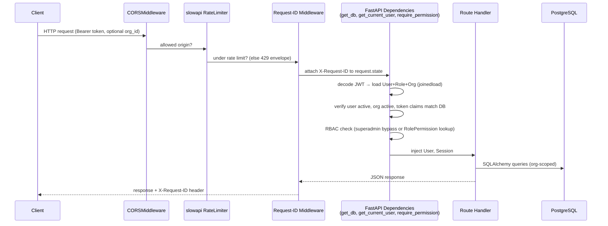
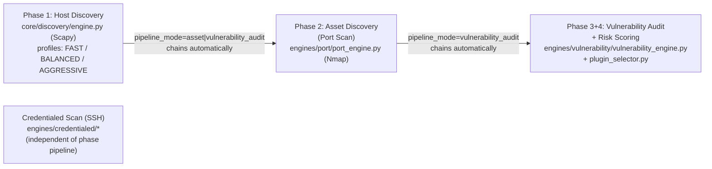
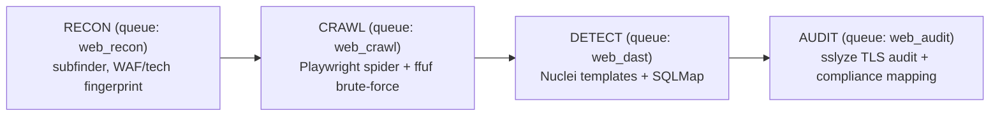

# CCure-Audit-PRO — System Architecture

> **Source of truth:** This document is generated strictly from the current implementation under `Backend/` and `Frontend/` (commit snapshot supplied for this review). Any prior documentation describing different modules, endpoints, or workflows has been superseded.

## 1. Product Summary

CCure-Audit-PRO is a multi-tenant vulnerability management and network/web auditing platform. A single deployment serves multiple **Organizations** (tenants); every user, asset, scan, and finding is scoped to exactly one organization, with a `superadmin` role able to operate across all tenants.

The platform has two independent scanning subsystems:

1. **Network Vulnerability Scanner** — a 4-phase pipeline (Host Discovery → Asset/Port Discovery → Vulnerability Audit → Risk Scoring) plus an SSH-based **Credentialed Scan**.
2. **Web Application Scanner (DAST)** — a 4-phase pipeline (Recon → Crawl → Detect → Audit) for URL-based targets.

Both subsystems share the same authentication, RBAC, multi-tenancy, notification, dashboard, and reporting infrastructure.

## 2. Technology Stack

| Backend framework | **FastAPI 0.111** (Python), Uvicorn ASGI server | `Backend/main.py` entry point with **179 registered endpoints** |
| ORM / DB layer | **SQLAlchemy 2.0** + **Alembic** migrations | **46 PostgreSQL tables** across 25 Alembic migrations (`Backend/db/models/*`) |
| Primary database | **PostgreSQL** (production) / SQLite fallback | Selected via `DATABASE_URL`; uses JSONB, INET, MACADDR, CIDR, GIN/trigram indexes |
| Vulnerability intelligence DB | Separate PostgreSQL database (`vuln_intel`) | `core/cve_database.py`, configured via `VulnIntelConfig` |
| Task queue | **Celery** with **Redis** broker/result backend | `core/celery_app.py` (`scanner`, `compliance`, `web_*` queues) |
| Real-time transport | **Redis Pub/Sub** + WebSockets + SSE | `core/redis_client.py` (`/scans/events`, `/notifications/stream`) |
| Authentication | **JWT** + **Argon2id** password hashing + **Fernet AES-256** | `auth/jwt_handler.py`, TOTP & Email OTP MFA |
| Rate limiting | **slowapi** | `scan_helpers.limiter`, decorator on auth/scan endpoints |
| Host discovery | **Scapy** (raw ARP/ICMP/TCP SYN/UDP probes) | `core/discovery/` |
| Port/service scanning | **Nmap** via `python-nmap` | `engines/port/port_engine.py`, `core/nmap/wrapper.py` |
| Credentialed scanning | **Paramiko** (SSH) | `engines/credentialed/` |
| Web DAST tooling | **Nuclei**, **SQLMap**, **sslyze**, **subfinder**, **ffuf**, **Playwright** | `core/web/*` |
| Policy Compliance Engine | **Celery** + **13 Framework Catalogs** + **python-docx** | ISO 27001, NIST CSF v2.0, CERT-In 2022, PCI-DSS v4.0, CIS v8.1, SOC 2, DPDP, GDPR, NIST 800-53, NIST 800-82, IEC 62443, NERC CIP, NIS2 |
| PDF & Word report generation | **ReportLab** + **python-docx** + **docxtpl** | `pdf_generator.py`, `web_pdf_generator.py`, `compile_docs.py` |
| Frontend framework | **React 18.3** + **Vite 5** | `Frontend/src` |
| Frontend routing | **react-router-dom 6.23** | `Frontend/src/App.jsx` (58 frontend routes) |
| Frontend HTTP client | **axios 1.7** with interceptors | `Frontend/src/api/axiosInstance.js` (silent refresh, non-masking 401 handler) |
| Reverse proxy | **nginx** (gateway container) | `docker-compose.yml`, `nginx/gateway.conf` |
| CI/CD Pipeline | **GitHub Actions** (`.github/workflows/ci.yml`) | Bandit, Ruff, Alembic integrity check, OpenAPI schema diff guard, test_docs_integrity.py |

## 3. High-Level Architecture

```mermaid
graph TB
    subgraph Client
        SPA["React 18 SPA (Vite build)<br/>served by nginx"]
    end

    subgraph Gateway
        GW["nginx gateway<br/>(single public entry point)"]
    end

    subgraph API_Layer["FastAPI Application (main.py)"]
        MW["Middleware:<br/>CORS → Rate Limiter →<br/>Request-ID Correlation →<br/>Exception Envelopes"]
        Routers["18 Routers:<br/>auth, scans, health,<br/>traditional/phase/credentialed scans,<br/>reports, admin_*, audit, user_profile,<br/>notifications, dashboard, assets,<br/>findings, web_scans, compliance"]
    end

    subgraph Workers["Celery Workers"]
        ScanW["scanner queue<br/>(core.tasks)"]
        WebW["web_recon / web_crawl /<br/>web_dast / web_audit queues<br/>(core.web.tasks)"]
        CompW["compliance queue<br/>(core.compliance_tasks)"]
    end

    subgraph Data["Data Stores"]
        PG[("PostgreSQL<br/>(primary app DB)")]
        VulnDB[("PostgreSQL<br/>vuln_intel DB<br/>(CVE/EPSS/KEV)")]
        Redis[("Redis<br/>Celery broker + result backend<br/>+ Pub/Sub progress/notifications")]
    end

    SPA -->|HTTPS| GW --> MW --> Routers
    Routers -->|SQLAlchemy| PG
    Routers -->|CVE lookups| VulnDB
    Routers -->|.delay()| Redis
    Redis --> ScanW
    Redis --> WebW
    Redis --> CompW
    ScanW -->|SQLAlchemy| PG
    WebW -->|SQLAlchemy| PG
    CompW -->|SQLAlchemy| PG
    ScanW -->|publish progress| Redis
    WebW -->|publish progress| Redis
    CompW -->|publish progress| Redis
    Redis -->|Pub/Sub| Routers
    Routers -->|WebSocket / SSE| SPA
```

## 4. Multi-Tenant Data Model

Every primary entity (`User`, `Scan`, `Asset`, `AssetVulnerability`, `WebScan`, `WebFinding`, `Notification`, `AuditLog`) carries an `org_id` foreign key to `organizations.id`, with `ON UPDATE CASCADE` so renaming an org slug propagates to all child IDs (IDs are human-readable "Stripe-style" strings, see `DATABASE_SCHEMA.md`).

Tenant isolation is enforced at the **query level** in every router:

- A helper `_resolve_org(user, requested_org_id)` is repeated across `routers/dashboard.py`, `routers/assets.py`, `routers/findings.py`, `routers/web_scans.py`, `routers/phase_scans.py`, and `scans/router.py`. It returns `user.org_id` for normal users, but allows a `superadmin` to pass `?org_id=` to inspect any organization.
- `scans/router.py` additionally checks `scans:read_all` permission (via `_user_can_read_all_scans`) to decide whether a non-admin sees only their own scans or all scans in their org.

## 5. Request Lifecycle (Backend)



Key middleware/handlers registered in `main.py`:

1. **CORSMiddleware** — origins from `CORS_ALLOW_ORIGINS` env var (defaults to localhost:3000/8080/5173) plus a permissive `allow_origin_regex` for any `http(s)://` origin; `allow_credentials=True`.
2. **slowapi rate limiter** — `app.state.limiter`; `RateLimitExceeded` is caught and rendered as a structured `429` envelope (`error_code: RATE_LIMIT_EXCEEDED`).
3. **Request-ID correlation middleware** — generates/propagates `X-Request-ID`, also special-cases CORS _Private Network Access_ preflight (`Access-Control-Request-Private-Network` header) by short-circuiting with the appropriate `Access-Control-Allow-Private-Network: true` response.
4. **Global `HTTPException` handler** — converts every raised `HTTPException` into the envelope `{"success": false, "error_code": "HTTP_<status>", "message": ..., "request_id": ...}`. Endpoints can override `error_code` via `exc.headers["X-Error-Code"]` (used by the web-scan authorization gate).
5. **`RequestValidationError` handler** — returns `422` with the same envelope plus an `errors` array; any field whose path contains `password`, `key_path`, `secret`, `token`, `api_key`, or `credential` has its echoed `input` value redacted.

## 6. Application Startup (Lifespan)

`main.py`'s `lifespan()` context manager runs on boot:

1. **DB connectivity check** — `SELECT 1`; logs an error but does **not** crash the process if the DB is unreachable (keeps the container alive for debugging/migration).
2. **RBAC + default org seeding** — calls `db.migrate_production_schema.seed_rbac()` and `seed_default_org()` inside a transaction (idempotent — checks for existing rows first).
3. **Default admin seeding** — if `DEFAULT_ADMIN_EMAIL` / `DEFAULT_ADMIN_PASSWORD` are set and no user with that email exists, creates a `superadmin` user in the seeded `default`-slug organization. If those env vars are unset and the `users` table is empty, logs a warning only.
4. **Engine initialization** — instantiates `HostDiscoveryAPI` (network scan engine façade) and stores it via `scan_helpers.set_api()` for use by `routers/health.py` and the traditional scan routers.
5. **Background cleanup loop** — an `asyncio` task that, every 24 hours: deletes generated PDF reports older than 7 days (`routers/reports.cleanup_old_reports`) and purges expired rows from `password_reset_tokens`.

On shutdown, the cleanup task is cancelled.

## 7. Router Map

All routers are registered in `main.py` via `app.include_router(...)`. Prefixes and responsibilities:

| Router module                  | Prefix                  | Responsibility                                                                                                                                   |
| ------------------------------ | ----------------------- | ------------------------------------------------------------------------------------------------------------------------------------------------ |
| `auth/router.py`               | `/auth`                 | Registration, login, logout, refresh, password reset, username/email availability checks, WS download tickets                                    |
| `scans/router.py`              | `/scans`                | Scan history, SSE live history stream, per-scan WebSocket progress, archive/restore/recycle/purge lifecycle                                      |
| `routers/health.py`            | `/` (+ `/scan`, `/api`) | System health/info, DB-backed scan progress, pipeline-mode documentation endpoints                                                               |
| `routers/traditional_scans.py` | `/scan`                 | Legacy synchronous `host`/`range`/`subnet`/`subnets` endpoints (backward compatibility)                                                          |
| `routers/phase_scans.py`       | `/scan`                 | Phase-selective async pipeline: `host-discovery`, `asset-discovery`, `vulnerability-audit`, `phases`, `quota`                                    |
| `routers/credentialed.py`      | `/scan`                 | SSH credentialed scan trigger                                                                                                                    |
| `routers/reports.py`           | `/reports`              | PDF report download/delete                                                                                                                       |
| `routers/admin_users.py`       | `/admin/users`          | User CRUD, role/org assignment, soft-delete/restore/purge, password reset                                                                        |
| `routers/admin_rbac.py`        | `/admin/roles`          | List roles and role→permission mappings                                                                                                          |
| `routers/admin_orgs.py`        | `/admin/organizations`  | Organization CRUD, activation/deactivation                                                                                                       |
| `routers/audit.py`             | `/admin/audit-logs`     | Immutable audit log query                                                                                                                        |
| `routers/user_profile.py`      | `/user`                 | Profile, password change, preferences, session management                                                                                        |
| `routers/notifications.py`     | `/notifications`        | Notification inbox, SSE stream, read/delete                                                                                                      |
| `routers/dashboard.py`         | `/dashboard`            | 15 analytics endpoints for the Security Dashboard (network + web)                                                                                |
| `routers/assets.py`            | `/assets`               | Asset registry, services/TLS/certificate inventories, tags/notes/changelog, AMT import                                                           |
| `routers/findings.py`          | `/findings`             | Vulnerability findings browser and triage                                                                                                        |
| `routers/web_scans.py`         | `/web-scans`            | Web application (DAST) scan lifecycle, findings, assets, report, WebSocket progress                                                              |
| `routers/compliance.py`        | `/compliance`           | Multi-tenant framework marketplace, custom policies, JIT credentials, manual attestations, Maker-Checker remediation requests, exception waivers |

See `BACKEND_API_REFERENCE.md` for the full endpoint-by-endpoint contract.

## 8. Network Vulnerability Scan Pipeline (Overview)

A "scan" is a `Scan` row whose lifecycle is driven by **frontend-orchestrated, phase-selective** Celery tasks (`core/tasks.py`), coordinated by `orchestrator.scan_orchestrator.ScanOrchestrator`.



Three **pipeline modes** (`Scan.pipeline_mode`) determine the terminal phase:

| `pipeline_mode`       | Phases run                     | Terminal phase | Discovery profile (Phase 1)                           |
| --------------------- | ------------------------------ | -------------- | ----------------------------------------------------- |
| `basic`               | 1                              | 1              | `FAST`                                                |
| `asset`               | 1 → 2                          | 2              | Intensity-aware (`light`/`normal`/`deep` — see below) |
| `vulnerability_audit` | 1 → 2 → 3 (incl. risk scoring) | 3              | `AGGRESSIVE`                                          |

**`discovery_intensity`** (only meaningful when `pipeline_mode=asset`) controls how Phase 1 host discovery balances speed vs. coverage — see `SCAN_ENGINE_DEEP_DIVE.md` for the full algorithm:

- `light` — `FAST` profile only.
- `normal` (default) — `FAST` first, then `BALANCED` fallback **only** for IPs still inactive.
- `deep` — full `BALANCED` profile for every IP.

A separate **`port_scan_intensity`** (`light`/`normal`/`deep`) controls Phase 2's Nmap port range, independent of `discovery_intensity`.

Each phase is tracked by a `ScanPhase` row (`status`: `pending → running → complete | failed | skipped`). Celery tasks chain themselves: `run_host_discovery_task` → `run_asset_discovery_task` → `run_vulnerability_audit_task`, each updating the `Scan`/`ScanPhase` rows and publishing progress to Redis (`scan_progress:{scan_id}` channel), consumed by the per-scan WebSocket (`GET /scans/{id}/progress` and `GET /web-scans/{id}/progress`).

## 9. Web Application Scan Pipeline (Overview)

`WebScan` rows are independent of the network `Scan` model (URL-based, not CIDR-based). The pipeline is a fixed 4-phase chain, each phase its own Celery queue:



Each phase persists `WebAsset`/`WebFinding` rows incrementally and updates `WebScan.recon_status` / `crawl_status` / `detect_status` / `audit_status`. Progress is broadcast over `scan_progress:{web_scan_id}` (Redis Pub/Sub) to `GET /web-scans/{id}/progress` (WebSocket).

## 10. Policy Compliance Engine (Overview)

The Policy Compliance Engine provides tenant-isolated security baseline posture evaluation (e.g. ISO 27001). Key components and workflows:

1. **Marketplace & Seeding**: The framework catalog contains global frameworks (ISO 27001, etc.) and technical check rules. Tenants install frameworks from the marketplace.
2. **Technical Auditing (Scanners & Evidence)**: Compliance scan runs are triggered via background Celery tasks (`compliance.run_scan`) which map rules against asset configurations (registry settings, files, open ports, legacy services). Manual controls are attested by analysts who write notes and upload files as evidence.
3. **Maker-Checker Remediation Queue**: Automated remediation scripts are executed over SSH using Paramiko. An analyst (Maker) initiates the remediation request (`POST /compliance/findings/{id}/remediate`), which enters a pending approval queue. A compliance officer/admin (Checker) must review and approve the script execution. Bypassing the checker queue requires explicit `emergency_bypass = True` configuration (restricted to admins).
4. **Exception Waivers**: Findings can be exempted by requesting exception waivers with compensatory control descriptions. Waivers must be approved by compliance officers and carry expiration deadlines.
5. **Real-time Scoring & Dashboards**: Asset-level and organization-level compliance scores (simple and risk-weighted) are cached (`compliance_scores` table) and visualized via the React workspace frontend. SoA PDF/Word reports are auto-compiled on demand.

## 11. Background Jobs (Celery)

`core/celery_app.py` defines the Celery app `ccure_tasks` with:

| Queue        | Consumed by               | Tasks                                                                                                                                                                          |
| ------------ | ------------------------- | ------------------------------------------------------------------------------------------------------------------------------------------------------------------------------ |
| `default`    | any worker                | `send_password_reset_email_task`                                                                                                                                               |
| `scanner`    | `worker` container (root) | `run_host_discovery`, `run_asset_discovery`, `run_vulnerability_audit`, `run_traditional_scan`, `run_credentialed_scan`, `sync_*_task` helpers, `reconcile_amt_inventory_task` |
| `web_recon`  | `web-worker` container    | `ccure.web.run_recon`                                                                                                                                                          |
| `web_crawl`  | `web-worker` container    | `ccure.web.run_crawl`                                                                                                                                                          |
| `web_dast`   | `web-worker` container    | `ccure.web.run_detect`                                                                                                                                                         |
| `web_audit`  | `web-worker` container    | `ccure.web.run_audit`                                                                                                                                                          |
| `compliance` | `worker` container (root) | `compliance.run_scan`, `compliance.run_remediation`, `compliance.run_reverify`, `compliance.prune_remediation_logs`                                                            |

`task_track_started=True`, `worker_concurrency` is configurable (`SCANNER_WORKER_CONCURRENCY`, default 20), and `task_time_limit = NMAP_TIMEOUT + 60` to prevent runaway scans.

## 12. Notifications & Real-Time Updates

- `Notification` rows are written for events such as user creation/suspension (`routers/admin_users.py`), scan completion, etc.
- `core/redis_client.publish_notification_sync` pushes events to `notifications:user:{user_id}`; `GET /notifications/stream` (SSE) relays them, falling back to a heartbeat-only mode if Redis is unreachable.
- `fan_out_notification()` broadcasts a notification to all active users in an org matching given role names (e.g. `superadmin`, `org_admin`), respecting each user's `preferences.in_app_alerts` flag.
- Scan progress uses a parallel Redis Pub/Sub channel per scan (`scan_progress:{scan_id}` / `scan_progress:{web_scan_id}`), consumed via WebSocket.
- `GET /scans/events` provides an SSE feed of the **scan history list** itself (adaptive polling: 0.5s while any scan is `running`, else 2s), useful for list views that need to reflect status changes without a dedicated WebSocket per row. It emits `connected`, `scans`, and `heartbeat` events and is separate from the phase-selective `/scan` endpoints.

## 13. Frontend Architecture (Summary)

The frontend is a single Vite-built React 18 SPA (`Frontend/src`). High-level points (full detail in `FRONTEND_ARCHITECTURE.md`):

- **Routing** (`src/App.jsx`): `react-router-dom` v6, with a top-level `<PrivateRoute>` wrapper that enforces authentication for the protected tree. Most routes are auth-only, while admin routes are further guarded with permission props such as `requiredPermission`, `requiredAny`, `requiredAll`, or `superadminOnly`.
- **Route structure**: the app includes both the legacy scan routes and the newer dashboard/asset/compliance surfaces. The web application scanning UI is mounted as a nested route subtree under `/web-scans/*` via `Frontend/src/modules/web-scanning/WebScanningRoutes.jsx`.
- **State management**: React Context — `AuthContext` (session/user/role), `ScanContext` (in-progress scan pipeline state), `PreferencesContext` (theme, defaults).
- **API layer** (`src/api/`): a shared `axiosInstance` with request interceptor (attaches `Authorization: Bearer` + `org_id` query param from `localStorage.activeOrgId`) and response interceptor (silent access-token refresh via `/auth/refresh`, then forced logout on failure).
- **RBAC mirroring**: `src/auth/permissions.js` re-implements the same `resource:action` permission-set check the backend performs, using the permission list embedded in `/auth/me`'s response, so the UI can hide/disable actions a user's role doesn't allow (the backend remains the authoritative enforcement point).
- **Web-scan integration**: the web-scanning module calls the backend web-scan lifecycle endpoints (`POST/GET/PATCH /web-scans`, findings/assets/report routes, and a ticket-based WebSocket on `/web-scans/{id}/progress`).

## 14. Deployment Topology

`docker-compose.yml` defines 6 services:

| Service      | Image/Build                                                        | Role                                                                                     |
| ------------ | ------------------------------------------------------------------ | ---------------------------------------------------------------------------------------- |
| `redis`      | `redis:7-alpine`                                                   | Celery broker/result backend + Pub/Sub                                                   |
| `api`        | `Backend/Dockerfile`                                               | FastAPI app (uvicorn), port 8000                                                         |
| `worker`     | `Backend/Dockerfile` (profile `container-scanner`, runs as `root`) | Celery worker, queue `scanner` — needs root for raw sockets (Scapy/Nmap)                 |
| `web-worker` | `Backend/Dockerfile` (profile `container-scanner`, runs as `root`) | Celery worker, queues `web_recon,web_crawl,web_dast,web_audit` — needs Playwright + root |
| `frontend`   | `Frontend/Dockerfile`                                              | nginx serving the Vite build, port 3200                                                  |
| `gateway`    | `nginx:stable-alpine`                                              | Single public entry point (captures real client IPs for audit logging), port 80          |

The primary PostgreSQL database and the separate `vuln_intel` database are expected to run on the Docker host (`host.docker.internal`), not as compose services — both are configured purely via environment variables (`DATABASE_URL`, `VULN_DB_*`).
