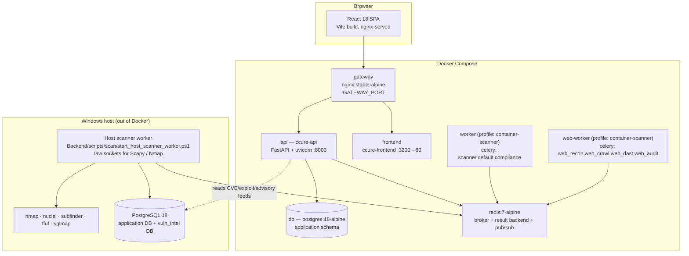
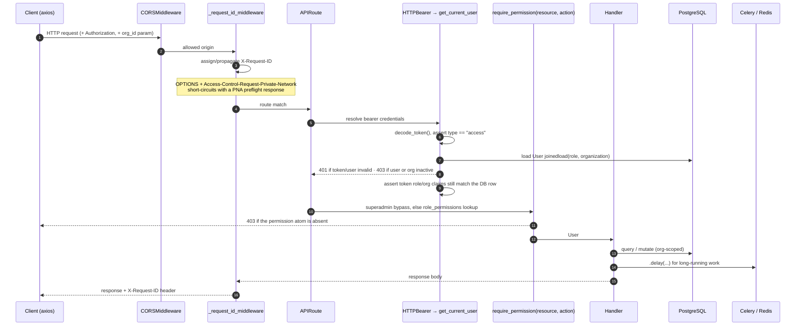
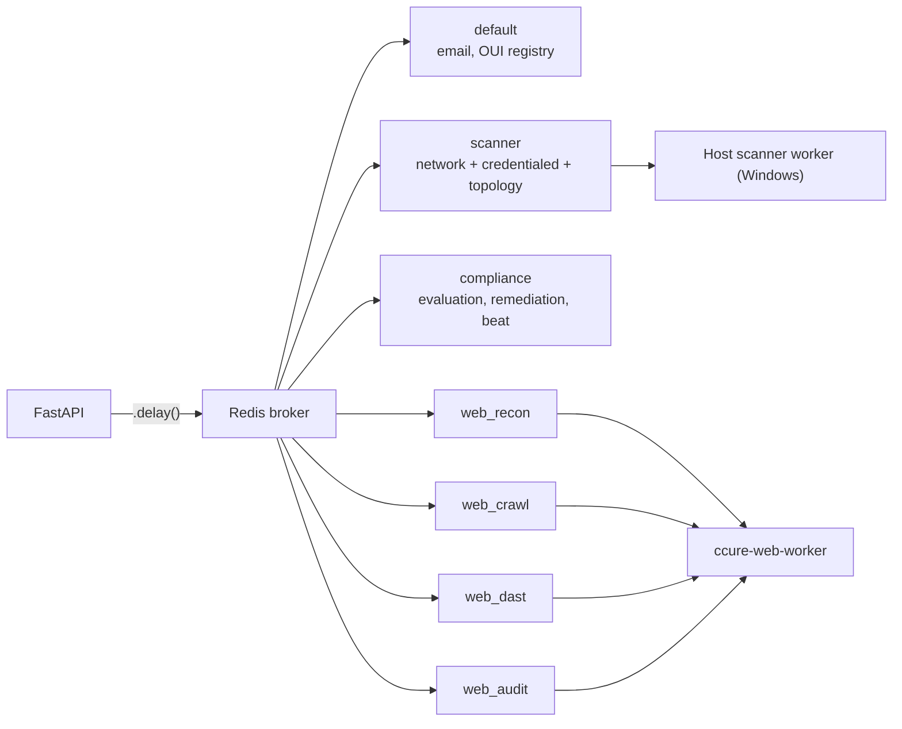
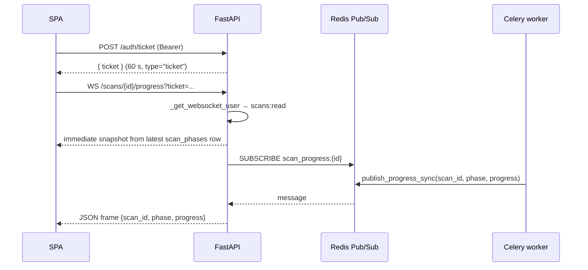
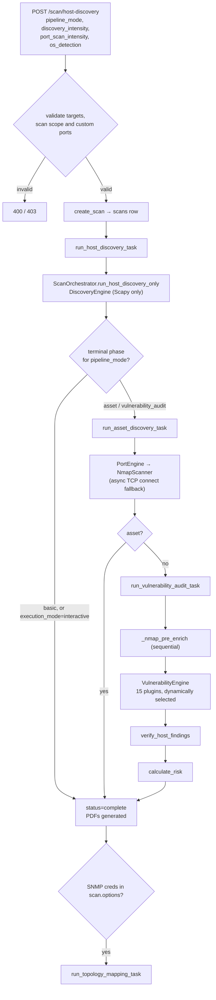
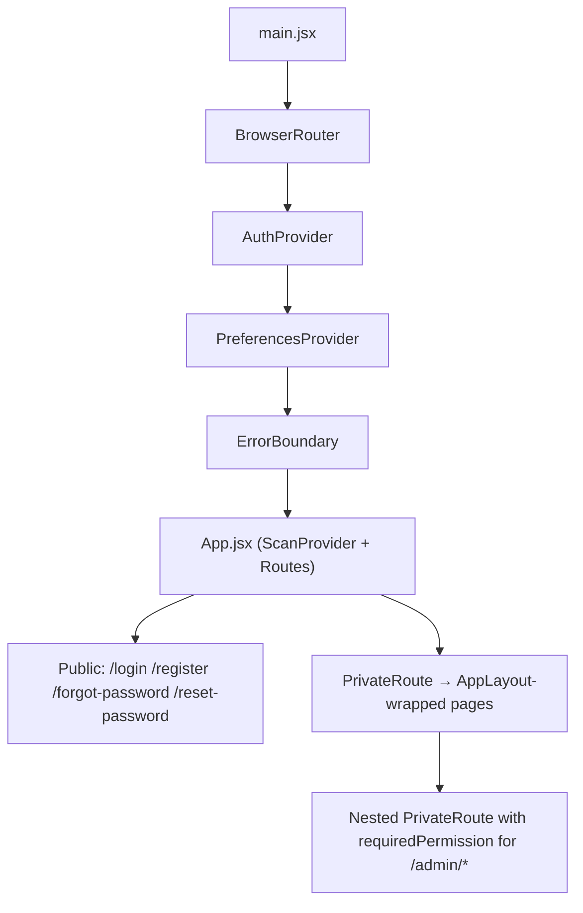

# System Architecture

**CCure-Audit-PRO** — network, web-application and compliance auditing platform.

> This document is generated from a direct audit of the current source tree. Every
> component, path, constant and flow named below was read out of the code, not
> inherited from previous documentation. Where a fact is easy to get wrong, the
> file and symbol that establishes it is cited inline.

---

## 1. What the system is

CCure-Audit-PRO is a multi-tenant security-audit platform built around four
independent assessment pipelines that share one asset registry, one finding
store and one RBAC model:

| Pipeline                                                            | Entry point                 | Executes as                                                  | Terminal artefact                                                                         |
| ------------------------------------------------------------------- | --------------------------- | ------------------------------------------------------------ | ----------------------------------------------------------------------------------------- |
| **Network scan** (host discovery → port scan → vulnerability audit) | `POST /scan/host-discovery` | Celery `scanner` queue                                       | `scans` + `scan_phases` + `assets` + `asset_vulnerabilities`, executive & technical PDFs  |
| **Credentialed audit** (authenticated host inspection)              | `POST /scan/credentialed`   | Celery `scanner` queue                                       | Same tables, `pipeline_mode="credentialed"`                                               |
| **Web application scan** (DAST)                                     | `POST /web-scans`           | Celery `web_recon`/`web_crawl`/`web_dast`/`web_audit` queues | `web_scans` + `web_assets` + `web_findings`, PDF                                          |
| **Compliance evaluation**                                           | `POST /compliance/scans`    | Celery `compliance` queue                                    | `compliance_scan_runs` + `compliance_findings` + `compliance_scores`, framework PDFs/DOCX |

A fifth capability, **network topology mapping**, is not a pipeline of its own —
it is an optional Phase 4 chained onto any network scan when SNMP credentials
are present in `scan.options` (`Backend/core/tasks.py::_chain_topology_if_needed`).

---

## 2. Deployment topology



**Container inventory** — `docker-compose.yml`, verified service by service:

| Service      | Container          | Image / build           | Published bind                                  | Notes                                                                                                      |
| ------------ | ------------------ | ----------------------- | ----------------------------------------------- | ---------------------------------------------------------------------------------------------------------- |
| `redis`      | `ccure-redis`      | `redis:7-alpine`        | `127.0.0.1:6379`                                | Celery broker, result backend, and Pub/Sub for progress + notifications                                    |
| `db`         | `ccure-db`         | `postgres:18-alpine`    | `127.0.0.1:${POSTGRES_PORT_BINDING:-5433}:5432` | Seeded by `scripts/docker-postgres-init.sql`                                                               |
| `api`        | `ccure-api`        | `./Backend/Dockerfile`  | `127.0.0.1:8000`                                | Runs `start.sh` → migrations, then uvicorn. Mounts `./Backend`, `./Backend/reports`, and `./docs:/docs:ro` |
| `worker`     | `ccure-worker`     | `./Backend/Dockerfile`  | —                                               | `profiles: ["container-scanner"]`, runs as `root`, queues `scanner,default,compliance`                     |
| `web-worker` | `ccure-web-worker` | `./Backend/Dockerfile`  | —                                               | `profiles: ["container-scanner"]`, runs as `root`, queues `web_recon,web_crawl,web_dast,web_audit`         |
| `frontend`   | `ccure-frontend`   | `./Frontend/Dockerfile` | `127.0.0.1:3200:80`                             | Multi-stage: `node:25-slim` build → `nginx:stable-alpine`. `VITE_API_BASE_URL` is a **build arg**          |

Both scanner workers sit behind the `container-scanner` Compose profile, so
`docker compose up` starts neither by default. That is deliberate: raw-socket
discovery (Scapy ARP/ICMP/SYN) and Nmap need direct access to the physical
network. On the VM the `worker` service gets it through `network_mode: host`
and `NET_ADMIN`/`NET_RAW`; `COMPOSE_PROFILES=container-scanner` in `.env` starts
both. (The Windows deployment ran the worker on the host via
`start_host_scanner_worker.ps1`; both were retired on 9 Oct 2026.)

> **CAUTION:** Because `VITE_API_BASE_URL` is baked at frontend build time, a
> change to the API URL requires `docker compose build frontend`, not a restart.

---

## 3. Backend application structure

`Backend/main.py` is deliberately thin. It owns app instantiation, the lifespan
hook, four cross-cutting middleware/exception concerns, and 20 `include_router`
calls. All endpoint logic lives in router modules.

```
Backend/
├── main.py                      FastAPI app, middleware, router registration
├── config.py                    Every env var read in one place (AppConfig et al.)
├── scan_helpers.py              PIPELINE_PHASES, rate limiter, HostDiscoveryAPI singleton
├── api/host_discovery_api.py    Thin façade the traditional endpoints call
│
├── auth/                        Authentication + RBAC
│   ├── router.py                15 endpoints under /auth
│   ├── jwt_handler.py           Token mint/decode/rotate, argon2+bcrypt passwords
│   ├── dependencies.py          get_current_user, get_current_user_flexible, AuthContext
│   ├── rbac.py                  require_permission(), require_role()
│   ├── email_utils.py           Case-insensitive email/username matching
│   └── mail_service.py          SMTP dispatch
│
├── routers/                     18 routers → 132 of the 155 HTTP operations
├── scans/                       Scan history router, DB helpers, normalizer, CVE engine
├── orchestrator/                scan_orchestrator.py (network), web_orchestrator.py (DAST)
├── engines/                     discovery / port / vulnerability / credentialed
├── core/                        Discovery techniques, Nmap wrapper, topology, web tools,
│                                Celery app + tasks, risk, quota, audit, feeds
├── db/                          SQLAlchemy Base, 47-table model set, RBAC seeder
├── alembic/versions/            32 migrations, head c3h4i5j6k7l8
├── reporting/                   Scan PDF/CSV generators and ReportLab helpers
├── data/compliance_seeds/       The 13 *_controls_seed.json catalogues
├── reports/                     Generated PDF/CSV output (bind-mounted)
└── tests/                       65 test modules in 10 groups (auth, security,
                                 compliance, scans, assets, topology,
                                 credentialed, web, reports, repo)
```

### Router registration

`main.py` registers these routers in order. Prefixes are declared on the
`APIRouter` itself, not at include time:

| Module                         | Prefix                 | Tag                               | Ops      |
| ------------------------------ | ---------------------- | --------------------------------- | -------- |
| `auth/router.py`               | `/auth`                | Authentication                    | 15       |
| `scans/router.py`              | `/scans`               | Scan History                      | 8 + 1 WS |
| `routers/health.py`            | _(none)_               | Health / Progress / Documentation | 4        |
| `routers/traditional_scans.py` | _(none)_               | Traditional Scans                 | 4        |
| `routers/phase_scans.py`       | _(none)_               | Phase-Selective Scans             | 5        |
| `routers/credentialed.py`      | _(none)_               | Credentialed Scans                | 1        |
| `routers/reports.py`           | _(none)_               | Reports                           | 2        |
| `routers/admin_users.py`       | `/admin/users`         | User Management                   | 11       |
| `routers/admin_rbac.py`        | `/admin/roles`         | RBAC Administration               | 2        |
| `routers/admin_orgs.py`        | `/admin/organizations` | Organization Management           | 5        |
| `routers/admin_nvd.py`         | `/api/v1/admin`        | Admin NVD Catalog                 | 2        |
| `routers/audit.py`             | `/admin/audit-logs`    | Audit Logs                        | 1        |
| `routers/user_profile.py`      | `/user`                | User Profile & Preferences        | 7        |
| `routers/notifications.py`     | `/notifications`       | Notifications                     | 7        |
| `routers/dashboard.py`         | `/dashboard`           | Dashboard                         | 15       |
| `routers/assets.py`            | `/assets`              | Assets                            | 16       |
| `routers/findings.py`          | `/findings`            | Findings                          | 5        |
| `routers/web_scans.py`         | `/web-scans`           | Web Scans                         | 8 + 1 WS |
| `routers/topology.py`          | _(none)_               | Network Topology                  | 2        |
| `routers/compliance.py`        | `/compliance`          | Compliance                        | 35       |

**Totals: 155 HTTP operations + 2 WebSocket endpoints.** Full inventory in
[BACKEND_API_REFERENCE.md](BACKEND_API_REFERENCE.md).

---

## 4. Request lifecycle



### Middleware and exception pipeline (`main.py`)

Registered in this order — note that FastAPI applies `add_middleware` in reverse,
so the request-ID middleware is the inner layer and CORS the outer one:

1. **`CORSMiddleware`** — origins from `CORS_ALLOW_ORIGINS` (comma-separated), or
   a six-entry localhost default. `allow_credentials=True`,
   `allow_origin_regex="https?://.*"`, methods `GET POST PUT DELETE PATCH OPTIONS`.
2. **`_request_id_middleware`** (`@app.middleware("http")`) — accepts an inbound
   `X-Request-ID` or mints a UUID4, stores it on `request.state.request_id`,
   echoes it on the response, and logs 4xx at WARNING / 5xx at ERROR. It also
   answers Chrome's **Private Network Access** preflight
   (`OPTIONS` + `Access-Control-Request-Private-Network`) directly.
3. **`RateLimitExceeded` handler** — 429 in the standard error envelope.
4. **`HTTPException` handler** — wraps every HTTP error as
   `{success, error_code, message, detail, request_id}`. `error_code` defaults to
   `HTTP_<status>` but an endpoint may override it via `exc.headers["X-Error-Code"]`.
5. **`RequestValidationError` handler** — 422 with `error_code="VALIDATION_ERROR"`.
   It strips Pydantic's raw `input` payload from every error (which would
   otherwise echo submitted passwords), stringifies `ctx` (an un-serialisable
   exception object there turned the 422 into a 500), and replaces the context of
   any field whose name matches `_SENSITIVE_FIELDS` = `{password, key_path,
secret, token, api_key, credential}` with `"Value redacted for security."`.

### Rate limiting

`scan_helpers.limiter` is a SlowAPI `Limiter` backed by the Celery Redis URL, so
limits persist across API workers. Its key function is **not** SlowAPI's
`get_remote_address`: `_rate_limit_key()` calls `core.ip_resolver.get_client_ip`,
which walks `X-Forwarded-For` from the nearest hop outward and stops at the first
address not in `TRUSTED_PROXIES`. Behind the nginx gateway the socket peer is
always the proxy, which would have put every user in one bucket.

Applied limits, all from `@limiter.limit(...)` decorators:

| Limit     | Endpoints                                                                                                                                                                                   |
| --------- | ------------------------------------------------------------------------------------------------------------------------------------------------------------------------------------------- |
| 20/minute | `GET /auth/check-username`, `GET /auth/check-email`                                                                                                                                         |
| 10/minute | `POST /auth/login`                                                                                                                                                                          |
| 5/minute  | `POST /auth/register`, `POST /auth/login/send-email-otp`, `POST /auth/login/verify-mfa`, all four `/scan/*` traditional endpoints, all four phase-scan endpoints, `POST /scan/credentialed` |
| 3/minute  | `POST /auth/forgot-password`                                                                                                                                                                |

### Application lifespan

`lifespan()` runs before the first request and performs, in order:

1. `SELECT 1` connectivity probe. **Failure is logged, not raised** — the
   container stays alive so an operator can exec in and repair it.
2. Additive schema helpers: `ensure_user_schema()`, `ensure_scan_schema()`,
   `ensure_topology_schema()`, `ensure_mac_vendor_schema()`.
3. `seed_rbac(conn)` and `seed_default_org(conn)` from
   `db/migrate_production_schema.py` — idempotent role, permission and default-org
   seeding.
4. First-admin seeding from `DEFAULT_ADMIN_EMAIL` / `DEFAULT_ADMIN_PASSWORD`
   (skipped if the email already exists; warns if no users exist and neither var
   is set).
5. Compliance catalog auto-seeding — checks 12 frameworks and their control counts
   against thresholds, and re-runs `seed_framework_and_controls` +
   `seed_and_evaluate` if any is short.
6. `HostDiscoveryAPI(silent=False)` instantiated and registered via `set_api()`.
7. Two background `asyncio` tasks: a report/token cleanup loop
   (`cleanup_old_reports(7)` plus expired `password_reset_tokens` purge) and a
   24-hour NVD auto-sync loop (`sync_nvd_to_vuln_intel(days_back=90)`).

Both loops are cancelled on shutdown.

---

## 5. Background processing

`core/celery_app.py` defines one Celery app, `ccure_tasks`, including three task
modules and declaring **seven queues**:



Configuration (`celery_app.conf`): JSON serialiser only, UTC, `task_track_started=True`,
`worker_concurrency=AppConfig.SCANNER_WORKER_CONCURRENCY`,
`worker_prefetch_multiplier=AppConfig.SCANNER_WORKER_PREFETCH_MULTIPLIER`,
`task_time_limit = NMAP_TIMEOUT + 60`, and `task_always_eager` driven by
`CELERY_TASK_ALWAYS_EAGER`.

**Celery Beat schedule** (`celery_app.conf.beat_schedule`):

| Schedule name                                 | Task                                          | Cadence                                         |
| --------------------------------------------- | --------------------------------------------- | ----------------------------------------------- |
| `prune-compliance-remediation-logs-weekly`    | `compliance.prune_remediation_logs`           | `crontab(hour=0, minute=0, day_of_week="sun")`  |
| `run-scheduled-compliance-scans-every-minute` | `compliance.run_scheduled_scans`              | every 60 s                                      |
| `purge-stale-unverified-accounts-daily`       | `ccure.tasks.purge_stale_unverified_accounts` | `crontab(hour=3, minute=30)`                    |
| `purge-stale-unapproved-accounts-daily`       | `ccure.tasks.purge_stale_unapproved_accounts` | `crontab(hour=3, minute=45)`                    |
| `sync-disposable-email-domains-weekly`        | `ccure.tasks.sync_disposable_domains`         | `crontab(hour=4, minute=15, day_of_week="mon")` |

**Beat runs as its own container** (`ccure-beat`, `docker-compose.yml`). It did
not, until 18 Aug 2026 — the schedule above was defined and no process published
it, so compliance scheduling and the account purges were configured, registered
with Celery, and silently dead. The command appeared only as a copy-paste line
in `DEVELOPER_SETUP_GUIDE.md`.

The service is deliberately **not** behind the `container-scanner` profile: that
profile exists to keep raw-socket scan workers out of the default `up`, and
applying it here would leave the scheduler off by default all over again.

Beat only _publishes_; the tasks execute on whichever worker consumes the queue,
which for `default` is the host scanner worker (`--queues=scanner,default`).
**Exactly one beat process may run at a time** — two schedulers publish every
task twice, and a second "purge stale accounts" is not harmless.

### Task inventory

**`core/tasks.py` — network + credentialed (queue `scanner` unless noted)**

| Task name                                   | Function                          | Role                                      |
| ------------------------------------------- | --------------------------------- | ----------------------------------------- | ----- | ------ | ------- | ------- |
| `ccure.tasks.run_host_discovery`            | `run_host_discovery_task`         | Phase 1; chains Phase 2                   |
| `ccure.tasks.run_asset_discovery`           | `run_asset_discovery_task`        | Phase 2; chains Phase 3                   |
| `ccure.tasks.run_vulnerability_audit`       | `run_vulnerability_audit_task`    | Phase 3                                   |
| `ccure.tasks.run_topology_mapping`          | `run_topology_mapping_task`       | Optional Phase 4                          |
| `ccure.tasks.run_traditional_scan`          | `run_traditional_scan_task`       | `/scan/host                               | range | subnet | subnets | phases` |
| `ccure.tasks.run_credentialed_scan`         | `run_credentialed_scan_task`      | Authenticated audit                       |
| `ccure.tasks.sync_host_discovery_task`      | `sync_host_discovery_task`        | Persist Phase 1 payload → normalized rows |
| `ccure.tasks.sync_asset_discovery_task`     | `sync_asset_discovery_task`       | Persist Phase 2 payload                   |
| `ccure.tasks.sync_vulnerability_audit_task` | `sync_vulnerability_audit_task`   | Persist Phase 3 payload                   |
| `ccure.tasks.send_password_reset_email`     | `send_password_reset_email_task`  | queue `default`                           |
| `ccure.tasks.send_mfa_otp`                  | `send_mfa_otp_task`               | queue `default`                           |
| `ccure.tasks.reconcile_amt_inventory_task`  | `reconcile_amt_inventory_task`    | AMT inventory reconciliation              |
| `ccure.tasks.update_mac_vendor_registry`    | `update_mac_vendor_registry_task` | queue `default`; refreshes OUI cache      |

**`core/web/tasks.py` — DAST**

| Task name              | Queue       | `soft_time_limit` / `time_limit` |
| ---------------------- | ----------- | -------------------------------- |
| `ccure.web.run_recon`  | `web_recon` | 1800 / 2400                      |
| `ccure.web.run_crawl`  | `web_crawl` | 3600 / 4200                      |
| `ccure.web.run_detect` | `web_dast`  | 7200 / 8400                      |
| `ccure.web.run_audit`  | `web_audit` | 1800 / 2400                      |

**`core/compliance_tasks.py` — queue `compliance`**

`compliance.run_scan`, `compliance.run_remediation`, `compliance.prune_remediation_logs`,
`compliance.run_reverify`, `compliance.run_scheduled_scans`.

### Cancellation

Cancellation is **cooperative**. `core/scan_control.py` exists because reading
the `Scan` row through the task's own long-lived SQLAlchemy session returned the
identity-map copy and never saw the API's `cancelled` commit. Every helper there
(`read_status`, `is_cancelled`, `raise_if_cancelled`, `make_cancel_check`) opens
its own short-lived session. `POST /scans/{id}/stop` additionally calls
`celery_app.control.revoke(task_id, terminate=True)`, but the host worker uses a
threads pool where `terminate` cannot kill a running thread — so the engine's
between-batch `is_cancelled()` poll is the mechanism that actually stops work.

---

## 6. Data architecture

Two separate PostgreSQL databases:

| Database                                                            | Owner             | Managed by                                | Contents                                                                                   |
| ------------------------------------------------------------------- | ----------------- | ----------------------------------------- | ------------------------------------------------------------------------------------------ |
| **Application DB** (`DATABASE_URL`)                                 | This repo         | Alembic, 32 migrations                    | 47 tables — tenants, users, RBAC, scans, assets, findings, web scans, compliance, topology |
| **`vuln_intel`** (`VULN_DB_*` / `VULNERABILITY_INTEL_DATABASE_URL`) | Feed sync scripts | **Not under this repo's Alembic control** | NVD CVEs, CVSS, CPE, OSV, MSRC, CSAF advisories, exploit intel, CISA KEV, VulnCheck KEV    |

`VulnIntelConfig.database_url()` resolves in three steps:
`VULNERABILITY_INTEL_DATABASE_URL` → the `VULN_DB_*` group (used whenever _any_
of those five vars is set) → `DATABASE_URL`. The middle step matters: without it,
a deployment that set `VULN_DB_NAME=vuln_intel` silently sent every CVE query to
the application database.

Feed ingest scripts under `Backend/scripts/vuln/`: `sync_osv.py`, `sync_msrc.py`,
`sync_exploit_intel.py`, `sync_csaf.py`, `sync_vulncheck.py`, `download_nvd.py`,
`backfill_finding_intel.py`; plus `Backend/scans/nvd_sync.py` used by the API's
24-hour loop and by `POST /api/v1/admin/sync-nvd`.

Schema detail: [DATABASE_SCHEMA.md](DATABASE_SCHEMA.md).

### Tenancy

Every tenant-scoped table carries an `org_id` (or `tenant_id`) FK to
`organizations.id` with `ON DELETE CASCADE`. Isolation is enforced at query time,
not by Postgres RLS. The standard pattern, repeated across routers, is:

```python
def _is_superadmin(user): return (user.role.name or "").lower() == "superadmin"

def _resolve_org(user, requested_org):
    if _is_superadmin(user) and requested_org:
        return requested_org        # superadmin may cross tenants explicitly
    return str(user.org_id)         # everyone else is pinned to their own org
```

The frontend cooperates: `axiosInstance` injects `params.org_id` from
`localStorage.activeOrgId` on every request unless the caller already set it.

### Primary keys

IDs are human-readable and mostly deterministic (`db/base.py`):

| Generator                                                     | Shape                                            | Example                          |
| ------------------------------------------------------------- | ------------------------------------------------ | -------------------------------- |
| `gen_org_id(slug)`                                            | `org_{slug}`                                     | `org_default`                    |
| `gen_user_id(org_slug, username)`                             | `usr_{orgtoken}_{user}_{rand4}`                  | `usr_defa_1a2b3c4d_pankaj_x9v1`  |
| `gen_scan_id(org_slug)`                                       | `scn_{orgtoken}_{ddmonyy}_{rand4}`               | `scn_defa_1a2b3c4d_07may25_x9v1` |
| `gen_asset_id(org, ip)`                                       | `ast_{orgtoken}_{ip}` — **deterministic**        | `ast_defa_1a2b3c4d_192_168_1_5`  |
| `gen_service_id(asset_id, port, proto)`                       | `svc_{asset}_{port}_{proto}` — **deterministic** | `svc_ast_..._22_tcp`             |
| `gen_vuln_finding_id(asset_id, vuln_id)`                      | `fnd_{asset}_{cve}` — **deterministic**          | `fnd_ast_..._CVE-2024-4577`      |
| `gen_network_link_id(org, src, dst)`                          | `lnk_{orgtoken}_{a}_{b}`, endpoints sorted       | undirected-stable                |
| `gen_web_scan_id` / `gen_web_asset_id` / `gen_web_finding_id` | `wsc_` / `was_` / `wfn_`                         | web pipeline                     |

Determinism is a design property, not a convenience: `services` is a
**current-state projection**, so re-scanning re-points existing rows rather than
appending a generation. Point-in-time results live in `scan_phases.summary`,
which the scan-detail API and the report generators read back.

`db.base` also registers a `connect` event that enables the `pg_trgm`, `pgcrypto`
and `uuid-ossp` extensions on first connection.

---

## 7. Real-time communication

Three distinct mechanisms, each with different auth:

| Channel                                                            | Transport | Auth                                                                                  | Producer                                        |
| ------------------------------------------------------------------ | --------- | ------------------------------------------------------------------------------------- | ----------------------------------------------- |
| `GET /scans/events`                                                | SSE       | `Authorization: Bearer` via `require_permission("scans","read")`                      | API polls the DB and emits on version change    |
| `GET /notifications/stream`                                        | SSE       | `Authorization: Bearer` via `get_current_user`                                        | Redis Pub/Sub channel `notifications:user:{id}` |
| `WS /scans/{scan_id}/progress`, `WS /web-scans/{scan_id}/progress` | WebSocket | **`?ticket=` query param** — a 60-second `type="ticket"` JWT from `POST /auth/ticket` | Redis Pub/Sub channel `scan_progress:{scan_id}` |

WebSockets cannot carry an `Authorization` header from the browser, which is why
the ticket exists. `_get_websocket_user()` in `scans/router.py` decodes it,
rejects any token whose `type` is not `"ticket"`, loads the user, and — unless
they are superadmin — requires the `scans:read` permission atom.



The `/scans/events` SSE stream is adaptive rather than push-based: it recomputes
a history snapshot, compares a composite `version` string, and emits a `scans`
event on change or a `heartbeat` otherwise — every **0.5 s while any scan is
running, 2 s otherwise**. It honours the same filters as `GET /scans`; without
that, a live update overwrote the client's filtered list.

The notification stream degrades safely: if the Redis subscribe fails it falls
back to a heartbeat-only loop at 25-second intervals rather than erroring.

**Publishing degrades safely too, and this is load-bearing.** All three
publishers in `core/redis_client.py` — `publish_progress`,
`publish_progress_sync` and `publish_notification_sync` — catch `RedisError`,
log a warning and return. A Redis outage must not end a scan: every figure
these channels carry is already committed to PostgreSQL (`scan_phases` and
their summaries via `scans/db_helpers.py`, per-IP counters via
`scans/progress.py`), and `GET /scan/progress/{scan_id}` reads it back from
there, so a subscriber that misses a frame loses nothing permanent. Before the
progress publishers were guarded, an unreachable broker raised `ConnectionError`
out of the engine loop and up through the Celery task, discarding an audit that
had already completed its network work — the scan died for want of a status
message about itself.

---

## 8. Scan orchestration overview



`PIPELINE_PHASES` (`scan_helpers.py`) is the authority on which phases belong to
which mode:

| `pipeline_mode`       | Phases         | Terminal core phase |
| --------------------- | -------------- | ------------------- |
| `basic`               | `[1, 4]`       | 1                   |
| `asset`               | `[1, 2, 4]`    | 2                   |
| `vulnerability_audit` | `[1, 2, 3, 4]` | 3                   |
| `credentialed`        | `[3]`          | 3                   |

`advanced` is accepted as an alias of `vulnerability_audit`
(`PIPELINE_MODE_ALIASES`). Phase 4 (topology) is excluded from the terminal-phase
calculation because it is an optional bolt-on, not a pipeline stage.

Full engine-by-engine treatment: [SCAN_ENGINE_DEEP_DIVE.md](SCAN_ENGINE_DEEP_DIVE.md).

---

## 9. Frontend architecture summary

React 18 + Vite 8, no TypeScript, no Redux — state is React Context plus
`sessionStorage`/`localStorage`.



Key implementation facts:

- **The access token never touches storage.** `api/tokenStorage.js` keeps it in a
  module-scope variable; the refresh token is an HttpOnly cookie the browser
  sends because `axiosInstance` sets `withCredentials: true`.
- A single-flight 401 interceptor calls `POST /auth/refresh`, replays the
  original request, and queues concurrent 401s behind the same refresh. Five
  auth URLs bypass it so their 401s surface as real errors.
- Route guarding is `components/auth/PrivateRoute.jsx`, which supports
  `requiredPermission`, `requiredAny`, `requiredAll` and `superadminOnly`, and on
  denial redirects to the first permission-appropriate fallback rather than a
  dead end.
- Permission evaluation lives in `auth/permissions.js` and mirrors the backend:
  superadmin short-circuits to `true`, otherwise `resource:action` must be in the
  set returned by `/auth/me`, with `resource:manage` accepted as a wildcard.

Detail: [FRONTEND_ARCHITECTURE.md](FRONTEND_ARCHITECTURE.md).

---

## 10. External integrations

| Integration                   | Where                                                                                             | Required?                                                               |
| ----------------------------- | ------------------------------------------------------------------------------------------------- | ----------------------------------------------------------------------- |
| **Nmap** binary               | `core/nmap/wrapper.py` (`shutil.which("nmap")` → `NMAP_AVAILABLE`)                                | No — PortEngine falls back to async TCP connect                         |
| **Scapy**                     | `core/discovery/techniques/*`                                                                     | Yes for Phase 1 raw-socket techniques (needs Npcap on Windows)          |
| **Nuclei**                    | `engines/vulnerability/plugins/nuclei_probe.py` (network) and `core/web/nuclei/wrapper.py` (DAST) | Network: optional. DAST: **essential** (`ESSENTIAL_TOOLS = {"nuclei"}`) |
| **subfinder / ffuf / sqlmap** | `core/web/*/wrapper.py`                                                                           | Optional; absence recorded in the scan's `ToolCoverage`                 |
| **SSLyze**                    | `core/web/sslyze/wrapper.py` — Python API, no subprocess                                          | Optional                                                                |
| **Playwright**                | `core/web/crawling/browser.py`                                                                    | Required for CRAWL phase                                                |
| **Paramiko (SSH)**            | `engines/credentialed/ssh_scanner.py`                                                             | Required — `POST /scan/credentialed` returns **503** without it         |
| **pysnmp-lextudio**           | `core/topology/client.py`                                                                         | Required for topology mapping                                           |
| **SMTP**                      | `auth/mail_service.py` via `SMTP_*`                                                               | Required for password reset and email OTP                               |
| **NVD API**                   | `scans/nvd_sync.py`                                                                               | Key optional (raises rate limit)                                        |
| **VulnCheck API**             | `scripts/vuln/sync_vulncheck.py`                                                                  | `VULNCHECK_API_TOKEN` required or the script exits 2                    |

A missing optional tool is treated as a **coverage gap, not an error**: the web
orchestrator's `ToolCoverage` records `ran` / `unavailable` / `failed` / `skipped`
per tool and emits a finding when an essential tool is absent, so an incomplete
assessment can never be read as a clean one.

---

## 11. Reports

| Route                             | `fmt` values                                        | Produces                       |
| --------------------------------- | --------------------------------------------------- | ------------------------------ |
| `GET /reports/download/{scan_id}` | `JSON`, `EXECUTIVE`, `EXECUTIVE_PDF`, `PDF`         | Executive PDF                  |
|                                   | `XML`, `TECHNICAL`, `TECHNICAL_PDF`                 | Technical PDF                  |
|                                   | `CSV`                                               | Host inventory or findings CSV |
| `GET /web-scans/{scan_id}/report` | —                                                   | Web scan PDF                   |
| `GET /compliance/reports/*`       | `pdf`; `docx` on `iec_62443`, `nist_800_82`, `nis2` | Framework reports              |

The `JSON`/`XML` names are historical aliases the frontend still sends; the
handler maps them through `_FORMAT_ALIASES` and **rejects anything unrecognised
with 400**. Previously an unknown format fell through to the executive PDF with
HTTP 200, so `?fmt=XLSX` returned a PDF that looked like a successful Excel
export. There is no Excel exporter in the scan modules; DOCX exists only in
Compliance.

Network reports are generated at scan completion and stored on
`scans.report_executive_path` / `report_technical_path`. The download endpoint
serves the stored file and regenerates only when it is missing — unconditional
generation orphaned a PDF pair per download and bumped `scans.updated_at`, which
corrupted the Scan History date. Generated paths are resolved and checked against
`Backend/reports/` with `os.path.commonpath` before being served.

---

## 12. Configuration

`Backend/config.py` is the only module that reads `os.getenv` for application
settings, and `Backend/.env` is the file it loads (`_selected_env_file()`:
`.env.test` when `APP_ENV` is `test`/`testing` and that file exists, otherwise
`.env`, otherwise `.env.test`).

> **IMPORTANT:** The repository-root `.env` is for docker-compose only. A token
> placed there is silently ignored by every Python script in `Backend/`.

Config classes: `DatabaseConfig`, `JWTConfig` (token lifetimes, issuer, audience, MFA key), `ScanConfig`, `CeleryConfig`,
`VulnIntelConfig`, `WebScanConfig`, `AdminConfig`, `EmailConfig`, and the
aggregate `AppConfig`. Full variable table in
[DEVELOPER_SETUP_GUIDE.md](DEVELOPER_SETUP_GUIDE.md).

Two hard-fail guards worth knowing:

- The API refuses to start without an `active` ES256 signing key in the platform
  keyset (`tokens.assert_signing_ready`) and without `MFA_ENCRYPTION_KEY`
  (`main.py`). There is no JWT secret and no HMAC fallback.
- `docker-compose.yml` uses `${VAR:?message}` for `POSTGRES_USER`,
  `POSTGRES_PASSWORD`, `POSTGRES_DB`, `MFA_ENCRYPTION_KEY` and
  `COMPLIANCE_ENCRYPTION_KEY`, so the stack refuses to start without them. The
  last one must match `Backend/.env` on the host scanner worker; a mismatch made
  every credentialed scan silently complete as an unauthenticated audit.

`core/security_crypto.py` (AES-256-GCM, used for stored scan credentials)
resolves its key **on first use, not at import**, and logs at ERROR when it falls
back to the hardcoded development key — import order previously decided which key
a Celery worker used.

---

## 13. Documentation drift guard

`Backend/tests/repo/test_docs_integrity.py` is executed by CI and asserts:

1. every path in `app.routes` (except `/docs*`, `/redoc`, `/openapi.json`) appears
   in `docs/BACKEND_API_REFERENCE.md`;
2. every key of `Base.metadata.tables` appears in `docs/DATABASE_SCHEMA.md`;
3. every permission string in `ROLE_PERMISSIONS` appears in
   `docs/RBAC_Management_Permissions.md`.

`docker-compose.yml` mounts `./docs:/docs:ro` on the `api` service so the test can
find these files inside the container. `Backend/scripts/compile_docs.py` compiles
eight of these Markdown files plus `QA_REGRESSION_STRATEGY.md` into
`docs/CCure_Audit_PRO_Documentation.docx`.

---

## 14. Related documents

- [BACKEND_API_REFERENCE.md](BACKEND_API_REFERENCE.md) — all 155 HTTP operations + 2 WebSockets
- [DATABASE_SCHEMA.md](DATABASE_SCHEMA.md) — 47 tables, relationships, constraints, migrations
- [AUTHENTICATION_AND_AUTHORIZATION.md](AUTHENTICATION_AND_AUTHORIZATION.md) — end-to-end auth trace
- [RBAC_Management_Permissions.md](RBAC_Management_Permissions.md) — 51 permissions, 5 roles, matrices
- [SCAN_ENGINE_DEEP_DIVE.md](SCAN_ENGINE_DEEP_DIVE.md) — every engine, plugin and probe
- [FRONTEND_ARCHITECTURE.md](FRONTEND_ARCHITECTURE.md) — SPA structure and integration
- [DEVELOPER_SETUP_GUIDE.md](DEVELOPER_SETUP_GUIDE.md) — verified setup, build and test commands
