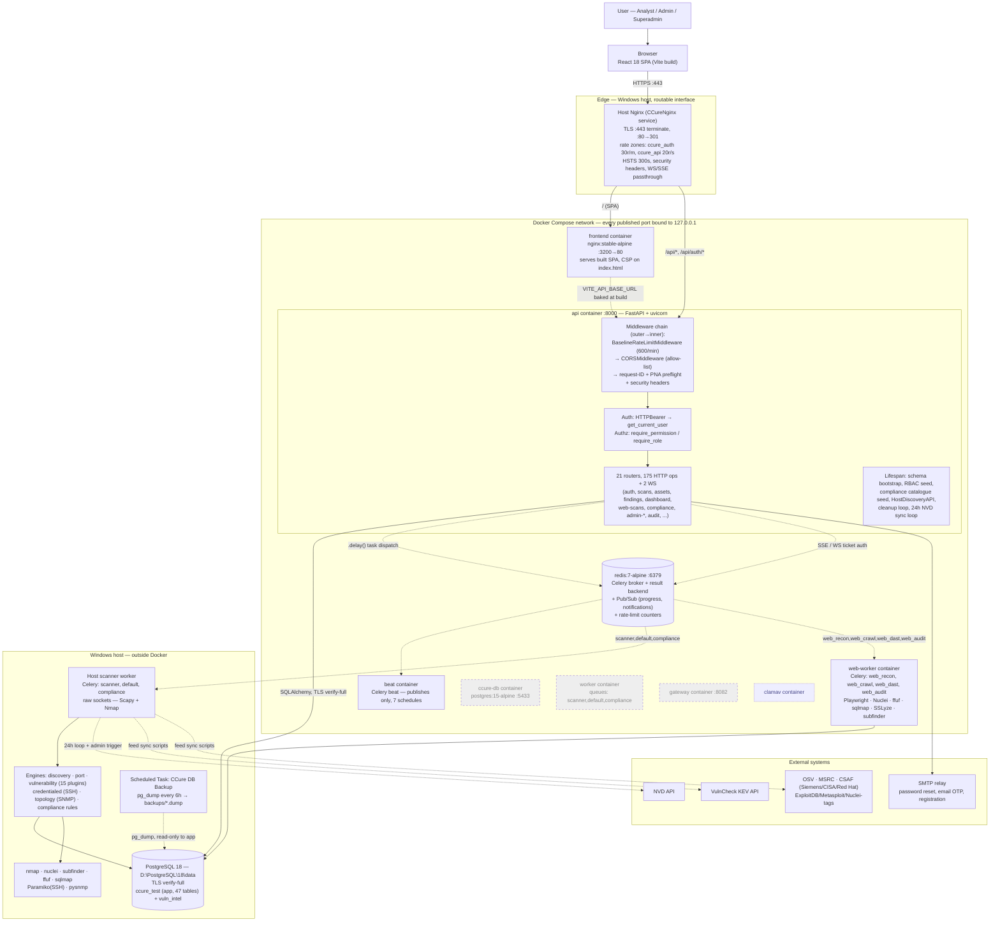
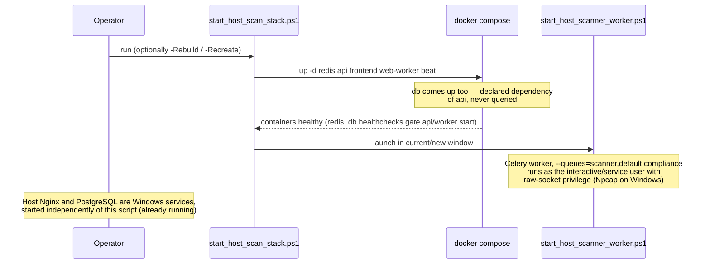

# Master System Architecture & Container/Deployment Architecture

> Part of the CCure Audit PRO architecture documentation package. See
> [README.md](../../architecture/README.md) for the package index. Component-level detail and
> citations live in [00_INVENTORY.md](00_INVENTORY.md); this document is the
> diagrams built on top of that inventory.

---

## A. Master System Architecture Diagram

This shows the full request path, every currently-started process, and the
trust boundary each arrow crosses. Dashed edges are asynchronous or
best-effort (Celery dispatch, Pub/Sub, background sync). Components drawn with
a dotted border are defined in `docker-compose.yml` but **not started** by the
supported startup path (`scripts/start_host_scan_stack.ps1`) — see
[00_INVENTORY.md §1](00_INVENTORY.md#1-runtime-topology-as-it-actually-starts).

### Reading this diagram

- **One TLS boundary.** Host Nginx is the only listener on a routable
  interface (`0.0.0.0:443`); every container port is bound to `127.0.0.1`, so
  nothing inside Docker is reachable except through it or from the host itself.
- **Two execution planes for scanning.** The network/credentialed/compliance
  pipelines run on the Windows host (raw-socket requirement); the DAST pipeline
  runs inside a container. Both read/write the same host PostgreSQL, so the
  data model is unified even though the compute is split.
- **One database server, two databases**, both TLS `verify-full`: `ccure_test`
  (this repo's Alembic-controlled schema) and `vuln_intel` (fed by separate
  sync scripts, no Alembic control of its own).
- **Redis is a single point of coordination, not of truth.** Every progress/
  notification publisher catches `RedisError` and degrades to a log line — the
  authoritative state for scans, findings and compliance runs is always
  PostgreSQL. An outage here delays live updates, it does not lose data.
- **Grey dashed boxes** (`ccure-db`, `worker`, `gateway`) are real
  `docker-compose.yml` services that do not participate in this deployment's
  actual request or task flow. They are drawn to show they exist, not because
  traffic reaches them.

---

## B. Container / Deployment Architecture

### B.1 What actually starts, in order

`worker` and `gateway` are named explicitly in the compose args' complement —
i.e. they are the two services the script's `$composeArgs` construction
excludes by design (see [00_INVENTORY.md §1](00_INVENTORY.md#1-runtime-topology-as-it-actually-starts)).
Anyone running a bare `docker compose up -d` instead of this script will start
`worker` too, which the script's own comments warn corrupts scan results by
racing the host worker for the same queue.

### B.2 Container inventory

| Service      | Container name     | Image / build                                                            | Published bind      | Restart policy   | Profile gate        | Runs in this deployment?                       |
| ------------ | ------------------ | ------------------------------------------------------------------------ | ------------------- | ---------------- | ------------------- | ---------------------------------------------- |
| `redis`      | `ccure-redis`      | `redis:7-alpine`                                                         | `127.0.0.1:6379`    | `no`             | none                | **Yes**                                        |
| `db`         | `ccure-db`         | `postgres:15-alpine`                                                     | `127.0.0.1:5433`    | `no`             | none                | Started (dependency), traffic never reaches it |
| `api`        | `ccure-api`        | `./Backend/Dockerfile`                                                   | `127.0.0.1:8000`    | `no`             | none                | **Yes**                                        |
| `worker`     | `ccure-worker`     | `./Backend/Dockerfile`, runs as `root`                                   | —                   | `no`             | `container-scanner` | **No**                                         |
| `beat`       | `ccure-beat`       | `./Backend/Dockerfile`, starts as `root`, drops to `ccure` via `setpriv` | —                   | `no`             | none                | **Yes**                                        |
| `web-worker` | `ccure-web-worker` | `./Backend/Dockerfile`, runs as `root`                                   | —                   | `no`             | `container-scanner` | **Yes** — started explicitly by name           |
| `frontend`   | `ccure-frontend`   | `./Frontend/Dockerfile`                                                  | `127.0.0.1:3200:80` | `no`             | none                | **Yes**                                        |
| `gateway`    | `ccure-gateway`    | `nginx:stable-alpine`                                                    | `127.0.0.1:8082:80` | `no`             | `alt-gateway`       | **No**                                         |
| `clamav`     | `ccure-clamav`     | `clamav/clamav:stable`                                                   | — (internal)        | `unless-stopped` | `av`                | **No**, optional                               |

All restart policies are deliberately `"no"` except `clamav`
(`unless-stopped`) — this stack is manual-start end to end, specifically so
`beat` cannot resurrect itself after a host reboot with no worker consuming its
queue (see `docker-compose.yml`'s inline comment on the `beat` service).

### B.3 Volumes

| Volume                                 | Type         | Mounted by                            | Purpose                                                                                                       |
| -------------------------------------- | ------------ | ------------------------------------- | ------------------------------------------------------------------------------------------------------------- |
| `pgdata`                               | named volume | `db`                                  | Persists the (unused) containerized Postgres data dir                                                         |
| `backend_venv`                         | named volume | `api`, `worker`, `beat`, `web-worker` | Python virtualenv, avoids reinstalling deps on every container recreate                                       |
| `beat_state`                           | named volume | `beat`                                | `celerybeat-schedule` file — kept out of the bind-mounted repo tree so it can't be committed by accident      |
| `clamav_db`                            | named volume | `clamav`                              | Signature database (~2 GB resident)                                                                           |
| `./Backend:/app`                       | bind mount   | `api`, `worker`, `beat`, `web-worker` | Live-reload of Python source; no rebuild needed for backend changes                                           |
| `./Backend/reports:/app/reports`       | bind mount   | `api`, `worker`, `web-worker`         | Generated PDF/CSV output, shared with the host filesystem                                                     |
| `./docs:/docs:ro`                      | bind mount   | `api`                                 | Read-only, lets `test_docs_integrity.py` find the doc files from inside the container                         |
| `./backups:/backups:ro`                | bind mount   | `api`, `worker`                       | Read-only; `audit_retention.assert_backup_recent` checks the newest dump's mtime here before allowing a purge |
| `./certs/ccure-internal-ca.crt:...:ro` | bind mount   | `api`, `worker`, `beat`, `web-worker` | Trust anchor for `sslmode=verify-full` against the host PostgreSQL                                            |

### B.4 What happens when a container restarts

- **`api` restart** — picks up Python source changes immediately (bind-mounted,
  no image rebuild). Re-runs the full lifespan sequence: schema bootstrap,
  RBAC/compliance seeding (idempotent, self-heals if control counts are below
  threshold), re-registers the two background asyncio loops. In-flight HTTP
  requests are dropped; in-flight Celery tasks are unaffected (they run in the
  worker process, not the API process).
- **`frontend` restart alone does _not_ pick up JSX changes** — the SPA is
  baked at Docker _build_ time (`VITE_API_BASE_URL` is a build arg), so a
  restart only re-serves the same static bundle. Requires
  `docker compose build frontend && docker compose up -d --no-deps frontend`.
- **`redis` restart** — every Celery task in flight loses its broker
  connection; `RATE_LIMIT_MEMORY_FALLBACK` (20/minute, per-worker-process)
  takes over rate limiting until Redis returns, logged once on the transition
  (`RATE_LIMIT_DEGRADED`). SSE/WebSocket progress streams degrade to
  heartbeat-only; nothing already committed to PostgreSQL is lost.
- **`beat` restart** — resumes from `beat_state` volume (last-run times
  survive), so a task already due fires promptly rather than waiting a full
  interval.
- **Host scanner worker restart (not a container)** — any scan whose task was
  mid-execution on that process is abandoned; `core/scan_control.py`'s
  cooperative-cancellation design means nothing auto-resumes it. The
  `compliance` queue also stops being consumed, since it's bound only here, not
  by any started container.

### B.5 External access summary

| Path                                                | Who reaches it               | TLS                    | Notes                                                                   |
| --------------------------------------------------- | ---------------------------- | ---------------------- | ----------------------------------------------------------------------- |
| `https://ccurepro.cdacb.in` / `https://10.180.6.14` | Any LAN client               | Yes, private-CA issued | HSTS only pins the hostname form (RFC 6797 §8.1.1 excludes IP literals) |
| `http://<host>:80`                                  | Any LAN client               | No                     | 301 redirect to 443 only                                                |
| `127.0.0.1:8000` (API direct)                       | Local tooling only           | No                     | Not reachable off-host; local dev/debug path                            |
| `127.0.0.1:3200` (frontend direct)                  | Local tooling only           | No                     | Same                                                                    |
| `127.0.0.1:8082` (gateway)                          | Nobody — service not started | No                     | Defined for deployments that terminate TLS elsewhere; unused here       |

---

_Previous: [00_INVENTORY.md](00_INVENTORY.md) — component inventory and
enabled/disabled matrix. Next in the package: per-module architecture
diagrams (Section D of the package), Authentication & Authorization, Database
Architecture, Audit Architecture, Compliance Architecture, Security
Architecture, and the remaining sections per the package README._
