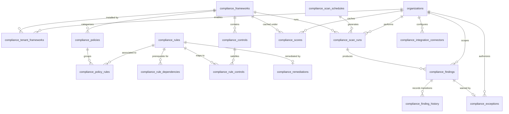

# CCure Audit PRO — Compliance Engine Database Design & Migrations

This document specifies the PostgreSQL relational database schema for the CCure Audit PRO Policy Compliance Engine. It maps out the 18 required compliance tables using the existing project's datatypes, multi-tenancy controls, and Stripe-style readable IDs (AD-015).

---

## 1. Entity-Relationship Diagram (Compliance Module)



---

## 2. Table Schemas (PostgreSQL DDL)

The following DDL queries define the tables in strict foreign key creation order.

### 2.1. Framework Catalog & Multi-Tenancy

```sql
-- Table: compliance_frameworks
-- Purpose: Global security frameworks/standards catalog (e.g. ISO 27001)
CREATE TABLE compliance_frameworks (
    id          VARCHAR(100) PRIMARY KEY, -- e.g. "cfw_iso27001_2022"
    tenant_id   VARCHAR(100) REFERENCES organizations(id) ON DELETE CASCADE, -- NULL = global catalog
    code        VARCHAR(50) NOT NULL,    -- e.g. "ISO27001_2022"
    name        VARCHAR(255) NOT NULL,   -- e.g. "ISO/IEC 27001:2022"
    version     VARCHAR(50) NOT NULL,
    is_active   BOOLEAN NOT NULL DEFAULT TRUE,
    created_at  TIMESTAMPTZ NOT NULL DEFAULT NOW()
);

-- Index for fast lookup by code
CREATE UNIQUE INDEX uq_compliance_framework_code_tenant ON compliance_frameworks(code, COALESCE(tenant_id, 'global'));

-- Table: compliance_tenant_frameworks
-- Purpose: Tenant framework installations (Marketplace states)
CREATE TABLE compliance_tenant_frameworks (
    id           VARCHAR(100) PRIMARY KEY, -- e.g. "ctf_tenant_iso_1a2b"
    tenant_id    VARCHAR(100) REFERENCES organizations(id) ON DELETE CASCADE NOT NULL,
    framework_id VARCHAR(100) REFERENCES compliance_frameworks(id) ON DELETE CASCADE NOT NULL,
    is_enabled   BOOLEAN NOT NULL DEFAULT TRUE,
    enabled_by   VARCHAR(150) REFERENCES users(id) ON DELETE SET NULL,
    enabled_at   TIMESTAMPTZ NOT NULL DEFAULT NOW(),
    CONSTRAINT uq_tenant_framework UNIQUE (tenant_id, framework_id)
);
```

### 2.2. Controls, Policies & Rule Versioning

```sql
-- Table: compliance_controls
-- Purpose: Granular security controls within a framework
CREATE TABLE compliance_controls (
    id               VARCHAR(100) PRIMARY KEY, -- e.g. "cct_iso27001_2022_8_24"
    framework_id     VARCHAR(100) REFERENCES compliance_frameworks(id) ON DELETE CASCADE NOT NULL,
    control_number   VARCHAR(50) NOT NULL,     -- e.g. "8.24"
    theme            VARCHAR(10) NOT NULL CHECK (theme IN ('ORG', 'PPL', 'PHY', 'TECH')),
    title            VARCHAR(255) NOT NULL,
    description      TEXT,
    scannability     VARCHAR(20) NOT NULL CHECK (scannability IN ('auto', 'semi_auto', 'manual')),
    scan_module_hint VARCHAR(100),
    CONSTRAINT uq_framework_control_number UNIQUE (framework_id, control_number)
);

CREATE INDEX idx_compliance_controls_theme ON compliance_controls(framework_id, theme);

-- Table: compliance_rules
-- Purpose: Technical checks supporting auto/semi-auto controls (Versioned, Immutable once active)
CREATE TABLE compliance_rules (
    id                     VARCHAR(100) PRIMARY KEY, -- e.g. "crl_auth_mfa_001_v1"
    rule_family_code       VARCHAR(100) NOT NULL,    -- stable across versions
    version_number         INTEGER NOT NULL DEFAULT 1,
    check_type             VARCHAR(50) NOT NULL CHECK (check_type IN ('registry', 'file_content', 'port_state', 'tls_config', 'service_status', 'api_response', 'command_output')),
    evidence_source        VARCHAR(50),              -- NULL = live connector execution
    target_platform        VARCHAR(50) NOT NULL CHECK (target_platform IN ('windows', 'linux', 'network_device', 'cloud', 'any')),
    check_definition       JSONB NOT NULL,
    severity               VARCHAR(20) NOT NULL DEFAULT 'medium' CHECK (severity IN ('critical', 'high', 'medium', 'low', 'info')),
    severity_weight        INTEGER NOT NULL DEFAULT 5, -- Critical=10, High=7, Medium=5, Low=2
    tags                   JSONB NOT NULL DEFAULT '[]',
    status                 VARCHAR(20) NOT NULL DEFAULT 'draft' CHECK (status IN ('draft', 'active', 'archived')),
    superseded_by_rule_id  VARCHAR(100) REFERENCES compliance_rules(id) ON DELETE SET NULL,
    remediation_id         VARCHAR(100),             -- Added FK link post remediation table creation
    CONSTRAINT uq_rule_family_version UNIQUE (rule_family_code, version_number)
);

CREATE INDEX idx_compliance_rules_family ON compliance_rules(rule_family_code);
CREATE INDEX idx_compliance_rules_tags ON compliance_rules USING gin (tags);

-- Table: compliance_rule_dependencies
-- Purpose: Deep check order sequence configuration
CREATE TABLE compliance_rule_dependencies (
    rule_id             VARCHAR(100) REFERENCES compliance_rules(id) ON DELETE CASCADE NOT NULL,
    depends_on_rule_id  VARCHAR(100) REFERENCES compliance_rules(id) ON DELETE CASCADE NOT NULL,
    dependency_type     VARCHAR(50) NOT NULL DEFAULT 'prerequisite' CHECK (dependency_type IN ('prerequisite', 'related')),
    PRIMARY KEY (rule_id, depends_on_rule_id)
);

-- Table: compliance_rule_controls
-- Purpose: Many-to-many bridge mapping rules to controls across frameworks
CREATE TABLE compliance_rule_controls (
    rule_id     VARCHAR(100) REFERENCES compliance_rules(id) ON DELETE CASCADE NOT NULL,
    control_id  VARCHAR(100) REFERENCES compliance_controls(id) ON DELETE CASCADE NOT NULL,
    PRIMARY KEY (rule_id, control_id)
);

-- Table: compliance_remediations
-- Purpose: Actionable technical recommendations mapped to rules
CREATE TABLE compliance_remediations (
    id                         VARCHAR(100) PRIMARY KEY, -- e.g. "crm_auth_mfa_001"
    rule_id                    VARCHAR(100) REFERENCES compliance_rules(id) ON DELETE CASCADE NOT NULL,
    recommendation_text        TEXT NOT NULL,
    fix_type                   VARCHAR(50) NOT NULL CHECK (fix_type IN ('manual', 'script', 'config_template')),
    fix_command                TEXT,
    fix_target_path            VARCHAR(512),
    documentation_url          VARCHAR(512),
    estimated_score_impact_pct NUMERIC(5,2) CHECK (estimated_score_impact_pct BETWEEN 0.00 AND 100.00),
    requires_reboot            BOOLEAN NOT NULL DEFAULT FALSE
);

-- Add missing foreign key constraint to compliance_rules now that compliance_remediations exists
ALTER TABLE compliance_rules ADD CONSTRAINT fk_rules_remediation FOREIGN KEY (remediation_id) REFERENCES compliance_remediations(id) ON DELETE SET NULL;
```

### 2.3. Policies

```sql
-- Table: compliance_policies
-- Purpose: User-defined or global templates grouping rule sets
CREATE TABLE compliance_policies (
    id                      VARCHAR(100) PRIMARY KEY, -- e.g. "cpl_win_server_baseline_v1"
    framework_id            VARCHAR(100) REFERENCES compliance_frameworks(id) ON DELETE CASCADE NOT NULL,
    tenant_id               VARCHAR(100) REFERENCES organizations(id) ON DELETE CASCADE, -- NULL = global template
    policy_family_code      VARCHAR(100) NOT NULL,
    version_number          INTEGER NOT NULL DEFAULT 1,
    name                    VARCHAR(255) NOT NULL,
    target_platform         VARCHAR(50) NOT NULL CHECK (target_platform IN ('windows', 'linux', 'network_device', 'cloud', 'database', 'any')),
    description             TEXT,
    status                  VARCHAR(20) NOT NULL DEFAULT 'draft' CHECK (status IN ('draft', 'active', 'archived')),
    superseded_by_policy_id VARCHAR(100) REFERENCES compliance_policies(id) ON DELETE SET NULL,
    tags                    JSONB NOT NULL DEFAULT '[]',
    is_active               BOOLEAN NOT NULL DEFAULT TRUE,
    created_by              VARCHAR(150) REFERENCES users(id) ON DELETE SET NULL,
    created_at              TIMESTAMPTZ NOT NULL DEFAULT NOW(),
    CONSTRAINT uq_policy_family_version UNIQUE (policy_family_code, version_number)
);

CREATE INDEX idx_compliance_policies_tags ON compliance_policies USING gin (tags);

-- Table: compliance_policy_rules
-- Purpose: Many-to-many lookup connecting policy versions to rule versions
CREATE TABLE compliance_policy_rules (
    policy_id VARCHAR(100) REFERENCES compliance_policies(id) ON DELETE CASCADE NOT NULL,
    rule_id   VARCHAR(100) REFERENCES compliance_rules(id) ON DELETE CASCADE NOT NULL,
    PRIMARY KEY (policy_id, rule_id)
);
```

### 2.4. Scan Scheduling & Run States

```sql
-- Table: compliance_scan_schedules
-- Purpose: Cron settings for auto scans
CREATE TABLE compliance_scan_schedules (
    id              VARCHAR(100) PRIMARY KEY, -- e.g. "csc_org1_weekly_1a2b"
    tenant_id       VARCHAR(100) REFERENCES organizations(id) ON DELETE CASCADE NOT NULL,
    framework_id    VARCHAR(100) REFERENCES compliance_frameworks(id) ON DELETE CASCADE NOT NULL,
    policy_id       VARCHAR(100) REFERENCES compliance_policies(id) ON DELETE SET NULL,
    scope           JSONB NOT NULL,           -- e.g. {"asset_ids": [...], "asset_tags": [...]}
    frequency       VARCHAR(50) NOT NULL CHECK (frequency IN ('daily', 'weekly', 'monthly', 'quarterly', 'continuous')),
    cron_expression VARCHAR(100),
    notify_on       VARCHAR(50) NOT NULL DEFAULT 'always' CHECK (notify_on IN ('always', 'on_failure_only', 'on_score_drop')),
    notify_channels JSONB NOT NULL DEFAULT '[]', -- e.g. ["email", "webhook"]
    is_active       BOOLEAN NOT NULL DEFAULT TRUE,
    next_run_at     TIMESTAMPTZ,
    last_run_at     TIMESTAMPTZ
);

-- Table: compliance_scan_runs
-- Purpose: Execution audit record for compliance runs (Finalized = Immutable)
CREATE TABLE compliance_scan_runs (
    id             VARCHAR(100) PRIMARY KEY, -- e.g. "csr_org1_07may26_1a2b"
    tenant_id      VARCHAR(100) REFERENCES organizations(id) ON DELETE CASCADE NOT NULL,
    framework_id   VARCHAR(100) REFERENCES compliance_frameworks(id) ON DELETE CASCADE NOT NULL,
    policy_id      VARCHAR(100) REFERENCES compliance_policies(id) ON DELETE SET NULL,
    schedule_id    VARCHAR(100) REFERENCES compliance_scan_schedules(id) ON DELETE SET NULL,
    initiated_by   VARCHAR(150) REFERENCES users(id) ON DELETE SET NULL, -- NULL = system schedule
    scope          JSONB NOT NULL,
    status         VARCHAR(50) NOT NULL DEFAULT 'queued' CHECK (status IN ('queued', 'running', 'completed', 'failed')),
    started_at     TIMESTAMPTZ,
    finished_at    TIMESTAMPTZ,
    is_finalized   BOOLEAN NOT NULL DEFAULT FALSE
);

CREATE INDEX idx_compliance_scan_runs_lookup ON compliance_scan_runs(tenant_id, framework_id, status);
```

### 2.5. Findings & Timeline Audit Trail

```sql
-- Table: compliance_findings
-- Purpose: Unified status report of technical checks and manual attestations
CREATE TABLE compliance_findings (
    id                     VARCHAR(250) PRIMARY KEY, -- e.g. "cfnd_org1_ast123_8_24_1a2b"
    scan_run_id            VARCHAR(100) REFERENCES compliance_scan_runs(id) ON DELETE SET NULL,
    tenant_id              VARCHAR(100) REFERENCES organizations(id) ON DELETE CASCADE NOT NULL,
    asset_id               VARCHAR(200) REFERENCES assets(id) ON DELETE CASCADE, -- NULL for organizational controls
    control_id             VARCHAR(100) REFERENCES compliance_controls(id) ON DELETE RESTRICT NOT NULL,
    rule_id                VARCHAR(100) REFERENCES compliance_rules(id) ON DELETE RESTRICT, -- NULL for manual controls
    source                 VARCHAR(50) NOT NULL CHECK (source IN ('auto_scan', 'manual_attestation')),
    status                 VARCHAR(50) NOT NULL CHECK (status IN ('pass', 'fail', 'not_applicable', 'manual_review', 'exception', 'remediation_applied', 'pending_reverify')),
    evidence               JSONB NOT NULL DEFAULT '{}', -- Raw payloads + confidence ratings
    evidence_file_ids      JSONB NOT NULL DEFAULT '[]', -- Attachment references
    attested_by            VARCHAR(150) REFERENCES users(id) ON DELETE SET NULL,
    remediation_applied_by VARCHAR(150) REFERENCES users(id) ON DELETE SET NULL,
    remediation_applied_at TIMESTAMPTZ,
    first_seen             TIMESTAMPTZ NOT NULL DEFAULT NOW(),
    last_seen              TIMESTAMPTZ NOT NULL DEFAULT NOW(),
    reviewed_at            TIMESTAMPTZ
);

CREATE INDEX idx_compliance_findings_asset ON compliance_findings(asset_id, control_id);
CREATE INDEX idx_compliance_findings_tenant_status ON compliance_findings(tenant_id, status);
CREATE INDEX idx_compliance_findings_rule ON compliance_findings(rule_id);

-- Table: compliance_finding_history
-- Purpose: Append-only immutable log for auditor timeline views
CREATE TABLE compliance_finding_history (
    id         VARCHAR(100) PRIMARY KEY, -- e.g. "cfh_cfnd123_1a2b"
    finding_id VARCHAR(250) REFERENCES compliance_findings(id) ON DELETE CASCADE NOT NULL,
    status     VARCHAR(50) NOT NULL,
    changed_at TIMESTAMPTZ NOT NULL DEFAULT NOW(),
    changed_by VARCHAR(150) REFERENCES users(id) ON DELETE SET NULL,
    source     VARCHAR(50) NOT NULL CHECK (source IN ('auto_scan', 'manual_attestation', 'remediation', 'exception_granted', 'exception_expired')),
    note       TEXT
);

CREATE INDEX idx_compliance_finding_history_finding ON compliance_finding_history(finding_id, changed_at DESC);
```

### 2.6. Exemptions, Scores & Config policies

```sql
-- Table: compliance_exceptions
-- Purpose: Active security exception waivers
CREATE TABLE compliance_exceptions (
    id                   VARCHAR(100) PRIMARY KEY, -- e.g. "cex_org1_control8_24_1a2b"
    tenant_id            VARCHAR(100) REFERENCES organizations(id) ON DELETE CASCADE NOT NULL,
    control_id           VARCHAR(100) REFERENCES compliance_controls(id) ON DELETE CASCADE NOT NULL,
    finding_id           VARCHAR(250) REFERENCES compliance_findings(id) ON DELETE SET NULL,
    reason               TEXT NOT NULL,
    compensating_control TEXT,
    requested_by         VARCHAR(150) REFERENCES users(id) ON DELETE SET NULL NOT NULL,
    approved_by          VARCHAR(150) REFERENCES users(id) ON DELETE SET NULL, -- requires approval permission
    status               VARCHAR(50) NOT NULL DEFAULT 'pending' CHECK (status IN ('pending', 'approved', 'rejected', 'expired')),
    expires_at           TIMESTAMPTZ NOT NULL
);

CREATE INDEX idx_compliance_exceptions_lookup ON compliance_exceptions(tenant_id, status, expires_at);

-- Table: compliance_scores
-- Purpose: Pre-calculated and cached score rollups
CREATE TABLE compliance_scores (
    id                  VARCHAR(100) PRIMARY KEY, -- e.g. "csco_org1_fw_iso_1a2b"
    tenant_id           VARCHAR(100) REFERENCES organizations(id) ON DELETE CASCADE NOT NULL,
    framework_id        VARCHAR(100) REFERENCES compliance_frameworks(id) ON DELETE CASCADE NOT NULL,
    scan_run_id         VARCHAR(100) REFERENCES compliance_scan_runs(id) ON DELETE SET NULL,
    asset_id            VARCHAR(200) REFERENCES assets(id) ON DELETE CASCADE, -- NULL for policy-level rollups
    theme               VARCHAR(10) CHECK (theme IN ('ORG', 'PPL', 'PHY', 'TECH')), -- NULL for full framework scores
    total_controls      INTEGER NOT NULL DEFAULT 0,
    applicable_controls INTEGER NOT NULL DEFAULT 0,
    pass_count          INTEGER NOT NULL DEFAULT 0,
    fail_count          INTEGER NOT NULL DEFAULT 0,
    na_count            INTEGER NOT NULL DEFAULT 0,
    pending_count       INTEGER NOT NULL DEFAULT 0,
    score_pct           NUMERIC(5,2) NOT NULL DEFAULT 0.00,
    weighted_score_pct  NUMERIC(5,2) NOT NULL DEFAULT 0.00
);

CREATE INDEX idx_compliance_scores_lookup ON compliance_scores(tenant_id, framework_id, asset_id);

-- Table: compliance_evidence_retention_policies
-- Purpose: Expiration rules for uploaded and cached compliance audit evidence
CREATE TABLE compliance_evidence_retention_policies (
    id                  VARCHAR(100) PRIMARY KEY, -- e.g. "ret_org1_fw1_1a2b"
    tenant_id           VARCHAR(100) REFERENCES organizations(id) ON DELETE CASCADE, -- NULL = platform default
    framework_id        VARCHAR(100) REFERENCES compliance_frameworks(id) ON DELETE CASCADE, -- NULL = all frameworks
    retain_years        INTEGER NOT NULL DEFAULT 7,
    archive_after_years INTEGER,
    encrypt_at_rest     BOOLEAN NOT NULL DEFAULT TRUE,
    immutable_storage   BOOLEAN NOT NULL DEFAULT FALSE,
    updated_by          VARCHAR(150) REFERENCES users(id) ON DELETE SET NULL,
    updated_at          TIMESTAMPTZ NOT NULL DEFAULT NOW()
);
```

### 2.7. Notifications & Integrations

```sql
-- Table: compliance_integration_connectors
-- Purpose: Connections to third-party endpoints (ticketing, SIEM)
CREATE TABLE compliance_integration_connectors (
    id             VARCHAR(100) PRIMARY KEY, -- e.g. "con_org1_jira_1a2b"
    tenant_id      VARCHAR(100) REFERENCES organizations(id) ON DELETE CASCADE NOT NULL,
    connector_type VARCHAR(50) NOT NULL CHECK (connector_type IN ('jira', 'servicenow', 'splunk', 'webhook', 'active_directory', 'entra_id', 'edr_generic')),
    config         JSONB NOT NULL DEFAULT '{}', -- Endpoint URL, auth headers, metadata
    is_active      BOOLEAN NOT NULL DEFAULT TRUE,
    created_by     VARCHAR(150) REFERENCES users(id) ON DELETE SET NULL,
    created_at     TIMESTAMPTZ NOT NULL DEFAULT NOW()
);

-- Table: compliance_notification_rules
-- Purpose: Rules for automated system and ticketing alerts
CREATE TABLE compliance_notification_rules (
    id                        VARCHAR(100) PRIMARY KEY, -- e.g. "cnr_org1_alert1_1a2b"
    tenant_id                 VARCHAR(100) REFERENCES organizations(id) ON DELETE CASCADE NOT NULL,
    framework_id              VARCHAR(100) REFERENCES compliance_frameworks(id) ON DELETE CASCADE,
    trigger_type              VARCHAR(50) NOT NULL CHECK (trigger_type IN ('score_below_threshold', 'control_failed', 'exception_expiring', 'schedule_failed')),
    threshold_value           NUMERIC(5,2),
    notify_channels           JSONB NOT NULL DEFAULT '[]', -- array of strings e.g. ["email", "webhook"]
    action_type               VARCHAR(50) NOT NULL DEFAULT 'notify' CHECK (action_type IN ('notify', 'create_incident', 'create_ticket')),
    integration_connector_id  VARCHAR(100) REFERENCES compliance_integration_connectors(id) ON DELETE SET NULL,
    is_active                 BOOLEAN NOT NULL DEFAULT TRUE
);
```

---

## 3. Seed Strategy (ISO 27001:2022 Controls Seed)

We will seed the global catalog during the migration phase using the following sequence:

1. **Insert Framework Record**:
   ```sql
   INSERT INTO compliance_frameworks (id, tenant_id, code, name, version, is_active)
   VALUES ('cfw_iso27001_2022', NULL, 'ISO27001_2022', 'ISO/IEC 27001:2022', '2022', TRUE)
   ON CONFLICT (code, tenant_id) DO NOTHING;
   ```
2. **Execute Python Seed Script**:
   We will read `iso27001_2022_controls_seed.json` programmatically using a seed migration command. Below is the Python data mapping parser logic:

```python
import json
from sqlalchemy.orm import Session
from db.models import compliance as models

def seed_iso27001_controls(db: Session, seed_filepath: str):
    with open(seed_filepath, 'r') as f:
        data = json.load(f)

    framework_id = "cfw_iso27001_2022"

    for c in data['controls']:
        control_id = f"cct_iso27001_2022_{c['id'].replace('.', '_')}"
        db_control = models.ComplianceControl(
            id=control_id,
            framework_id=framework_id,
            control_number=c['id'],
            theme=c['theme'],
            title=c['title'],
            description=c.get('note', ''),
            scannability=c['scannability'],
            scan_module_hint=c.get('scan_module_hint')
        )
        db.merge(db_control)

    db.commit()
```

---

## 4. Rollback Strategy

To safely reverse these database alterations, the rollback migration script executes drop tables in reverse foreign key dependency order:

```sql
BEGIN;

-- Drop notification and integration systems
DROP TABLE IF EXISTS compliance_notification_rules CASCADE;
DROP TABLE IF EXISTS compliance_integration_connectors CASCADE;
DROP TABLE IF EXISTS compliance_evidence_retention_policies CASCADE;

-- Drop scores and exceptions
DROP TABLE IF EXISTS compliance_scores CASCADE;
DROP TABLE IF EXISTS compliance_exceptions CASCADE;

-- Drop findings and audit trail
DROP TABLE IF EXISTS compliance_finding_history CASCADE;
DROP TABLE IF EXISTS compliance_findings CASCADE;

-- Drop scan runs and scheduling configs
DROP TABLE IF EXISTS compliance_scan_runs CASCADE;
DROP TABLE IF EXISTS compliance_scan_schedules CASCADE;

-- Drop policy links and templates
DROP TABLE IF EXISTS compliance_policy_rules CASCADE;
DROP TABLE IF EXISTS compliance_policies CASCADE;

-- Drop rules, dependency maps, and remediations
DROP TABLE IF EXISTS compliance_rule_controls CASCADE;
DROP TABLE IF EXISTS compliance_rule_dependencies CASCADE;
DROP TABLE IF EXISTS compliance_remediations CASCADE;
DROP TABLE IF EXISTS compliance_rules CASCADE;
DROP TABLE IF EXISTS compliance_controls CASCADE;

-- Drop framework marketplace entries
DROP TABLE IF EXISTS compliance_tenant_frameworks CASCADE;
DROP TABLE IF EXISTS compliance_frameworks CASCADE;

COMMIT;
```
