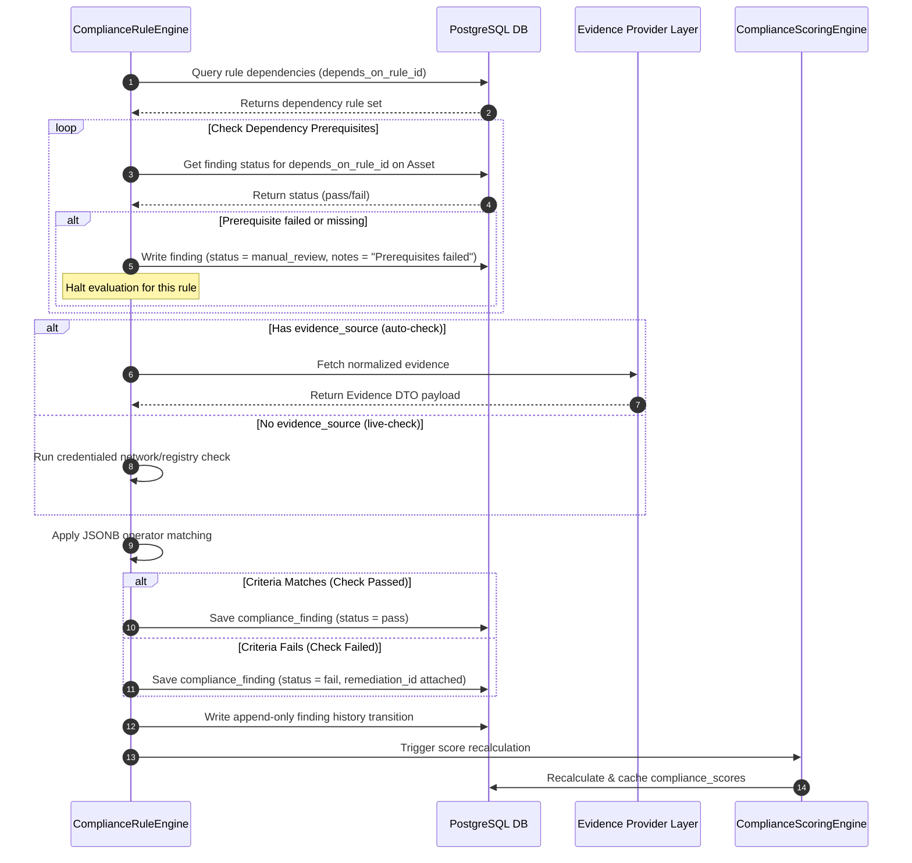
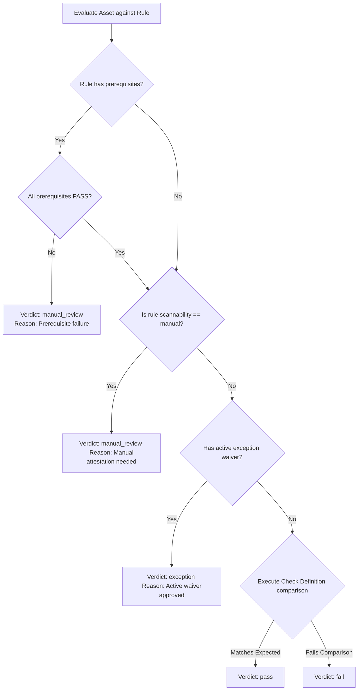

# CCure Audit PRO — Compliance Rule Engine Design Spec

The Compliance Rule Engine evaluates active rules against normalized evidence to produce findings, compute risk-weighted compliance scores, and suggest remediation steps.

---

## 1. Rule Lifecycle

Rules move through three distinct states to preserve audit trails:

```
[Draft] ────(Publish)────► [Active] ────(New Version Released)────► [Archived]
```

- **Draft**: The check definition is being authored or modified. It is not evaluated during scan runs.
- **Active**: The rule is globally available and evaluated against assets. It is immutable once activated.
- **Archived**: A newer version of the rule has been published. The archived version is no longer evaluated in new scans but remains in the database to display historical findings.

---

## 2. Rule Evaluation Sequence Diagram

The sequence diagram below represents rule evaluation including prerequisite checks, evidence fetches, criteria matching, and score recalculations:



---

## 3. Decision Tree: Check Evaluation Verdict

The engine maps rule attributes, dependency states, and checks to determine the target finding status:



---

## 4. Rule Engine Implementation (Pseudo-Code)

Below is the Python implementation detailing recursive dependency checking and operator execution:

```python
"""
Module: compliance.services.engine
Purpose: Rule Engine evaluation logic.
Author:  Compliance Dev Team
"""

from typing import Any, Dict, List
from datetime import datetime, timezone
from sqlalchemy.orm import Session
import re

class RuleEvaluator:
    def __init__(self, db: Session):
        self.db = db

    def evaluate_operator(self, operator: str, actual: Any, expected: Any) -> bool:
        """Applies mathematical and string comparison operators."""
        if operator == "equals":
            return str(actual).lower() == str(expected).lower()
        elif operator == "not_equals":
            return str(actual).lower() != str(expected).lower()
        elif operator == "contains":
            return str(expected).lower() in str(actual).lower()
        elif operator == "not_contains":
            return str(expected).lower() not in str(actual).lower()
        elif operator == "version_gte":
            # Simple numeric version checker (e.g. 1.2.3 -> [1, 2, 3])
            def parse_v(v): return [int(x) for x in re.findall(r'\d+', str(v))]
            return parse_v(actual) >= parse_v(expected)
        elif operator == "version_lte":
            def parse_v(v): return [int(x) for x in re.findall(r'\d+', str(v))]
            return parse_v(actual) <= parse_v(expected)
        return False

    def check_dependencies(self, asset_id: str, rule_id: str) -> bool:
        """Verifies that all prerequisite rules have a PASS verdict."""
        # Query dependency rows
        dependencies = self.db.execute(
            "SELECT depends_on_rule_id FROM compliance_rule_dependencies WHERE rule_id = :rule_id",
            {"rule_id": rule_id}
        ).fetchall()

        for (dep_id,) in dependencies:
            # Check latest finding status
            finding = self.db.execute(
                "SELECT status FROM compliance_findings WHERE asset_id = :asset_id AND rule_id = :rule_id",
                {"asset_id": asset_id, "rule_id": dep_id}
            ).fetchone()

            if not finding or finding["status"] != "pass":
                return False
        return True

    def run_evaluation(self, asset_id: str, rule_id: str, run_id: str) -> Dict[str, Any]:
        """Evaluates a single compliance rule against an asset."""
        # 1. Fetch Rule & check definition
        rule = self.db.execute(
            "SELECT check_type, check_definition, evidence_source FROM compliance_rules WHERE id = :id",
            {"id": rule_id}
        ).fetchone()

        # 2. Check Prerequisite Rules
        if not self.check_dependencies(asset_id, rule_id):
            return {
                "status": "manual_review",
                "evidence": {"message": "Prerequisite rules failed verification."}
            }

        # 3. Resolve Evidence Payload
        if rule["evidence_source"]:
            # Query EPL Cache or database
            evidence = self.db.execute(
                "SELECT payload FROM compliance_findings WHERE asset_id = :asset_id AND rule_id = :rule_id",
                {"asset_id": asset_id, "rule_id": rule_id}
            ).fetchone()
            if not evidence:
                return {
                    "status": "manual_review",
                    "evidence": {"message": "No evidence payload found from source."}
                }
            payload = evidence["payload"]
        else:
            # Run Live Check / Mock check
            payload = {"status_value": "configured"}

        # 4. Criteria Matching
        check_def = rule["check_definition"]
        actual_value = payload.get(check_def.get("key"))
        passed = self.evaluate_operator(
            operator=check_def["operator"],
            actual=actual_value,
            expected=check_def["expected"]
        )

        return {
            "status": "pass" if passed else "fail",
            "evidence": payload
        }
```
