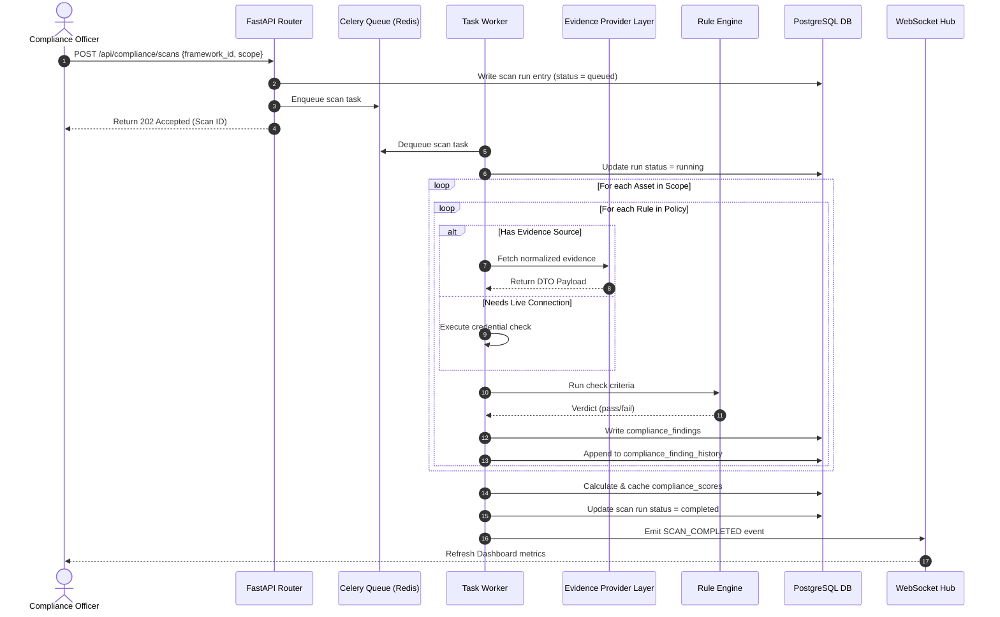
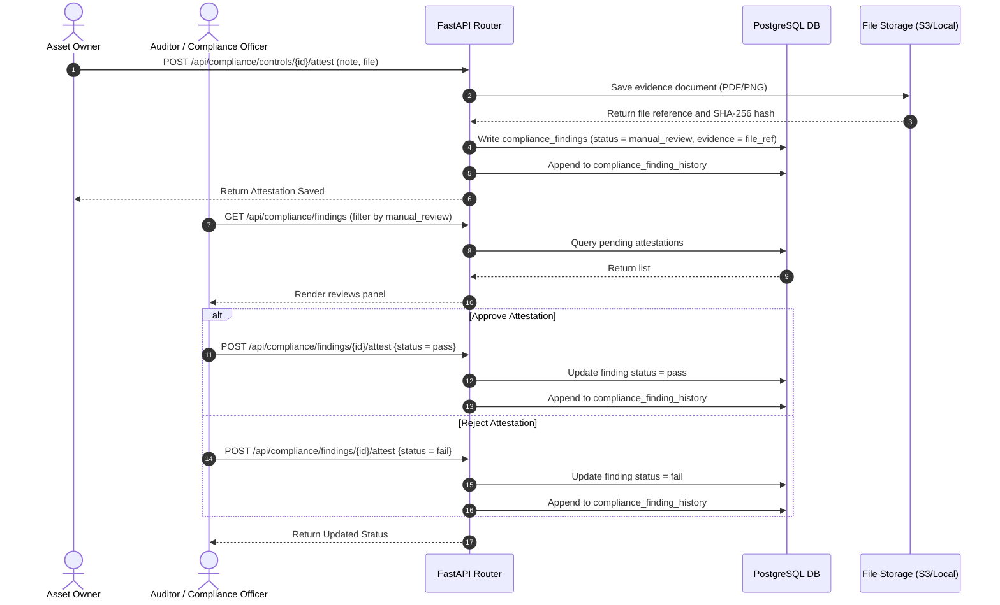
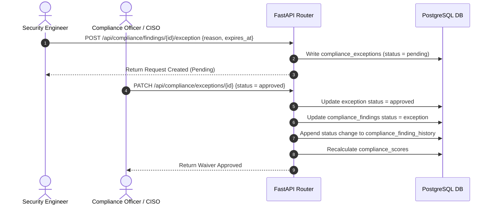
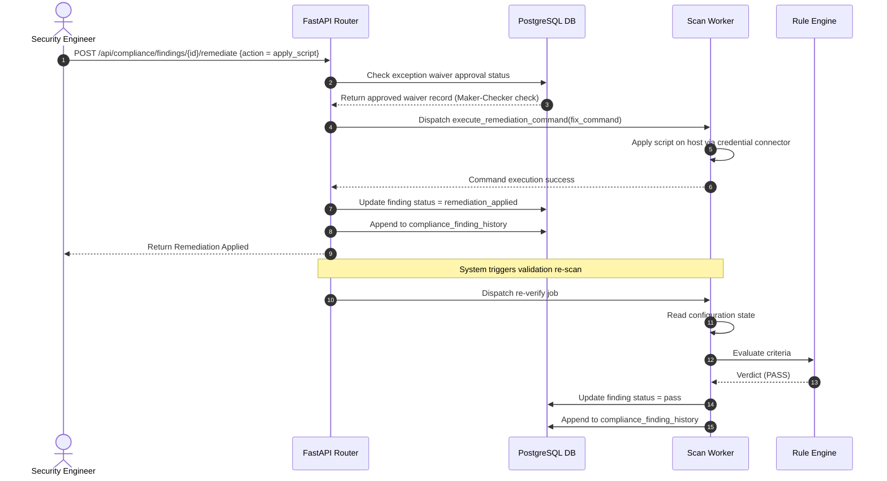

# CCure Audit PRO — Compliance Engine Sequence Diagrams

This document collects the complete set of sequence diagrams detailing operations in the Policy Compliance Engine.

---

## 1. End-to-End Scan Execution Workflow

This flow shows what happens from the moment a user clicks "New Scan" to the metric update on the dashboard:

---

## 2. Manual Controls Attestation Workflow

This workflow represents the lifecycle of governance and process controls that cannot be technically scanned:

---

## 3. Exception Waiver Request & Approval Pipeline

This flow details the request, approval, and expiration tracking for policy waivers:

---

## 4. Automated Remediation & Verification

This flow describes the execution of a corrective script and its validation:

