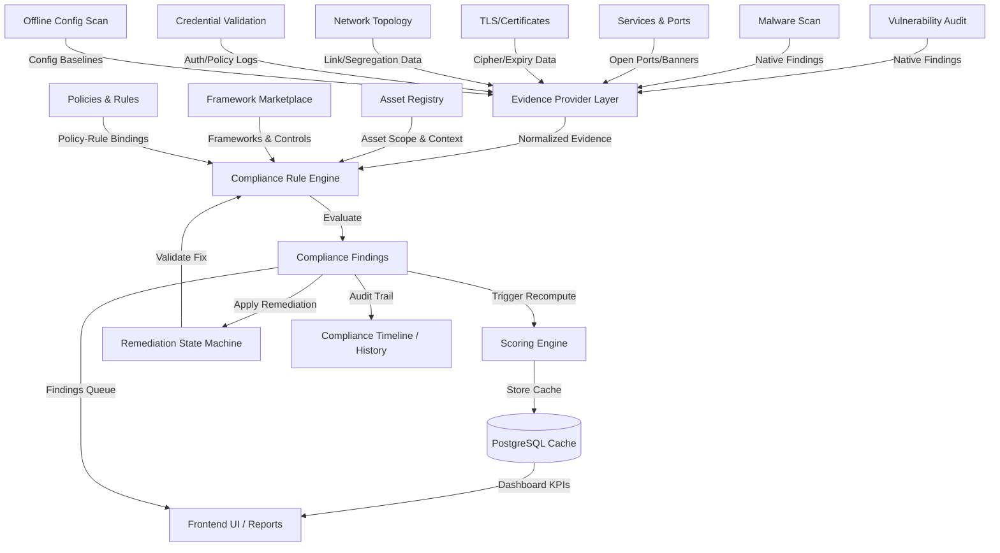
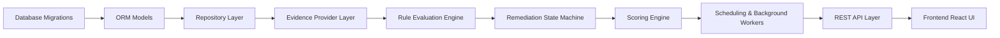
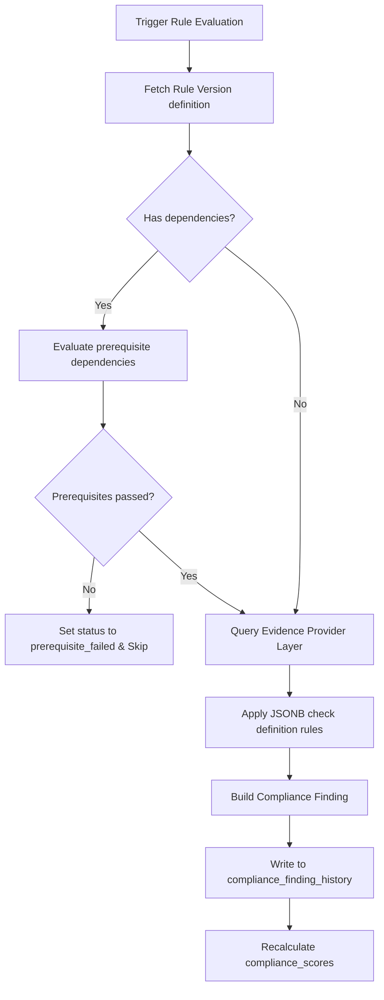
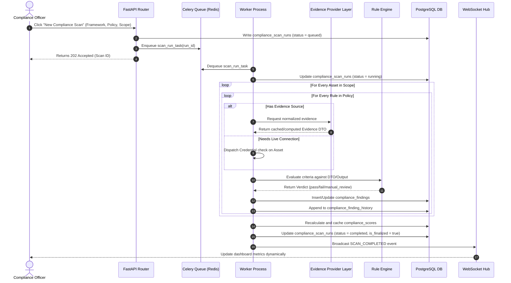
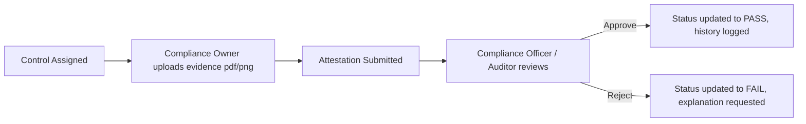

# CCure Audit PRO — Policy Compliance Engine Implementation Roadmap (Master Plan)

This document outlines the end-to-end implementation roadmap for integrating the new Policy Compliance Engine into the CCure Audit PRO platform. It is designed to guide developers through the implementation without modifying the approved system architecture.

---

## Phase 1: Project Analysis & Integration Mapping

### 1. Module Interactions & Integration Map

The Policy Compliance Engine acts as an orchestration and analytical overlay sitting on top of existing security scanners. It does not replicate scan logic but consumes findings via the **Evidence Provider Layer (EPL)**.



### 2. Dependency Graph



### 3. Reusable Platform Components

- **Audit Logging**: Existing `AuditLog` ORM model and logger middleware will capture compliance exceptions, policy updates, and manual attestations.
- **Background Worker**: Celery task runner will process asynchronous scan jobs and schedule daily/weekly evaluations.
- **RBAC Helper**: `PrivateRoute` and permission checks in the FastAPI router will map the new roles.
- **Reporting Core**: Existing PDF generation (`pdf_generator.py`) will be extended to format the Statement of Applicability (SoA) and Compliance reports.

---

## Phase 2: Database Schema & Migrations

### 1. Table Migration Order (Foreign Key Resolution)

To prevent foreign key constraint violations, tables must be created in the following strict order:

1. `compliance_frameworks` (No FKs)
2. `compliance_tenant_frameworks` (FK to `compliance_frameworks`, `organizations`)
3. `compliance_controls` (FK to `compliance_frameworks`)
4. `compliance_remediations` (Self-referential rule FK resolved post-creation)
5. `compliance_rules` (FK to `compliance_remediations`)
6. `compliance_rule_dependencies` (FKs to `compliance_rules`)
7. `compliance_rule_controls` (FK to `compliance_rules`, `compliance_controls`)
8. `compliance_policies` (FK to `compliance_frameworks`, `organizations`)
9. `compliance_policy_rules` (FK to `compliance_policies`, `compliance_rules`)
10. `compliance_scan_schedules` (FK to `organizations`, `compliance_frameworks`, `compliance_policies`)
11. `compliance_scan_runs` (FK to `organizations`, `compliance_frameworks`, `compliance_policies`, `compliance_scan_schedules`, `users`)
12. `compliance_findings` (FK to `compliance_scan_runs`, `organizations`, `assets`, `compliance_controls`, `compliance_rules`, `users`)
13. `compliance_finding_history` (FK to `compliance_findings`, `users`)
14. `compliance_exceptions` (FK to `organizations`, `compliance_controls`, `compliance_findings`, `users`)
15. `compliance_scores` (FK to `organizations`, `compliance_frameworks`, `compliance_scan_runs`, `assets`)
16. `compliance_evidence_retention_policies` (FK to `organizations`, `compliance_frameworks`)
17. `compliance_notification_rules` (FK to `organizations`, `compliance_frameworks`)
18. `compliance_integration_connectors` (FK to `organizations`)

### 2. Indexes and Constraints

- **Uniqueness Constraints**:
  - `uq_tenant_framework`: `compliance_tenant_frameworks(tenant_id, framework_id)`
  - `uq_control_number`: `compliance_controls(framework_id, control_number)`
  - `uq_policy_version`: `compliance_policies(policy_family_code, version_number)`
  - `uq_rule_version`: `compliance_rules(rule_family_code, version_number)`
  - `uq_rule_control_link`: `compliance_rule_controls(rule_id, control_id)`
  - `uq_policy_rule_link`: `compliance_policy_rules(policy_id, rule_id)`
- **Key Indexes**:
  - `idx_findings_asset_control`: `compliance_findings(asset_id, control_id)` (fast lookup for asset dashboards)
  - `idx_findings_status`: `compliance_findings(status)` (dashboard metric queries)
  - `idx_scores_lookup`: `compliance_scores(tenant_id, framework_id, asset_id)` (cached dashboard rollups)
  - `idx_finding_history_finding`: `compliance_finding_history(finding_id)` (timeline loading)

### 3. Rollback Strategy

Every forward migration step will be accompanied by an Alembic `downgrade()` script that drops tables in reverse order and clears metadata.

---

## Phase 3: Backend Implementation Plan

### 1. Order of Backend Construction

```
Repositories ➔ Services ➔ Business Logic ➔ Rule Engine ➔ Evidence Providers ➔ Scoring Engine ➔ Recommendation Engine ➔ Scheduling ➔ Notifications ➔ Reports ➔ REST APIs
```

### 2. Detailed Service Specifications

#### A. Repository Layer (e.g., `ComplianceFindingRepository`)

- **Responsibilities**: Direct CRUD on compliance tables using SQLAlchemy.
- **Dependencies**: `db.session`.
- **Public Methods**:
  - `get_by_id(finding_id: str) -> Optional[ComplianceFinding]`
  - `get_active_findings(tenant_id: str, asset_id: Optional[str]) -> List[ComplianceFinding]`
  - `create_finding(finding_data: dict) -> ComplianceFinding`
- **Transactions**: Read operations are non-transactional. Write operations execute within explicit SQLAlchemy `session.begin()` boundaries.
- **Optimistic Locking**: Handled on finding state transitions using a `version_id` column to prevent overwrites from concurrent scans.

#### B. Evidence Provider Layer Service (`EvidenceProviderService`)

- **Responsibilities**: Normalized collection of data from existing scanners.
- **Dependencies**: `VulnerabilityRepository`, `ServiceRepository`, `CertificateRepository`.
- **Public Methods**:
  - `fetch_evidence(source: str, asset_id: str, criteria: dict) -> NormalizedEvidenceDTO`
- **Caching**: 5-minute TTL cache in Redis for asset evidence to prevent database thrashing during large compliance runs.

#### C. Rule Engine Service (`ComplianceRuleEngine`)

- **Responsibilities**: Executing JSONB-based rule definitions against evidence payloads.
- **Dependencies**: `EvidenceProviderService`.
- **Public Methods**:
  - `evaluate_rule(rule: ComplianceRule, asset: Asset) -> EvaluationResultDTO`
- **Validation**: Strict JSON schema checks on rule definition updates to ensure operator compatibility (e.g. `equals`, `contains`, `version_gte`).

#### D. Scoring Engine (`ComplianceScoringEngine`)

- **Responsibilities**: Performing score rollups (Simple, Weighted, Asset, Policy).
- **Dependencies**: `ComplianceFindingRepository`.
- **Public Methods**:
  - `recalculate_scores(tenant_id: str, framework_id: str, scan_run_id: Optional[str]) -> ComplianceScore`
- **Caching**: Real-time invalidation of Redis-cached scores upon finding status transitions.

---

## Phase 4: Evidence Provider Layer Details

Existing scan modules are integrated via translation adapters. The Evidence Provider Layer converts native outputs into the standardized `Evidence` format.

| Existing Module           | Scan Output Format                                            | EPL Transformation Logic                                        | Target Evidence Payload Schema                                                                    |
| ------------------------- | ------------------------------------------------------------- | --------------------------------------------------------------- | ------------------------------------------------------------------------------------------------- |
| **Vulnerability Audit**   | Table `asset_vulnerabilities` joined with NVD CVE definitions | Checks for critical/high vulnerabilities and maps them.         | `{ "cve_ids": ["CVE-2024-4577"], "max_severity": "critical", "unpatched_days": 15 }`              |
| **Malware Scan**          | Scan reports with signatures / file hashes                    | Aggregates infected count and active real-time status.          | `{ "malware_detected": false, "active_signatures_count": 83452, "last_scan_date": "2026-07-03" }` |
| **Services & Ports**      | Table `services` (port, banner, product)                      | Filters exposed management/plaintext ports (e.g. 21, 23, 3389). | `{ "open_ports": [22, 80, 443], "insecure_ports_detected": [] }`                                  |
| **TLS/Certificates**      | Table `tls_details` (protocols, ciphers, grades)              | Validates TLS versions, expiration dates, self-signed flags.    | `{ "min_tls_version": "1.2", "is_expired": false, "self_signed": false, "grade": "A" }`           |
| **Network Topology**      | Table `network_links` (subnet groupings)                      | Checks boundary connections and verifies zone isolation.        | `{ "isolated_subnets": ["10.0.10.0/24"], "cross_zone_leakage": false }`                           |
| **Credential Validation** | Active Directory user mappings, password logs                 | Validates account status, admin counts, MFA flags.              | `{ "mfa_enforced_pct": 100, "expired_credentials_count": 0 }`                                     |
| **Offline Config Scan**   | Configuration baseline check reports                          | Evaluates registry keys, baseline hardening rules.              | `{ "failed_baseline_keys": [], "compliance_percentage": 94.5 }`                                   |

---

## Phase 5: Compliance Rule Engine Architecture

### 1. Rule Lifecycle

```
[Draft] ➔ [Active] ➔ [Archived] (triggered by new version release)
```

_Note: A rule version is immutable once activated. Historical scan records point to the specific version ID to ensure reproducibility._

### 2. Evaluation Pipeline Flow



### 3. Rule Evaluation Algorithm (Pseudo-Code)

```python
def evaluate_compliance_rule(rule: Rule, asset: Asset, db_session: Session) -> EvaluationResult:
    # 1. Resolve Dependencies
    for dep in rule.dependencies:
        dep_finding = db_session.query(Finding).filter_by(asset_id=asset.id, rule_id=dep.depends_on_rule_id).first()
        if not dep_finding or dep_finding.status != "pass":
            return EvaluationResult(
                status="manual_review",
                evidence={"message": f"Prerequisite rule {dep.depends_on_rule_id} failed or not evaluated."},
                confidence_pct=70.0
            )

    # 2. Check Evidence Source
    if rule.evidence_source:
        evidence = EvidenceProvider.get_latest(rule.evidence_source, asset.id)
        if not evidence or is_stale(evidence, max_age_days=30):
            return EvaluationResult(
                status="manual_review",
                evidence={"message": "No fresh evidence found in EPL. Manual review required."},
                confidence_pct=60.0
            )
        payload = evidence.payload
    else:
        # Live Check Execution
        payload = run_live_connector_check(rule, asset)

    # 3. Evaluate Rule Criteria
    passed = evaluate_jsonb_criteria(rule.check_definition, payload)
    return EvaluationResult(
        status="pass" if passed else "fail",
        evidence=payload,
        confidence_pct=95.0 if rule.evidence_source else 100.0
    )
```

---

## Phase 6: Frontend Workspace & Page Implementations

The new workspace will reside under `/compliance`. It uses React (Vite) with Vanilla CSS (dark-themed/glassmorphic grid styling matching existing layouts).

### 1. Workspace Pages

#### A. Marketplace

- **Components**: Installable cards grid, category tabs (Standards, Hardening, Frameworks), resource counters.
- **State**: `installedFrameworks[]`, `availableFrameworks[]`, `installingStatus{}`.
- **Permissions**: `compliance:manage_frameworks` (Admin only).

#### B. Compliance Dashboard

- **Components**: KPI Header widget, SoA compliance gauge (circular progress), theme breakdown cards (ORG, PPL, PHY, TECH), compliance trend line chart (ChartJS/Recharts), top non-compliant assets list.
- **State**: `dashboardKPIs`, `historicalTrendData[]`, `assetBreakdowns[]`, `filters{}`.
- **Filters**: OS/Site/Criticality/Tags.

#### C. Control Explorer

- **Components**: Framework hierarchy tree, scannability filter button group, status pills, details drawer.
- **State**: `expandedControls{}`, `selectedControl`, `evidenceFiles[]`, `attestationForm`.
- **Permissions**: `compliance:attest` (to submit evidence for manual controls).

#### D. Findings & Recommendation Panel

- **Components**: Paginated table of compliance findings, exception request modal, remediation drawer, bulk action toolbar.
- **State**: `selectedFindings[]`, `activeWaiverRequest`, `remediationScript`, `reverifyJobStatus`.
- **UX**: Actionable one-click "Apply Remediation" followed by "Run verification" status indicator.

---

## Phase 7: Scan Workflow

Sequence of operations when a compliance scan is initiated:



---

## Phase 8: Manual Controls Attestation Workflow

Manual controls require governance-based verification.



- **Audit Integrity**: Uploaded files receive a cryptographic hash (SHA-256) recorded in `compliance_findings.evidence` and are marked with retention expiration markers based on the tenant's retention policy configuration.

---

## Phase 9: Compliance Recommendation Engine

When a technical check fails, the Recommendation Engine provides remediation logic to achieve compliance.

```
Rule Fail ➔ Lookup Remediation ID ➔ Check Dependencies ➔ Verify Prerequisites Pass ➔ Render Command/Script ➔ User Confirms ➔ Dispatch Fix ➔ Auto Trigger Re-Scan ➔ PASS
```

- **Remediation Resolution Script**:
  - Windows Hardening: PowerShell cmdlets.
  - Linux Hardening: Bash commands or Ansible tasks.
- **Estimated Score Impact Formula**:
  $$\text{Impact \%} = \frac{\text{Severity Weight of Rule}}{\sum \text{Severity Weight of all Applicable Controls}} \times 100$$
  - Critical = 10, High = 7, Medium = 5, Low = 2.
  - Mitigating a critical rule provides 5x the score gain of a low-severity rule.

---

## Phase 10: Score Calculations

The Scoring Engine maintains distinct categories of metrics.

### 1. Simple Score

Simple compliance rating based on count:
$$\text{Score \%} = \frac{\text{Passed Controls Count}}{\text{Applicable Controls Count}} \times 100$$

### 2. Weighted Score (Risk-Weighted Headline Score)

Uses severity weightings to reflect risk posture:
$$\text{Weighted Score \%} = \frac{\sum_{i \in \text{Passed}} W_i}{\sum_{j \in \text{Applicable}} W_j} \times 100$$
where $W$ is the severity weight associated with the rule (Critical=10, High=7, Medium=5, Low=2).

### 3. Theme Score

Aggregated per ISO theme (ORG, PPL, PHY, TECH) using the simple score formula restricted to the controls within that theme.

### 4. Asset Score

Enables auditing compliance posture of a specific node:
$$\text{Asset Compliance \%} = \frac{\sum_{i \in \text{Passed on Asset}} W_i}{\sum_{j \in \text{Applicable to Asset}} W_j} \times 100$$

### 5. Executive / Multi-Framework Score

Aggregates the weighted score percentage across all enabled frameworks in the workspace.

---

## Phase 11: Compliance Reporting Specifications

Compliance reports must be exportable in multiple formats:

- **Statement of Applicability (SoA)**:
  - Format: DOCX/PDF.
  - Structure: Grid of all 93 controls, theme groupings, scannability, compliance status, attestation text, and reviewer signatures.
- **Executive Report**:
  - Format: PDF.
  - Structure: Headline cards, 30/90-day progress graphs, top risk items, exception waivers summary, and department breakdowns.
- **Asset Compliance Report**:
  - Format: CSV/Excel.
  - Structure: Tabular list of asset hostnames, IP addresses, OS types, active policies, compliance percentage, and failed checks count.

---

## Phase 12: RBAC Permissions Mapping

The compliance engine uses granular scopes mapped to standard user roles:

| API Endpoint                               | Method     | Reader | Auditor | Compliance Officer | Security Engineer | Administrator |
| ------------------------------------------ | ---------- | ------ | ------- | ------------------ | ----------------- | ------------- |
| `/api/compliance/marketplace`              | GET        | ✓      | ✓       | ✓                  | ✓                 | ✓             |
| `/api/compliance/marketplace/{id}/install` | POST       | —      | —       | —                  | —                 | ✓             |
| `/api/compliance/frameworks`               | GET        | ✓      | ✓       | ✓                  | ✓                 | ✓             |
| `/api/compliance/policies`                 | POST/PATCH | —      | —       | —                  | ✓                 | ✓             |
| `/api/compliance/rules`                    | POST/PATCH | —      | —       | —                  | ✓                 | ✓             |
| `/api/compliance/scans`                    | POST       | —      | —       | ✓                  | ✓                 | ✓             |
| `/api/compliance/controls/{id}/attest`     | POST       | —      | —       | ✓                  | —                 | ✓             |
| `/api/compliance/findings/{id}/remediate`  | POST       | —      | —       | —                  | ✓                 | ✓             |
| `/api/compliance/findings/{id}/exception`  | POST       | —      | —       | ✓                  | —                 | ✓             |
| `/api/compliance/exceptions/{id}`          | PATCH      | —      | —       | ✓                  | —                 | ✓             |
| `/api/compliance/retention-policies`       | PATCH      | —      | —       | ✓                  | —                 | ✓             |

---

## Phase 13: Scan Scheduling & Execution

- **Frequency Options**: Manual, Daily, Weekly, Monthly, Quarterly, Continuous.
- **Execution Mechanism**:
  - Background cron rules managed via Celery Beat schedules.
  - Continuous Mode: Scan execution is triggered dynamically by new Asset discovery events or critical vulnerability disclosures.
- **Fault Tolerance**:
  - Maximum of 3 retry attempts on scan connection dropouts.
  - Automated alert dispatch via Notification Engine on worker failure or job timeouts.

---

## Phase 14: Notification Engine & Connectors

Alert routing uses a trigger-rules model:

```
Score Drops / Control Fails / Exception Expiring ➔ Notification Rule ➔ Integration Connector ➔ Email / Webhook / Jira Ticket / ServiceNow Incident
```

- **Connectors**:
  - **Email**: SMTP dispatch to compliance owners.
  - **Webhook**: POST payload with finding details and score drop metrics.
  - **Ticketing (Jira/ServiceNow)**: Creates issues automatically for failed critical controls.
  - **Audit Log**: Non-repudiation log of all outgoing notifications.

---

## Phase 15: Cross-Module UI & API Integrations

- **Vulnerability Details**: Add a `Related Compliance Controls` row to vulnerability models.
- **Asset Registry Details**: Show `Compliance Score` badge adjacent to the existing `Vulnerability Risk Score`.
- **Executive Dashboard**: Inject compliance rollup metrics next to active vulnerability stats.

---

## Phase 16: Testing Strategy

- **Unit Tests**:
  - Formula validation for simple/weighted scores.
  - Rule parser matching tests (ensuring JSONB comparisons handle nulls/casing).
- **Integration Tests**:
  - End-to-end scan job dispatch through local Celery queue.
  - Evidence Provider mapping transformations on mock scan data.
- **Security Tests**:
  - Verification of RBAC permissions on exception overrides.
  - SQL injection checks on filter query parameters.
- **ISO Validation Tests**:
  - Verification that the database seeds the complete set of 93 controls correctly.

---

## Phase 17: Deployment & Operations Plan

- **Rollout Order**:
  1. DB Migrations execution.
  2. Rule pack seeds loading.
  3. Deploy Backend Engine API routers.
  4. Enable Frontend `/compliance` workspace.
- **Feature Flag**:
  - Wrap API/UI access under `COMPLIANCE_ENGINE_ENABLED` flag in `AppConfig`.
- **Rollback Procedure**:
  - Toggle feature flag to `False` (instant UI removal).
  - Run Alembic downgrade scripts if data migration rollback is required.
- **Logging & Metrics**:
  - Structured logs using event correlation: `{"event_type": "compliance_scan", "run_id": "...", "tenant_id": "..."}`.
  - Export metrics (e.g. active worker queues, evaluation times) to Prometheus.

---

## Phase 18: Future Framework Extensibility

The database schema is framework-agnostic. Support for other security standards (CIS, NIST, PCI-DSS, HIPAA) is implemented via:

1. **Catalog Addition**: Insert rows into `compliance_frameworks` and `compliance_controls`.
2. **Cross-Framework Mapping**: Map existing checks using the `compliance_rule_controls` table.
3. **No Code Modifications**: Adding a framework requires zero backend service changes, as the rule evaluator and evidence provider layer map dynamically based on configuration tables.
